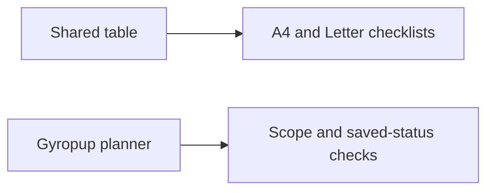

# Printable planner checklist evidence

> **Current status (2026-11-11): printable source is delivered, full public acceptance remains failed/incomplete.** Reviewed #318 and promotion #319 delivered main `b894a51c` with actual released cad-agent v0.36.0 provenance; source-fixture setup/uses/callouts and retained PDFs remain valid at their recorded source. Actual public A admitted only six JS/CSS identities and produced a misframed queue PNG before a screenshot timeout. V2 admitted all seven source/deployment identities but failed before capture. V3 produced correctly framed desktop queue/orders images and measured capture phases, then failed graceful browser close at the unchanged 15-second bound. A later full attempt B admitted all seven identities and returned the same two desktop images, then failed a redundant Buy click before made visibility was inspected. B graceful close returned within its original bound; that does not clear V3. Its narrow helper repair now requires coherent selected state plus the connected CSS-visible target for zero-click reuse, while genuine transitions remain native; this is an offline-tested source correction, not a new execution result. No public PDFs or complete phone/state/full campaign passed. The [actual public observations](public-observation/README.md) retain those outcomes separately. The [repaired procedure](public-acceptance/README.md) and [design/testing contract](public-acceptance/repair-plan.md) require independent source review and a separately bound/reviewed full packet; this follow-up performs offline controls only. Earlier evidence and failures below remain historical, not a substitute for full public acceptance.

2026-11-11: the shared Chromium suite at `83339d32` passed numeric/text sorting, unknowns, stable row/checklist state, import/export, denied storage and responsive controls plus the new full/matching snapshot checks. New checks cover hidden screen pages, consumer filters, invalid scope, empty matches, blocked popup, preserved live DOM/page/status and selected sort order. Exact command: `timeout 150s env TEST_OUTPUT=<owned-output> node tests/webkit/webkit-part-table-browser.mjs` from the toolkit branch.

Actual retained A4/Letter PDFs each have 4 pages. The `pdftotext -bbox` audit finds repeated headers on all 4 pages, all 75 unique part IDs exactly once and no text beyond the page boundaries. `shared-pdf-audit.json` seals both original PDFs. The first weighted-layout attempt cut the original equal-width output from 8 to 4 pages; final layout reserves more room for descriptions and keeps checklist/status columns small. Physical printers and arbitrary consumer data remain unqualified.

The local WebKit invocation failed before tests because its Playwright executable was absent. No browser installation or replacement was performed. Normal CI must provide actual WebKit acceptance.

Gyropup's provisional Chromium planner report uses actual planner/data code with the unrelated assembly guide module explicitly intercepted to avoid WebGL; this is a table fixture, not full Build-page integration proof. Queue output contains 54 parts across 10 visible rows; matched output contains 3 parts. Exact stable key `print/rig/pod` retains its checked status, and printing preserves the live table HTML. Full vs matching scope, current published revision and original-workstream limits were checked. Actual A4/Letter queue PDFs were 2 pages.

The provisional report's Find a part alignment measurements are **not accepted**: that table was in the hidden Buy panel, so zero-size deltas could pass. The committed regression now opens each relevant panel and requires positive header/cell widths; its corrected execution remains pending. Queue was in the active Print panel and its measurement rejects an actual 12 px shifted-header control. Earlier harness failures are preserved below; no alignment CSS or geometry fix was inferred.

## Preserved failures and corrections

- The first Gy negative fixture applied `display:block` to a header but did not shift its measured edges; expected misalignment rejection failed (`true !== false`). It now applies a real 12 px translation.
- The second Gy check selected `print/rig/pod` by substring and also matched `print/rig/pod_lid`, producing a strict-mode error. It now selects the exact Part ID cell.
- A provisional toolkit adoption dropped product pagination/filter extensions. This was caught before browser acceptance or publication; generic behavior is upstreamed and tested. See the [incident](../../inbox/2026-11-11-table-adoption-must-preserve-consumer-extensions.md).

No CAD/native collection, manufacturing file or printed-leg geometry changed. The hardware diff from accepted dev is empty. The existing twelve-poster source contract passes without a media refresh.

## Independently checked amended renderer and product output

A later independent review rejected the original real queue layout: Grams `1106` split into `110` / `6` and short headers broke midword. The first interpretation misattributed the trailing `6` to Hours `72.5`; the actual source/bounding boxes corrected this, and the initial exact `72.56` assertion failed before being replaced with same-row Grams `1106` and Hours `72.5`. Source row warnings were also being lost from plain printed labels. These failures are retained in the linked incident; the earlier generic PDFs remain historical, not amended-product acceptance.

Shared source `e232bcace9dba7de56808d30022e0755155325db` and exact product source/build `0b7b5f0c0ef0` were then checked by a separate GPT-6 reviewer. The shared copies are byte-identical (SHA-256 `9d893a93410c3ec52bd4c5ad8f15be1491057cb1dd98d71b60a0585345f41ad8`). The reviewer ran the existing shared Chromium harness and `tests/site/content/test-print-checklist.mjs` once after each necessary correction, with 150 s command bounds and finally cleanup; no author browser campaign overlapped.

The `amended-*` PDFs and JSON reports retain the actual successful outputs:

- Shared 75-row A4 and Letter: three pages each, all 75 IDs once, repeated headers on every page, no out-of-page words. Actual first-page visual inspection found whole compact values/headers. This fixture remains portrait.
- Actual Gy queue A4 and Letter: three landscape pages each, 54 unique IDs once, whole `1106`, `72.5` and `Hours` tokens, repeating headers and no out-of-page words. Browser range checks also require each compact/header cell to occupy one line within its cell at both printable paper widths.
- Actual pending turret queue A4 and Letter: two landscape pages each, 23 unique IDs once and all 21 row-specific `Model export pending` warnings. No export was invented or enabled. Headers repeat and text stays inside every page.
- Both real tables were activated in their actual Print/Buy panels before comparing positive-width header/cell boxes at 1280 px and 320 px. The seeded 12 px header shift is rejected. The prior hidden-table report remains provisional.
- A one-part table through the actual product adapter retains its visible Print checklist action, emits exactly one stable-key row with checked status and has no unnecessary search/sort controls. Full/matched all-page scope and live HTML/page/status preservation also pass.

The author independently replayed `pdftotext -bbox` checks on all four product PDFs: unique expected IDs, repeated `ID`/`Quantity` headers on every page, whole compact tokens, 21 `pending` tokens for the pending queue and no word beyond page boundaries. `amended-pdf-audit.json` seals those product files. The shared reviewer’s original machine audit is `amended-shared-pdf-audit.json`.

These are bounded Chromium/browser/PDF results with the unrelated 3D assembly module explicitly isolated. Normal CI supplies WebKit and complete Build-page integration; physical printer output, manufacturing readiness and physical fit/strength remain unqualified. No CAD/native or printed-leg geometry changed.

## Actual All orders/BOM gap and correction in progress

The later279-row All orders fixture found a genuine gap in queue-only evidence. Original full PDFs are212 A4/237 Letter pages and unreadable despite complete IDs; a width-only candidate still failed at72/75 pages. Both failed packets are preserved in `orders-original/` and `orders-width-only/`, including source identity, measurements and the original assertion. The32-path planner input closure retains the original0b7b5 build identity honestly.

Shared cad-agent#573 correctionc9794848 adds per-part grouped note rows for supporting text over240 characters; scalar amounts/statuses and main identity/name/quantity/currency columns remain ordinary table cells. Gyropup copies the shared component unchanged. Product wiring supplies readable mobile-label and seller-note text boundaries. The next focused source-fixture checks all actual BOM values/IDs/statuses plus complete supporting text and whole-sheet row bounds; final PDF/readability and queue controls remain required before new review and release adoption. This is still a draft, not a public integration pass.

Final source-fixture acceptance is retained in `orders-accepted/`, `queue-accepted/` and `shared-rich-accepted/`. Functional sourcea781e8e1, fresh build identity and exact component/test hashes are in `procurement-source-identity.json`; `procurement-evidence-files.json` seals the files. Large JSON reports use `.json.gz` without changing their original bytes. Original212/237-page and failed72/75-page candidates remain separate.

All orders full output has279 IDs across45 A4/50 Letter pages; matching one real part has1 page on either paper. Exact values/statuses/supporting text, readable name widths, printable group heights and all36 long-note/same-part page associations pass. The longest2990-character note was visually checked on A4 page14 and Letter page15. This retains historical source prices/sourcing and original prototype-workstream limits; it is not a short full checklist, fresh procurement quote or complete current-body plan. The current source-bound full/matching scope labels remain explicit.

Prior queue controls pass on the same product code: positive-width desktop/phone alignment and shifted-header rejection, all-page scope/live-state preservation, singleton action,54 queue IDs/3 pages/whole1106grams and72.5hours, and23 turret IDs/2 pages/all21 pending-export warnings. The generic40-part long-note fixture has14 pages each, with all40 unique note records associated with their part on the same sheet. New independent GPT-6 review, normal CI/WebKit, actual released toolkit provenance and real public Build integration are still required.

## Source fidelity correction

The `source-fidelity/` packet retains the bounded all-case result at functional source `cd276824`, complete original producer cells, raw reference records, all ten actual PDFs, per-part/source-field PDF audits and inspected setup/callout/use pages. `source-identity.json` records the actual built source and executed test hashes. The later test-only channel change honors the workflow's existing Chromium provider; the default local installed Chrome path is unchanged. `files.json` seals the retained artifacts; large JSON files are losslessly compressed.

The oracle captures producer HTML synchronously before table enhancement and requires zero `data-print-value` overrides at that point. It compares every meaningful original field with the corresponding printed main cell or labelled same-part note. Only Picture and duplicate mobile labels are excluded. Independent raw sentinels cover the hip frame's 274 × 158 × 81 mm dimensions, turned placement, full web-down instructions and 100 % infill; the ballast shaft's two-post use; and the output adapter's aluminium material and all 12 CNC callouts. Seeded omissions must fail the oracle. Exact header/body edge and colgroup-order checks cover the new details column before status columns at 320 and 1280 pixels.

PDF extraction checks every source-equivalent field in its own stable-ID segment and on that part's page. Full queue output has 54 IDs, complete setup and whole values of 1,106 grams and 72.5 hours. Both pending outputs retain all 21 warnings. All 16 made rows retain source files, material and callouts. Full order output preserves use/sourcing history, so it is longer than the earlier incomplete 45 / 50 page version. These remain retained prototype workstreams and source prices; no complete current-body plan, current quote, manufacturing release or physical printer acceptance follows.

The first PDF reader falsely counted a shorter ID twice when a longer ID's suffix wrapped onto another line. `pdf-audit-initial-failure.txt` preserves the failure excerpt. `pdf-id-extractor.py` allocates longer known IDs first, rejects overlap, and still rejects genuine short/long duplicates and missing short IDs. Its five independent controls pass. This finite PDF reader supplements exact original/printed DOM membership and uniqueness; it does not replace them.

Recheck the retained PDFs without a browser using `python3 .agents/plans/printable-parts/source-fidelity/audit-pdfs.py`; run the five independent extractor controls with the neighbouring `pdf-id-extractor.py`. The audit is read-only and handles losslessly compressed receipts.
