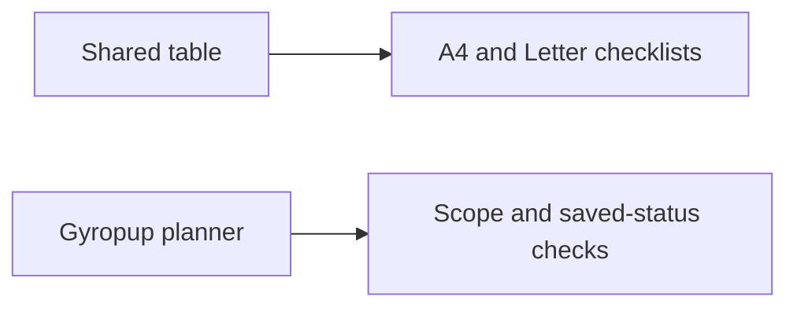

# Printable planner checklist evidence

2026-11-11: the shared Chromium suite at `83339d32` passed numeric/text sorting, unknowns, stable row/checklist state, import/export, denied storage and responsive controls plus the new full/matching snapshot checks. New checks cover hidden screen pages, consumer filters, invalid scope, empty matches, blocked popup, preserved live DOM/page/status and selected sort order. Exact command: `timeout 150s env TEST_OUTPUT=<owned-output> node tests/webkit/webkit-part-table-browser.mjs` from the toolkit branch.

Actual retained A4/Letter PDFs each have 4 pages. The `pdftotext -bbox` audit finds repeated headers on all 4 pages, all 75 unique part IDs exactly once and no text beyond the page boundaries. `shared-pdf-audit.json` seals both original PDFs. The first weighted-layout attempt cut the original equal-width output from 8 to 4 pages; final layout reserves more room for descriptions and keeps checklist/status columns small. Physical printers and arbitrary consumer data remain unqualified.

The local WebKit invocation failed before tests because its Playwright executable was absent. No browser installation or replacement was performed. Normal CI must provide actual WebKit acceptance.

Gyropup's provisional Chromium planner report uses actual planner/data code with the unrelated assembly guide module explicitly intercepted to avoid WebGL; this is a table fixture, not full Build-page integration proof. Queue output contains 54 parts across 10 visible rows; matched output contains 3 parts. Exact stable key `print/rig/pod` retains its checked status, and printing preserves the live table HTML. Full vs matching scope, current published revision and original-workstream limits were checked. Actual A4/Letter queue PDFs were 2 pages.

The provisional report's Find a part alignment measurements are **not accepted**: that table was in the hidden Buy panel, so zero-size deltas could pass. The committed regression now opens each relevant panel and requires positive header/cell widths; its corrected execution remains pending. Queue was in the active Print panel and its measurement rejects an actual 12 px shifted-header control. Earlier harness failures are preserved below; no alignment CSS or geometry fix was inferred.

## Preserved failures and corrections

- The first Gy negative fixture applied `display:block` to a header but did not shift its measured edges; expected misalignment rejection failed (`true !== false`). It now applies a real 12 px translation.
- The second Gy check selected `print/rig/pod` by substring and also matched `print/rig/pod_lid`, producing a strict-mode error. It now selects the exact Part ID cell.
- A provisional toolkit adoption dropped product pagination/filter extensions. This was caught before browser acceptance or publication; generic behavior is upstreamed and tested. See the [incident](../../inbox/2026-11-11-table-adoption-must-preserve-consumer-extensions.md).

No CAD/native collection, manufacturing file or printed-leg geometry changed. The hardware diff from accepted dev is empty. The existing twelve-poster source contract passes without a media refresh.

## Independently checked amended renderer and product output

A later independent review rejected the original real queue layout: Grams `1106` split into `110` / `6` and short headers broke midword. The first interpretation misattributed the trailing `6` to Hours `72.5`; the actual source/bounding boxes corrected this, and the initial exact `72.56` assertion failed before being replaced with same-row Grams `1106` and Hours `72.5`. Source row warnings were also being lost from plain printed labels. These failures are retained in the linked incident; the earlier generic PDFs remain historical, not amended-product acceptance.

Shared source `e232bcace9dba7de56808d30022e0755155325db` and exact product source/build `0b7b5f0c0ef0` were then checked by a separate GPT-6 reviewer. The shared copies are byte-identical (SHA-256 `9d893a93410c3ec52bd4c5ad8f15be1491057cb1dd98d71b60a0585345f41ad8`). The reviewer ran the existing shared Chromium harness and `tests/site/content/test-print-checklist.mjs` once after each necessary correction, with 150 s command bounds and finally cleanup; no author browser campaign overlapped.

The `amended-*` PDFs and JSON reports retain the actual successful outputs:

- Shared 75-row A4 and Letter: three pages each, all 75 IDs once, repeated headers on every page, no out-of-page words. Actual first-page visual inspection found whole compact values/headers. This fixture remains portrait.
- Actual Gy queue A4 and Letter: three landscape pages each, 54 unique IDs once, whole `1106`, `72.5` and `Hours` tokens, repeating headers and no out-of-page words. Browser range checks also require each compact/header cell to occupy one line within its cell at both printable paper widths.
- Actual pending turret queue A4 and Letter: two landscape pages each, 23 unique IDs once and all 21 row-specific `Model export pending` warnings. No export was invented or enabled. Headers repeat and text stays inside every page.
- Both real tables were activated in their actual Print/Buy panels before comparing positive-width header/cell boxes at 1280 px and 320 px. The seeded 12 px header shift is rejected. The prior hidden-table report remains provisional.
- A one-part table through the actual product adapter retains its visible Print checklist action, emits exactly one stable-key row with checked status and has no unnecessary search/sort controls. Full/matched all-page scope and live HTML/page/status preservation also pass.

The author independently replayed `pdftotext -bbox` checks on all four product PDFs: unique expected IDs, repeated `ID`/`Quantity` headers on every page, whole compact tokens, 21 `pending` tokens for the pending queue and no word beyond page boundaries. `amended-pdf-audit.json` seals those product files. The shared reviewer’s original machine audit is `amended-shared-pdf-audit.json`.

These are bounded Chromium/browser/PDF results with the unrelated 3D assembly module explicitly isolated. Normal CI supplies WebKit and complete Build-page integration; physical printer output, manufacturing readiness and physical fit/strength remain unqualified. No CAD/native or printed-leg geometry changed.
