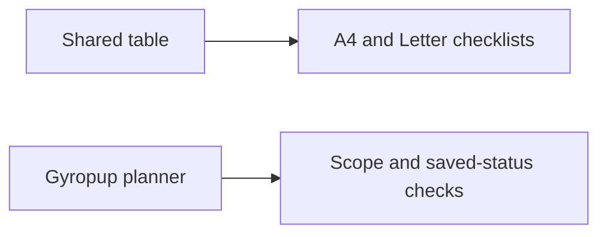

# Printable planner checklist evidence

2026-11-11: the shared Chromium suite at `83339d32` passed numeric/text sorting, unknowns, stable row/checklist state, import/export, denied storage and responsive controls plus the new full/matching snapshot checks. New checks cover hidden screen pages, consumer filters, invalid scope, empty matches, blocked popup, preserved live DOM/page/status and selected sort order. Exact command: `timeout 150s env TEST_OUTPUT=<owned-output> node tests/webkit/webkit-part-table-browser.mjs` from the toolkit branch.

Actual retained A4/Letter PDFs each have 4 pages. The `pdftotext -bbox` audit finds repeated headers on all 4 pages, all 75 unique part IDs exactly once and no text beyond the page boundaries. `shared-pdf-audit.json` seals both original PDFs. The first weighted-layout attempt cut the original equal-width output from 8 to 4 pages; final layout reserves more room for descriptions and keeps checklist/status columns small. Physical printers and arbitrary consumer data remain unqualified.

The local WebKit invocation failed before tests because its Playwright executable was absent. No browser installation or replacement was performed. Normal CI must provide actual WebKit acceptance.

Gyropup's provisional Chromium planner report uses actual planner/data code with the unrelated assembly guide module explicitly intercepted to avoid WebGL; this is a table fixture, not full Build-page integration proof. Queue output contains 54 parts across 10 visible rows; matched output contains 3 parts. Exact stable key `print/rig/pod` retains its checked status, and printing preserves the live table HTML. Full vs matching scope, current published revision and original-workstream limits were checked. Actual A4/Letter queue PDFs were 2 pages.

The provisional report's Find a part alignment measurements are **not accepted**: that table was in the hidden Buy panel, so zero-size deltas could pass. The committed regression now opens each relevant panel and requires positive header/cell widths; its corrected execution remains pending. Queue was in the active Print panel and its measurement rejects an actual 12 px shifted-header control. Earlier harness failures are preserved below; no alignment CSS or geometry fix was inferred.

## Preserved failures and corrections

- The first Gy negative fixture applied `display:block` to a header but did not shift its measured edges; expected misalignment rejection failed (`true !== false`). It now applies a real 12 px translation.
- The second Gy check selected `print/rig/pod` by substring and also matched `print/rig/pod_lid`, producing a strict-mode error. It now selects the exact Part ID cell.
- A provisional toolkit adoption dropped product pagination/filter extensions. This was caught before browser acceptance or publication; generic behavior is upstreamed and tested. See the [incident](../../inbox/2026-11-11-table-adoption-must-preserve-consumer-extensions.md).

No CAD/native collection, manufacturing file or printed-leg geometry changed. The hardware diff from accepted dev is empty. The existing twelve-poster source contract passes without a media refresh.
