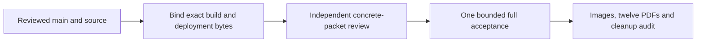

# Public checklist acceptance



This is a recoverable procedure for #281, not an execution approval or a public
pass. [Actual A/V2/V3 observations](../public-observation/README.md) remain failed:
A framed the wrong content and never admitted HTML; V2 failed before capture;
V3 produced two correct desktop captures but exceeded graceful browser-close's
15-second bound. Full public/PDF acceptance is still outstanding. Source-fixture
PDFs in [the parent evidence](../README.md) remain separate. No printer or purchase
is operated by this procedure.

## Prepare and test without a browser

From the repository root, run only the offline controls:

```sh
node --test .agents/plans/printable-parts/public-acceptance/test-*.mjs tests/site/assembly/test-capture-diagnostics.mjs
python3 -I -B .agents/plans/printable-parts/public-acceptance/test-runner-recovery.py
python3 -I -B .agents/plans/printable-parts/public-acceptance/test-admission.py
```

These exercise pure root/nested clipping, actual retained V2 geometry, one native
scroll with fake elements, drift/occlusion/horizontal-motion rejection, exact HTML
byte comparisons, passive observer identity/error behavior and bounded cleanup
failure. Collector tests AST-extract only the existing lifecycle function with
mocked subprocesses. Admission tests use an isolated disabled temporary contract;
Python optimization is rejected before inputs or unit admission. No test launches
a browser/unit or fetches a network resource. Historical HTML fixtures are test
evidence, never the future live binding.

Recover the scripts/modules into a fresh exclusive private packet directory.
Copy public-checklists.mjs, run.py, audit-pdfs.py, clip-geometry.mjs,
position-header.mjs, deployment-html.mjs and cleanup-observer.mjs. Copy the canonical
`../source-fidelity/pdf-id-extractor.py` beside them unchanged. Copy the canonical
`tests/site/assembly/capture-diagnostics.mjs` beside them unchanged; bind its exact
Git source and SHA-256 in helper. Do not duplicate either canonical helper in Git.
Copy each TEMPLATE JSON to its unsuffixed name and privately bind real providers.
Do not commit machine paths, provider inventories, armed contracts or review seals.
Templates remain false/TODO and have no execution artifacts.

## Bind source and delivered identity separately

Bind final main/tree/assets, guide/model/source identity, actual toolkit release,
four raw JS hashes and three final-built HTML/CSS hashes. The built root must be
from exact final main, explicitly labelled a local expected rebuild or an actual
CI artifact. A build timestamp is not source identity. Freeze it through acceptance.
Require an unchanged final source checkout. Independently derive table IDs, matching
IDs, long notes, source-field fragments and final page counts; never derive expected
membership from the enhanced renderer or reuse an incomplete old PDF count.

Navigate directly to `https://gyropup.com/designer/build`; its response corresponds
to built designer/build.html. The old .html route redirects. Deployment may insert
Cloudflare's beacon: bind the full compiled HTML hash, full actual response hash,
exact insertion offset/length/hash and complete insertion bytes. Privately retain
compiled-build.html, served-build.html and deployment-beacon.html. Admission must
reconstruct the complete response by that one exact byte insertion, without DOM
serialization, stripping, regex tolerance or normalization. Any other difference
fails closed and needs new evidence/review. The six JS/CSS assets still require
unchanged bytes. All seven actual identities must pass before framing/capture.

Bind existing Node/Playwright/Chrome bytes and version, plus the same Playwright
CRConnection implementation used by the passive observer. No install is part of
recovery. The final concrete packet needs independent GPT-6 review under the repo
workflow. Only afterwards enable its concrete contract and seal the final reviewed
bytes. review-seal.json records review_url and files_sha256 for all fifteen runtime
files explicitly listed in run.py, including exact HTML/insertion inputs and both
canonical copied helpers. It is a byte binding, not an authentication mechanism.
Any changed input requires renewed review.

## Run once and inspect the complete result

Only from that reviewed private packet, run `python3 -I -B run.py --execute-reviewed`.
Admission validates everything before the atomic exclusive attempt marker. Existing
output/unit/marker or changed bindings are rejected. Never reuse a spent namespace
or replay browser work to repair a collector, screenshot or close failure.

One installed Chrome context uses the real notice, planner and source-bound
Combined assembly; no route interception or injected app-data fixture is used.
The owned unit remains capped at two CPU cores, 3 GiB, zero swap, 512 tasks and
480 seconds. Work remains 420 seconds. Readiness/actions retain their old limits;
required screenshots remain 30 seconds and PDFs 20 seconds. Live effective limits
are captured before browser work; terminal owned-cgroup emptiness is independently
collected afterwards. Collected-unit defaults are not historical limit evidence.

At 1280 and 320 px, select the actual Print/Buy panel. Root clipping uses standards
viewport coordinates; ordinary BODY/planner/table padding clips remain. The
observed HTML hidden/auto overflow, CSS1Compat, HTML scrollingElement, scale-one
zero-offset visual viewport profile is explicit; unsupported cases fail.
Within one total five-second stage, pin the same connected real table/header/
document, call one native instant/center/nearest scroll, and record pre-scroll plus
two passive samples 100 ms apart. They must agree within one pixel after scrolling,
retain header/identity hits and preserve every horizontal offset. This is sampled
geometry agreement, not a render-cadence claim. Keep positive-width/header-edge
alignment checks and reject the seeded shift. No scroll/capture retry, focus/render/
font/scene trick or screenshot fallback is accepted.

Six required screenshots use the existing passive capture-phase observer; record
before/after geometry and protocol timing without changing the capture operation.
The twelve PDFs remain queue/orders full and matching A4/Letter, plus Made/pending
full A4/Letter. Preserve source-derived membership/current live order, same-part
notes/fields/status identity, isolated checkbox persistence, whole queue values,
all warnings, repeated headers, bounds and independent PDF matrix/page audits.

Context close remains five seconds; graceful browser close remains 15 seconds.
Passive local-client before/after state, phase timing and bounded close events
record whether each operation returned/rejected/timed out. They do not issue CDP,
focus, render, extra close or kill calls. A late disconnect or terminal empty cgroup
never relabels a failed graceful close as success. Retain original errors and all
cleanup failures; missing observations are explicit. Browser/context/work/response/
positioning cleanup must settle under existing bounds. The overall attempt stays
failed when any required work or lifetime contract fails.

Inspect run.log, live-unit.json, report.json, capture phase files,
terminal-cleanup.json and pdf-audit.json; actually view screenshots and representative
PDFs. Keep failures and immutable identities. Publish a privacy-safe issue receipt,
then close #281 only after all full acceptance conditions pass. These checks do not
establish physical printer output, current procurement quotes or manufacturing fit.
