# Gyropup

**A research robot designed to balance on two wheel-legs, with a foam-ball turret: CAD and simulation in the open.**

[Website & playground](https://gyropup.com) · [Documentation map](docs/README.md) · [Prototype warning](docs/prototype-safety.md) · [Contributing](CONTRIBUTING.md)

The banner is drawn from the project's own CadQuery code (<code>cad/build_leg.py</code>, <code>cad/turret.py</code>, <code>cad/turret_stand.py</code>) with hidden lines removed, set as the project's own <code>tools/readme_hero.py</code> sets it, by the <a href="https://github.com/mvalancy/mvalancy/tree/9a878ce602d8a5256027c9f4367d2ae5ea4784da/tools/hero">README banner generator</a>.

## What it is

A research project exploring a self-balancing wheel-legged robot and a foam-ball turret, with a live browser playground and an open engineering notebook.

The design combines two hub-motor wheels, two five-bar legs driven by RobStride RS-04 actuators, and a pan/tilt
turret for Rival-size foam balls. CAD, simulation, parts catalogs and test plans are developed here; the browser
playground does not control physical hardware.

**Gyropup prototypes are unsafe, are for research purposes only, and will not be offered for sale.** Future play
with children and families is an aspiration, not a qualified use of today's designs. Read the
[prototype warning](docs/prototype-safety.md).

## Build order

**One design, built in this order** (decisions D36-D38 in [docs/decisions.yaml](docs/decisions.yaml)):

1. **One leg** on a vertical-rail test rig: a five-bar with both motors in its hip frame. CAD in
   [`cad/fivebar.py`](cad/fivebar.py), physics in [`sim/leg_rig.py`](sim/leg_rig.py).
2. **The turret** on its own bench base ([`cad/turret.py`](cad/turret.py)).
3. **The body** around two legs: the Orin compute, the battery and the electronics inside one printed shell, the
   lights on the hips beside the turret, the eyes on the face.

## Status

**Status:** CAD and simulation; no assembled robot yet and no print release. Current interactive pages share the
v2 robot and detailed turret. Historical reports and recordings retain their own geometry, loads and limitations;
they do not establish physical fit, safe operation or qualification of the current design.

**Weight ceiling:** 100 lb (45.36 kg) for the complete robot. The current CAD estimate is 37.5 kg (83 lb);
[the weight budget](docs/design-weight-budget.md) distinguishes that estimate and existing tested loads from the new ceiling.

## Start here

Start with the [documentation map](docs/README.md), [live program tracker #31](https://github.com/Valpatel/gyropup/issues/31),
or [contributor orientation](CONTRIBUTING.md). Agents reading the public website can use
[/llms.txt](https://gyropup.com/llms.txt) and the [public reading guide](docs/agent-guide.md).

**Website & playground:** [gyropup.com](https://gyropup.com). The same landing page,
simulator and engineering portal run locally: `nvm use && npm ci && npm run dev`.
Reviewed changes on `main` publish automatically through Cloudflare Pages.
[Development, deployment and browser checks](docs/site-deployment.md).

## Repository map

| Folder | What is in it |
|---|---|
| [`cad/`](cad/) | The parts in CadQuery: the leg (`fivebar.py`, `build_leg.py`), the turret (`turret.py`), the interface standard (`gmi.py`, `interfaces.json`) |
| [`sim/`](sim/) | MuJoCo: the single-leg rig (`leg_rig.py`); the old robot's balance controller and scenarios |
| [`docs/`](docs/README.md) | Grouped engineering notes, requirements, decisions, validation evidence and reading guides |
| [`research/`](research/) | Sourced research: comparable robots, actuators, wheels, power, sensors, the turret |
| [`catalog/`](catalog/) | The parts this robot uses, with specs, prices and sources ([format](catalog/SCHEMA.md)); McMaster hardware in `hardware.json` |
| [`designer/`](designer/) | Browser playground, Progress, Build and model viewers |
| [`tools/`](tools/) | The leg's geometry sweep, McMaster CAD downloads, the voice server |

The tooling that compared many designs and parts lives on in [cad-agent](https://github.com/Valpatel/cad-agent) as a
generic comparison framework; the version that was here is at the git tag `explorer-snapshot-2026-10-26`.

## Licence

**Licence:** [MIT](LICENSE), covering the code, CAD sources, generated models, docs and data in this repository.
Bought parts' vendor CAD (STEP files from McMaster-Carr, RobStride, Seeed and others) is not in the repository and is
not covered: `references/vendor/**/SOURCE.txt` records where each came from, and the build fetches them locally.
Product names and trademarks belong to their owners.
