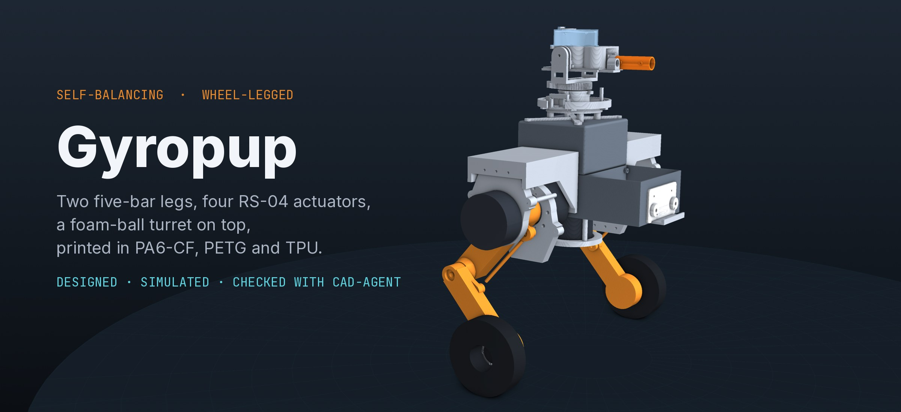

# Gyropup

A friendly self-balancing wheel-legged robot that plays foam-ball target games with kids.

Gyropup balances on two hub-motor wheels and crouches, stands and jumps on two five-bar legs, each driven by two
RobStride RS-04 actuators inside the body. A pan/tilt turret on top fires Rival-size foam balls at knock-down targets
(always low, never above horizontal). Every custom part is 3D printed: structure in PA6-CF on a hardened nozzle, the
rest in PETG and TPU. Bought parts are bearings, pins, screws and inserts from McMaster-Carr, the motors and the
electronics.

**One design, built in this order** (decisions D36-D38 in [docs/decisions.yaml](docs/decisions.yaml)):

1. **One leg** on a vertical-rail test rig: a five-bar with both motors in its hip frame. CAD in
   [`cad/fivebar.py`](cad/fivebar.py), physics in [`sim/leg_rig.py`](sim/leg_rig.py).
2. **The turret** on its own bench base ([`cad/turret.py`](cad/turret.py)).
3. **The body** around two legs: the Orin compute, the battery and the electronics inside one printed shell, the
   lights on the hips beside the turret, the eyes on the face.

**Status:** leg v2 is in CAD and simulation; nothing is built yet. The old serial-leg robot (`cad/build.py`,
`cad/leg.py`, `sim/model.py`, the 3D game page) stays only until leg v2 is on the full robot.

**Dashboard:** `.venv/bin/cad-agent site --serve --port 8642`, then
[http://127.0.0.1:8642/designer/progress.html](http://127.0.0.1:8642/designer/progress.html).

| Folder | What is in it |
|---|---|
| [`cad/`](cad/) | The parts in CadQuery: the leg (`fivebar.py`, `build_leg.py`), the turret (`turret.py`), the interface standard (`gmi.py`, `interfaces.json`) |
| [`sim/`](sim/) | MuJoCo: the single-leg rig (`leg_rig.py`); the old robot's balance controller and scenarios |
| [`docs/`](docs/) | [Requirements](docs/requirements.md), [decisions](docs/decisions.yaml), [milestones](docs/milestones.yaml), the [interface standard](docs/mechanical-interfaces.md) |
| [`research/`](research/) | Sourced research: comparable robots, actuators, wheels, power, sensors, the turret |
| [`catalog/`](catalog/) | The parts this robot uses, with specs, prices and sources ([format](catalog/SCHEMA.md)); McMaster hardware in `hardware.json` |
| [`designer/`](designer/) | The progress page and the 3D game page (Gyropup's voice and turret; the turret on the Orin AGX box, fired by hand, its mechanism laid open) |
| [`tools/`](tools/) | The leg's geometry sweep, McMaster CAD downloads, the voice server |

The tooling that compared many designs and parts lives on in [cad-agent](https://github.com/Valpatel/cad-agent) as a
generic comparison framework; the version that was here is at the git tag `explorer-snapshot-2026-10-26`.

**Licence:** private and closed source for now.
