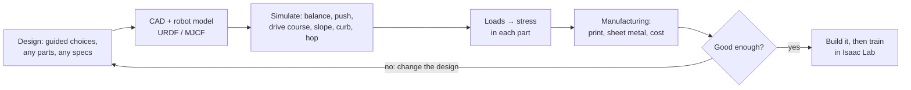

# wobbit

A self-balancing wheel-legged robot, and the tool that designs it.

wobbit is a two-wheeled, two-legged robot in the spirit of the DDT Diablo: it balances on direct-drive wheels and
crouches, stands and hops on legs driven by quasi-direct-drive actuators. It carries a Jetson AGX Orin 32GB compute
box, a Velodyne VLP-16 lidar, a ZED stereo camera and a RealSense depth camera. It is mostly 3D printed, starting in PLA
on a Bambu P1S, with carbon-fibre filament, SendCutSend metal and carbon-fibre tube as upgrades.

The designer is as important as the robot. The goal is a closed loop:

**Status:** research and architecture. Nothing is built or tested on hardware.

| Folder | What is in it |
|---|---|
| [`docs/`](docs/) | Requirements (in the user's words) and architecture |
| [`research/`](research/) | Sourced research: reference robots, actuators, wheels, power, sensors, fabrication, prior art |
| [`catalog/`](catalog/) | Parts with prices, specs and sources ([format](catalog/SCHEMA.md)) |
| [`designer/`](designer/) | The choose-your-own-adventure designer (web) and its model |

Built with [cad-agent](https://github.com/Valpatel/cad-agent).
