<h1 id="gyropup"><picture style="display:block;max-width:640px;margin:0 auto"><source media="(prefers-reduced-motion: reduce)" srcset="docs/img/hero/gyropup-title-still.svg"></picture></h1>

<picture style="display:block;max-width:640px;margin:0 auto"><source media="(prefers-reduced-motion: reduce)" srcset="docs/img/navigation/project-map-still.svg"></picture>
<a href="https://cad-agent.valpatel.com/"><picture style="display:block;width:142px;max-width:100%;margin:10px auto"><source media="(prefers-reduced-motion: reduce)" srcset="docs/img/hero/made-with-cad-agent-still.svg"></picture></a>
A fictional playground. <a href="docs/program/physical-progress.md">Follow the real build evidence.</a> 
<a href="https://gyropup.com/designer/sim.html">Play</a> · <a href="https://gyropup.com/designer/build.html">Build</a> · <a href="docs/README.md#design-and-qualification">Understand</a> · <a href=".github/CONTRIBUTING.md">Contribute</a>

## What is it?

A research robot designed to balance on two wheel-legs, with a foam-ball turret: CAD and simulation in the open.
Explore the [browser playground](https://gyropup.com/designer/sim.html), the
[design](docs/README.md#design-and-qualification) and [dated physical evidence](docs/program/physical-progress.md).

 
CAD snapshot · <a href="docs/guide/project-overview.md#keeping-the-design-illustration-current">Source and context</a>.

## Why is it cool?

- Wheel-legs bring rolling, stepping and balance into one research problem.
- Open models make the design explorable in your browser.
- Gyropup evolves with cad-agent through good sources, evaluation, independent review and reusable methods.

Follow the [leg, turret and body build paths](docs/guide/project-overview.md#follow-the-build),
or browse the [published progress and reports](https://gyropup.com/designer/progress.html).

## How do I join in?

Start with [Contributing](.github/CONTRIBUTING.md), then choose a scoped issue from
[program #31](https://github.com/Valpatel/gyropup/issues/31). The [project guide](docs/guide/project-overview.md)
and [documentation map](docs/README.md) lead to the hardware, software, tools, tests and local website workflow.

**Unsafe research prototypes; not for sale.** Read the [prototype warning](docs/guide/prototype-safety.md).

[MIT](LICENSE) · [Licensing and vendor boundaries](docs/guide/project-overview.md#licence).
