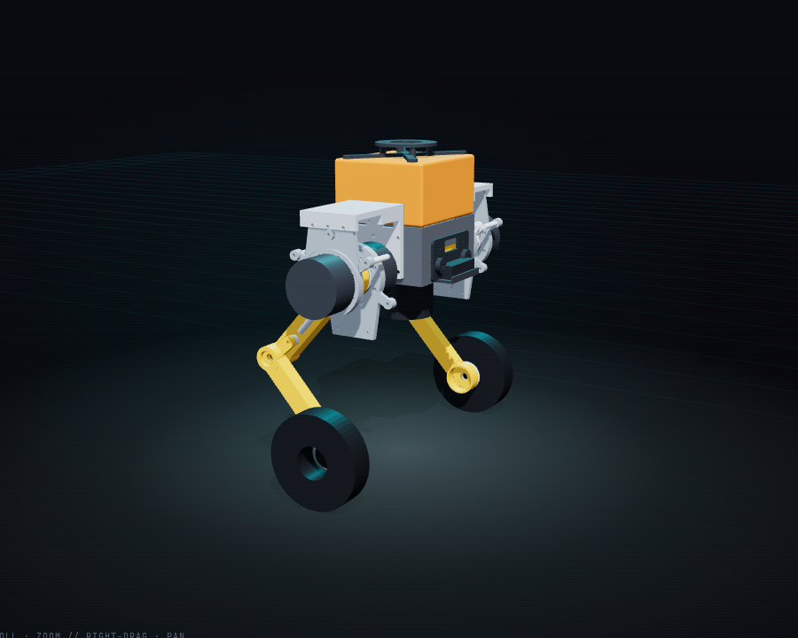
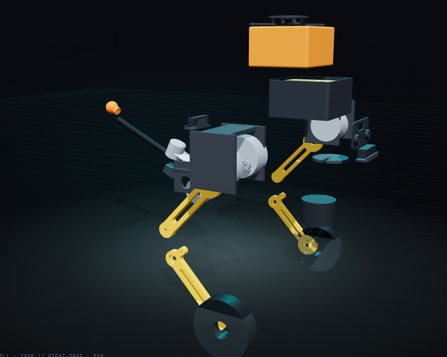

# Printed parts (CAD)

[`build.py`](build.py) makes every part of a design in CadQuery: the aluminium chassis, the two leg modules ([`leg.py`](leg.py), built on the mechanical interface standard in [`gmi.py`](gmi.py) and [`../docs/mechanical-interfaces.md`](../docs/mechanical-interfaces.md)), and the printed head, face and sensor mounts. The motor interfaces come from the vendors' drawings ([`../catalog/interfaces.json`](../catalog/interfaces.json)). [`studies.py`](studies.py) runs the stiffness and strength studies, and [`cables.py`](cables.py) checks the cable routes over the leg's whole range of motion.

```
.venv/bin/python cad/build.py designs/default.json   # STEP + print-ready STL in exports/, then:
.venv/bin/cad-agent view                              # the 3D assembly, at /_cadagent/kit/viewer.html
```

| Assembled, standing | Exploded |
|---|---|
|  |  |

| Part | Qty | Made | Notes |
|---|---|---|---|
| `chassis` | 1 | 3 mm 6061, laser cut and bent (SendCutSend) | The spine: floor, side walls with the HM pattern where the legs bolt on (6 × M6 + 2 dowels each side) and the cable passes, front and rear walls for the face and cameras, top flanges where the J501 box stands on its four M3 standoffs |
| `battery_cradle` | 1 | printed PLA | Rails and strap channels for the FLEXVOLT pack inside the chassis |
| `yoke_bracket` | 2 | printed PA6-CF | Wall plate on the chassis (HM), deck over both motors, drop faces onto both motor plates' tabs: with the three posts it closes a box around the joint |
| `hip_motor_plate`, `knee_motor_plate` | 2 + 2 | CNC 6061 | The motor-specific AC part: the motor's mounting lugs and spigot, a 61812 support bearing around the output adapter, standard post and bracket holes |
| `hip_output_adapter`, `knee_output_adapter` | 2 + 2 | CNC 6061 | The motor-specific AO part: dowels into the motor's output, a Ø60 journal for the support bearing, the standard face (Ø40 spigot, 8 × M5 on Ø50, 2 dowels) |
| `thigh` | 2 | CNC 6061 box (or 40 × 30 × 3 tube with bonded ends) | On the hip's standard face; knee pin at the far end; the wheel's cables run inside |
| `shin` | 2 | CNC 6061 box | Two 6001-2RS knee bearings, the push-rod lever, the WH face for the wheel adapter; cables inside |
| `knee_crank` | 2 | CNC 6061 | On the knee's standard face; drives the shin through the push-rod (two M6 rod ends and a Ø12 tube, bought) |
| `wheel_adapter` | 2 | 6061 | WH face to the shin, the BotWheel's 4 × M6 flange and boss on the other side, the cable through the middle |
| `head_saddle` | 1 | printed PLA | Open frame on the J501 lid screws; lifts the turret ring 20 mm so the cooler grille keeps breathing |
| `face` | 1 | printed PLA | DualEye window and two headlight bosses |
| `camera_cradle` | 2 | printed PLA | D415 or D435 on its 1/4-20, front and rear |
| `lidar_hanger` | 1 | printed PLA | VLP-16 under the waist: 1/4-20 and two locating pins |

Every part is a valid single solid; the printed ones also pass the watertight-STL and P1S bed checks (`exports/geometry-checks.json`). The CAD masses go to [`exports/mass-properties.json`](../exports/mass-properties.json), and `sim/model.py` uses them in place of the designer's estimates, together with the real hip and wheel positions from [`exports/mech-layout.json`](../exports/mech-layout.json).

The stiffness studies, the cable routes and the open weight work are in [`../docs/mechanical-interfaces.md`](../docs/mechanical-interfaces.md#results-rev-02-2026-10-25). The vendor STEP files used for the clash checks stay local (`references/vendor/`, no licence to redistribute). The assembly shows bought parts as simple envelopes.

## The turret on the Orin AGX compute box

[`turret_box.py`](turret_box.py) mounts the turret ([`turret.py`](turret.py)) on the lid of the J501 enclosure
(`~/Code/j501-agx`, Rev 0.8), so it can be aimed and fired from the computer that will drive it. Nothing is drilled in
the box: four legs stand on the lid's screw corners and longer screws (M3 × 35 for M3 × 16) clamp leg, lid and base
into the same inserts. The J501's fan breathes in through the roof cells inside its Ø80 ring and exhausts through the
cells around it, so the deck stands 44 mm up and an intake shroud keeps the two apart.

```
.venv/bin/python cad/build_turret_box.py     # exports/turret/box/ (parts, print plan, checks) and exports/sim/turret_box/
```

The second folder is the scene for the 3D game page: pick **Turret on the Orin AGX box** in the simulator's design
list (`designer/sim.html?design=turret-box`). The build reads the J501's sizes from its `cad/parameters.json` and its
meshes from its `exports/view/` (set `J501_DIR` if the repo is elsewhere), so rebuild after either project changes.

| Part | Qty | Made | Notes |
|---|---|---|---|
| `box_deck` | 1 | printed PETG, upside down | The TM face (4 × M5 inserts, 2 dowels), four hollow legs with spigots in the lid's counterbores, the front skirt, the control pod at the back (24 V XT60, switch, fuse, pendant jack, USB-CAN out) |
| `intake_shroud` | 1 | printed PETG, on its floor | Collar over the J501's intake cells, a duct flaring to a grille at the front; 6 × M3 into the deck |
| `pod_cover` | 1 | printed PETG | Closes the pod from below |

`exports/turret/box/box.json` has the checks: the moving turret against the deck and against upright antennas on the
J501's RP-SMA bulkheads, the shroud's cost to the J501's fan (a hand estimate for its CFD to check), tipping, the top
ball speed if the throttle limit fails, and how long a ball can still fire after ARM is released.
