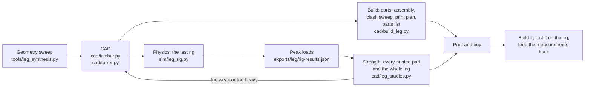

# How Gyropup is engineered

One robot (D36), built and tested in pieces: one leg on a test rig, the turret on a bench stand, then the body around
two legs. Each piece goes through the same chain, and every step writes files the next one reads.

## The pieces

| Step | Code | Writes | What it checks |
|---|---|---|---|
| Geometry | `tools/leg_synthesis.py` | `exports/leg/synthesis.json` | Push force at the motors' 60 N·m cap over the whole working range, joint angles away from dead points, links short enough to print |
| CAD | `cad/fivebar.py`, `cad/gmi.py` | (parts in memory) | Every printed part a single valid solid; bought parts at their real sizes |
| Build | `cad/build_leg.py` | `exports/leg/*.step`, `*.stl`, `leg.json`, `print-plan.json`, `bom.json`, pictures | No part touches another from crouch to full height and ±20° of lean; every part fits the 256 mm bed |
| Physics | `sim/leg_rig.py` | `exports/leg/rig-results.json`, `rig_*.mp4` | Stand, squat, jump, drop, power loss: motor torque and speed, axle force, link forces, stop loads |
| Strength | `cad/leg_studies.py` | `exports/leg/fea/` | Safety factor 2 everyday and 1.2 in rare events on humid printed PA6-CF; overload videos and the interactive 3D view |
| Turret | `cad/turret.py`, `cad/build_turret.py` | `exports/turret/` | The turret's parts, its ball path, its clashes, the bench stand |

The interface standard (`docs/mechanical-interfaces.md`, `cad/interfaces.json`) keeps the motor-specific parts (output
adapters, motor seats) apart from everything else, so a motor can change without redesigning the links.

## What the numbers rest on

- Motor data from RobStride's drawings and STEP (lug pattern, output flange), the BotWheel from ODrive's drawing.
- Printed-material allowables: Bambu's dry PA6-CF data, times 0.6 for humidity and 0.8 for print defects.
- Estimates, flagged where they are used: the RS-04's rotor inertia (it sets how hard a landing is), the BotWheel
  tyre's stiffness, the RS-04's power-off damping. The test rig measures them.

Simulation and FEA do not prove that a part fits or holds: the rig and the bench do. The old serial-leg robot's
pipeline (`cad/build.py`, `sim/model.py`, the 3D game page) stays until leg v2 is on the full robot.
