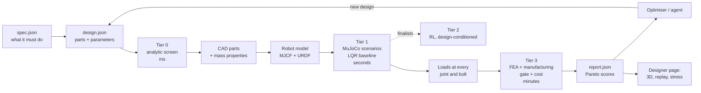

# Architecture: the closed loop

Goal (R14): design a robot, evaluate it in simulation, find its stress points, check it can be made, and iterate without a
human in the loop. Any components, any specs. The designer is the front end.

This plan builds on the prior-art surveys in [`research/prior-art-codesign.md`](../research/prior-art-codesign.md) and
[`research/prior-art-toolchain.md`](../research/prior-art-toolchain.md). Their key finding: **nobody has published the whole
loop** (CAD → sim → loads → FEA → printability and cost → iterate). The pieces exist separately, and the stress step is
almost missing from robot co-design. Upkie's printed legs broke in use, and Text2Robot used uniform-density masses with
no stress check.

## Contracts (files between stages)

| File | Written by | Read by | Holds |
|---|---|---|---|
| `spec.json` | designer or agent | every tier | What the robot must do: payload, max size, budget, speed, slope, curb, hop height, runtime. The optimiser reads only this, so what was asked for can be audited (Wilhelm 2026) |
| `design.json` | designer, optimiser, agent | every tier | Part choices (catalog id or custom specs), leg topology, dimensions, materials, print settings. Already used by `designer/model.js` |
| `exports/<part>.step/.stl` + `mass-properties.json` | CAD build | robot model, FEA, designer | Printed parts and exact mass properties |
| `robot.xml` (MJCF) + `robot.urdf` | robot model | sim, Isaac Lab, designer 3D view | One link tree; MJCF via MuJoCo's `MjSpec`; URDF checked by text-to-cad's validator |
| `runs/<scenario>.json` + `.mp4` | scenario harness | scorer, designer | Time series: joint torque, speed and power, contact forces, link wrenches; video |
| `loads.json` | scenario harness | FEA | Worst wrench per part interface, per load case (stand, landing, fall) |
| `fea/<part>.json` + `.glb` | FEA | gate, designer | Max stress, safety factor, deflection; stress-coloured mesh |
| `report.json` | scorer | optimiser, designer | Pass/fail per check, metrics, objectives (cost, mass, performance, worst safety factor, energy per metre) |

## Tiers

**Tier 0: analytic screen (milliseconds).** This is `designer/model.js`, already working. It covers compatibility
(voltages, CAN, the J501's 12–36 V input), the mass budget, squat torque against rated torque, wheel torque for balance
and slope, speeds scaled to the bus voltage, a printed-link stress screen, and cost. It runs in the browser and in Node
(`tools/derive.mjs`). It rejects designs that can't work before any CAD is built.

**Tier 1: model-based simulation (seconds).**
- **Simulator:** MuJoCo on the CPU (3.17, installed). No framework ships a wheel-legged scenario suite, so we write the
  harness.
- **Controller:** a baseline balancer, re-tuned for every design. The LQR is computed from the design's own MuJoCo
  linearisation (`mjd_transitionFD`) with gains scheduled on leg length, plus leg position control. It is ported from
  Upkie's PD/MPC balancers (Apache-2.0) and the documented RoboMaster method (RP_Balance, MIT). Every design gets a fair,
  tuned controller, so designs are compared, not controllers.
- **Actuators:** level 0 is a linear torque–speed clip plus reflected rotor inertia, friction and command delay. That is
  the same formula as mjlab's and Isaac Lab's `DcMotor`, so evaluation and RL agree. Level 1 is MuJoCo's `<dcmotor>`
  with winding temperature, which answers "how long can it hold a crouch" (Diablo manages about 15 minutes).
- **Scenarios** (from the co-design survey, section 4.2):

  | Scenario | Pass |
  |---|---|
  | Stand and squat sweep | Torque below the continuous rating at every height |
  | Balance with sensor noise | No fall in 60 s |
  | Push recovery (front, back, side) | Survives the spec impulse |
  | Drive course: steps, turns, reversing | Speed and yaw tracking within spec |
  | Slope | Holds and climbs the spec slope |
  | Curb | Clears the spec height |
  | Scripted hop and landing | Reaches the spec hop height; landing is the main FEA load case |
  | Unpowered fall onto the front and side | The impact load case |
  | All of the above, randomised | Pass rate with randomised mass, centre of mass, friction and actuator parameters |

- **Loads:** MuJoCo force/torque sensors at a site on every joint and bolt interface. Each logs a six-axis wrench, and
  the worst cases go to `loads.json`.

**Tier 2: RL (finalists only).** mjlab (MuJoCo Warp, Apache-2.0), starting from `mjlab_upkie`'s velocity task, which has
the same morphology. Later, one policy takes the design vector as input (Bjelonic 2023), so finalists only need
fine-tuning. Isaac Lab 3.0 comes after that: it targets Isaac Sim 6.2, and vp-isaac-sim pins 6.0. Deployment is ONNX →
TensorRT on the AGX Orin.

**Tier 3: structure, manufacturing and cost (minutes, for the parts that survive).**
- **FEA screen:** CadQuery STEP → gmsh mesh → scikit-fem, linear elastic with second-order tets. Each load case is
  applied as unit loads per interface and superposed, so one solve per part covers every time step. Printed parts use
  the across-layer (Z) strength from the filament datasheet, with separate safety factors for the static, landing and
  fall cases.
- **FEA verification:** CalculiX, run as a subprocess, with direction-dependent material for flagged parts and the top
  designs.
- **Manufacturing gate:** a reimplementation of the RoboForge checklist: single watertight solids, P1S bed fit, insertion
  paths, fastener length chains, clearance through the full range of motion, and mass reconciliation (CAD vs slicer vs
  model). It also uses the text-to-cad `dfam-check`, `bambu-labs` and `sendcutsend` skills already vendored in cad-agent.
- **Cost:** catalog BOM + filament grams + print hours + SendCutSend estimate.

**Optimiser.**
- **Outer loop:** an Optuna 5 multi-objective study over categorical parts and continuous dimensions, with constraints.
- **Stages:** staged inside the objective (Optuna cannot prune multi-objective studies): Tier 0 → short balance sim →
  full suite → FEA.
- **Pre-screen:** pymoo seeds the study from Tier 0 alone.
- **Controller weights:** pycma tunes them per design.
- **Output:** a Pareto set, not one weighted score.

**The agent's role** (Kawaharazuka 2025, Auto-Robotist, RoboForge): it turns intent into `spec.json`, proposes about
every tenth design from the Pareto history, diagnoses failures (geometry, target or controller?), and keeps a rule
library learned from runs. **It never replaces the numbers and never skips the deterministic checks.** LLM designs made
without these checks were mostly infeasible: in one study none of 30 could be verified.

## Buildable by construction

The optimiser never edits free-form geometry. It edits the parameters of a **typed template** that the CadQuery
generators always turn into a buildable assembly:
- **Leg topology:** stacked hip motors with a four-bar knee (Diablo), a five-bar, or motor at the knee.
- **Actuators:** catalog choices.
- **Dimensions:** link lengths, wheel size, track width.
- **Mass layout:** where the battery and electronics sit.
- **Structure:** wall count, infill, fork or single-plate links, print orientation, material, or a SendCutSend / CF-tube
  version with the same interfaces.
- **Style:** only on non-structural shells.

A four-bar or five-bar leg is modelled twice: as the true closed loop in MuJoCo (for loads) and as an equivalent serial
chain for RL and URDF.

## What we build vs reuse

| Stage | Reuse | We write |
|---|---|---|
| CAD | CadQuery 2.8 | Part generators for the template |
| Mass properties | OCP B-rep (exact); slicer masses later (Open Duck) | `cadagent.robot` (done) |
| MJCF / URDF | MuJoCo `MjSpec`; text-to-cad URDF validator; onshape-to-robot conventions | Move `cadagent.robot.write_mjcf` onto `MjSpec`; closed-loop and serial variants |
| Reference fixtures | `robot_descriptions` (Upkie, TRON1-WF) | Harness tests against a known-good wheel-legged robot |
| Control | Upkie balancers, RP_Balance method | Per-design LQR synthesis, gain schedule |
| Actuators | MuJoCo `DcMotor` / `<dcmotor>`, `mujoco.sysid`, BAM | Catalog → actuator parameters |
| FEA | gmsh, scikit-fem, CalculiX | STEP → mesh → loads → safety factor glue |
| Optimiser | Optuna, pymoo, pycma | Staging and gates |
| RL | mjlab, `mjlab_upkie`, Isaac Lab 3.0 | gyropup task config |
| Viewer | three.js + urdf-loader, `@mujoco/mujoco`, Rerun | `run.json` and stress GLB exporters |

**Generic pieces go into cad-agent** (R7): robot export, the scenario harness API, FEA glue, mass reconciliation and the
staged optimiser. gyropup-specific parts stay here: the template, scenarios, controller and spec. GPL tools (gmsh,
CalculiX) stay optional extras in the public MIT cad-agent.

**Licences.** Upkie, mjlab, `mjlab_upkie`, Text2Robot, BAM and robot_descriptions are Apache-2.0. RP_Balance, SurGE,
Eureka and onshape-to-robot are MIT. DDT's Diablo RL repo, Vitruvio and Open_Duck_Playground have no licence, so read
them only. RoboGen is GPL-3.0: don't copy its code.

## Milestones

| # | Milestone | Done when |
|---|---|---|
| M0 | Research, catalogs, Tier 0 model, designer draft | Done (this commit) |
| M1 | Template → CAD parts → mass properties → MJCF + URDF | The default design builds; the model loads in MuJoCo; masses reconcile with Tier 0; the URDF passes both validators; the Upkie fixture loads in the same harness |
| M2 | Scenario harness, per-design LQR, level-0 actuators | The default design passes stand, balance, push and drive; videos are written; it fails sensibly when a part is undersized |
| M3 | Loads → FEA screen | A safety factor per printed part for the stand, landing and fall cases; a stress GLB per part |
| M4 | Manufacturing gate + cost | RoboForge-style checks and the text-to-cad skills pass on the default design |
| M5 | Optimiser + agent loop | `tools/iterate.py` improves the default design against `spec.json` unattended and writes a Pareto report |
| M6 | Designer shows it | 3D view, scenario replay, stress overlay and the Pareto set in the guide |
| M7 | RL | mjlab velocity policy on the default design; ONNX export |
| M8 | Hardware calibration | Bench actuator identification, coupon and leg break tests, then the sim and FEA are updated |
