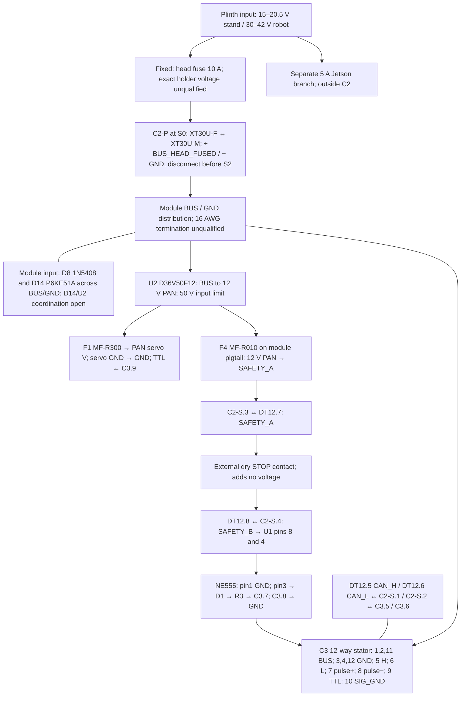

# Carrier disconnect and wiring-window candidate

Issue #66 / PR #67. This is an **interface and service-layout design**, not a checked electrical schematic, finished harness or print release. It retains the existing power and actuator requirements. The [component checklist](base-board-component-checklist.md) and [stock/drill plan](base-board-stock.md) remain part of its acceptance record.

## What C2 actually carries

The two power conductors carry the entire head branch: PAN input **plus** the current passed to the slip ring. `sim/turret_power.py` computes `i_base = p_pan_in / v_node + i_ring`. The Jetson is on a separate 5 A branch and is excluded here. The operating supplies are 15–20.5 V on the stand and 30–42 V on the robot; the head branch has a 10 A fuse. A fuse rating is not an instantaneous current limit. Existing power reports include pulses and a failing low-voltage stand-profile case; neither those simulations nor an averaged current establish the connector's thermal or fault qualification.

The existing [power report](../exports/turret/e2e/power.json), `supplies.*.spinup_worst` / `burst_worst`, provides the following design inputs. These are historical model outputs, **not measured currents or a newly run qualification**. Burst ring peak is a lower bound on instantaneous C2 current because PAN adds current upstream of the ring. Thus a 15 A temperature-rise test rating cannot simply be compared with the smaller 100 ms figures and declared sufficient.

| Supply | Head branch spin-up peak, 100 ms | Head branch burst peak, 100 ms | Burst ring instantaneous peak alone |
|---|---:|---:|---:|
| 15 V | 9.73 A | 10.36 A | 16.75 A |
| 20.5 V | 6.72 A | 6.94 A | 17.17 A |
| 30 V | 4.45 A | 4.52 A | 10.52 A |
| 42 V | 3.17 A | 3.20 A | 7.36 A |

The separately modelled 15 V stand profile still has `ring_ok: false` at worst assumed loads. No firmware, supply, load or motor setting is changed by this carrier design. Qualification needs the actual profile's C2 RMS/pulse waveform, ambient and connector/joint temperature rise, plus fuse clearing and inrush evidence.

| C2 interface | Conductors and pin identities | Requirement and disposition |
|---|---|---|
| C2-P power | `+` = BUS_HEAD_FUSED; `−` = GND | Select AMASS XT30U-F.G.Y on the supply tail and XT30U-M.G.Y on the module for layout. Use the moulded polarity symbols, not invented cavity numbers. 16 AWG PTFE connector tails; existing 18 AWG trunk remains separate. |
| C2-S signal | 1 = CAN_H to DT12.5 / C3.5; 2 = CAN_L to DT12.6 / C3.6 | Select Molex 43025-0400 on the fixed tail, 43020-0400 on the module, four 43030-0001 female and four 43031-0001 male contacts. 24 AWG UL1007, nominal OD 1.4 mm. CAN is a differential bus; a 5 V transceiver supply does not make these constant 5 V conductors. |
| C2-S pendant | 3 = SAFETY_A, from 12 V PAN through F4 to DT12.7; 4 = SAFETY_B, DT12.8 to U1 pins 8 and 4 | Existing dry-contact loop is approximately 10 mA in the circuit notes. F4 MF-R010 has 0.1 A hold rating, not a guaranteed 0.1 A current clamp. Fault/transient coordination remains to qualify. |

The [AMASS 2023V2 sheet](https://www.china-amass.com/public/upload/20240608/810c62b3f7ace2287989748538eb2a6b.pdf) gives 15 A with **16 AWG** at a temperature rise up to 30 K, 100 mating cycles, and 500 VDC **withstand**. It does not establish a 30 A continuous application rating or a working-voltage rating. The manufacturer's 12.40/13.70 mm separate body lengths and 5.60 × 10.20 mm sections are retained in the reservation; mating overlap is unknown. The 14 mm release movement is a design reservation, not a published contact-wipe dimension.

The [Molex specification, revision R](https://www.molex.com/content/dam/molex/molex-dot-com/products/automated/en-us/productspecificationpdf/430/43045/PS-43045-001.pdf) gives the 43020/43025 family 600 VAC/DC, with current dependent on wire size, circuit count and application. Its 24 AWG maximum insulation OD is 1.85 mm. For four circuits it requires **12.7 mm free of ties, twist or external bias** after the housing; the existing 12-way C3 needs 19.1 mm. These are straight/free-exit distances, **not minimum bend radii**. Tin/gold durability is 30 mating cycles. Exact crimp tooling and the completed assembly still need qualification.

The manufacturer drawings [SDA-43020, revision G, mirrored](https://definum.ru/system/files/430200400_sd.pdf) and [430250000-SD, revision A, mirrored](https://www.100y.com.tw/pdf_file/10-molex-430251400.pdf) establish the 16.89 mm plug, 14 mm receptacle and 24.77 mm mated length. Four-way body width is **6.85 mm**; 9.85 mm is the six-way row. The candidate reserves extra room for ears/latch. Its solids are labelled authored reservations, not complete manufacturer CAD. Wire numbering must follow the moulded circuit-1 identifier and drawing; opposite mating views mirror. The interface diagram specifies electrical cavity identities without pretending to be a physical crimp-face drawing.

Source copies read on 2026-10-29: AMASS PDF SHA256 `5d52c3481361a0a28c2d7777b96896f51c99a4eabe4535f95eceb00e0a30eee4`; Molex plug drawing PDF SHA256 `9cacfec6dbada15731fe5a6d9521bde7a347548786ff2098a3301b1bfa01d4df`. Licensed source documents remain outside git; the repository records their facts, URLs and identity.

## Power termination and protection decisions

The XT30 tails cannot quietly inherit the manufacturer's 16 AWG rating when wired with 18 AWG. The proposed fixed-side transition uses **two TE PIDG 320559 butt splices**, one conductor per end: 18 AWG trunk to 16 AWG tail. [TE's part data](https://www.te.com/en/product-320559.html) gives 22–16 AWG, 32.13 mm length and 3.18 mm maximum insulation diameter. [Application specification 114-2157 G](https://www.te.com/commerce/DocumentDelivery/DDEController?Action=srchrtrv&DocFormat=pdf&DocLang=English&DocNm=114-2157&DocType=Specification+Or+Standard&PartCntxt=320559) identifies 600 V splice use and specifies preparation, tooling and crimp checks. This is a specific correction candidate, **not yet a qualified joint**: verify the exact thin-wall wire/crimper combination and retention, put the rigid splices upstream of the fixed service anchor, and inspect/pull-test samples. The module's 16 AWG termination into the board's BUS/GND distribution is unresolved; do not force it through an assumed perfboard pad or add an unrecorded second gauge transition.

[Remington's wire table](https://www.remingtonindustries.com/content/PTFE%20Hook%20Up%20Wire%20Data%20Sheet.pdf) gives OD 2.032 mm for 16PTFESTR and 1.7526 mm for 18PTFESTR. Its voltage/temperature data do not provide the installed minimum bend radius. Copper paths, solder joints, insulation sleeves and the carbon-filled carrier's electrical isolation remain unqualified.

Two upstream corrections remain separate from this mechanical candidate. The exact bare Littelfuse 0FHM0001ZXJ voltage is **unqualified because manufacturer revisions and distributor listings conflict**, rather than proven to be only 32 V. 0FHM0003ZXJS is a documented 58 V candidate, not a silent substitution. TE 0460-202-16141 is 16–20 AWG, incompatible with direct 24 AWG signal termination; changing to a 22–24 AWG contact alone also leaves the DT housing seal too large for the selected 1.4 mm insulation. The [supplier audit](../research/supply/turret-carrier-2026-10-29.md) records the source evidence and candidates. D14's 70.1 V published maximum clamp versus U2's 50 V limit remains a separate protection-coordination blocker.

## Interface drawing

**Electrical identities only.** Connector positions S0–S2 below are mechanical review poses. This drawing does not verify fault energy, wire ampacity, PCB copper, isolation, crimping or protective-function performance.

## Mechanical poses and measurable service allowance

The carrier now has a **52 × 14 mm, R2 window** through x53–56, y±26, z14–28. It exposes the solder side, including the existing edge-pad area, while preserving every PCB boss, mount-hole neighbourhood and external retainer datum. PCB thickness/pose are unchanged. C2 exit lanes have wire-sized reservations through the window; the PCB net-to-pad layout and real solder insulation still need completion.

The new fixed saddle is x50–58, y37–42, z5–12 above the existing foot; its 4 × 2.5 mm slot runs through Y. Its nominal wire anchor is `(54,40,13)`. Two 3 × 1.5 mm through-X tie slots on the carrier side rail at y−32..−29, z18..19.5 and z22.5..24 retain a 3 mm web; wire anchor `(57,−30.5,21)`. The carrier retains its flat exterior face and original 8 mm print depth, unlike an outward saddle that would require lifting the plate off the bed. These are real printed features, but their tie fit, abrasion protection and pull strength are not qualified. Existing catalog tie 7130K12 is only a candidate until its exact dimensions/model and fit are obtained; no assumed tie appears as complete hardware in the model.

| Pose | Action / geometry |
|---|---|
| S0, seated | Power axis parallel Y at x65,z11.5. Signal axis parallel Y at x68,z29, latch facing +X. The source-side leads exit +Y, module leads −Y. |
| S1, disconnected | Isolate supply and verify stored energy is discharged under the project procedure. Remove bumper and release the connector keeper/ties. Grip the housings; move power source half +14 mm Y and signal source half +16 mm Y. Disconnect C3 and the pan-servo lead separately before withdrawing the carrier; those two access paths are not proved here. |
| S2, withdrawn | Only after all interfaces are disconnected and four external retainers removed, translate the complete module +45 mm X. This is a declared layout pose; the full installed-module sweep and parking of loose fixed tails still need proof. Insertion reverses this sequence. |

Each C2 fixed tail retains **55 mm free wire** between housing exit and fixed anchor; each module tail retains 40 mm. These are retained assembled lengths, not cutting allowances. The generated [interface receipt](../exports/turret/base-board-service/interfaces/interfaces.json) calculates `straight_exit + distance(end_of_straight_exit, anchor)` at both endpoints and 31 intermediate release positions. That is a **necessary lower bound**. The difference from retained length is available for bends; it does not establish a valid radius or collision-free loop. The checker rejects 10 mm tails and rejects withdrawing the still-mated module 45 mm with these lengths. Unknown minimum bend radius therefore keeps readiness false even when the lower bound passes.

The 4-way signal connector is a different circuit count from CT power (6), CT signal (10), and the ring (12). C2-P can still cross-mate with other XT30 power interfaces: labels alone do not prevent bypassing the 10 A branch fuse. A captive/routed-tail reach exclusion and an XT30 keeper remain required. No connector is authorized for live make/break.

## Reproduce and finish

`python cad/check_base_board_interfaces.py` runs bounded BREP reservations and writes the source-hashed receipt plus the project-authored [carrier candidate](../exports/turret/base-board-service/interfaces/carrier-wiring-candidate.step), [base candidate](../exports/turret/base-board-service/interfaces/pan-base-wiring-candidate.step) and [review assembly](../exports/turret/base-board-service/interfaces/carrier-wiring-layout.step). The assembly includes the base, carrier, actual PCB/component footprint layout, all eight mounting screws and eight inserts as authored public representations, and the connector reservations. It does not claim complete bought-part detail or model the missing tie/keeper/solder/harness. It tests preserved foot/bearing/servo regions, unchanged mounting neighbourhoods, six window lanes, connector release samples, driver and grip space, and intentional blocked/short/connected-removal cases. A green reservation result is separate from `readiness: false`.

The corrected checker requires cad-agent v0.4.2's reviewed relation engine4. It uses `relate` for topology validity, adaptive-volume uncertainty and conservation, raises on unknown results, and retains each relation witness. The1e-6 mm³ overlap threshold is unchanged; protected-region comparisons split the former1e-6 mm³ total difference budget between both outside volumes. Invalid zero-mass Booleans cannot become clearances. `tools/test-base-board-interface-geometry.py` reproduces that failure with a real invalid open solid and checks invalid clipping/unknown numerical outcomes too.

Input provenance uses the existing conservative `print_provenance.snapshot`: every CAD/config/catalog/design Python/JSON file, optional parameter identity, runtime versions and toolkit-source fingerprint. Capture precedes geometry imports and must still match at completion. The kernel-free guard compares the entire source closure, so changed M5 clearances, missing `gmi.py`, or newly added inputs invalidate the receipt. Runtime equality is enforced by the CAD run; CI's source guard does not pretend to recreate a CAD environment. Named coloured STEP members distinguish the grey base, blue carrier, green PCB, dark component envelopes, steel/brass authored hardware and orange connector reservations.

Next: obtain exact connector/tie geometry; finish BUS/GND solder termination and insulated pad layout; resolve source protection and DT seals; define and prove C3/servo disconnection and loose-tail parking; qualify bends, keeper and strain relief with samples; then rerun the complete module/fastener/print/structure checks against one source revision. Historical service and wall receipts remain historical.
