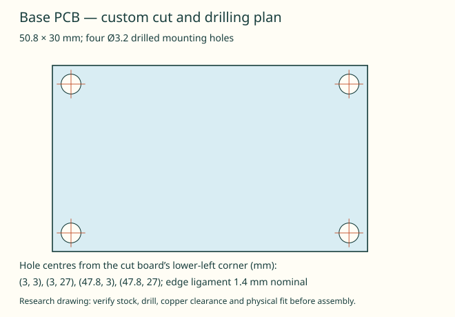

# Base-board stock and custom drilling

Use one 50.8 × 30 mm cut piece of SparkFun PRT-08619 Wombat PTH stock for this carrier. The [manufacturer page](https://www.sparkfun.com/protoboard-wombat-pth.html) identifies the board and its 2.54 mm prototyping pitch; its linked [v1.4 design file](https://github.com/sparkfun/ProtoBoard_Wombat-PTH/blob/v_1.4/Hardware/SparkFun_Protoboard-PTH-v14.brd) has a 78.74 × 99.06 mm outline and four original Ø3.175 mm mounting holes. The page's 80 × 100 mm size is rounded. Received stock still needs measurement.

The carrier uses a **new drilled pattern**, not those original holes. Cut an interior piece clear of the original mounting holes, then drill four Ø3.2 mm holes with centres measured from the new lower-left cut corner:

| Centre | X (mm) | Y (mm) |
|---|---:|---:|
| Lower left | 3.0 | 3.0 |
| Upper left | 3.0 | 27.0 |
| Lower right | 47.8 | 3.0 |
| Upper right | 47.8 | 27.0 |

The nominal remaining board material between each hole and its closest edge is 1.4 mm. This is a drawing dimension, not an edge-strength qualification. Inspect the cut edges, deburr holes and verify copper clearance/insulation around fasteners. Carbon-filled carrier material must not be assumed electrically insulating. The 1.6 mm CAD board thickness remains an assumption to check on the actual stock, including solder and jumper-wire projection on its rear face.

The separate **printed carrier retainer holes remain Ø3.4 mm**. This resolves the previous accidental use of that plastic clearance dimension for the PCB; the original base-board drilling instruction remains Ø3.2 mm. `tools/export-base-board-drill.py` generates the drawing and source-hash receipt from the same parameters as the PCB CAD. Four bounded manufacturer-input regressions, including the real public screw-stack positive control, pass after this change; old complete service receipts remain historical.

Do not use the existing catalog assumption that one Wombat sheet yields two 52 × 50 mm bay boards: two 50 mm spans exceed the design file's 99.06 mm before allowing for a saw kerf. The carrier needs one 50.8 × 30 mm piece; combining it with another workstream's offcut requires a verified nesting plan. No procurement quantity or other board design is changed by this note.

Source inspected 2026-10-29: manufacturer Eagle file SHA256 `b52382cef7887cf9b664424cbb7d29b462a9e85b94f381385341d4fea6d09fd2`; tag object `c0bbb0628dc7dfb9bdc2e96d88e1cfc9b5267311`. The original vendor file is not included in the public export.
