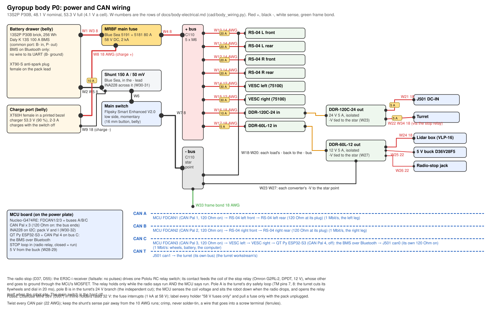

# Body electrics: the 13S bus, the battery, the power skid and the CAN buses

The P0 power system of Gyropup's body as built from `cad/body_wiring.py` (the wire list and the drawing),
`cad/body_battery.py` (the brick and the drawer), `cad/body_layout.py` (where every part sits on the power plate) and
`exports/body/bom.json` (what to buy, by catalogue key). It is the build package for milestone M5's power skid: a
person with the parts, a spot welder and a crimper can build and test it from this page and
[the wiring diagram](../exports/body/wiring.svg). Decisions: D43 (the 13S bus), D45 (the converters and the turret's share),
D54 (the battery and its BMS), D55 (the protection and the switch).
Written 2026-10-27.

## 1. The numbers

| | |
|---|---|
| Pack | 13S2P Molicel INR-18650-P30B (26 cells), in the belly drawer |
| Voltage | 48.1 V nominal; charged to 53.3 V (4.1 V a cell, not 4.20: about 9 % of the capacity traded for cycle life); empty at 39.0 V (3.0 V a cell) |
| Capacity | 6.0 Ah, 256 Wh to 4.10 V a cell |
| Current | 80 A for a jump's 0.2-0.3 s; 72 A continuous rating (36 A a cell); 9 V of sag at 80 A |
| BMS | Daly K 13S 100 A, BT + UART, common port (B-/P-) |
| Main fuse | MRBF 80 A (Blue Sea 5181 on a 5191 block), 58 V DC, 2 kA interrupting at 58 V |
| Branch fuses | Littelfuse MINI 58V (0997 series), 1 kA at 58 V |
| Rails | 24 V 5 A isolated (Mean Well DDR-120C-24), 12 V 5 A isolated (DDR-60L-12), 5 V 3.2 A (Pololu D36V28F5 from the 12 V) |
| Below SELV | 53.3 V is under the 60 V DC limit: nothing on the robot is a shock hazard, but the pack's short-circuit current is |

The bus was chosen in docs/body-plan.md (D43): every load is rated across 39-53.3 V (the RS-04 15-60 V, the 75100
14-84 V, the switch 12-84 V, the DDR converters 33.6-67.2 V and 18-75 V, the MINI 58V fuses and the MRBF 58 V), and
regeneration has room to 57 V before anything is near its limit.

## 2. The battery

### 2.1 The brick

26 Molicel P30B (18650, 3.0 Ah, 36 A) in 13 groups of two. The cells lie along y (across the robot) in two layers of
13 columns (`cad/body_battery.py` `brick()`: 266 x 76 x 60 mm with the BMS on top, 1.54 kg with its share of nickel and
insulation); a column is one 2P group, its two cells one above the other; the groups' + ends alternate side to side, so
every series link is a short strip from one column to the next.

1. **Match the cells.** Charge or discharge every cell to the same voltage (3.6-3.7 V, within 0.02 V of each other)
   before welding. Write each cell's voltage on a list; reject any below 2.5 V or that warms on the bench.
2. **Fish paper.** One ring on every cell's + end (the 18650's can is the - terminal right up to the + cap).
3. **Lay out the columns** in the printed cell nest (the bay halves, `exports/body/bay_rear.stl` and `bay_front.stl`),
   + ends alternating, so that column 1's - end and column 13's + end come out at the same end of the brick.
4. **Weld the 2P groups and the series links** with the 2P pre-shaped strip (IMR 0.15 x 18.5 mm), four welds a cell
   end, then a second layer of strip on every series link (the jump's 80 A crosses each link). Test-weld scrap first
   and peel it: the nugget should tear the strip, not lift.
5. **Kapton** between the layers' ends, over every weld, and round the brick's edges where the strip turns.
6. **Balance leads** (the BMS's 14-wire harness, 24 AWG): B0 to the brick's - end (group 1 -), B1 to the group 1/2
   link, B2 to 2/3 ... B12 to the 12/13 link, B13 to the brick's + end (group 13 +). Solder each to its strip's tab, not
   to a cell. **Do not plug the harness into the BMS yet.**
7. **Check the harness**: with the BMS unplugged, measure each pin against B0: 3.6, 7.2, 10.8 ... 46.8 V, rising by
   one cell each pin, in order. Any step that is not one cell is a wrong tap: fix it before going on.
8. **BMS:** B- lead (10 AWG) to the brick's - end first; then plug the balance harness; then P- (10 AWG, to the
   XT90-S's - cup); the pack + lead (10 AWG) from the brick's + end to the XT90-S's + cup. The XT90-S female (sockets)
   goes on the pack, the male on the robot.
9. **Set the BMS** in Daly's app over Bluetooth before the first charge (and write the settings in the build log):
   cell over-voltage 4.15 V (release 4.1 V), under-voltage 3.0 V
   (release 3.2 V), charge over-current 6 A, discharge over-current
   100 A, charge temperature 0-45 °C, discharge
   -10-60 °C, balancing from 3.9 V at a
   15 mV spread. The over-voltage is the backstop: the charger stops at 4.10 V a cell.
10. **Wrap** the brick (Kapton, then the bay halves screw together round it: 4 x M5 x 10 each side into the belly's nuts).

The BMS's UART ground is B-, not the robot's ground (P-): a wire from it to the MCU would be a path round the BMS's
switches when they are open. So the BMS is read only over its Bluetooth, by the QT Py ESP32-S3 on the MCU board, which
puts the cell voltages and the state of charge on CAN bus C (D54). Nothing is wired to the BMS but the pack.

### 2.2 Charging

The charge port is an XT60H **female** in a printed bezel in the belly (no live pins on the robot). It goes straight to
the pack's + (through a 10 A MINI 58V fuse at the MRBF block's battery stud, W8) and to the shunt's load side (W9): it
charges with the main switch off, and the shunt counts the charge. The charger is the Luna 48V Advanced (XT60 output):
set its voltage knob to 90 % and **meter its open-circuit output before it ever meets the pack: it must read 53.3 V
(±0.2)**; if it does not, the backup is the Grin Satiator, which is set to 53.3 V directly. Charge current 2-3 A
(0.3-0.5 C). Charge on a non-flammable surface, attended, the robot's main switch off. The BMS's over-voltage at 4.15 V
is the backstop if the charger is mis-set.

## 3. The main path and the branches

On the power plate (`exports/body/sendcutsend/power_plate_*.dxf`; the layout in `cad/body_layout.py`): the bay's +
lead goes to the MRBF block's battery stud (its M8 post sits in a printed PETG insulating bushing in the plate, the
block on 3 mm PETG spacers), the 80 A fuse to the **shunt in the + lead**, then the + bus bar; the bay's - lead goes to
the main switch (Flipsky Smart Enhanced V2.0, momentary mode: hold 0.3 s on, 1 s off; its smart mode off), then the
- bus bar. **The shunt is on the + side on purpose (issue #11, docs/body-fuse-board.md 1):** the INA228's inputs may
not go more than 0.3 V below its ground (the MCU's, the switched - bus). With the shunt in the - lead ahead of the
low-side switch, opening the switch lets the - bus float up toward + while the INA228's inputs stay at the pack's -:
the chip dies and its input clamps carry the load round the open switch. High side, its inputs sit 30-41 V above its
ground whether the switch is on or off, inside its 85 V common mode. **Flipsky draws its switch on the negative: read
the wiring card that comes with it before the first wire; if it is high side, the switch moves into the + lead after
the shunt.** The bus bars are SendCutSend C110 copper (0.125 in, cut only, five Ø6.4 holes each)
on printed insulators: each lug stack is an M6 x 16 socket head down through the lug(s) and the bar into a DIN 985
nyloc nut held in a hex pocket of the insulator, its tip 1.5 mm above the insulator's floor, so no screw of a bar
reaches the plate. (SendCutSend does no service, tapping included, on a part under 1 in wide: its app refused the
20 mm bar's taps when the prices were read, 2026-10-27; three threads of copper were a poor hold for a lug anyway.)
A tap with no lug gets no screw.

Every branch has its own MINI 58V fuse in an inline holder on the + side, as close to the bus bar as the lead allows.
The holders are rated 32 V by Eaton; the fuse does the interrupting (1 kA at 58 V), so each holder is labelled
**58 V fuses only** and a fuse is pulled only with the pack unplugged (D55). A fuse board with PCB holders (Keystone
3568, JLCPCB) replaces them in P3.

### 3.1 The wire list

Red +, black -, white sense or signal, green the frame bond. Silicone wire throughout (BNTECHGO, 200 °C, 600 V). Lengths
are cut to the plate in P0 and recorded. **Every live end on the body is a socket** (D58, hazard 11): the 48 V branch
leads end in XT60H-F and the 24 V and 12 V ones in XT30U-F; the devices' leads carry the pins (the RS-04 pigtails'
XT60H-M are the leg's, the VESC leads', the J501's and the lidar box's adapter leads' are in this order). The table is
written by `cad/body_wiring.py` from its wire list; `cad/test_body.py` checks that no body-side lead ends in a pin.

| Wire | From | To | AWG | Colour | Ends | Fuse | Why |
|---|---|---|---|---|---|---|---|
| W1 | front adapter + (its 10 AWG lead) | XT90-S female (the bay's lead) + | 10 | red | XT90-S solder cup | - | the adapter's own lead (Terrafirma, 10 AWG, 30 A stated): on the pack's side of the MRBF, unfused as every pack lead; keep it to its 300 mm |
| W2 | front adapter - | rear adapter + (the series link) | 10 | black | XT90-S pair (in the bay's middle) | - | the two packs in series: the link unplugs so each half is 18 V when the bay is serviced |
| W3 | rear adapter - | XT90-S female (the bay's lead) - | 10 | black | XT90-S solder cup | - | the pair's negative |
| W4 | XT90-S male (robot) + | MRBF block, battery stud (M8) | 8 | red | lug M8 | - | unfused until the MRBF: keep it short (<150 mm) |
| W5 | MRBF block, load stud (M8) | shunt, battery side (M8) | 8 | red | lugs M8 | MRBF 80 A | the shunt on the + side: the INA228 reads it high side (docs/body-fuse-board.md 1); its base insulates it from the plate |
| W6 | shunt, load side (M8) | + bus bar, tap 1 (M6) | 8 | red | lugs M8 / M6 | MRBF 80 A | the whole robot |
| W7 | XT90-S male (robot) - | main switch IN- (B-) | 8 | black | ferrule / its lead | - | Flipsky draws the switch on the negative: check its card |
| W8 | main switch OUT- (P-) | - bus bar, tap 1 (M6) | 8 | black | lug M6 | - | the switched negative: everything below is off with it |
| W10 | + bus tap 2 | RS-04 left front (XT60H) | 14 | red | lug M6 / XT60H-F | MINI 58V 20 A | ~12 A at a jump, 25 A peaks: 14 AWG silicone; the motor's 450 mm pigtail carries the XT60H-M |
| W11 | + bus tap 2 | RS-04 left rear (XT60H) | 14 | red | lug M6 / XT60H-F | MINI 58V 20 A | as W10 (two lugs share the tap) |
| W12 | + bus tap 3 | RS-04 right front (XT60H) | 14 | red | lug M6 / XT60H-F | MINI 58V 20 A | as W10 |
| W13 | + bus tap 3 | RS-04 right rear (XT60H) | 14 | red | lug M6 / XT60H-F | MINI 58V 20 A | as W10 |
| W14 | + bus tap 4 | VESC left (Flipsky 75100) + | 12 | red | lug M6 / XT60H-F | MINI 58V 30 A | the wheel: its battery current limit 20 A in VESC Tool (the fuse board's FL1 holders carry 22 A); its own lead carries the XT60H-M |
| W15 | + bus tap 4 | VESC right + | 12 | red | lug M6 / XT60H-F | MINI 58V 30 A | as W14 |
| W16 | + bus tap 5 | TRACO TEP 150-4812WI Vin+ | 18 | red | lug M6 / ferrule | MINI 58V 10 A | 150 W out: 5.6 A in at 30 V |
| W22 | + bus tap 5 | stop relay, pole B (in): the turret's branch | 16 | red | lug M6 / screw terminal | MINI 58V 7.5 A | D66: the turret's own robot on the bus (its Orin NX ~40 W, flywheel bursts to ~140 W: 4.7 A at 30 V); 7.5 A keeps the G2RL-2's contact under its 8 A (about 6 A breaking at 41 V: docs/body-fuse-board.md); the stop relay cuts it |
| W18 | - bus taps 2-3 | RS-04 x 4 (XT60H) | 14 | black | lug M6 / XT60H-F | - | returns, one per motor (the - of W10-W13's plugs) |
| W19 | - bus tap 4 | VESC left, right - | 12 | black | lug M6 / XT60H-F | - | returns (the - of W14-W15's plugs) |
| W20 | - bus tap 5 | TRACO Vin-, the turret's XT30U-F - | 16 | black | lug M6 / ferrule / XT30 | - | returns |
| W21 | TRACO +V | J501 DC-IN (XT30) | 16 | red | ferrule / XT30U-F | MINI 10 A (inline) | the J501 at 12 V (12-36 V in): 60 W peak, 5 A; its DC-IN adapter lead carries the XT30U-M |
| W43 | TRACO +V | 12 V loads: lidar box, buck, jack, lights, eyes | 16 | red | ferrule / Wago 221 | MINI 58V 7.5 A (inline) | about 40 W: the VLP-16 8 W (3 A at spin-up), the SSC1 pods, the eyes, the 5 V buck |
| W23 | TRACO -V | J501 return; star point | 16 | black | ferrule / XT30U-F | - | one tie from -V to the - bus (the CAN reference) |
| W24 | 12 V loads (W43) | lidar interface box (XT30) | 18 | red | Wago 221 / XT30U-F | (W43's 7.5 A) | the box's lead carries the XT30U-M |
| W25 | 12 V loads (W43) | 5 V buck VIN (Pololu D36V28F5) | 22 | red | Wago 221 / solder | (W43's 7.5 A) | ~0.6 A at 12 V |
| W26 | 12 V loads (W43) | radio-stop jack pin 3 (+12 V) | 22 | red | Wago 221 / jack | (W43's 7.5 A) | D37: the jack offers 12 V |
| W27 | TRACO -V | lidar box, buck, jack GND | 18 | black | ferrule | - | the 12 V loads' returns |
| W28 | 5 V buck VOUT | Nucleo E5V, 3 CAN Pal, VN-100, radio receiver | 22 | red | solder / GH | (the buck's 3.2 A limit) | ~1 A in all |
| W29 | 5 V buck GND | the same, GND | 22 | black | solder / GH | - |  |
| W30 | shunt sense + (battery side screw) | INA228 IN+ | 22 | white | ring / screw terminal | - | Kelvin pair, twisted, away from the 8 AWG; high side: 30-41 V above the INA228's ground, inside its 85 V |
| W31 | shunt sense - (load side screw) | INA228 IN- | 22 | white | ring / screw terminal | - | the INA228's own 15 mOhm shunt is removed |
| W32 | + bus tap 5 | INA228 VBUS | 22 | red | lug M6 / ring | MINI 58V 5 A (its own inline holder) | pack voltage, 85 V input; 22 AWG carries 7 A |
| W33 | frame (a tray PEM stud) | - bus star point | 14 | green | ring M5 / lug M6 | - | a + short to the frame blows a fuse, not leaves it live; 14 AWG: a + lead chafed ahead of its branch fuse puts the MRBF's let-through on it |
| W34 | stop relay, pole B (out) | the turret's XT30U-F + | 16 | red | screw terminal / XT30U-F | MINI 58V 7.5 A (W22) | dead whenever the stop relay is open; the turret's lead carries the XT30U-M |
| W36 | J501 Ethernet (its second port or a switch) | the turret's RJ45 | None | blue | Cat 6, 0.5 m | - | D66: the turret's link (it had can1) |
| W37 | stop relay, pole A (closed = run) | the turret's safety loop (SAFETY_A, SAFETY_B) | 22 | white | twisted pair | - | the turret's dry safety loop (12 V at 2 mA; D41 D7: it cuts the flywheels and the dial in hardware) |
| W38 | stop relay coil, + side | MCU STOP sense (divider 12 V to 3.3 V) | 22 | white | GH | - | 12 V on the coil = the radio says run: the MCU sits the robot down when it drops (D37) |
| W39 | 12 V loads (W43) via the RC switch's contact | stop relay coil, + side | 22 | red | solder / screw terminal | (W43's 7.5 A) | the coil (12 V, 33 mA) is fed only while the radio says run; its - side through the MCU's MOSFET (MCU_RUN), a diode across it |

### 3.2 The rails

- **24 V** (DDR-120C-24, 120 W): the J501 (60 W at MAXN) and the turret (60 W peaks, 40 W playing). Exactly its
  rating at the two peaks together: the firmware staggers the turret's flywheel start from the J501's boot, and a
  DDR-240C-24 (10 A, $132.74 at TRC) is the step up if the bench shows it at its limit. Two are bought (D58): Master
  Electronics flags the DDR-120C-24 "no longer being manufactured"; the SD-100C-24 is its successor if both ever fail.
- **12 V** (DDR-60L-12, 60 W): the lidar interface box (8 W, 3 A at spin-up), the 5 V buck (~5 W), the radio-stop
  jack; in P3 the SSC1 pods (25.6 W) and the eyes, switched on after the lidar has spun up.
- **5 V** (Pololu D36V28F5 from the 12 V, 3.2 A): the Nucleo (E5V), four CAN Pal, the QT Py, the VN-100, the radio
  receiver; about 1 A in all.

Both converters are isolated; each one's -V is tied once to the - bus at the star point (W23, W27), so the MCU, the CAN
transceivers and the motor drivers share one reference. The frame is bonded to the star point (W33): a + lead chafed
through to the aluminium blows its fuse instead of leaving the frame live.

## 4. CAN

| Bus | Master | Nodes, in order | Notes |
|---|---|---|---|
| A | MCU FDCAN1 (CAN Pal 1, 120 Ohm on) | RS-04 left front → RS-04 left rear (120 Ohm at its plug) | 1 Mbit/s, the left leg |
| B | MCU FDCAN2 (CAN Pal 2, 120 Ohm on) | RS-04 right front → RS-04 right rear (120 Ohm at its plug) | 1 Mbit/s, the right leg |
| C | MCU FDCAN3 (CAN Pal 3, 120 Ohm on) | VESC left → VESC right → QT Py ESP32-S3 (CAN Pal 4, off): the BMS over Bluetooth → J501 can0 (its own 120 Ohm on) | 1 Mbit/s: wheels, battery, the computer |
| T | J501 can1 | the turret (its own bus) | the turret workstream's |

All 1 Mbit/s classic CAN (the RS-04s and the VESCs speak it; the G474's FDCAN runs it), 22 AWG twisted by hand at
about 30 twists a metre, 120 Ohm at both ends of each bus and nowhere else (the CAN Pal's switch, the J501's built-in
terminator). The J501's two ports are capacitively isolated (Seeed wiki, read 2026-10-27); if only one comes up on the
board (`ip link`), the turret moves to an isolated USB-CAN adapter as on its bench (docs/body-plan.md 9).

## 5. The radio stop and the switches

The radio stop (D37, D55): the ER3C-i receiver (failsafe: no pulses) drives one Pololu RC relay switch; its contact feeds the coil of the stop relay (Omron G2RL-2, DPDT, 12 V), whose other end goes to ground through the MCU's MOSFET. The relay holds only while the radio says run AND the MCU says run. Pole A is the turret's dry safety loop (TM pins 7, 8: the turret cuts its flywheels and dial in 20 ms), pole B is in the turret's 24 V branch (the independent cut); the MCU senses the coil voltage and sits the robot down when the radio drops, and opens the relay itself when the robot sits. The main switch is the hard off.

No contactor, no e-stop button on the robot (D37): the radio stop sits the robot down, and the main switch on the
belly is the hard off for a person standing at the robot. The stop relay, its MOSFET (a logic-level N-channel on
MCU_RUN), the flyback diode and the 12 V-to-3.3 V divider for the sense sit on the MCU carrier's protoboard. The
turret's interface is docs/turret-next-plan.md 3.1-3.2 (TM pins 1-2 +24 V, 3-4 GND, 5-6 CAN, 7-8 the dry safety
loop): plug its DT12 only with the stop relay open (its three 1,000 µF capacitors charge through the plug otherwise).

## 6. Bring-up (P0, on the bench, before the plate goes into the robot)

The whole power skid is one plate: it is built and tested on the bench with dummy loads, then dropped into the body
on its four posts. The packs are two DeWalt DCB609 in 20 V mode, in series (D65): the robot is their only protection,
so the firmware's cut-off and current limit (docs/body-firmware.md 5) are tested here before any motor runs.

1. **Continuity, unpowered**: every W-row end to end; no + to - or + to plate (> 1 MOhm); the frame bond to the - bus
   (< 0.1 Ohm, W33 14 AWG). Fuses out. **The bus-bar insulators: > 10 MOhm at 50 V from every lug screw to the plate**
   (they are PETG: a carbon-filled print conducts).
2. **Packs alone**: each DCB609 18-20.5 V on its adapter's leads (the FLEXVOLT slider must stay out: 20 V mode); the
   pair 36-41 V at the bay's XT90 with the series link plugged, 0 V across the link's open XT90 with it unplugged.
3. **Plug in, switch off**: the bus reads 0 V (the low-side switch is open).
4. **Before the INA228 is wired**: the shunt is in the **+ lead** (W5 MRBF load stud to the shunt, W6 the shunt to the
   + bus), the switch in the - lead (W7, W8), and nothing of the INA228 is connected to the - lead. If the plate was
   wired from the 13S drawing (the shunt in the - lead), move the shunt first, or leave the INA228's VIN+ and VIN-
   unconnected until it is moved: switching off would destroy the INA228 and bypass the switch through its sense lead.
5. **Switch on** (hold the button 0.3 s): the bus at pack voltage. Fit the converter's fuse only: the 12 V and 5 V
   rails within 2 % of nominal; the 12 V -V to the - bus 0 V.
6. **MCU**: the INA228 reads the pack within 0.2 V of a meter and the current within 0.1 A at a 2 A dummy load on the
   12 V rail (high side: discharge reads negative); switching the main switch off and on with the INA228 wired leaves
   it reading (the check of step 4); with the transmitter switched off the stop relay opens within 0.5 s (the
   receiver's failsafe), the turret's safety loop reads open and its XT30 dead, and the MCU logs the stop; MCU_RUN low
   opens it too.
7. **The firmware's windows on a bench supply** in place of the packs (current-limited, 30-45 V): warn at 35.0 V, no
   jump under 34.0, sit at 32.0, the latched cut-off at 30.0 V under load, the over-charge latch at 44.0 V, no arming
   over 42.0 V (docs/body-firmware.md 5).
8. **Branches**: fit the RS-04 and VESC fuses one at a time with nothing plugged; then each motor on its own (the leg
   workstream's bring-up) at a 10 A current limit. The VESCs' battery current limit set to 20 A in VESC Tool (the fuse
   board's FL1 holders carry 22 A).
9. **Switch off with the buses loaded**: no spark at the XT90 (the switch takes it); the rails fall in order.
10. **An 80 A, 0.3 s pulse** (the two RS-04s stalled at a current limit, or an electronic load) on a fresh pair: the
    12 V rail stays up (the TRACO runs down to 18 V), the adapters' contacts under 60 C after ten pulses (B12).

## 7. Open items

- The Flipsky switch's side (low or high) from its wiring card on arrival (section 3).
- The Daly K BMS's mass and its short-circuit trip current: the MINI 58V (1 kA) and the MRBF (2 kA) interrupt
  ratings must be above the pack's prospective short-circuit current through the BMS; 26 P30B in 13S2P can source
  more than 1 kA into a dead short, and the BMS's short-circuit protection (microseconds) is what limits it. Read it
  from the BMS's card, or measure the trip on the bench with a current-limited supply.
- The Luna charger's 90 % voltage (metered before use).
- The INA228 breakout's on-board shunt removed (a 15 mOhm resistor in parallel with the 0.33 mOhm external shunt would
  take 2 % of the current: small, but it is not rated for it).
