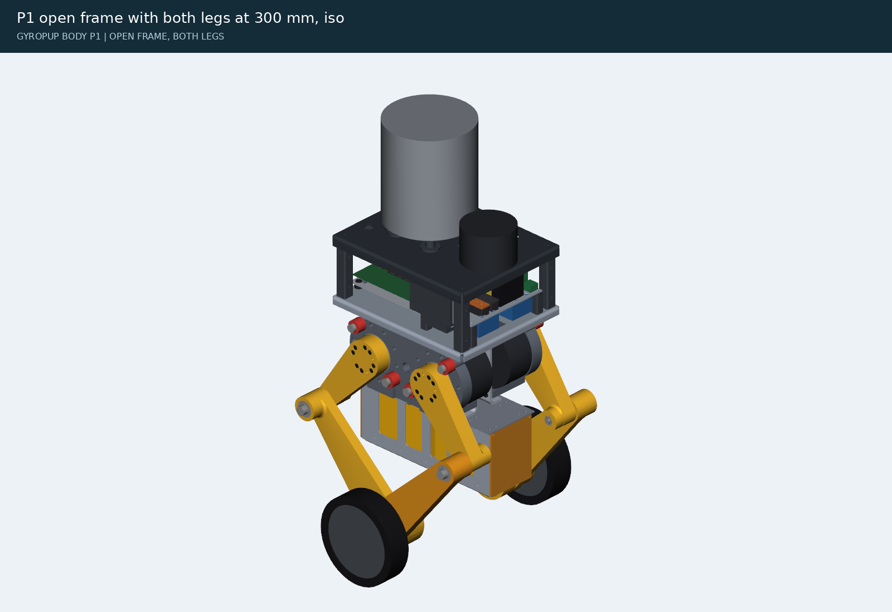

# Body frame: the open frame as built (P1), and what changed from the plan

The body's structure as `cad/body_frame.py` builds it (milestone M5, tasks T1-T3, T6, T8 of docs/body-plan.md):
the spine that carries both hip frames, the floor tray, the belly plate with the battery drawer under it, the deck
with the lidar and the turret's riser, the compute pallet, and the power plate that is the P0 skid. Numbers come
from `exports/body/body.json`, `mass.json`, `fea/summary.json` and `leg-loads.json`; regenerate them with
`cad/build_body.py`, `cad/body_legloads.py` and `cad/body_studies.py`. Orders: docs/body-orders.md. Electrics:
docs/body-electrical.md. Hazards: docs/body-safety.md. Decisions D43-D45, D54-D56. Written 2026-10-27.

## 1. The parts

| Part | Made | What it does |
|---|---|---|
| 2 x cheek | SendCutSend 5052-H32 3/16 in, a C-channel 184 long, 181 tall, 30 mm flanges outwards, 8 PEM SS-M5-0 | each hip frame bolts to its cheek's outer face with its six M5 inserts (x 0, ±83, z ±70: `fivebar.frame_mounts()`), six M5 x 12 ISO 7380 from inside the gap; one part for both sides, as one hip frame serves both legs |
| 8 x standoff | McMaster 95947A065, aluminium M4 x 31, 6 mm hex | between the cheeks in the hip frames' bolt rows (x ±10, ±72; z ±67.5): they carry each leg's roll moment straight across to the other frame; M4 x 10 flat heads flush on the frame side |
| floor tray | SendCutSend 5052-H32 1/8 in, 320 x 254, 15 mm lips down | on the cheeks' upper flanges (z 90.5); carries the compute pallet, the power skid's posts, the DDR-120C, the VN-100 and the deck posts |
| belly plate | SendCutSend 6061-T6 0.100 in, 320 x 116 | under the cheeks' lower flanges; the battery drawer hangs from its twelve nuts; 116 wide so the knee eyes keep 25 mm |
| deck | SendCutSend 5052-H32 0.100 in, 320 x 254, lips down | z 216 (the sim's TOP); the VLP-16 (x 103, 143 mm ahead of the turret's pan axis at x -40: the turret's depression table is computed for that), the riser, the fan intake field, the lidar cable pass, the turret harness grommet (right rear) |
| compute pallet | SendCutSend 6061-T6 0.125 in, countersunk | the J501 carrier on four M3 x 16 standoffs and the cooler's tie-down, on four printed TPU isolators |
| power plate | SendCutSend 5052-H32 0.100 in, 16 flush PEM nuts | the P0 power skid: switch, MRBF, bus bars, fuses, shunt, DDR-60L-12, MCU board, 5 V buck on top; the VESCs and the switch hang under it; on four printed posts (42 mm) |
| 2 x bus bar | SendCutSend C110 copper 0.125 in, cut only, five Ø6.4 holes | + and -, on printed PA6-CF insulators (14 mm) with a nyloc nut held under each hole: the lugs' M6 x 16 screws go into them (SendCutSend taps no part under 1 in wide) |
| 4 x deck post, riser, 4 x plate post, 2 x bus insulator, 2 x DIN rail | printed PA6-CF | heat-set M5 (M3 for the insulators) inserts |
| battery bay (2 halves, door), 4 x skid, 4 x isolator | printed PETG, TPU 95A | the battery drawer (a bent 5052 box in P3), the belly's skids, the pallet's isolators |

Track 414.3 mm (the spine 40.5 mm between the frames' faces); spine top z 90.5; tray top 93.0; belly bottom -93.0;
deck top 216. The SendCutSend rules (bend radius, K, the half-die distance from bends, PEM edge distances, the
channel's 2x rule, countersink depth) are checked on every part by `cad/body_sheet.py`: none broken.

## 2. What changed from the plan, and why

| Plan (docs/body-plan.md) | Built | Why |
|---|---|---|
| A one-piece U spine, 36 wide x 150 deep, 1/8 in 5052 | two C-channel cheeks on standoffs | SendCutSend bends a channel only if its base is at least twice its flanges: a 36 mm base cannot carry 150 mm sides |
| 1/8 in sheet; a 0.100 in tray | 3/16 in cheeks; a 1/8 in tray | at the rig's loads (section 3) no standoff layout passed with 1/8 in cheeks (SF 0.6); 3/16 in passes with eight standoffs in the bolt rows. The tray overhangs the cheeks' ends to the deck posts: 0.100 in was SF 1.55 at the landing, 1/8 in is 2.5 |
| track 415.8 (spine 42) | 414.3 (spine 40.5) | McMaster's M4 standoffs come in 30, 31 and 37 mm; 31 keeps the track |
| spine top z 78 | z 90.5 | the cheek's bend needs half a die (12.5 mm for 3/16 in) clear of the frame's M5 holes, which moved to z ±70 with the leg's 13 mm flanges (main cdda86d) |
| battery cassette in the tray, 13S2P P50B, JK BMS | a 13S2P P30B drawer under the belly, Daly K BMS | the JK BMS (162 x 102 mm) fits no cassette; the tray could not hold the cassette, the J501, the converters and the VESCs; P30B saves 0.6 kg (D54) |
| power parts on the belly plate | one power plate on posts over the tray's front half | built and tested on the bench as one skid (P0), dropped in on four posts; the tray's middle is covered by the cheeks' flanges, where nothing can be screwed |
| 10 x 38 gPV fuses on DIN | MINI 58V blade fuses | the gPV holders stand 83 mm off the rail and need 193 mm of it (D45) |
| belly plate 160 wide | 116 wide | the knee eyes sweep past at \|y\| 83: 3 mm from a 160 mm plate's edge, a shear point; 25 mm from 116 |
| lidar at x 108.35 | x 103 | its front pin hole was 2.8 mm from the deck's front bend (SendCutSend: 8 mm) |
| the J501's WS-RDN-601 cooler (34 mm) | the fitted G48R (50.3 mm, 9215 fan) from the j501-agx project | the user's photos: the G48R is fitted; its fins blow out at ±y, so the lidar's box and cable coil moved behind it |
| M5 x 16 frame screws | M5 x 12 | 16 bottoms out in the insert's 11 mm pilot through a 3/16 in cheek |
| the turret harness grommet at (-130, +60), the left rear | (-130, -60), the right rear | the turret's DT12 plug is on its right; its 300 mm pigtail does not reach the left (docs/turret-next-plan.md 3.1) |
| the head at 1.34 kg | 1.70 kg, its centre 100 mm above the turret-mount face | the turret plan's head budget (1.639 kg with 30 balls today); `body_params.tm()` reads exports/turret/mount.json when the turret publishes it |
| a stop relay per safety loop | one DPDT stop relay: the turret's dry loop and its 24 V branch | the turret plan asks for a second pole of the same relay in its 24 V branch (docs/turret-next-plan.md 3.2) |

## 3. Strength

The loads are the leg's reactions where they enter the body (D56): `cad/body_legloads.py` runs the leg rig at half
the ledger's robot mass and takes, every step, the vertical force and the roll moment at the hip frame's mount plane
by d'Alembert on the leg module (the rig's own ballast force checks the vertical within 2 %). The axle's peak force is
mostly the wheel and links decelerating against the ground: the body sees 0.4-0.5 of the axle force times its 187 mm
offset. FEA: `cad/body_studies.py` (cadagent.fea, second-order tets, 5052-H32's 193 MPa yield for every part), with
overload videos (R43) in `exports/body/fea/`.

Body loads at 15.97 kg a leg (the ledger's 31.94 kg robot when they were run; it is 32.27 kg now with the turret's 1.70 kg budget and the 1/8 in tray, 1 % more, well inside the margins below): rare 204.7 N m of roll (drop_150), fault 275.1 N m (power_off); the axle's peaks were 2367.8 N and 1661.7 N.

| Case | Load | Target | SF (away from the standoffs' ends) | Max deflection | Result |
|---|---|---|---|---|---|
| [S1-landing](../exports/body/fea/S1-landing.mp4) | rig 'drop_150' at 15.97 kg a leg (axle 2212 N): 205 N m roll and 558 N up at the hip frame's mount plane, plus 10 % of the 2990 N ground force sideways at the contact patch on BOTH legs; the payload's inertia on the tray | 2.0 | 1.52 (4.42) | 0.0868 mm | pass |
| [S1F-collapse](../exports/body/fea/S1F-collapse.mp4) | rig 'power_off' at 15.97 kg a leg (axle 1662 N): 275 N m roll and 964 N up at the hip frame's mount plane, plus 10 % of the 1672 N ground force sideways at the contact patch on BOTH legs (the undamped power cut, D39); pa | 1.2 | 1.7 (2.88) | 0.12 mm | pass |
| [S1b-one-leg-bound](../exports/body/fea/S1b-one-leg-bound.mp4) | rig 'drop_150' at 15.97 kg a leg (axle 2212 N): 205 N m roll and 558 N up at the hip frame's mount plane, plus 10 % of the 2990 N ground force sideways at the contact patch on ONE leg, the other cheek clamped: every newt | 2.0 | 1.68 (2.8) | 0.0802 mm | pass |
| [S2-twist](../exports/body/fea/S2-twist.mp4) | one leg's 80 N m roll moment (the HM budget) against the other's | 2.0 | 7.94 | 0.0156 mm; twist 0.0126 deg (target 0.1) | pass |
| [S3-pitch](../exports/body/fea/S3-pitch.mp4) | the two motors' 60 N m caps reacted as one 120 N m couple about y, and 600 N fore-aft (the HM budget) | 2.0 | 27.34 | 0.003 mm | pass |
| [D1-hand-front](../exports/body/fea/D1-hand-front.mp4) | 300 N down on the deck at the front (a child leaning on it) | 2.0 | 2.53 | 0.4685 mm; 0.328 mm at the load (target 0.5) | pass |
| [D1-hand-riser](../exports/body/fea/D1-hand-riser.mp4) | 300 N down on the deck at the riser (a child leaning on it) | 2.0 | 2.89 | 0.5143 mm; 0.383 mm at the load (target 0.5) | pass |
| [D2-turret-fall](../exports/body/fea/D2-turret-fall.mp4) | a 30 g fall of the 1.70 kg head (the turret plan's budget) at 45 deg, its centre 100 mm above the TM face: a tip-over, an abuse case like the power cut (SF >= 1.2) | 1.2 | 1.31 | 1.5506 mm | pass |
| [T1-tray](../exports/body/fea/T1-tray.mp4) | what stands on the floor tray at 8.65 g (the body's landing peak from the rig): the compute 1.39 kg on its isolators, the power skid 1.71 kg on its posts, the deck with the lidar and turret 3.69 kg on the deck posts, the | 2.0 | 2.5 | 0.4797 mm | pass |

The spine's lowest numbers are at the standoffs' ends, where a bonded hex meets the web: a corner the linear model
makes singular (its stress rises with every mesh refinement) and the real joint does not have (the standoff is
clamped by an M4 screw). Away from those ends (4 mm) the spine is at the factor in brackets. By hand, each standoff
carries at most about 0.5 kN (the bolt row's 2 kN couple over four), against an M4 8.8 screw's 5 kN proof load and
the aluminium thread's ~4 kN strip.

## 4. Mass and centre of mass

D57 (docs/body-next-plan.md 2.4): the robot is **designed for 32.5 kg** (16.25 kg a leg) in every strength case, and
**held under 32.0 kg as built** (each leg under 9.6 kg, the body and head under 12.8 kg). The plan's 28.5 / 10.3 kg
budget is retired. `cad/body_layout.py` keeps the ledger (`ledger()`, `BUDGET`, `LEVERS`), writes it to
`exports/body/mass.json` (`.venv/bin/python cad/body_layout.py --ledger` alone, or with the whole build), and
`cad/test_body.py test_the_mass_ledger_under_the_ceiling` gates every commit: the P3 ledger, with every scheduled
lever that is not in the CAD yet taken at its planned grams, must be under the ceiling; once the scheduled levers are
all in the CAD, the ledger itself must be. Over it, the on-call levers go in order (10, 11, 12, ...) before the next
part is ordered.

| Stage | Robot | Legs | Body and head | COM (x, y, z) mm at a 300 mm stance | Groups (kg) |
|---|---|---|---|---|---|
| P1 | 29.18 kg | 18.96 kg | 10.22 kg | [3.4, 0.5, -43.9] | legs 18.96, frame 4.32, compute 1.51, power 2.02, deck 0.83, battery 1.54 |
| P3 | 32.28 kg (ceiling 32.0: 0.28 over) | 18.96 kg (9.48 each, under 9.6) | 13.31 kg | [1.3, 0.4, -15.8] | legs 18.96, frame 4.32, compute 1.51, power 2.02, deck 2.53, battery 1.54, shell 1.40 |
| P3 with the scheduled levers | **31.58 kg** (gate: pass) | 18.96 kg | 12.61 kg (under 12.8) | | the nine scheduled levers below, -705 g |

P1 is the open frame with the battery, compute, power skid and lidar; P3 adds the turret and the shell. The legs are
exports/leg/leg.json's 9,282 g each plus the 200 g the leg workstream announced for its 13 mm flanges and stops (D53
says 204 g); the ledger takes leg.json's total as it is once the leg publishes a total other than 9,282 g.

The levers (docs/body-next-plan.md 2.3; each one's status is read from the CAD, never typed):

| # | Lever | g | Cost | Stage | Kind | Status |
|---|---|---|---|---|---|---|
| 1 | shell panels in 2 mm PETG with ribs instead of 3 mm | -240 | $0 | P3 | scheduled | open |
| 2 | floor tray Rev B: lightening cutouts | -150 | $62 | P3 | scheduled | open |
| 3 | deck Rev B: cutouts outside the lidar, TM pattern and intake field | -120 | $65 | P3 | scheduled | open |
| 4 | the turret mount plate (D59), 6061-T6 0.125 in | +135 | $25 | P2 | scheduled | open |
| 5 | deck posts printed hollow | -100 | $0 | P2 | scheduled | open |
| 6 | compute pallet cutouts | -60 | $30 | P3 | scheduled | open |
| 7 | the fuse board (D60) instead of ten inline holders | -35 | $20 | P3 | scheduled | open |
| 8 | the 1 mOhm shunt on the fuse board instead of the Blue Sea block | -75 | $3 | P3 | scheduled | open |
| 9 | the main path in 10 AWG, the VESC leads in 14 AWG | -60 | $25 | P2 | scheduled | open |
| 10 | Pololu D42V110F12 instead of the DDR-60L-12 (when restocked) | -200 | $69.95 | P3 | on call | open |
| 11 | cheeks Rev B (holes in the web, or 1/8 in with more standoffs) | -150 to -330 | $120 | P3 | on call | open |
| 12 | aluminium hex standoffs instead of the printed deck posts | -80 | ~$30 | P3 | on call | open |
| 13 | the 34 mm WS-RDN-601 cooler instead of the G48R (the user's call) | -200 | $49 | P3 | on call | open |
| 14 | the lidar cable shortened to 1 m (a Velodyne waiver) | -150 | $0 | P3 | on call | open |
| 15 | the turret's own levers (its plan) | -51 | $0 | P2 | on call | open |

The centre of mass is inside ±10 mm (x) and ±5 mm (y) at P1 and P3. The harness (400 g), hardware (300 g) and the
G48R cooler (450 g) are estimates until P0 and P1 are weighed (B12, B14).

## 5. Clearance to the legs

The clash sweep (`cad/build_body.py`) poses both legs at 22 stances (leg lengths and leans across the range): **0 clashes**. The moving parts' nearest approaches to the body (ISO 13854's 25 mm for fingers):

| Leg part | Body part | mm | Stance (length, lean) |
|---|---|---|---|
| upper_link_front | belly_plate | 25.06 | [280.0, 0.0] |
| upper_link_rear | belly_plate | 25.06 | [280.0, 0.0] |
| knee_pin_front | belly_plate | 28.36 | [280.0, 0.0] |
| knee_pin_rear | belly_plate | 28.36 | [280.0, 0.0] |
| knee_nut_upper_front | belly_plate | 28.79 | [280.0, 0.0] |
| knee_nut_upper_rear | belly_plate | 28.79 | [280.0, 0.0] |
| knee_pin_front | bay_front | 30.97 | [300.0, 0.0] |
| knee_pin_rear | bay_front | 30.97 | [300.0, 0.0] |
| knee_pin_front | bay_rear | 32.76 | [300.0, 0.0] |
| knee_pin_rear | bay_rear | 32.76 | [300.0, 0.0] |

The battery bay's door was narrowed after the sweep found it 23.7 mm from the knee pins at the 320 mm stance; it is 29 mm now (checked separately).

## 6. Building the P1 frame

1. **P0 first** (docs/body-electrical.md 6): the power plate with all its parts, tested on the bench.
2. **The box**: the eight standoffs between the two cheeks (M4 x 10 flat heads from outside, 2.5 N m, threadlocker),
   the cheeks' flange nuts outwards.
3. **The hip frames**: each frame onto its cheek's outer face, six M5 x 12 button heads from inside the gap (a 3 mm
   ball-end key; start each screw by hand: the gap is 31 mm), 3 N m. The motors' harnesses leave forwards and backwards
   past the cheeks' ends (`fivebar.harness_angle()`), turn into the spine's gap at its ends and run up through the tray's
   slot.
4. **The belly plate** under the lower flanges (eight M5 x 10 up into the cheeks' nuts), then the battery drawer
   (twelve M5 x 10 up into the belly's nuts).
5. **The floor tray** on the upper flanges (eight M5 x 10 down into the cheeks' nuts); the DDR-120C's rail, the VN-100,
   the pallet's isolators.
6. **The compute**: the pallet on its isolators, the J501 on its standoffs, the cooler tied down from below (the
   j501-agx rule: 4 x M3 x 35 flat heads).
7. **The power plate** on its four posts; its leads to the legs, the pack and the converters as the wire list.
8. **The deck** on its four posts, with the VLP-16, the lidar box and coil, the riser; the turret (P2) last.

## 7. Open items

- The Flipsky switch's side, the BMS's short-circuit trip and mass, the charger's 90 % voltage (docs/body-electrical.md 7).
- The M3 x 35 flat heads, the VLP-16's 1/4-20 screw and dowels, the bus bars' M3 x 8 screws: specified, product page
  to read (bom.json `to_source`).
- The leg's mass after its stop redesign (+0.2 kg a leg is in the ledger until exports/leg/leg.json carries it).
- The P3 shell, guards and thermal (T7), the sim on the real body (T4), the firmware (T9), the dock (T10).
