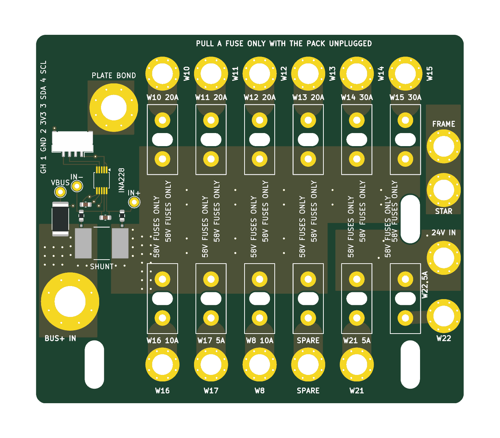
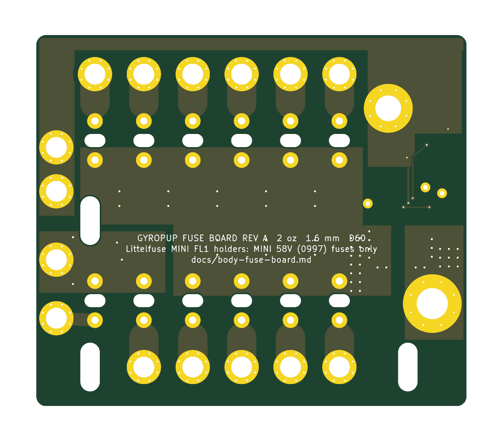

# The fuse board (D60, task B5)

One JLCPCB board that takes the place of the eleven inline MINI holders and the Blue Sea shunt on the power plate in
P3: twelve MINI 58V fuse holders, the 1 mOhm shunt and the INA228 that reads it, the - star point and the frame bond.
Everything here is generated: `hardware/fuse-board/design.py` (parts, nets, placement), `generate.py` (the KiCad 10
schematic and PCB), `build.sh` (checks, fabrication files, pictures), `analysis.py` (the numbers below), and
`cad/body_fuse_board.py` (the board as the body sees it). Written 2026-10-27; prices read that day.

| | |
|---|---|
| Board | 88 x 76 mm, 2 layers, 2 oz (70 um) copper, 1.6 mm FR-4, lead-free HASL, green |
| Where | robot x 34..122, y -14..62 on the power plate's top face (z 138.2); the board at z 148.2..149.8 on 10 mm printed standoffs; fuse tops at z 174.2 |
| Holders | 12 x Littelfuse MINI FL1 178.6764.0001 (58 V DC, 22 A continuous, fuses to 30 A): ten on the + bus, two on the 24 V rail |
| Shunt | Bourns CSS2H-3920R-1L00F, 1 mOhm 1 %, 8 W, on the **high side** between the MRBF and the + bus |
| Monitor | INA228 (U1, TSSOP-10) on the board, or the Adafruit 5832 wired to three pads (TP1-TP3); I2C on a JST GH 4-pin |
| Studs | M6 for the 80 A input; M4 for every branch, the 24 V input, the star point and the frame bond |
| Checks | KiCad DRC clean against JLCPCB's 2 oz rules, schematic parity 0, ERC 0 (`hardware/fuse-board/reports/`) |
| Price | JLCPCB $40.60 for 5 boards (instant price from the uploaded zip); one board built for $156.70 in parts and packs |
| Mass | 132 g with its screws, nuts and standoffs (45 g the bare board with its holders) |

## 1. What changed from the brief, and why

**The shunt is on the + side, not in the pack's - lead.** The brief put the 1 mOhm shunt where the Blue Sea shunt is
today (W5, W6, W9: between the XT90's - and the main switch's IN-). The INA228's inputs may not go more than 0.3 V
below its own ground (TI SLYS021A, absolute maximum, both pins). Its ground is the MCU's, the switched - bus. With the
shunt in the pack's - lead before the low-side switch, turning the switch off lets the - bus float up toward the + bus
(the loads pull it there) while the INA228's inputs stay at the pack's -: its input clamps then carry the robot's load
current round the open switch, which destroys the INA228 and leaves the switch bypassed through a 22 AWG sense lead.
On the + side the INA228's inputs sit 0 to 57 V above its ground whether the switch is on or off, which is the INA228's
own high-side application (TI's figure 8-2, charger on the load side of the shunt). The charge is still counted: the
charge port's 10 A fuse (F9) hangs off the board's + bus, after the shunt, so the charger's current runs back through
the shunt and the MRBF into the pack (it reads with the opposite sign). The low-side fix, an isolated INA228 (I2C
isolator and a 1 W isolated supply), was the alternative: more parts for the same result.

**This applies to P0 as wired today**: the Adafruit INA228 across the Blue Sea shunt in the - lead, grounded on the
MCU, sees exactly this when the switch goes off. Before bring-up step 4 either move the Blue Sea shunt into the + lead
(MRBF load stud to the + bus bar's tap 1; W8 then lands on the + bus bar with its inline 10 A fuse, W9 on the switch's
IN-), or leave the INA228's VIN+/VIN- unconnected until the board arrives.

**Littelfuse MINI FL1 holders, not Keystone 3568.** Keystone rates the 3568 at 20 A at 500 V AC with no DC rating
(Keystone catalogs M55, 2006, and M60, 2013, page 40; TME lists 20 A; some distributors list 30 A without a source;
Keystone's own drawing, rev C 2019, states none), so it does not carry the VESC branches' 30 A fuses. The 3570 is not a
MINI holder (a 6.3 x 32 mm fuse clip; LCSC lists no specification). The Littelfuse MINI FL1 (178.6764.0001) is
rated 58 V DC, 22 A continuous, for MINI fuses up to 30 A (Littelfuse's product page, read 2026-10-27; its 2016
datasheet says 125 V, LCSC's text 32 V). It is the only PCB MINI holder found with a DC rating at the bus voltage, so
D55's "32 V holder on a 53 V bus" ends with it; the "58 V FUSES ONLY" silk stays at every holder because a standard
32 V MINI fuse may still fit it (check on arrival whether one seats). The holder's 22 A continuous sets a rule for
the wheels: **the VESCs' battery current limit at 20 A** (VESC Tool, "Battery Current Max"; the motor current limit can
stay higher, the battery current at low speed is a fraction of it). The 30 A fuses stay (the fuse's own derating puts
its continuous load at 22-24 A at 40-60 C).

**88 x 76, not 120 x 42.** A holder and its stud need about 27 mm in line (the 14.2 mm holder, its output run, a 7 mm
stud and the lug's edge) and 10 mm across (the M4 lugs side by side). Twelve in one row is 120 mm long and 27 mm deep,
which leaves 15 mm of the 42 for the + bus feeding them and nothing for the M6 input, the shunt, the INA228, the 24 V
input or the star and frame studs; two rows back to back with the bus between them need about 66 mm of depth. The
board takes the whole free area of the plate (x 34..122, y -14..62).
It sits 36 mm tall over the plate (10 mm standoffs, the holder and the fuse), 6 mm more than the brief's 30: the deck's
underside is at z 213.5, 39 mm above the fuses.

## 2. The schematic in words

`hardware/fuse-board/pictures/schematic.pdf`; the nets are global labels named as below.

- **+BAT_IN**: J1, the M6 stud the MRBF's load stud feeds (W4, 8 AWG), poured on both layers to the shunt's pad 1.
- **R1**, the shunt: pad 1 +BAT_IN, pad 4 **+BUS**. Its Kelvin taps (pads 2 and 3, net-tied to 1 and 4 inside the
  footprint) sit at Bourns' measurement points, 8.40 mm apart, and leave sideways of the current.
- **+BUS**: a band poured on both layers between the two rows of holders, stitched with 36 vias; it feeds F1-F10.
- **+24V**: J14 (W40 from the DDR-120C-24's +V) to F11 and F12, its own pour.
- **F1-F12**: each holder's pin 2 runs to its own M4 stud (J2-J13): OUT_W10 ... OUT_W22, OUT_SPARE.
- **The INA228**: R2 and R3 (10 Ohm, TI's protection against a hard short's dV/dt) from the taps to IN- and IN+; C1
  (100 nF, 100 V) across them; VBUS through R4 (4.7 kOhm, 1 W 2512: 11 mA if VBUS ever shorts) from +BAT_IN; VS on
  3V3 with C2; A0 and A1 to ground (address 0x40); ALERT not connected (the firmware polls). IN+ is the bus side:
  **positive current is charging**, discharge reads negative.
- **J17** (JST GH 4, SM04B-GHS-TB): 1 GND, 2 3V3, 3 SDA, 4 SCL, to the MCU carrier (W42); the I2C pull-ups (4.7 kOhm)
  are on the carrier. The order is the board's, chosen so the four lines leave the INA228 without crossing; the body
  makes this lead.
- **The Adafruit 5832 instead of U1** (U1 is not fitted while LCSC has none): its 15 mOhm shunt removed and its VBUS
  jumper open, VIN+ to TP2, VIN- to TP1, VBUS to TP3, its STEMMA QT lead to the MCU, mounted on the MCU carrier as in
  P0. Not both: both answer at 0x40. TP1-TP3 are also the meter's Kelvin points for the calibration.
- **BUS-** (the switched - bus): J15, the star stud (W23, W27, and W41 from the - bus bar), J16, the frame-bond stud
  (W33 on its own stud, so the bond is never loosened with the star), MH1 (the plate bond), U1's ground and J17's
  ground, joined by a strip on the bottom along the north edge.

## 3. Layout and mounting

The holders stand in two rows of six across the robot, 10 mm apart, inputs toward the + bus band between the rows,
outputs outward to a row of studs on each long edge: the four RS-04s and the two VESCs along the board's left edge
(+y, toward the MCU board), the converters, the charge port, the spare and the J501 along its right edge (-y, toward
the bus bars), the turret, the 24 V input and the star and frame studs at its front (+x, beside the MRBF block). The
power entry (J1, the shunt) and the INA228 are in the strip at its rear (-x); MH1 sits on the plate's old shunt nut.

**Mounting** (all into features the P1 plate already has):

- **MH1**, robot (50, 47): an M5 x 14 socket head (91290A230) down through the plated hole and a printed standoff
  (OD 12, 10 mm) into the plate's flush nut (the Blue Sea shunt's base nut). It bonds the plate to the - bus: the
  plate stands on printed posts and was otherwise floating under every + lead of the skid (hazard 10).
- **Three cable ties** (7130K12) through the plate's old fuse-bundle slots at (46, -6), (111, -6) and (111, 24), a
  printed tie block (10 mm, a 4 x 10 slot through it) and the board's own 4 x 10 slots, round the block.
- **Every stud is its own standoff**: a printed foot (OD 12 for M4, 16 for M6, 10 mm) under the stud with a hex pocket
  at its top holding the nyloc (M4: 7.2 AF x 5.3; M6: 10.2 AF x 6.3) and the screw's hole through it. The lug sits on
  the top pad and the screw goes down through the lug and the board into the nut: copper to copper, serviced from
  above, as the bus bars' insulators hold their nuts. M4 x 12 (91290A148) at every M4 stud (with one 18 AWG ring the
  tip stops 0.4 mm short of the plate, with the star's three rings 2.0 mm), M6 x 12 (91290A318) at J1.
- **Print them in PETG** (PA6-GF if the plate runs over 60 C), **never a carbon-filled filament**: the standoffs hold
  nuts at different potentials. Bambu publishes no resistivity for PA6-CF and chopped carbon fibre in nylon ranges
  from dissipative to conductive; the same question stands for the bus bars' PA6-CF insulators (section 10).
- Under the board stay clear of the two VESC flange screws whose tips stand 4.5 mm above the plate at (41, 29.15)
  and (41, 56.15): no stud is over them.

The layout item for `cad/body_layout.py` is `body_fuse_board.LAYOUT_ITEM` (name `plate_fuse_board`, which is what
`lever_taken('fuse_board')` looks for): it replaces `plate_fuses` and `plate_shunt`; the board's mass and box come from
`cad/body_fuse_board.py`.

## 4. The copper

IPC-2221B's external-conductor curve, per layer, with each conductor's current split equally between the two layers
(they meet at every holder pin and at every stud's ring of vias). Its charts stop at 35 A and 10.2 mm; beyond them it
is extrapolated and marked so. Fault let-through against the copper: IEC 60949's adiabatic K for copper from 60 to
200 C against the fuse's typical pre-arcing I^2t (Littelfuse 0997 datasheet).

| Holder | Branch | Fuse | Copper (each layer) | IPC-2221 width needed for +20 C | Rise at the fuse's rating | Neck past the peg (2.6 x 3.6 mm) | Fault I^2t margin |
|---|---|---|---|---|---|---|---|
| F1-F4 | RS-04 x 4 (W10-W13) | 20 A | 6.0 mm | 2.4 mm | 4.3 C | +0.2 C | 6.9 |
| F5, F6 | VESC L, R (W14, W15) | 30 A | 6.0 mm | 4.1 mm | 10.8 C | +0.5 C | 2.4 |
| F7 | DDR-120C-24 in (W16) | 10 A | 6.0 mm | 0.9 mm | 0.9 C | 0 | 28 |
| F8 | DDR-60L-12 in (W17) | 5 A | 6.0 mm | 0.4 mm | 0.2 C | 0 | 105 |
| F9 | charge port (W8) | 10 A | 6.0 mm | 0.9 mm | 0.9 C | 0 | 28 |
| F10 | spare (sized for 30 A) | - | 6.0 mm | 4.1 mm | 10.8 C | +0.5 C | 2.4 |
| F11 | J501 24 V (W21) | 5 A | 6.0 mm | 0.4 mm | 0.2 C | 0 | 105 |
| F12 | turret 24 V (W22) | 5 A | 2.6 mm | 0.4 mm | 0.7 C | 0 | 105 |

Every branch carries its fuse's rating at a few degrees; the heat at a holder is the fuse's own (2.6 W in a 30 A
MINI at its rating, 1.9 W in a 20 A), which is why the holders are 10 mm apart. The neck is where the 6 mm run passes
the holder's peg slot; it is 3.6 mm long between two large copper ends and rises half a degree.

**The main path** (J1, the shunt, the + bus band):

| Section | Copper | At 40 A | At 80 A (extrapolated) | The 80 A, 0.3 s jump pulse |
|---|---|---|---|---|
| +BAT_IN pour, J1 to the shunt | 12 mm, both layers, 14 vias at the shunt | +6.6 C | +32 C | +3.4 C |
| + bus band beside the shunt | 14.4 mm, both layers, 20 vias at the shunt | +4.9 C | +24 C | +2.4 C |
| + bus band toward the holders | 30 mm, both layers, 16 vias | +1.5 C | +7 C | +0.5 C |

The shunt's pads are on the top only, so the bottom layer's half comes up through the vias beside them: 1.4 A a via
at 40 A, 2.9 A for the 0.3 s pulse. **The board's continuous rating is 40 A**, set by the shunt, not the copper: its
8 W rating needs its terminals under 70 C, and with about 21 C/W from its pads into the pours it reaches about 34 C
over the board at 40 A (1.6 W) and would reach about 130 C at 80 A continuous (6.4 W). The jump's 80 A for 0.3 s is
1.9 J (the shunt's short-time rating is 5 x 8 W for 5 s), and the board takes 80 A for up to about 30 s. The duty
the plan gives (80 A pulses, a few amps on average) is far inside this; the INA228's alert or the firmware can
watch the RMS if a stalled motor ever holds the bus near 40 A.

**Clearances** (`fuse-board.kicad_dru`): 1.0 mm between every pair of different power nets and between power and
logic (IPC-2221B 51-100 V: 0.6 mm uncoated external, B2); 0.2 mm inside the shunt group (+BAT_IN, +BUS and the sense
lines differ by at most the shunt's 80 mV); 0.25 mm where the sense lines escape the INA228's 0.5 mm pins beside its
ground and logic (TI's own package puts VBUS 0.2 mm from GND; IPC-2221B B4, coated: 0.13 mm); the INA228's pin pitch
itself exempt. Copper is at least 0.3 mm from every edge and NPTH.

## 5. The INA228's accuracy

The error budget in % of reading (`analysis.py`); the board between 15 and 55 C, calibrated at 25 C.

| Source | Value | Removed by the calibration |
|---|---|---|
| Shunt tolerance | 1.0 % | yes |
| Kelvin taps at Bourns' measurement points (pad copper, solder) | 0.5 % (allowance) | yes |
| INA228 gain error (max) | 0.05 % | yes |
| 10 Ohm input resistors against the 92 kOhm input | 0.022 % | yes |
| Shunt TCR, 100 ppm/C with its copper terminals, over 30 C | 0.30 % | no |
| Shunt self-heating (12.5 C/W to its terminals; the 80 A pulse adiabatic) | 0.02-0.20 % | no |
| INA228 gain drift, 20 ppm/C over 30 C | 0.06 % | no |
| Offset 1 uV + drift 0.3 uV + CMRR 154 dB at 53 V 0.1 uV + thermal EMF 3 uV | 5.4 uV (0.27 % at 2 A) | no |
| The calibrating meter (10 A range) | 0.3 % | - |

| Current | Uncalibrated, worst case | Uncalibrated, RSS | Calibrated, worst case | Calibrated, RSS |
|---|---|---|---|---|
| 1 A | 2.47 % | 1.28 % | 1.20 % | 0.69 % |
| 2 A | 2.20 % | 1.19 % | 0.93 % | 0.51 % |
| 5 A | 2.04 % | 1.17 % | 0.77 % | 0.44 % |
| 10 A | 2.00 % | 1.16 % | 0.73 % | 0.43 % |
| 40 A | 2.15 % | 1.18 % | 0.87 % | 0.47 % |
| 80 A (0.3 s) | 2.13 % | 1.18 % | 0.85 % | 0.47 % |

**Result: within 1 % of reading from 2 A to 80 A after a one-point calibration; not within 1 % without it** (the
shunt's own 1 % and the layout allowance are most of the error). Below 2 A the floor is about 5 mA plus 0.7 % of
reading. **The calibration** (bring-up step 5, which already compares the INA228 with a meter): 5-10 A from a bench
supply through the shunt (or a dummy load on the 24 V rail), read on a meter with 0.3 % or better on its 10 A range;
set the firmware's scale (or SHUNT_CAL) so the INA228 agrees; record the factor in the build log. VBUS the same against
the meter's DC volts (its 4.7 kOhm in series with the 1 MOhm VBUS input reads 0.47 % low before calibration). The
INA228's SHUNT_TEMPCO can take the shunt's 100 ppm/C against the die temperature: the two sit 10 mm apart on the same
copper.

## 6. JLCPCB

- **Rules** (`fuse-board.kicad_pro`, `fuse-board.kicad_dru`), from jlcpcb.com/capabilities/pcb-capabilities read
  2026-10-27: 2 oz, 2 layers: track and space 0.16 mm (we use 0.2 minimum), PTH annular ring 0.254 mm (vias 0.3/0.85
  and 0.4/0.95, rings 0.275 mm), pad hole-to-hole 0.45 mm, copper to edge 0.2 mm (we use 0.3), NPTH slot width 1.0 mm
  (ours 2.7 and 4.0), legend line 0.15 mm and text 1.0 mm.
- **Checks**: `build.sh` runs KiCad's DRC with zone refill and schematic parity and fails on any violation: 0
  violations, 0 unconnected, 0 parity issues; ERC 0. The upload to JLCPCB parsed it as "2 layer board of 76x88mm" and
  priced it; JLCPCB's own engineering review of the files happens after an order is placed (not run: it needs an order).
- **Files**: `fab/fuse-board-gerbers.zip` (copper, mask, paste, silk, outline, PTH and NPTH drills with the oval slots
  as G85); `fab/bom-jlcpcb.csv` and `fab/cpl-jlcpcb.csv` for the seven SMD parts if JLCPCB assembles them (check the
  shunt's, the 2512's and the GH's rotation in JLCPCB's placement preview).
- **Instant price**, read with `jlcpcb_quote.py` from the uploaded zip (no account): **$40.60 for 5 boards** (2 oz
  outer copper $35.30 of it, lead-free HASL $1.30), $38.60 from JLCPCB's desktop app; DHL estimate $31.49; 3 days.
  Choose: 2 layers, 1.6 mm, 5 pieces, green, lead-free HASL, **2 oz outer copper**, everything else default.
- **Assembly** is optional: about $31 for two boards by JLCPCB's published Economic PCBA fees ($8.18 setup, $1.53
  stencil, $3.07 for each extended part) plus the parts; an estimate, since its BOM step asks for a sign-in. The
  default below is hand assembly: the shunt on its 2 oz pours wants a hot plate or hot air with preheat, the rest is
  0603 and a 1.25 mm GH.

## 7. Parts and prices

One board built from a 5-board PCB order (`cad/body_fuse_board.py ORDER`, the catalogue's entries):

| Part | Catalogue key | Qty | Seller (backup) | Paid |
|---|---|---|---|---|
| PCB, 5 boards | fuse_board_pcb | 1 order | JLCPCB (PCBWay) | $40.60 |
| Littelfuse MINI FL1 holder | fuse_holder_mini_pcb | 14 (2 spare) | LCSC C142933 $1.67 (TME $4.56) | $23.38 |
| Bourns CSS2H-3920R-1L00F shunt | shunt_1mohm_3920 | 2 | LCSC C4087295 $0.78 (C1848566 $1.50) | $1.57 |
| 10 Ohm 0603, 100 nF 100 V and 50 V 0603, 4.7 kOhm 2512 | res_10r_0603, cap_100n_100v_0603, cap_100n_50v_0603, res_4k7_2512 | LCSC minimums | LCSC (alternates listed) | $1.95 |
| JST GH 4 header, housings, 4 pre-crimped wires | gh_header_4p_smd, gh_housing_4p, gh_lead_2p_300 | 5, 2, 4 | LCSC, TLC Electronics | $6.97 |
| Ancor #8 heat-shrink rings 12-10, 16-14, 22-18 AWG | ring_12awg_m4, ring_14awg_m4, ring_18awg_m4 | 3, 7, 9 | go2marine 3-packs (25-packs) | $28.65 |
| M4 x 12 socket head, M4 nyloc, M6 x 12, M5 x 14, 4 in ties | screw_m4x12_socket, nut_m4_nyloc, screw_m6x12_socket, screw_m5x14_socket, cable_tie_4in | 100-packs | McMaster-Carr (next length up) | $53.59 |
| **Total** | | | | **$156.70** before shipping |

Reused from P0: the eleven MINI 58V fuses, the Adafruit 5832, W4's 8 AWG M6 lug and the bus bars' M6 nylocs. The
standoffs are printed (about 26 g of PETG). The bare INA228 (ina228_ic, LCSC C2887910 $6.42, none in stock on
2026-10-27) is optional.

## 8. The P3 wire list

`cad/body_fuse_board.P3_WIRES` holds the rows in `cad/body_wiring.py`'s form for the body to merge:

- **W4** MRBF load stud to the board's J1 (was: the + bus bar's tap 1). The + bus bar carries nothing in P3: anything
  left on it would bypass the shunt.
- **W5** XT90's - straight to the switch's IN-; **W6 goes**; **W9** (charge port -) to the switch's IN- with W5.
- **W8** from J10 (F9, 10 A, fed from the + bus after the MRBF and the shunt) to the charge port (was: from the MRBF's
  battery stud through an inline holder; the unfused stub at the battery stud goes with it).
- **W10-W17, W21, W22** from their M4 studs (J2-J9, J12, J13) with #8 rings (was: + bus taps and the DDR-120C's +V
  through inline holders).
- **W23, W27** to J15 (the star); **W33** to J16 in **14 AWG** (was 18): a + lead chafed through before its branch
  fuse puts the MRBF's let-through on the bond.
- New: **W40** DDR-120C-24 +V to J14 (18 AWG); **W41** - bus bar tap 5 to J15 (14 AWG); **W42** J17 to the MCU
  carrier (GH 4, 28 AWG pre-crimped: 1 GND, 2 3V3, 3 SDA, 4 SCL; 4.7 kOhm pull-ups on the carrier).
- **W30, W31, W32 go** (the sense pair and VBUS are on the board), unless the Adafruit replaces U1: then three short
  leads TP1, TP2, TP3 to its VIN-, VIN+, VBUS.

## 9. Building and testing it

1. Order the PCB (section 6) and the parts (section 7); print 16 stud standoffs (15 x OD 12, 1 x OD 16), MH1's
   standoff and three tie blocks, 10 mm tall, in PETG.
2. SMD first: the shunt (R1) with the board on a hot plate at about 150 C and hot air, then R2-R4, C1, C2, J17, and
   U1 if fitted. Inspect the shunt's four joints; R1's taps are the small pads outside its north edge.
3. Holders: snap each FL1's peg into its oval slot (the slot takes the peg on either side of the terminals' line),
   check it sits flat, solder both terminals (a large tip: the + bus band is 2 oz on both layers).
4. Insulation, before anything is bolted: more than 1 MOhm between +BAT_IN, +BUS, +24V, BUS- and every OUT_ stud,
   with no fuses in; +BAT_IN to +BUS reads about 1 mOhm (four-wire: 5 A in at J1, out at an output, mV across TP1-TP2).
5. On the plate: the standoffs with their nylocs pressed in, MH1's screw into the plate's nut (plate to J16 under
   0.1 Ohm), the three ties; then the lugs, each screw down through its lug into its standoff's nut.
6. Bring-up (docs/body-electrical.md 6) with these changes: step 4's rails with the converters' fuses (F7, F8, F11)
   only; step 5 the calibration of section 5 against a meter; step 6 the RS-04 and VESC fuses one at a time. A
   fuse is pulled only with the pack unplugged.

## 10. Still open

- **P0's INA228 across the - lead shunt** (section 1): fix before bring-up step 4.
- **The VESCs' battery current limit at 20 A** (the holder's 22 A continuous): for the firmware (B8) and the VESC Tool
  setup in B12.
- **PA6-CF as an insulator**: the bus bars' insulators (`cad/body_frame.py bus_insulator()`) hold the + and - bars
  over the aluminium plate, which this board now bonds to the - bus. Bambu publishes no resistivity for PA6-CF;
  carbon-filled nylon can conduct. Measure a printed insulator (more than 100 MOhm at 50 V across it) or print them in
  PA6-GF or PETG.
- The FL1's voltage rating disagrees between Littelfuse's page (58 V DC), its 2016 datasheet (125 V) and LCSC's text
  (32 V); the board relies on the page and keeps D55's procedure regardless. Whether a standard 32 V MINI fuse seats
  in it (Littelfuse markets the MINI 58V's rejection feature) is to check on arrival.
- The FL1's peg side is not dimensioned on its drawing; the oval slot covers both sides. Check the first holder's fit
  before soldering twelve.
- JLCPCB's assembly price and its engineering review need a sign-in and an order; the PCB price is read.
- The mass: the board and its hardware are 132 g against the 195 g of inline holders, leads and Blue Sea shunt they
  replace: about -63 g, not the plan's -110 g (levers 7 and 8); most of the difference is steel (15 M4 screws and nuts,
  42 g). Aluminium screws would bring back about 20 g.
- The height: 36 mm over the plate against the brief's 30; nothing above it until the deck.
