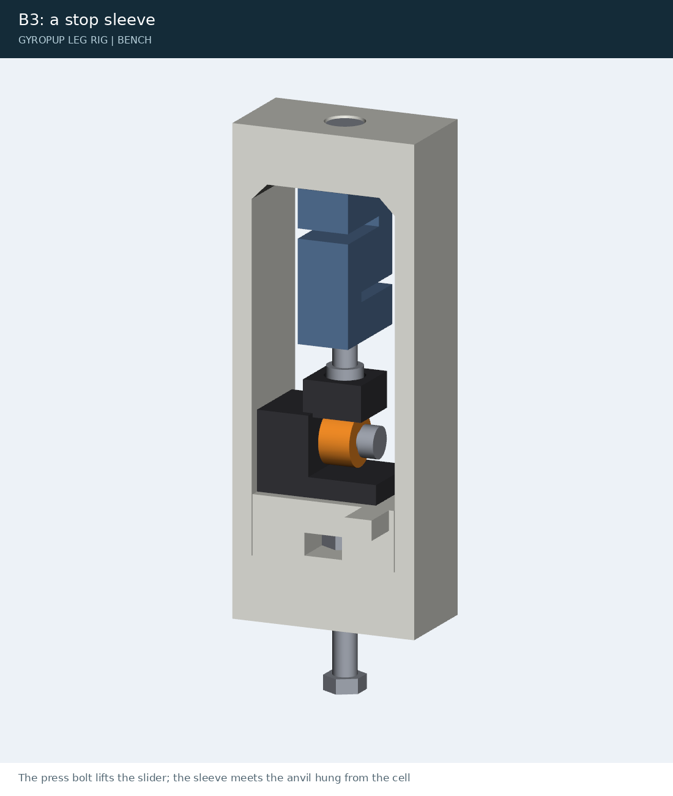
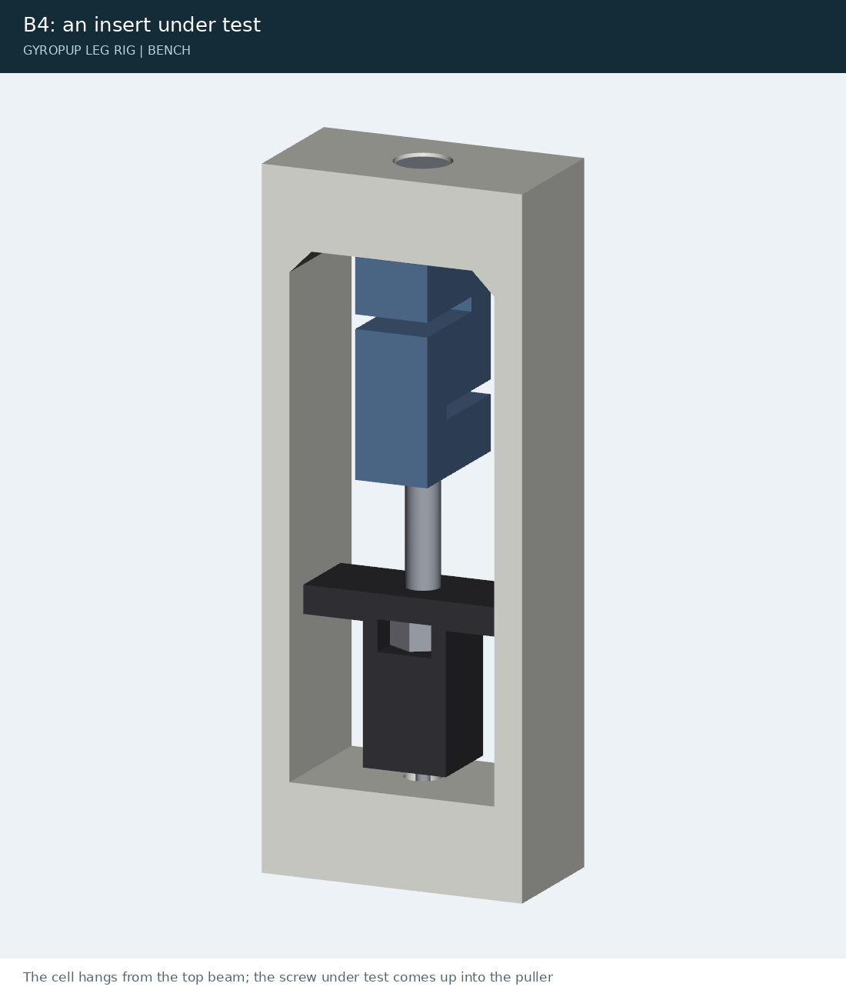

# Leg bench tests (milestone M3)

> **Fixture revision in progress:** old dyno lug plates and the nominal frame-ring
> coupon do not reproduce an acceptable RS-04 mounting stack. See
> [RS-04 mounting fit](rs04-mounting-fit.md) before preparing any print or bench setup.
> The procedures below are planned tests, not evidence that the hardware passed.

How to test the first leg, from a motor on the bench to the power cut on the rig, with the numbers the simulation
predicts and the pass/fail of each test (docs/leg-prototype-plan.md section 5, tasks T12 and T13). Before anything
moves, go through `docs/leg-rig-safety.md`. The parts: `docs/leg-rig-orders.md`. The wiring:
`docs/leg-rig-wiring.md`. The build: `docs/leg-rig-assembly.md`.

Every script prints what it did and writes its results under `exports/rig/`:

- the bench's results go in `exports/rig/bench/` (`b1-*.json`, `b2-motor*.json`, `c6-jitter-*.json`, and the data
  sheets in `sheets/`);
- every rig run goes in `exports/rig/runs/<date>-<time>-can-<test>.{json,npz,png}`, with its verdict against
  `rig/criteria.json`.

`python -m rig.bench.fit_params` turns the bench's results into `exports/rig/bench/sim-params.json`. That file is what
the main session puts back into the simulation (plan flags F1 and F2).

## The order

| Step | Test | Needs | Decides |
|---|---|---|---|
| 1 | B0 coupon fits | the printed coupons, the bearings, sleeves and one adapter | the print offsets of every seat |
| 2 | C1-C6 commissioning, one motor | one RS-04, the bench supply, the U2C | ids, limits, watchdog; the loop's rate |
| 3 | B2 spin-down | one RS-04 on the dyno, nothing on its output | the rotor inertia (ARMATURE) |
| 4 | B1 back-drive | both RS-04s on the dyno, the pack for the driver | D39: the power-off damping |
| 5 | B3 stop sleeve | the press cage, the load cell, a stop post and sleeve | STOP_K, STOP_TRAVEL |
| 6 | B4 inserts and screws | the press cage, the load cell, the pullers | the assembly torques; HUB_PRELOAD_N |
| 7 | B6 the packs' resistance | the pair, the 10 ohm resistor, a multimeter | the start voltage of jumps and drops |
| 8 | R0 bumper calibration | the rig without the leg, ballast | the bumpers' infill |
| 9 | C7, S1 stand-up | the leg on the rig | the first stand |
| 10 | B5 tyre | the leg on the rig, the top stop lowered | TYRE_SOLREF |
| 11 | S2 squat, S3 jump, S4 drop | | |
| 12 | S5 power cut, bumper high | B1's curve in the simulation | |
| 13 | S6 power cut onto the leg's stops | only if B1 and its rerun say the knees survive | D39 |

B0, B3 and B4 need only printed parts, so they run while the motors ship. Each test below gives its set-up, its steps,
what the simulation assumes or predicts, and how it passes.

## What the simulation assumes for each bench test

<!-- gen:assumes -->
| Test | What the simulation assumes | Value now |
|---|---|---|
| B1 | power-off drag of an RS-04 (OFF_DAMPING) | 5.88 N m s/rad, linear (the undamped case: 0) |
| B2 | rotor inertia at the output (ARMATURE) | 0.0243 kg m^2 (3e-4 x 9^2, an estimate) |
| B3 | stop sleeve rate (STOP_K) and travel | 243 N/mm at the post (816 N m/rad at r 58 mm), 4.5 mm before steel |
| B4 | preload per M5 in the hub joint (HUB_PRELOAD_N) | 1200 N |
| B5 | tyre contact (TYRE_SOLREF) | solref 0.0077 0.7 (about 100-250 N/mm) |
| B6 | the packs' resistance (rig/run.py --r-int) | 0.10 ohm (an estimate: two 5S3P packs in series, D65) |
<!-- /gen:assumes -->

## The predicted numbers for the rig tests

<!-- gen:predictions -->
At 14.75 kg carried, 500 Hz with one tick of latency, the pack at its start rule (jumps and drops from 40.5 V, R_int 0.1 ohm), the bumpers meeting the carriage at a leg length of 140 mm (S6: lowered to 74 mm). From `python -m rig.run --predict`.

| Test | Motor peak N m | Gearbox peak N m | Wheel N | Knee pin N | Leg length mm | VBUS V | Jump mm | Fall s |
|---|---|---|---|---|---|---|---|---|
| S1 stand-up | 14.0 | 13.9 | 157 | 159 | 140-304 | 37.9-38.0 | - | - |
| S2 squat | 14.1 | 14.0 | 157 | 151 | 157-303 | 37.9-38.0 | - | - |
| S3 jump | 60.0 | 76.5 | 2,259 | 1,229 | 155-338 | 37.1-43.4 | 207 | - |
| S4 drop 150 mm | 37.9 | 70.8 | 2,874 | 1,331 | 279-335 | 40.4-41.6 | - | - |
| S5 power cut, undamped | 12.5 | 54.1 | 459 | 365 | 136-303 | 37.9-38.0 | - | 0.20 |
| S5 power cut, damped | 12.5 | 12.5 | 159 | 160 | 139-303 | 37.9-38.0 | - | 0.42 |
| S6 power cut onto the stops, undamped | 12.5 | 27.1 | 1,548 | 1,713 | 89-303 | 37.9-38.0 | - | 0.23 |
| S6 power cut onto the stops, damped | 12.5 | 12.5 | 244 | 264 | 100-303 | 37.9-38.0 | - | 0.57 |
<!-- /gen:predictions -->

## Pass and fail for each run (`rig/criteria.json`)

The run's own log is judged at the end of every run (`python -m rig.compare <run.json>` again at any time). The last
column is the simulation's own run of the same test. A check can stay open in the simulation: "follows the prediction"
compares the run with this very prediction, and "measured only" needs the load plate.

<!-- gen:criteria -->
| Test | Check | Limit | The prediction |
|---|---|---|---|
| S1 stand-up | holds 300 +- 10 mm | 10 mm | 3.5 |
| S1 stand-up | follows the prediction within 15 mm | 15 mm | (the run itself) |
| S1 stand-up | peak motor torque <= 18 N m | 18 | 14.0 |
| S1 stand-up | no oscillation over 5 mm peak to peak in the hold | 5 mm p-p | 0.2 |
| S1 stand-up | load plate 120-170 N steady (14.75 kg carried: about 145 N) | 120 to 170 | (measured only) |
| S1 stand-up | VBUS inside 32-45 V | 32 to 45 | 37.9-38.0 |
| S2 squat | follows the prediction within 15 mm (the model is right) | 15 mm | (the run itself) |
| S2 squat | tracks the command within 35 mm (the VMC lags a 0.5 Hz squat by design: 26 mm predicted) | 35 mm | 26.5 |
| S2 squat | peak motor torque <= 18 N m | 18 | 14.1 |
| S2 squat | VBUS under 45 V (regeneration) | - to 45 | 37.9-38.0 |
| S3 jump | the push and the flight follow the prediction within 20 mm (to the landing) | 20 mm | (the run itself) |
| S3 jump | jump height 200-320 mm | 200-320 mm | 207.1 |
| S3 jump | motor torque feedback <= 70 N m | 70 | 60.0 |
| S3 jump | settles to 250 +- 15 mm within 0.5 s of landing | 0.5 s | 0.2 |
| S3 jump | VBUS inside 28-45 V (a push sags it, the tuck and landing lift it) | 28 to 45 | 37.1-43.4 |
| S4 drop 150 mm | motor torque feedback <= 55 N m | 55 | 37.9 |
| S4 drop 150 mm | back to 300 +- 10 mm within 0.5 s of touching down | 0.5 s | 0.1 |
| S4 drop 150 mm | the dip within 20 % of the prediction | 20 % | 20.6 |
| S5 power cut, undamped | the fall's time within 30 % of the prediction rerun with B1's damping | 30 % | 0.20 |
| S5 power cut, damped | the fall's time within 30 % of the prediction rerun with B1's damping | 30 % | 0.42 |
| B5 tyre press (on the rig) | the load plate reads the commanded force within 15 % at every step (the motors' torque constant and the leg's geometry, checked) | 15 % | - |
| B5 tyre press (on the rig) | motor torque <= 60 N m (the cap) | 60.5 | - |
| B5 tyre press (on the rig) | the leg stays put while pressing (within 10 mm of 360) | 345 to 372 mm | - |
| B5 tyre press (on the rig) | VBUS inside 32-45 V | 32 to 45 | - |
<!-- /gen:criteria -->

## Instruments

- **The load cell:** Phidgets 3140_0, S-type, 500 kg, M12 x 1.75 at both ends. It comes with a calibration
  certificate. Its own HX711 board plugs into the rig node in place of the load plate's (the 4-pin header on the
  FeatherWing). The node prints `F <newtons>` lines on its USB serial at 10 Hz (`screen /dev/ttyACM0 115200`;
  typing `t` re-tares it). The node's firmware and its settings are in `rig/firmware/feather_rig/`.
  - Zero it with nothing hanging on it.
  - Check the slope with the rig's weight plates, 2 x 1.134 kg + 2 x 0.567 kg = 33.4 N, hung from the lower thread
    on a wire. The certificate's mV/V sets the slope; the plates only check it within 1 %.
- **The dial indicator:** 0-25 mm, 0.01 mm, on its magnetic base on a steel plate or the bench's vise. Read it at
  each step. A phone video of the dial and the serial terminal together keeps both readings.
- **Torque tools:**
  - a torque screwdriver, 1-6 N m, for the M5s into printed parts;
  - the 2-25 N m wrench for everything else.
  - Step the torque up; never back off and re-tighten within a step.

## B0: the fit coupons

Each seat is printed at -0.1, 0 and +0.1 mm on its diameter (`exports/rig/bench/coupon_*`). Print them in PA6-CF,
dried, on the settings the leg will use.

| Coupon | Fit it with | The right fit |
|---|---|---|
| `coupon_frame_ring` | a 61812, from the motor side, onto the lip; the motor's 10 x M4 lugs on the nominal ring | the bearing presses in by hand or with a vise and soft jaws, seats on the lip, does not rock; no crack at the lugs |
| `coupon_hub_face` | the machined adapter's Ø40 spigot and its two Ø5 dowels | the spigot enters by hand with no play you can feel; the dowels enter; the eight M5 clearance holes line up with the adapter's threads |
| `coupon_knee_eye` | a DIN 179 12 x 18 x 20 sleeve (the hole is the leg's, with `PRINT_HOLE_COMP` and the bed-face lead-in) | a light vise press with soft jaws, or a close slide for the structural epoxy (D74); it stays put when the coupon is knocked on the bench |
| `coupon_frame_pins` | a Ø16 x 40 stop pin from the bed face; a Ø5 dowel from the top | the pin goes in with a light press or a close slide for the epoxy and seats on the floor; the dowel enters by hand, close (it locates the motor in its own H7 hole) |
| `coupon_knee_boss` | a 6301 | hand press, seats, no rocking |
| `coupon_apex_eye` | a 61812 | hand press, seats, no rocking |
| `coupon_hub_stub` | a 61812's inner race and the DIN 471-60 circlip | the race slides on with a light push; the circlip snaps into its groove |

Record the variant that fits each seat. The main session sets the leg's print offsets from that table. If a slip fit
is the best there is (a bearing seat), the assembly uses Loctite 641 on it, as `docs/leg-rig-assembly.md` says, only
after a coupon shows it on a printed bore: Henkel does not normally recommend its anaerobic compounds on thermoplastics
(D74; research/leg-preprint).

## C1-C6: commissioning, one motor on the bench supply

The archived dyno board (`exports/rig/bench/dyno_*`) is not a current mounting release.
The proposed interface uses ten M4 × 20 screws per RS-04, but mounting support,
the manufacturing tolerance stack and tightening preload remain unqualified in
[the mounting-fit work](rs04-mounting-fit.md). The earlier 2.5 N m instruction had
no established manufacturer or joint-validation basis and is withdrawn. Establish
the measured joint and its tightening procedure before commissioning.

The planned bench supply (Mean Well LRS-600-36, 36 V: the robot's bus, D65) feeds
the motor's XT30. Fit the CAN lead and its terminators only as part of a released
bench setup; this planned procedure is not evidence of readiness.

| Step | Do | Pass |
|---|---|---|
| C1 | `sudo ip link set can0 up type can bitrate 1000000`; with the power off, measure H to L at the far end | 60 ohm (two 120 ohm terminators); the link is up in `ip -details link show can0` |
| C2 | `python -m rig.rs04 --iface can0 scan`, then `--id 127 version` | it finds id 127 (the factory id) and its UID; the firmware version is printed: write it down |
| C3 | `python -m rig.rs04 --id 127 setid 1`, then `--id 1 save`; on the second motor the same with 2 | `scan` finds 1 (front) and 2 (rear) |
| C4 | `python -m rig.rs04 --id 1 setup`, then `--id 1 save` | it reads back run_mode 0, limit_torque 60, canTimeout 2000 (0.1 s), zero_sta 1, and logs damper (0 = the anti-backdrive protection on, the default) |
| C5 | `python -m rig.rs04 --id 1 enable`, wait 1 s, `--id 1 watch` | the motor has dropped to reset by itself (the 0.1 s CAN watchdog) |
| C6 | `python -m rig.bench.jitter --iface can0 --ids 1 --rate 500 --seconds 20` (again with `--load`) | 99 % of sends within 0.3 ms and under 0.1 % of ticks missed; if not, the first stand runs at 250 Hz (`--rate 250`) |

## B2: the rotor's inertia (spin-down)

One motor on its lug plate, its output bare (the hub off: its inertia would add), on the bench supply.

1. Run `python -m rig.bench.spin_down --iface can0 --id 1`. It pushes 2 N m from rest until 0.4 s or 8 rad/s, then
   coasts. It does this three times and writes `b2-motor1.json`.
2. The same for motor 2.

**Pass:**
- J within +-20 % of the simulation's ARMATURE (the table above);
- the three repeats within 5 % of each other.

Outside +-20 %, the main session sets ARMATURE from it (F1). The landing predictions move with it, so regenerate them
before S3.

## B1: the power-off damping (decides D39)

**Why.** When the power goes, the leg falls. How hard the knees land depends on how much the unpowered motors resist
being turned. The RS-04 has a power-off anti-backdrive switch, the `damper` parameter (0x702A, uint8). 0, the default,
means the protection is on. 1 means it is off. The simulation assumes 5.88 N m s/rad when damped.

**Set-up.** The dyno: both motors output to output through the TPU spider.
- Motor A (id 1) is the one tested.
- Motor B (id 2) drives it in velocity mode, and its own torque reading is the drag.
- B runs on the pack (through the pod's fuse and contactor). At 60 N m x 13 rad/s it can pull more than the 600 W
  bench supply gives. Start the pair at 40 V or under, and hold the pendant through each sweep: the contactor is
  closed only while it is held.
- A is either unplugged or on the bench supply, as each condition says.

**Steps:**

1. **Friction first.** Take the spider out (B alone) and run
   `python -m rig.bench.backdrive --iface can0 --driver 2 --condition friction`. This measures B's own drag.
2. **Damper 0, unpowered.** Spider in. With A powered: `python -m rig.rs04 --id 1 param damper 0`, then
   `python -m rig.rs04 --id 1 save`, then `python -m rig.rs04 --id 1 param damper` (it must read 0). Unplug A's XT30
   and tape its pins apart: back-driven at 13 rad/s, A makes about 30 V. Run
   `... --condition unpowered_damper0`.
3. **Damper 1, unpowered.** Power A, set `damper 1`, save, read it back, unplug, and run
   `... --condition unpowered_damper1`.
4. **Powered and stopped.** A powered and in reset (`python -m rig.rs04 --id 1 stop`):
   `... --condition powered_stopped`.
5. **Put A back to the default:** `damper 0`, save, read back 0. The robot relies on the default.
6. Run `python -m rig.bench.fit_params`. B1_backdrive in `sim-params.json` gets, for each condition, the drag table
   (rad/s, N m) and its fit c sign(w) + b w.

The sweep runs 0.5, 1, 2, 4, 7, 10 and 13 rad/s each way, settles 1.5 s and averages 1.5 s at each speed. It stops a
direction early once the drag passes 60 N m: then the answer is simply "strong".

**Cross-check by hand (optional).** Hang a 5 kg mass on a 0.3 m arm on A's unpowered output and film the fall. It
should fall at about 14.7 N m / b. For the simulation's 5.88 that is 2.5 rad/s.

**Decision (the main session, F1).** It reruns `power_off` with the measured curve:
- If the knees stay at or under the fault case (R3 in `cad/leg_studies.py`, SF 1.0), no spring is needed and D39
  stands.
- If not, the options are the knee-to-knee spring, softer and longer-travel bumpers, and a firmware sit-down before
  any planned power-off.

Which of damper 0 and 1 the robot runs is decided by the same rerun.

## B3: the TPU stop sleeve

**Set-up (the press cage on its side, clamped to the bench):**
- The load cell hangs from the top beam on an M12 x 30 at 30 N m.
- The anvil hangs on a second M12 x 30, screwed into the cell's lower thread; its head sits in the anvil's socket.
- A stop post (one of the leg's Ø16 pins, D53) goes in the sleeve block's blind hole as it goes in the hip frame, with its
  TPU sleeve on. The block's hole is drawn and printed as the frame's, so B3 also shows how the pin seats.
- The block sits on the slider against the left wall.
- The M12 x 80 press bolt comes up through the bottom beam into the press base's nut.
- The dial indicator's tip rests on the slider's tab.

**Steps:**

1. **Zero run, without the sleeve.** The anvil sits on the bare post. Load 0-2,000 N in 200 N steps by turning the
   press bolt, and read the dial at each step. This is the cage's, the cell's and the post's own compliance.
2. **Sleeve run.** Put the sleeve on. Load 0-2,000 N in 200 N steps, wait 10 s at each, read the force and the dial,
   and unload in the same steps.
3. **Cycles.** Cycle to 7 mm (or 2,000 N) ten times. Record cycles 1 and 10 fully.
4. **Data.** Run `python -m rig.bench.fit_params --templates` once for blank sheets. Write each step into `sheets/b3.csv`:
   - cycle;
   - force_n;
   - deflection_mm: the sleeve run less the zero run at the same force.

**Pass:**
- the measured rate within 0.5-2x the simulation's STOP_K (the table above);
- no tear after 10 cycles;
- a permanent set under 0.3 mm.

F1 updates STOP_K and STOP_TRAVEL from `sim-params.json`.

## B4: heat-set inserts and the screws into printed parts

**Set-up:**
- The cell hangs from the top beam.
- An M12 x 75 stud (80 also fits) from the cell's lower thread carries a puller. The M12 nut goes in the puller's side pocket.
- Screw the puller down the stud until its insert face is 5 mm above the bottom beam.
- The puller's wings bear on the side walls, so the screw's torque never reaches the cell.
- The screw under test comes up from below the bottom beam, into the insert.

Set every insert with the soldering iron at the temperature B0 proved, as in the hip frame.

| Part | Under the head | Steps | Pass | Sets |
|---|---|---|---|---|
| B4a: M5 insert (2 pullers) | an M6 oversized washer (steel) | M5 x 40, tighten in 0.5 N m steps, reading the tension, to 4 N m; then on to 3,500 N or until the insert pulls out or the thread strips | >= 1,200 N at a torque with margin; holds 2,400 N (2x) without moving | the frame-to-plate torque (6 x M5 x 16) |
| B4b: the link under the head (1 puller) | a bearing disc (PA6-CF, the link's material) on the M6 washer | M5 x 40 to 1,200 N: note the torque; hold 30 min, reading at 1, 5, 10 and 30 min; then on to 2,000 N | the tension after 30 min >= 1,000 N; no crushing round the head at 2,000 N | the upper-link-to-adapter torque (8 x M5 x 40) and HUB_PRELOAD_N |

Write the rows into `sheets/b4.csv`:
- size (M5; B4c, the M8 insert, went with D53: the stop posts are pins, not screws);
- sample;
- torque_nm;
- tension_n;
- pullout_n (on its own row, at the end).

`fit_params` gives the tension per N m, the nut factor, the torque for 1,200 N and the pull-out. Put the torques into
the assembly's torque table, which until then uses 1.5 N m for the M5s. Send the measured
preload to the main session (F2: `cad/leg_studies.py` reruns with it).

## B6: the packs' resistance

1. Charge both packs.
2. With nothing connected, read the pair (the two packs in series in their docks) at its XT60 lead: V_open.
3. Connect the 10 ohm 25 W resistor across the pair's leads for 1 s (about 4 A; it gets warm). Read the voltage during the
   pulse: V_loaded. A meter with min/max helps, or a video of the meter.
4. Repeat three times, a minute apart. Write the rows into `sheets/b6.csv` (v_open, v_loaded, r_load_ohm).

`fit_params` gives R_int and the start voltage for jumps and drops: 44.5 - 40 A x R_int. Pass `--r-int` to
`rig/run.py`; it refuses a jump or a drop above that voltage.

**Cross-check after S3.** The jump's push draws about 45 A for 0.3 s. Its sag in the run's VBUS log, divided by that
current, gives R_int at the real load.

## R0: calibrating the bumpers

This is the rig without the leg: the carriage with ballast to about 10 kg (weigh it).

1. Hang the carriage on the drop pin at three heights above bumper contact and pull the pin each time. Film at 240 fps
   against the tape on the post.

   | Energy | Drop height |
   |---|---|
   | 7 J | 70 mm |
   | 15 J | 150 mm |
   | 33 J | 335 mm: a hard fault at the jump's apex |

2. Read the crush from the video: the lowest point less the contact height.

**Pass:**
- under 20 mm of crush at 15 J and under 25 mm at 33 J;
- no sharp stop in the video (bottoming);
- no crack in the bumper or its base.

The bumpers are printed at 30 % gyroid. If they bottom, print the 40 % pair. If 7 J barely marks them, 30 % is right
and stays.

## C7 and S1: the leg's first stand

1. **C7.** Hang the carriage on the drop pin at 150 mm with the leg in the air. Run
   `python -m rig.run --backend can --test drop_150 --rate-limit 5` without pulling the pin. The leg rises to 300 mm
   and holds. Then check the angles against a ruler with `python -m rig.calibrate --check`: the leg length within
   5 mm.
2. **S1.** The carriage is on its bumpers and the load plate is under the wheel. Run
   `python -m rig.run --backend can --test stand_up`. The first time, add `--rate-limit 5`.

## B5: the tyre, on the rig

**Set-up:**
- The leg stands at 360 mm on the load plate.
- Lower the top stop onto the carriage's top edge there, so the carriage cannot rise.
- The dial indicator's base goes on the load plate, its tip on the wheel link's hub.

**Steps:**

1. Run `python -m rig.run --backend can --test tyre_press`. It stands up to 360 mm, then presses the wheel into the
   plate at 200, 300 ... 900 N and back down to 200 N, 4 s per step.
   - Near full stretch the motors' 60 N m reaches about 940 N.
   - If the carriage is not held, the leg stretches and the run goes limp at once.
2. Read the dial at each step. Take the force from the run's load plate.
3. Do this three times, turning the wheel 120 degrees by hand between runs. Let the motors cool 2 min.
4. Write the rows into `sheets/b5.csv`: spot, direction (load or unload), force_n, deflection_mm.

**Pass:**
- a rate and a hysteresis come out of it;
- the load plate follows the command within 15 % (the run's own verdict).

If the rate is under 100 N/mm, the main session regenerates the drop's and the jump's predictions before S3 and S4
(F1).

## S2-S6

Each is one command. The tables above give its predicted numbers and its pass/fail.

| Test | Command | Set-up | After the run |
|---|---|---|---|
| S2 squat | `python -m rig.run --backend can --test squat` | the load plate under the wheel | re-check every screw |
| S3 jump | `... --test jump` | the load plate out; the tether on (150 mm of slack above the highest jump); the pack at or under the start voltage | inspect the knees, the adapters and the stop sleeves; compare with the simulation rerun at the measured J and tyre rate |
| S4 drop | `... --test drop_150` | the carriage on the drop pin, 150 mm up; when the leg holds 300 mm (1 s), pull the pin; the run lasts 8 s | inspect as S3 |
| S5 power cut, bumper high | `... --test power_off` | standing at 300 mm; release the pendant: the leg holds for the relay's 1.0 s, then the contactor opens | the carriage lands on the bumpers; compare the fall time with both predictions (undamped and damped): which one it matches says whether the damper works in a real fall |
| S6 onto the leg's stops | `... --test power_off` with the bumpers shimmed down to 74 mm contact | only after B1 and the main session's rerun clear it | the knees, the eye sleeves, the pins and the 6301s inspected; the stop sleeves show no permanent set |

**The packs.** Jumps and drops start at or under the start voltage (B6). The runner reads the motors' VBUS before it
arms and refuses above it.

## After every run

- Read the verdict the runner prints.
- Look at the overlay PNG next to the run's log: the run, the prediction and the limits.
- Before the next run: the motors' temperatures (in the log) under 60 C; the screws' paint marks unbroken; nothing
  on the bumpers.
- Anything off-limits stops the series. Write down what happened in `exports/rig/runs/notes.md`, under the run's
  file name.
