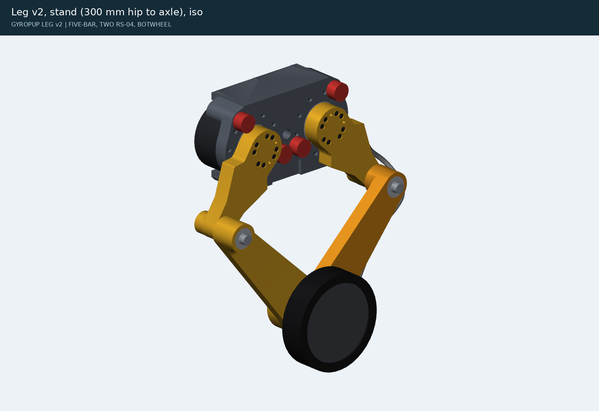
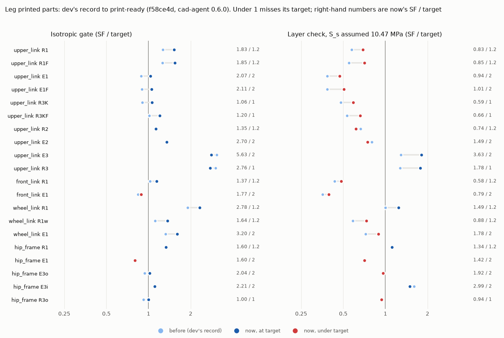
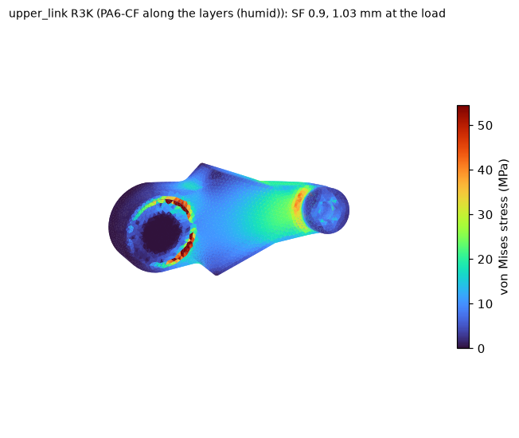
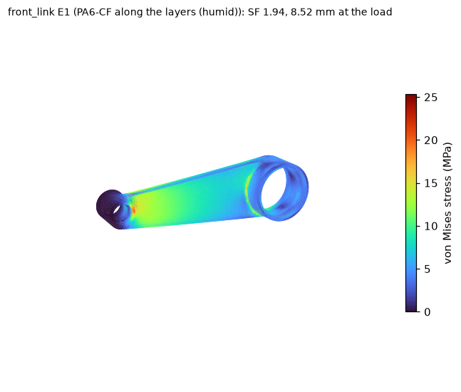
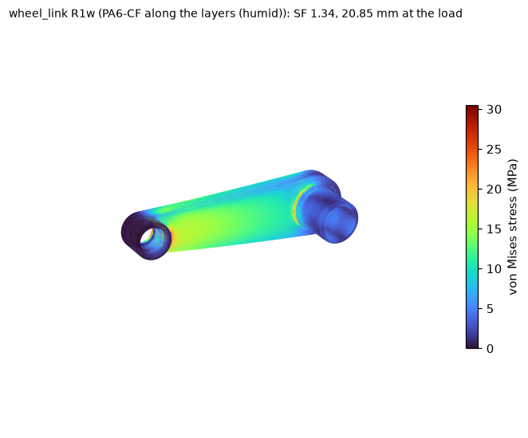
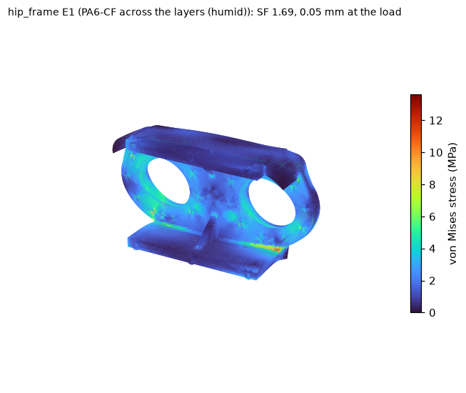

# Leg print package (first leg)

What to buy, print, check and assemble for the first leg, after the pre-print review
([research/leg-preprint/](../research/leg-preprint/README.md)) and the D74 joint policy. The files come from
`cad/build_leg.py`. The CAD and FEA records below do not prove fit or strength. The coupons (C1-C4) and the
unpowered proof loads at the end of this page settle them, and nothing here replaces them.

No part has been bought and no powered test run for this page.

## At a glance

<!-- gen:glance -->

The chart is `research/leg-preprint/figure.py`, drawn from the same rows as the table in section 8 (generated by `screen.py`).

| | Isotropic gate | Layer check (S_s assumed) |
|---|---|---|
| Rows at target, dev's record | 13 of 20 | 5 of 20 |
| Rows at target, this branch | 18 of 20 | 5 of 20 |
| Rows that went up | 15 of 20 | 17 of 20 |

Coupon C4 decides the layer rows (section 8). The mass is in section 9 and the open decisions in section 10.

<!-- /gen:glance -->

The weak spots, from the re-run's isotropic stress plots (`exports/leg/fea/`). Each plot is coloured by the
isotropic stress, so its red is not always the layer check's worst corner:

| Upper link, knee stub (R3K) | Front link, apex ring (E1) | Wheel link, hub root (R1w) | Hip frame (E1) |
|---|---|---|---|
|  |  |  |  |
| red at the hub's bonded pad rim (left out of the gate: section 8); the layer check's worst corner is the knee stub, which C4 tests | the apex ring: decision 1 | the hub root, a sharp corner, so its number depends on the mesh: decision 1 | decision 2 |

## 1. Buy first (nothing is ordered yet)

The leg's bought parts and their links are in [leg-rig-orders.md](leg-rig-orders.md) (regenerated from
`exports/leg/bom.json`). New or changed for the first print:

| Item | Qty a leg | Why | Status |
|---|---|---|---|
| DIN 433 M6 washer, 6.4 x 11 x 1.6, stainless (`washer_m6_din433`) | 4 | under the BotWheel screws' heads (D74) | McMaster-Carr part number to confirm: its product pages returned no data on 2026-11-01 |
| Structural epoxy for metal to nylon (two-part, gap-filling, about 0.1-0.25 mm) | 1 kit | the stop pins, the knee-eye sleeves and the RS-04 dowels (D74): Henkel does not recommend the anaerobic retainer (LOCTITE 638) on thermoplastics | the owner picks the product; C1 tries it |
| PA6-CF, four 1 kg spools of one lot | 3.1 kg of parts a leg (the print plan), plus supports, brim and purge | the hip frame alone is 1,106 g, so it takes a spool change | dry before use (section 3) |
| TPU 95A | 62 g | the four stop sleeves | |

## 2. Print the coupons first

The coupons are drawn in `cad/rig_bench.py` and exported to `exports/rig/bench/` (STEP and STL, in print
orientation). Their measurement sheets are in [research/leg-preprint/sheets/](../research/leg-preprint/sheets/), and
[research/leg-preprint/README.md](../research/leg-preprint/README.md#print-first-coupons) says what each settles.
They take hours, not days, and each one changes a number in the CAD:

| Coupon | Files | What it changes |
|---|---|---|
| **C1, the bores** | `coupon_knee_eye`, `coupon_frame_pins`, `coupon_knee_boss`, `coupon_apex_eye`, `coupon_hub_stub`, `coupon_hub_face`, `coupon_frame_ring` (each at -0.1 / 0 / +0.1 mm) | The printed-hole error. `PRINT_HOLE_COMP` (0.125 mm on the diameter, the middle of an assumed -0.20 to -0.05 mm) sets the sleeve and dowel holes; set it from C1 before printing the links. The 6301 and 61812 seats and the stop-pin holes are drawn at their own fits (`KC`, `AC`, `STOP_HOLE_PLAY` in `cad/fivebar.py`), so C1's numbers change them by hand. Every seat coupon opens on the bed face with the leg's lead-in, as the parts do |
| **C2, the insert** | `insert_coupon`, `puller_m5` | The M5 insert's pull-out against the hip-frame mount's preload |
| **C3, the clamp** | `coupon_c3_sleeved`, `coupon_c3_plain` (the frame's flange, M5), `coupon_c3_wheel` (the wheel link's foot, M6 on a DIN 433) | How much preload creep takes from a clamped printed stack, reported per mm of clamped plastic and scaled to each joint: the re-torque schedule, and whether the wheel joint keeps the clamp it needs (below) |
| **C4, the boss root** | `coupon_c4_today`, `coupon_c4_pr2` (the upper link's knee end with dev's stub and the drawn one) | The interlayer strength the layer check assumes. The FEA of the coupon itself predicts the load at which each root peels (section 8); the measured load over the predicted one is the factor on the assumed S_z and S_s. Condition it humid first, as the prediction assumes |

## 3. Drying and printer set-up

These come from the filament's data sheet, as in [rs04-fit-job.md](rs04-fit-job.md):

- Dry PA6-CF at 80 °C for 8-12 h.
- Feed it dry, below 20 % RH: from a dry box, for the whole print. The hip frame runs for three days.
- Use a hardened nozzle.
- Nozzle 260-290 °C, bed 80-100 °C with glue.

Record the filament lot, the drying, the nozzle, the slicer and its settings, and each part's mass after printing.

## 4. The parts

Each printed part is written as `exports/leg/<part>.step`, plus `.stl` and `.3mf` meshes in their print orientation on
z = 0. `exports/leg/print-plan.json` gives each part's hours and grams.

| Part | Qty | Face on the bed | Settings | Watch for |
|---|---|---|---|---|
| hip_frame | 1 | the web's outer (leg-side) face; turned 45° to fit the 256 mm bed | 100 % solid | 72 h and more than one spool: splice or change the spool at a layer change, from the same lot. At 45° it needs a 249.2 mm square of the 256 mm bed, so the brim is 3 mm at most (or brim ears at the corners). The stop-pin holes open on the bed: keep their 0.5 mm lead-ins clean |
| upper_link | 2 | the outer face (the head pockets open at the bed) | 100 % solid | the knee-eye sleeve holes open on the bed |
| front_link | 1 | the inner face | 100 % solid; **supports from the bed under the link's body** | it floats: only the apex ring (15 cm²) touches the bed, with 141 cm² of underside 32 mm up. Use tree supports from the build plate only, never in the bearing seats |
| wheel_link | 1 | the outer face | 100 % solid | the outer knee seat opens on the bed |
| apex_spacer | 1 | the inner face | 100 % solid | |
| stop_sleeve | 4 | cap down | TPU 95A, 100 % | |

## 5. After printing, before assembly

1. Weigh each part and compare it with the print plan, after the same comparison on the C1 coupons: their
   measured-to-CAD mass ratio is this printer's solid ratio. A part more than 5 % under that ratio has voids: do not
   use it.
2. Measure every press-fit bore at its mouth and 5 mm in, on two diameters, as C1's sheet does:
   - the knee-eye sleeve holes, drawn Ø18.125;
   - the 6301 seats, Ø37.04;
   - the 61812 seats, Ø78.04;
   - the RS-04 dowel holes, Ø5.155;
   - the stop-pin holes, Ø16.1.

   Compare each with the band C1 measured.
3. Check that the hip frame's motor faces and the links' faces are flat (feeler gauge on a surface plate). Check the
   flange ends for warp.
4. Look for open layers at the boss roots, the flange roots and the apex ring. Those are the places the layer check
   names.

## 6. Assembly order and the D74 joints

Follow [leg-rig-assembly.md](leg-rig-assembly.md). The D74 joints change it here:

- **Stop pins, knee-eye sleeves and RS-04 dowels:** bond them with the structural epoxy, pressed or pushed to depth,
  and let it cure fully before you load them. The sleeve holes are drawn for about 0.02 mm of press at the printed
  band's middle; C1 says whether they come out loose or tight.
- **BotWheel:** 4 x M6 x 30, each on a DIN 433 washer, at 1.8 N m with threadlocker (it was 8 N m), 7.4 mm into the
  wheel. The plastic under a bare head was at 150 MPa. Most of the drop to 25 MPa comes from the lower torque; the
  washer raises the bearing area from 44 to 61 mm². At 1.8 N m the joint has 1.13 x the clamp the wheel's flange
  needs, and only at assembly, before torque scatter and creep: the flange may open at the rare peak. C3's wheel
  samples measure what is left after creep. If it is short, the fix is a steel plate under the heads, not more torque.
- **Re-torque** every clamped printed joint after 24 h and after the first humid week. C3 sets the schedule.
- The stop sleeves go on last, over the bonded pins.

## 7. Unpowered proof loads

Run these on the bench with the motors unpowered, before any powered rig test. Set-up:

- The leg is folded onto its stop posts (the R3 posture), so the stops, not the motors, react the load.
- The hip frame is bolted to the rig's carriage plate, with the carriage clamped.
- Load the wheel's axle with weights, or with the bench press and its load cell.
- A dial indicator reads at the axle.
- The TPU stop sleeves are in the load path and creep. Load to P1 once and unload to seat them, then zero the
  indicator. To judge the plastic parts' set alone, swap the sleeves for rigid spacers of the same size.

<!-- gen:proof -->

| Step | Load at the axle | Hold | Pass |
|---|---|---|---|
| P1 | 460 N vertical (E1's axle load: 2.5 x standing) | 10 min | after the seating cycle, it returns to within 0.05 mm of its start; no whitening, cracking or creaking |
| P2 | 945 N vertical (R1's axle load, applied in the folded posture) | 1 min | set after unloading under 0.1 mm; the same visual checks; the torque marks have not moved |
| P3 | 10 % of P2 sideways, at the tyre's mid-plane | 1 min | the same |

In the folded posture the axle load goes where R3's does, and P2 is 0.52 of R3's 1831 N. Scaled from the R3 rows (generated by `screen.py` from the same record):

| Part | Case | Gate at P2 | Layer check at P2 | Left-out edge at P2 |
|---|---|---|---|---|
| upper_link | R3K | 2.05 | 1.14 | pad rim 1.28 |
| upper_link | R3KF | 2.32 | 1.28 | pad rim 1.36 |
| hip_frame | R3o | 1.94 | 1.82 | pin band 1.01 |

So P2 brings the knee stubs and the stop pins' bands near SF 1 in the folded posture: apply it in steps of a quarter, listening and watching the indicator, and stop at the first whitening.

<!-- /gen:proof -->

After P2, look closely with a lamp at:

- the upper links' knee-eye roots;
- the hip frame round the stop pins and at its flange roots;
- the wheel link's knee boss root.

Any crack stops the build: the part goes to metal or is redesigned.

**What these do not check.** The folded posture carries the load through the stops, the links' bending and the
frame. It is not the R1 or E1 load path through the knees and the apex: the front link's apex ring has no R3 row, so
what P2 does there is not known. To proof the R1 path unpowered, hold the leg at its R1 height with a steel bar
locking each motor's output adapter to the hip frame; that bar is not drawn yet. The rig's powered tests (S1-S5 in
[leg-bench-tests.md](leg-bench-tests.md)) cover these paths after this page.

## 8. The leg's studies after these changes

<!-- gen:final-record -->

Generated by `research/leg-preprint/screen.py` from `exports/leg/fea/summary.json` and `research/leg-preprint/evidence/leg-layer-check-print-ready.json` (cad-agent 0.6.0, 4 mm mesh, source f58ce4d), against dev's record (`research/fea-v060-29/evidence/leg-layer-check.json`). The printed parts' rows are below.

- **Isotropic gate:** 18 of 20 rows at target, against 13 before.
- **Layer check:** 5 of 20 rows at target, against 5 before. It assumes the interlayer shear strength S_s = S_z / sqrt(3) = 10.47 MPa; nobody has measured it.
- **Mass basis:** the loads are the 37.5 kg design robot's (`cad/leg_studies.py` ROBOT_KG). At the 38.69 kg this branch weighs (section 9) every SF falls by 0.969: hip_frame E3o 2.04 → **1.98** (target 2) and hip_frame R3o 1 → **0.97** (target 1) would then miss their targets. They are counted at target above, but they sit at the limit.
- **Mesh check (the hip frame, `research/leg-preprint/evidence/hip-frame-print-ready.json`):** the gate at 4 mm and at 3 mm: R1 1.6 → 1.36, E1 1.6 → **1.4**, E3o 2.04 → 2.01, E3i 2.21 → 2.39, R3o 1 → **0.98**. The gate is not converged, so read every frame row as a screen; bold rows miss their target at 3 mm.

| Part | Case | Target | Gate: before → now | Layer check: before → now | Printed strength that would pass (MPa) | Worst corner |
|---|---|---|---|---|---|---|
| upper_link | R1 | 1.2 | 1.52 → 1.83 | **0.69** → **0.83** | S_s ≥ 26.4 (2.5× assumed) | knee eye stub root (r 21.3 from the knee axis, 2.6 mm into the stub) |
| upper_link | R1F | 1.2 | 1.51 → 1.85 | **0.66** → **0.85** | S_s ≥ 17.6 (1.7× assumed) | knee eye stub root (r 21.4 from the knee axis, 2.5 mm into the stub) |
| upper_link | E1 | 2 | **1.77** → 2.07 | **0.77** → **0.94** | S_z ≥ 38.6 (2.1× assumed; tension) | knee eye stub root (r 21.7 from the knee axis, 2.1 mm into the stub) |
| upper_link | E1F | 2 | **1.79** → 2.11 | **0.77** → **1.01** | S_z ≥ 35.9 (2.0× assumed; tension) | knee eye stub root (r 21.8 from the knee axis, 2.1 mm into the stub) |
| upper_link | R3K | 1 | **0.9** → 1.06 | **0.48** → **0.59** | S_s ≥ 17.6 (1.7× assumed) | knee eye stub root (r 21.8 from the knee axis, 2.1 mm into the stub) |
| upper_link | R3KF | 1 | 1.01 → 1.2 | **0.53** → **0.66** | S_s ≥ 15.9 (1.5× assumed) | knee eye stub root (r 21.7 from the knee axis, 2.1 mm into the stub) |
| upper_link | R2 | 1.2 | 1.37 → 1.35 | **0.8** → **0.74** | S_s ≥ 17 (1.6× assumed) | hub, the Ø40 spigot recess's rim on the inner face (r 20.0) |
| upper_link | E2 | 2 | 2.73 → 2.7 | **1.6** → **1.49** | S_s ≥ 14.1 (1.3× assumed) | hub, the Ø40 spigot recess's rim on the inner face (r 20.0) |
| upper_link | E3 | 2 | 6.13 → 5.63 | 2.58 → 3.63 |  | hub (r 23.2 from the motor axis), inner face |
| upper_link | R3 | 1 | 3.01 → 2.76 | 1.27 → 1.78 |  | hub (r 23.2 from the motor axis), inner face |
| front_link | R1 | 1.2 | 1.23 → 1.37 | **0.52** → **0.58** | S_z ≥ 37.5 (2.1× assumed; tension) | apex eye ring (r 45.0 from the apex axis, y 48.0) |
| front_link | E1 | 2 | **1.68** → **1.77** | **0.71** → **0.79** | S_z ≥ 45.9 (2.5× assumed; tension) | apex eye ring (r 45.0 from the apex axis, y 48.0) |
| wheel_link | R1 | 1.2 | 2.28 → 2.78 | 1.2 → 1.49 |  | apex hub root (r 37.5 from the apex axis, at the link's inner face y 54.0) |
| wheel_link | R1w | 1.2 | 1.34 → 1.64 | **0.7** → **0.88** | S_s ≥ 36.3 (3.5× assumed) | apex hub root (r 37.5 from the apex axis, at the link's inner face y 54.0) |
| wheel_link | E1 | 2 | 2.65 → 3.2 | **1.44** → **1.78** | S_s ≥ 12.1 (1.2× assumed) | knee boss root (r 32.6 from the knee axis, y 51.3) |
| hip_frame | R1 | 1.2 | 1.58 → 1.6 | 1.32 → 1.34 |  | flange root, inner face (x -74, y -26.5) |
| hip_frame | E1 | 2 | **1.63** → **1.6** | **1.39** → **1.42** | S_z ≥ 25.5 (1.4× assumed; tension) | web, motor side (x 95, z -59) |
| hip_frame | E3o | 2 | **1.88** → 2.04 | **1.89** → **1.92** | S_s ≥ 12.2 (1.2× assumed) | flange root, inner face (x 95, y -65.1) |
| hip_frame | E3i | 2 | 2.18 → 2.21 | 3.2 → 2.99 |  | web, motor side (x 95, z -59) |
| hip_frame | R3o | 1 | **0.92** → 1 | **0.93** → **0.94** | S_s ≥ 13.2 (1.3× assumed) | flange root, inner face (x 95, y -65.1) |

Bold: under target. The strength column is what coupon C4 has to show for the row to pass as drawn: an interlayer shear strength S_s (with S_z at the assumed 18.13 MPa), or, where through-layer tension alone fails, a through-layer strength S_z (with S_s scaled with it). A row whose number C4 does not reach needs geometry or metal (section 10); a row that needs more than about twice the assumed value is unlikely to pass, so read those as the parts most likely to need it. Each number holds at the row's worst corner only, so it is a lower bound.

**Left out of the gate, as the records do.** Two contact edges the linear model cannot resolve are not judged: the upper link's bonded pad rim (the adapter's edge on the hub face) and the hip frame's band round a stop pin (the pin bearing on its hole). Counted, they would read:

| Part | Case | Target | Gate as judged | With the left-out edge |
|---|---|---|---|---|
| upper_link | R1 | 1.2 | 1.83 | pad rim **1** |
| upper_link | R1F | 1.2 | 1.85 | pad rim **0.95** |
| upper_link | E1 | 2 | 2.07 | pad rim **1.16** |
| upper_link | E1F | 2 | 2.11 | pad rim **1.13** |
| upper_link | R3K | 1 | 1.06 | pad rim **0.66** |
| upper_link | R3KF | 1 | 1.2 | pad rim **0.7** |
| hip_frame | E3o | 2 | 2.04 | pin band **1.06** |
| hip_frame | E3i | 2 | 2.21 | pin band **1.34** |
| hip_frame | R3o | 1 | 1 | pin band **0.52** |

The plots in the summary show these edges red. Bench test B4b (the hub on its adapter) and proof load P2 (the pins, section 7) are the physical checks.

**Coupon C4's prediction** (`research/leg-preprint/evidence/c4-fea.json`, `research/leg-preprint/c4_fea.py`: the coupon itself at 1 kN, held at its cut face 90 mm back, loaded through the knee bore at the knee boss's mid-plane):

| Stub | Weakest direction | Predicted peel load (2 mm / 1.5 mm mesh) | Governed by | Bulk (in-layer) load |
|---|---|---|---|---|
| dev's (coupon_c4_today) | -x | 1,350 N / 1,420 N | bond | 3,390 N |
| drawn (coupon_c4_pr2) | +z | 1,780 N / 1,800 N | bond | 3,750 N |

The prediction uses the humid PA6-CF rows, so condition C4 humid first (its sheet says how): a dry coupon reads about twice the prediction. Load it in the weakest direction. The measured peel load over the predicted one is the factor on the assumed S_z and S_s for every row above; the two stubs check that the drawn one gains what the FEA says.

<!-- /gen:final-record -->

## 9. Mass

The changes on this branch, a leg. Printed parts are solid volume at 1.09 g/cm³ (100 % infill, as the print plan),
before and after, from `cad/fivebar.py`. Bought parts come from their catalogue entries.

| Joint or part | Change | Mass a leg |
|---|---|---|
| `leg.knee_eye_sleeves` (2 upper links) | the stub's root fillet 5 → 7.5 mm on a Ø55 bulb; the sleeve holes opened 17.96 → 18.125 mm with a lead-in | +49.4 g (366.48 → 389.13 cm³ a link) |
| `leg.apex` / wheel link | the knee-boss fillet 10 → 16 mm, the hub root Ø64 → Ø75 from 2 mm past the outer 61812, a lead-in | +11.6 g (582.63 → 593.25 cm³) |
| `leg.wheel_botwheel` | 4 DIN 433 M6 washers | +3.2 g |
| `leg.stop_posts`, RS-04 dowels | lead-ins, opened dowel holes, epoxy in place of the retainer | -0.1 g (hip frame); the epoxy is about a gram |
| front link | the inner 61812 seat's lead-in | 0 g |
| **The leg** | | **+64 g** (+128 g on the robot) |

At +128 g, the robot's ledger moves from 38.56 to about 38.69 kg. D71's as-built gate is 37.0 kg. The undrawn D74
options in section 10 would add 180–280 g a leg more.

## 10. Owner decisions still open

These are not drawn on this branch. The pre-print review
([screen.md](../research/leg-preprint/screen.md#joints)) gives the options. Masses are a leg.

1. **The apex: printed or metal.** The front link's apex ring and the wheel link's hub root are short in the layer
   check (section 8), and the gate fails at the ring (front link E1 1.77 against 2.0, from 1.68 on dev). Two printed apex-ring
   variants made the solver fail on the compute host (#29), so no printed ring has been shown to reach the target.
   - A turned 6061 hub costs +104 g. It also puts the wheel's M6 heads on metal.
   - A 6061 bearing ring bonded into the front link (Ø78 / Ø84 x 45 mm) is 34 cm³, so +56 g net of the plastic it
     replaces. It has not been drawn or run.
   - Printed as drawn: C4 measures the interlayer strength. No unpowered proof load checks the ring (section 7);
     the rig's powered tests are the first to load it.
2. **The hip-frame mount: inserts or sleeved through-bolts (+93 g).** D74 picks the through-bolt: an 851 N fault
   tension on inserts with a 1,500 N estimated humid pull-out. It is not drawn here. The frame's FEA has to change with
   it, because the bolt then carries the flange's end load to the web, and the frame still misses its gate (E1 1.60
   against 2.0). C2 and C3 give the numbers. Until then, keep the inserts at the 1.5 N m in the
   torque table.
3. **The upper link's hub: a 6061 clamp ring under the eight heads (+25 g).** It needs `HUB_PRELOAD_N` in
   `cad/leg_studies.py` and B4b's measured preload.
4. **The RS-04 lugs: crush sleeves (+51 g).** These are held for #116's mounting stack.
5. **The knee spacer: steel in place of the 6061 tube (+6 g).** SKF's abutment rule calls for it. The part was not
   picked: McMaster-Carr's pages returned no data today.
6. **Mass.** The robot is at about 38.69 kg with this branch, against D71's 37.0 kg. All of 1-5 with the metal apex
   add 180-280 g a leg more.

**For the next CAD revision, the one that takes C1's numbers.** The wheel link's hub root is a sharp corner, so its
R1w number depends on the mesh. The #148 review found that a 1.5 mm root fillet fits: it sits at y 52.5-54, past the
front link's outer face. `hub_root_fillet` draws it, but the cap in `wheel_link()` (`HUB_ROOT_R_MAX`) needs relaxing
for that band first. It changes the FEA record, so it goes in with C1's hole sizes rather than ahead of the first
print.
