# Leg rig: assembly

> **Unqualified assembly walkthrough:** this sequence and its loading assumptions do not establish a current print or operating release. The RS-04 lug support, physical fits and tightening procedure remain unqualified. Use [the current mounting-fit evidence](rs04-mounting-fit.md) and the separate [unpowered coupon job](rs04-fit-job.md); no physical coupon results are recorded.

The order to build the single-leg rig and the first leg on it, from `cad/rig_assembly.py` (the pictures come from the CAD: each step's new parts in colour, lifted along the way they go in; what is already fitted in grey). Part numbers: `docs/leg-rig-orders.md`; wiring: `docs/leg-rig-wiring.md`; before anything moves: `docs/leg-rig-safety.md`; the tests: `docs/leg-bench-tests.md`.

**Tools:** metric hex keys 2.5-6 mm and a 5/16 in key (the ballast screws), a torque wrench 2-25 N m and a torque screwdriver 1-6 N m (the M5s into printed parts), a soldering iron with heat-set tips (M4, M5, M8) at the coupon-proven temperature, an arbor press or a vise with soft jaws (bearings, sleeves), DIN 471 circlip pliers for a 60 mm ring, a machinist's square, the ferrule crimper. Threadlocker (medium) on every screw into steel; never a hard press into PA6-CF: the coupons set every fit.

## 1. The base frame

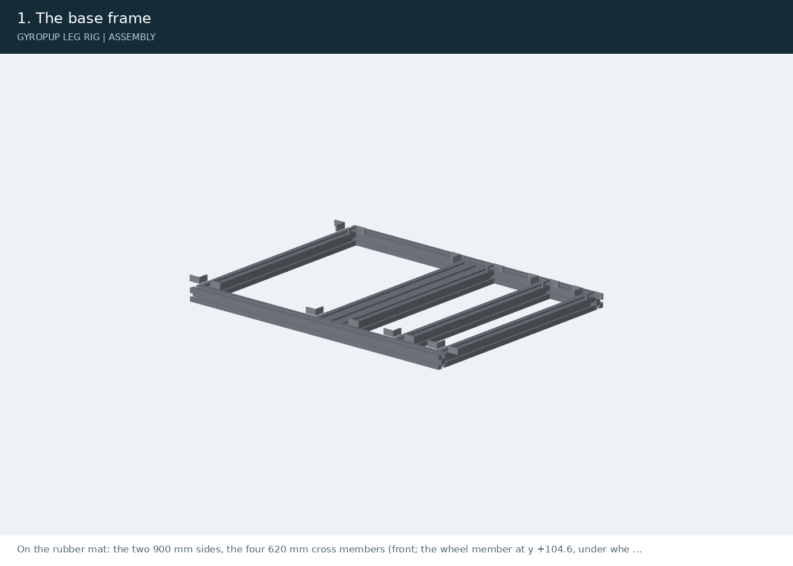

On the rubber mat: the two 900 mm sides, the four 620 mm cross members (front; the wheel member at y +104.6, under where the tyre lands; the bumper member against the post member; the rear) and the 4080 lying flat as the post's member. A corner bracket on each free vertical face of every joint (16: the bumper member and the post member lie against each other, so those two joints take one each side), their own M8 screws and drop-in nuts, square by the diagonals (equal to 1 mm), every screw 20 N m.

## 2. The post and the brace

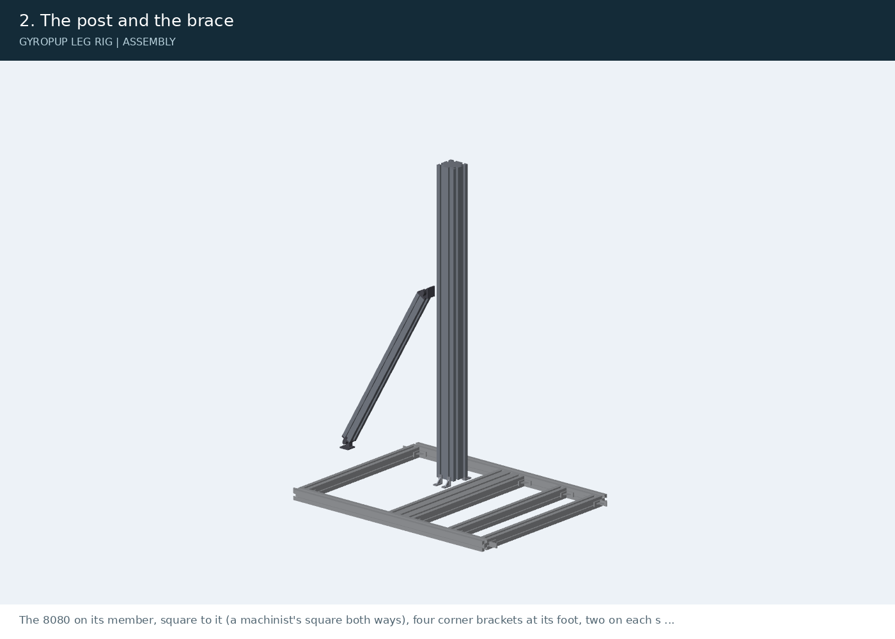

The 8080 on its member, square to it (a machinist's square both ways), four corner brackets at its foot, two on each side face. The 720 mm brace from the post's back face 668 mm above the deck's top (686 above the frame) to the rear member's top on a free-angle bracket at each end. Tighten the brace last, with the post plumb.

## 3. The rails

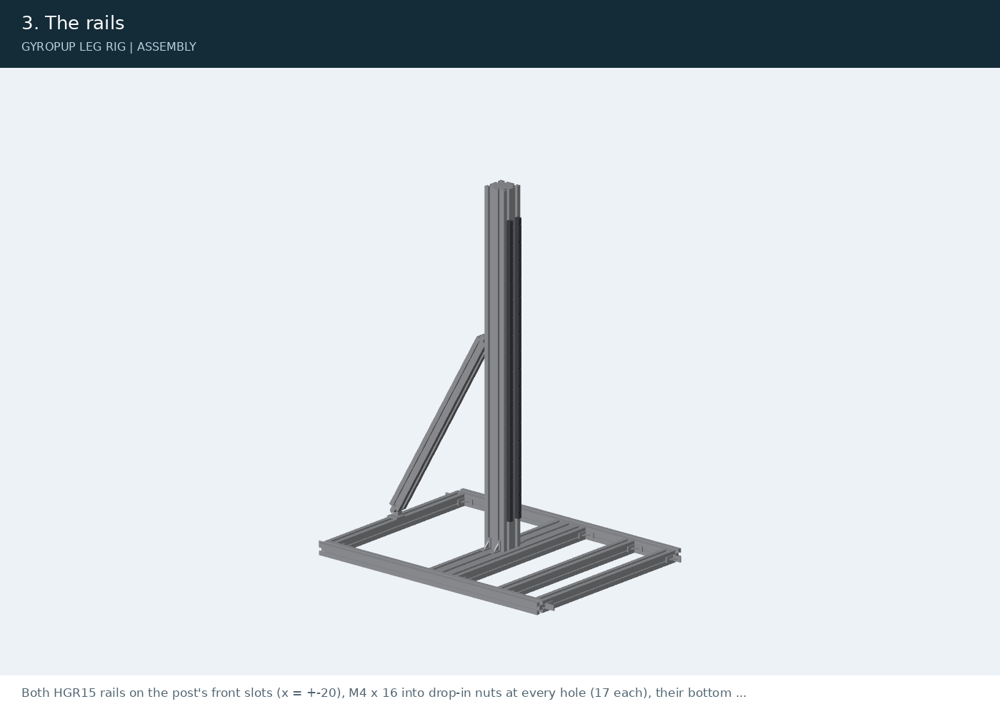

Both HGR15 rails on the post's front slots (x = +-20), M4 x 16 into drop-in nuts at every hole (17 each), their bottom ends 1 mm above where the deck's top will be (a 19 mm block on the frame while tightening). Snug them, run a block along both by hand, then tighten from the middle outwards (4 N m) while a second block rides the other rail: the carriage must slide its whole travel with no tight spot. The rails' top ends stay open until the carriage is on.

## 4. The deck and the ToF sensor

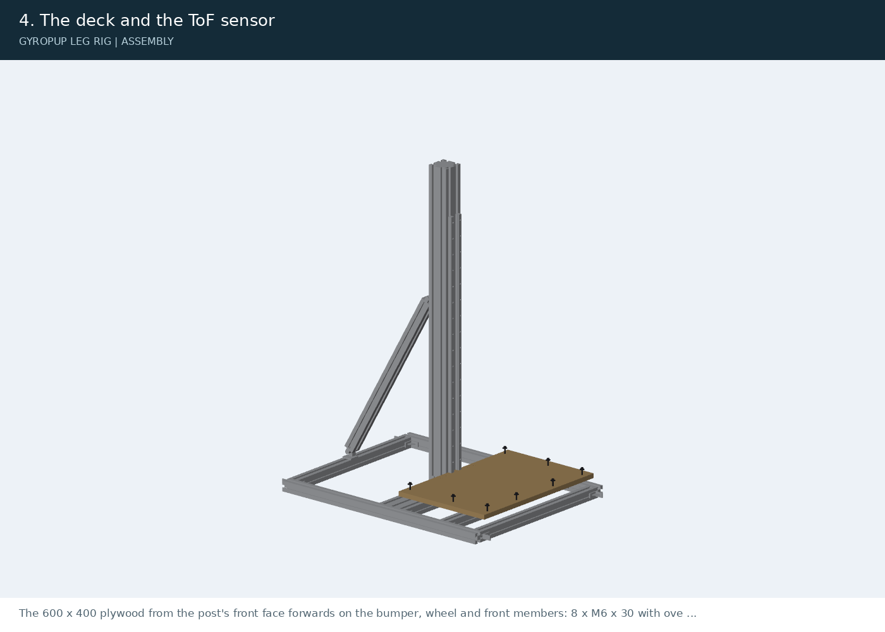

The 600 x 400 plywood from the post's front face forwards on the bumper, wheel and front members: 8 x M6 x 30 with oversized washers into drop-in nuts in the members' top slots (none under the tyre's landing, x within +-130 at y 60-150). The VL53L1X in its mount, facing up, at x -212 under the carriage's target: two M4 x 16 wood screws; its STEMMA QT lead to the pod.

## 5. The bumpers

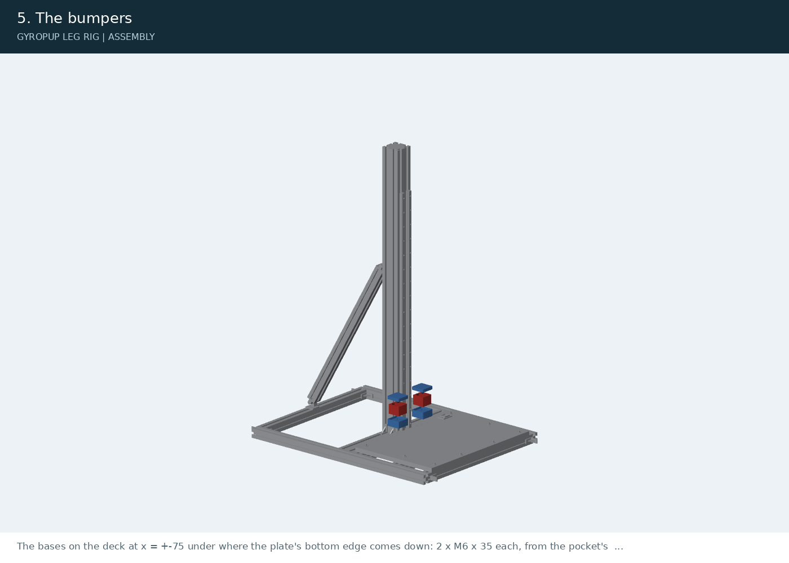

The bases on the deck at x = +-75 under where the plate's bottom edge comes down: 2 x M6 x 35 each, from the pocket's floor through the deck into drop-in nuts in the bumper member's top slot (the holes sit 11 mm behind the base's centre, over the slot); a TPU block in each pocket, a cap on each (R0 in docs/leg-bench-tests.md picks the infill first).

## 6. The pod

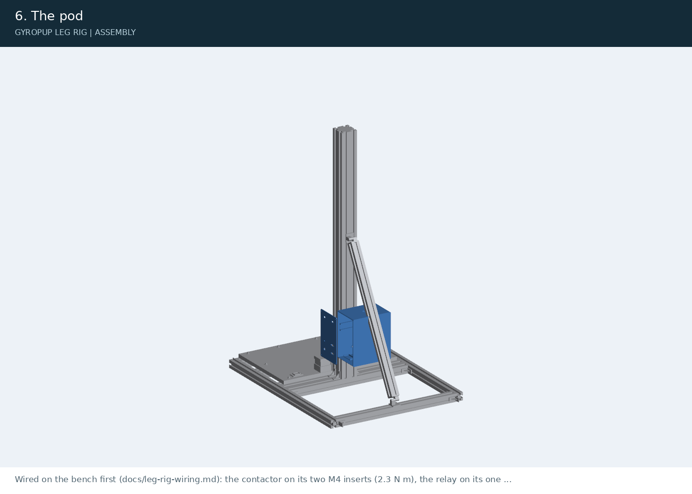

Wired on the bench first (docs/leg-rig-wiring.md): the contactor on its two M4 inserts (2.3 N m), the relay on its one, the Class CC fuse holder and the 12 V converter on the printed rail, the U2C in its pocket, the Feather on its FeatherWing on the -y wall; the panel's XT60s, jack and fuse holder. Then on the post's back face: 4 x M8 x 16 through the 6 mm pads into drop-in nuts. The pendant's clip on the -y wall: 2 x M4 x 10 into its inserts.

## 7. The hip frame and the motors (bench)

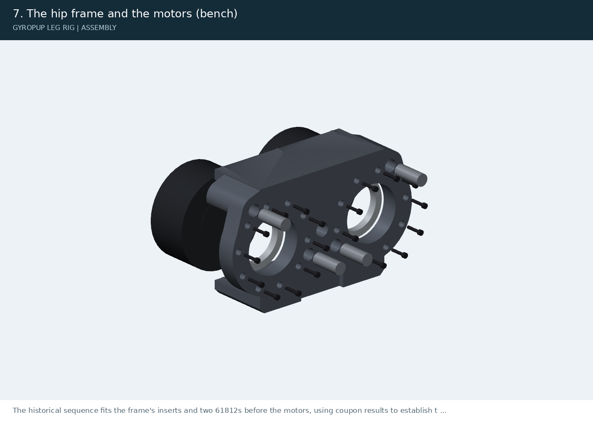

The historical sequence fits the frame's inserts and two 61812s before the motors, using coupon results to establish the bearing fit. Those physical coupon results have not been recorded. Each motor uses two Ø5 locating dowels and ten M4 x 20 mounting screws. The former counterbore and lug-tightening instructions are superseded: use [the current motor-fit evidence](rs04-mounting-fit.md) to establish the measured screw stack, and qualify support and preload separately. Fit the lug screws before upper links and stop posts as specified by the bounded driver-access study. This historical sequence does not approve dimensions, bearing retention, tightening torque or a powered zeroing test.

## 8. The upper links (bench)

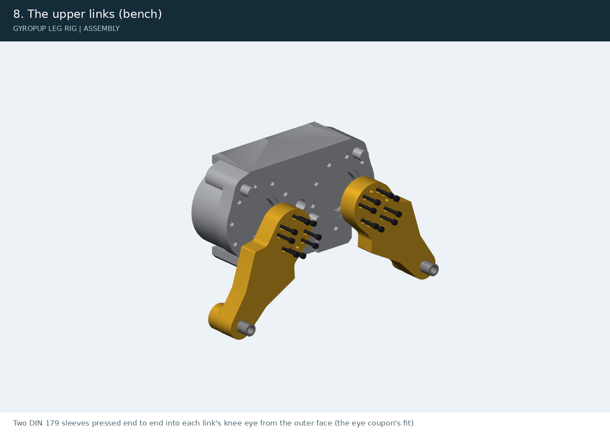

Two DIN 179 sleeves pressed end to end into each link's knee eye from the outer face (the eye coupon's fit). Each link onto its adapter's face: the two Ø5 dowels, 8 x M5 x 40 into the adapter's threads (D46: tapped aluminium), at the B4 torque (1.5 N m until B4 has run: the printed link under the heads sets it, for the 1,200 N per screw cad/leg_studies.py assumes). Both links swing freely to their bare posts.

## 9. The carriage (bench)

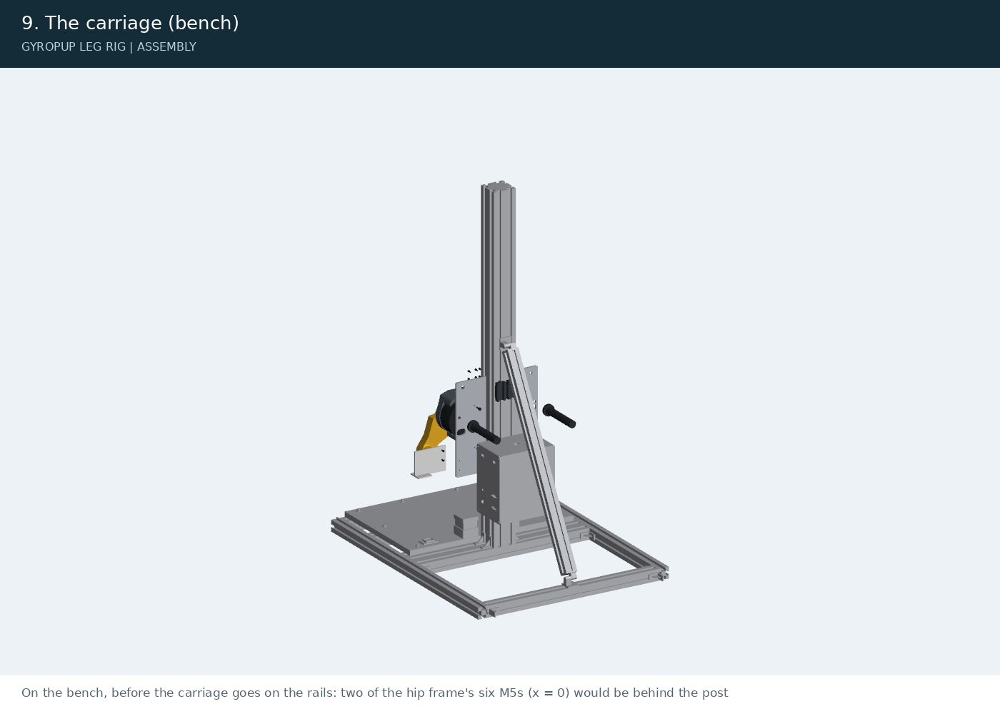

On the bench, before the carriage goes on the rails: two of the hip frame's six M5s (x = 0) would be behind the post. The four HGH15CA blocks onto the plate's back (16 x M4 x 10 from the front, no washers: 3.65 mm into their 5 mm threads; 3 N m); the two ballast posts (3/8-16 x 1 in and a plain washer from the front, 25 N m: out at x = +-138 the heads clear the motors' rear covers, which sit 2 mm in front of the plate); the ToF target arm (2 x M4 x 10 from the back into its inserts). Each motor's lead through its slot first (XT30 and GH plug together), then the upper half face down on the plate: 6 x M5 x 16 with washers from the back into the frame's inserts (the B4 torque).

## 10. The carriage onto the rails

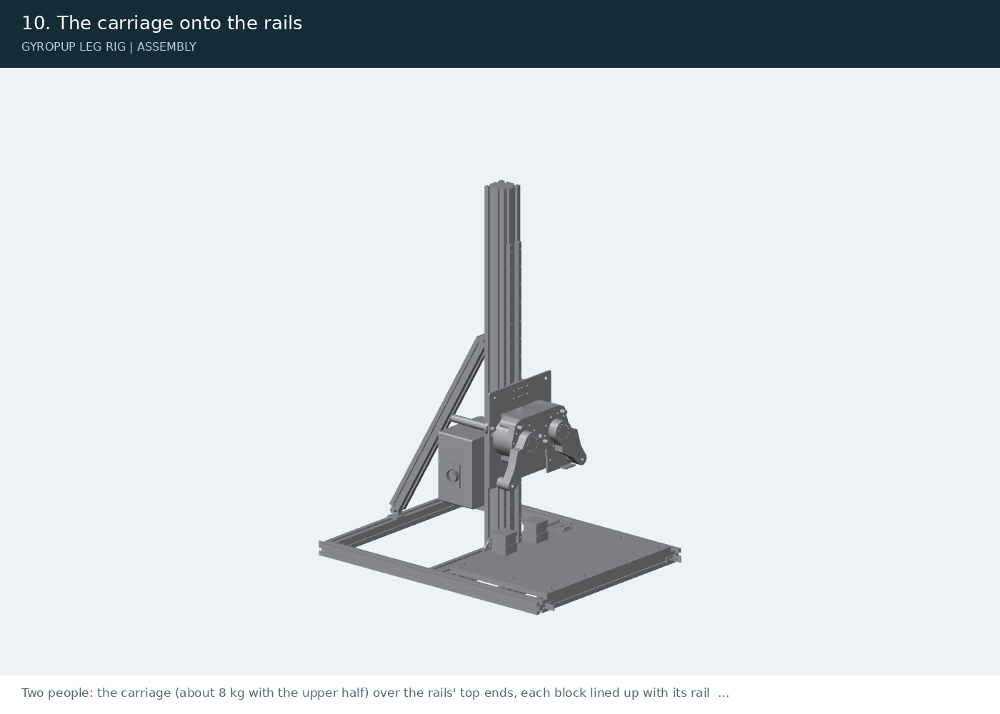

Two people: the carriage (about 8 kg with the upper half) over the rails' top ends, each block lined up with its rail and slid off its plastic retainer onto the steel, then down until it rests on the bumpers: the plate's edge lands on both caps at once (shim a base if not). On the plate's back: the two XT30s into the Y-splice, the two GH plugs into the CAN junction, the service loop up to the post's top (cable-tied to the plate's top edge).

## 11. The top stop

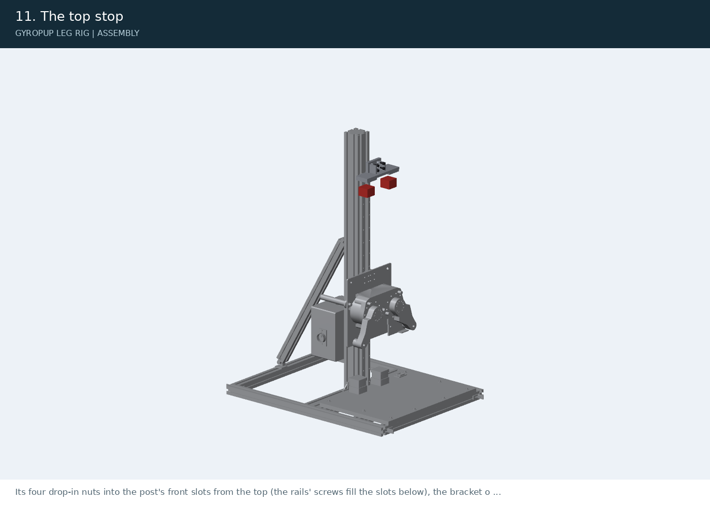

Its four drop-in nuts into the post's front slots from the top (the rails' screws fill the slots below), the bracket on them above the rails' ends: 4 x M8 x 16, 6 mm of bracket under each head; its two TPU blocks in its cups.

## 12. Zero the motors

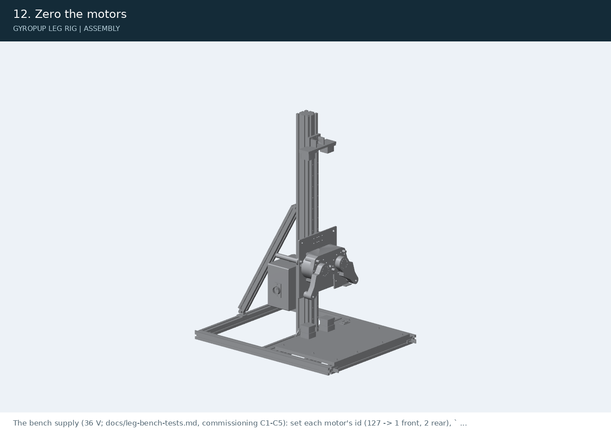

The bench supply (36 V; docs/leg-bench-tests.md, commissioning C1-C5): set each motor's id (127 -> 1 front, 2 rear), `python -m rig.rs04 --id N setup`, save. Then python -m rig.calibrate: hold each upper link on its bare knee-out post, it zeroes the motor there, you swing the link to the knee-in post, it checks the 142 deg between the bare posts and the direction and writes rig/calibration.json. Power off.

## 13. The knees

Two 6301-2RS and the 24 mm spacer tube into each lower link's knee boss (the boss coupon's fit), a DIN 433 washer each side; the 12 x 90 shoulder screw from the outer side through the lower link, the washers and the eye sleeves; the M10 nyloc in the upper link's pocket onto the sleeves (20 N m: steel on steel). The knees turn freely.

## 14. The apex

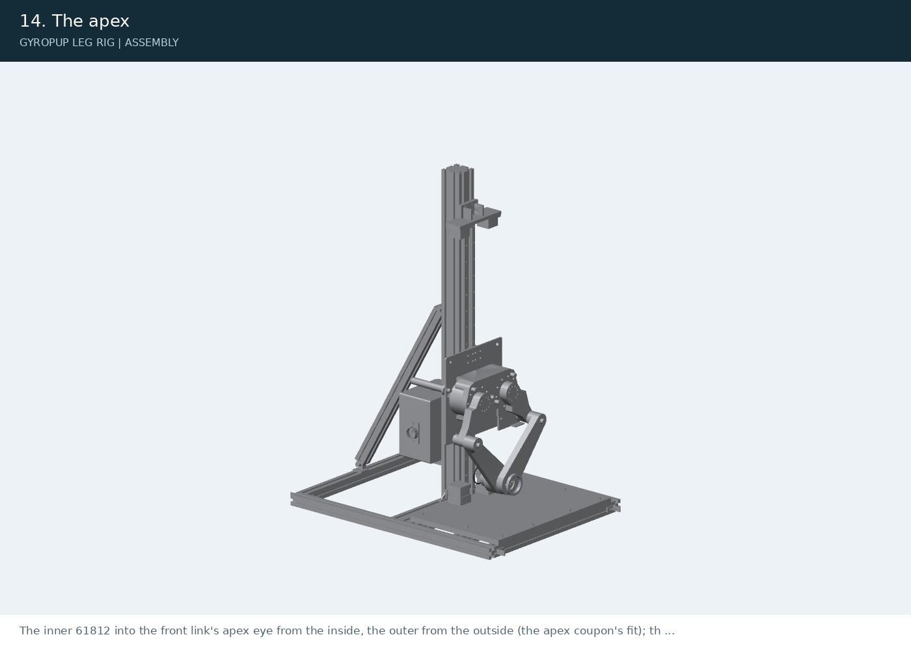

The inner 61812 into the front link's apex eye from the inside, the outer from the outside (the apex coupon's fit); the wheel link's hub through both from the outside with the printed spacer between the inner races; the DIN 471-60 circlip in its groove (circlip pliers). The loop now closes: the leg folds and stretches by hand from stop to stop.

## 15. The wheel

Measure the BotWheel's flange threads first (bom.json's note: M6 x 30 for a 15 mm thread). Its boss into the wheel link's recess, 4 x M6 x 30 from inside the hub (8 N m, threadlocker). Its phase and hall leads taped along the wheel link and the rear upper link (not driven on the rig: plan section 1.3).

## 16. The stop sleeves

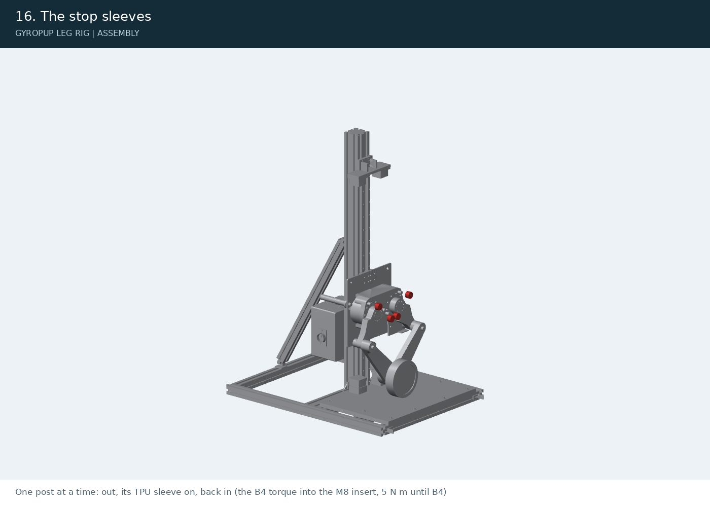

One post at a time: out, its TPU sleeve on, back in (the B4 torque into the M8 insert, 5 N m until B4). Swing the leg by hand to both stops: no part touches another; the knees stay free.

## 17. Ballast and tethers

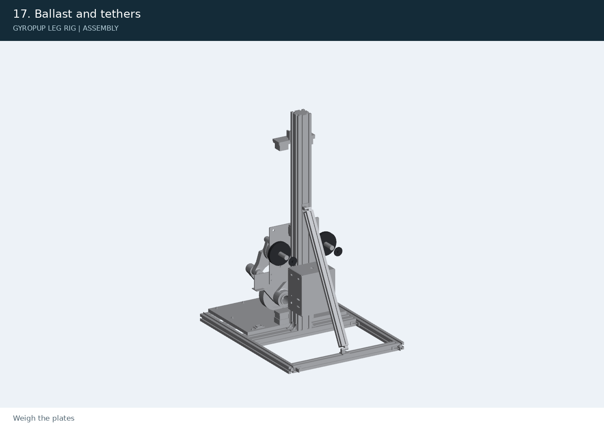

Weigh the plates. For 14.75 kg: one 2.5 lb plate per post (within 2 %: exports/rig/rig.json), retained by the 2 in washer and a 3/8-16 x 3/4 in screw in the post's end (25 N m). The carriage tether: the endless sling girth-hitched round the post under the top stop, a screwgate through the plate's tether hole, 150 mm slack above the highest jump. The link tether: a sling round the wheel link next to its knee boss to the same hole, slack over the whole range (sweep by hand).

## Torques

| Joint | Torque |
|---|---|
| Extrusion brackets (M8 into drop-in nuts) | 20 N m |
| Rails (M4 x 16 into drop-in nuts) | 4 N m |
| Blocks to plate (M4 x 10 into the block) | 3 N m |
| Plate to hip frame (M5 x 16 into heat-set inserts) | the B4 torque (1.5 N m until B4) |
| Motor lugs (M4 x 20, 12.9, into the RS-04) | Not established; qualify the measured mounting joint and preload before use. |
| Adapter to motor (M5 x 25, D46) | 6 N m, threadlocker |
| Upper link to adapter (M5 x 40 into tapped 6061, heads on the printed link) | the B4 torque (1.5 N m until B4) |
| Knee nut (M10 nyloc onto the steel sleeves) | 20 N m |
| Stop posts (M8 into heat-set inserts) | the B4 torque (5 N m until B4) |
| Wheel (M6 x 30 into the BotWheel) | 8 N m, threadlocker |
| Ballast posts (3/8-16) | 25 N m |
| Contactor mounting (M4) / load terminals (M5) | 2.3 / 4 N m (TE) |
