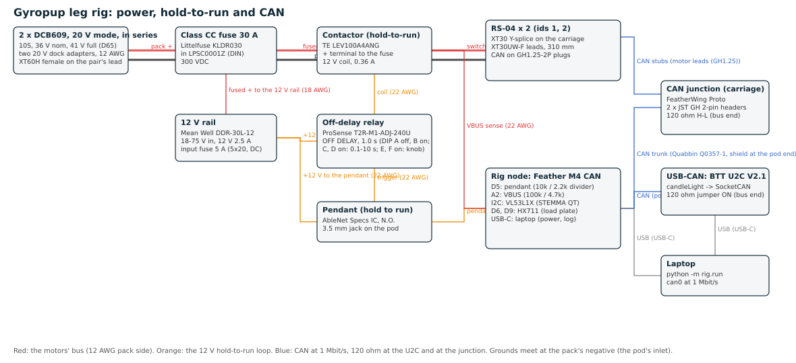

# Leg rig: wiring

What to wire, wire by wire, for the single-leg rig (docs/leg-prototype-plan.md section 3, task T10). The diagram is
`exports/rig/wiring.svg` (and the list behind it, `exports/rig/wiring.json`, from `tools/rig_wiring.py`); the parts and
their part numbers are in `docs/leg-rig-orders.md`; where each part sits in the pod is `cad/rig_parts.py` `POD_PARTS`.

## The rules

- **Nothing on the motors' bus is live unless the pendant is held.** The contactor in the pack's positive is closed only
  by the off-delay relay, and the relay only by the pendant; let go and the leg sits down under software, and 1.0 s later
  the contactor opens whatever the software did.
- **The pendant switches signals only.** It closes the relay's trigger input and tells the rig node; it never carries
  the contactor's coil current (AbleNet publishes no contact rating).
- **The pack is the master switch.** Unplug its XT60 and everything is dead; there is no other switch.
- **Jumps and drops start at or under 57.5 V - 27 A x the pack's resistance** (about 50 V until B6 measures it): the
  tuck and the landing push up to 27 A back into the pack and the RS-04 trips at 60 V (docs/leg-bench-tests.md).
- **One ground**: the pack's negative at the pod's inlet. The CAN ground, the 12 V rail's 0 V, the rig node's GND and the
  motors' negatives all meet there. The U2C is not isolated: on the bench supply or a floating pack that is fine; with the
  laptop on mains and the motors on the bench supply, use the isolated InnoMaker USB2CAN.

## Power: pack to motors (12 AWG silicone)

| # | From | To | Wire | Length | Notes |
|---|---|---|---|---|---|
| P1 | Dock adapter + | XT60H female (pack lead) | 12 AWG red | 0.5 m | the adapter's own leads; the female on the pack side: no bare live pin |
| P2 | Dock adapter - | XT60H female - | 12 AWG black | 0.5 m | |
| P3 | Pod inlet XT60E-M + | Class CC fuse holder, line | 12 AWG red, ferrule | 0.10 m | inside the pod |
| P4 | Fuse holder, load | Contactor + terminal (M5) | 12 AWG red, ring lug | 0.15 m | the LEV100's contacts are polarised: + to the pack side |
| P5 | Contactor - terminal (M5) | Pod outlet XT60E-F + | 12 AWG red, ring lug | 0.15 m | 4 N m on the M5 terminals (TE) |
| P6 | Pod inlet XT60E-M - | Pod outlet XT60E-F - | 12 AWG black | 0.10 m | also the ground point: the 12 V rail's 0 V, the CAN GND |
| P7 | XT60H male (motors' lead) | Y-splice on the carriage | 12 AWG red + black, twisted | 1.6 m | up the service loop: the post's top, down to the plate's top edge |
| P8 | Y-splice | 2 x XT30 male | 12 AWG pairs | 0.10 m | to each RS-04's XT30UW-F (red VBAT+, black GND) |

## The 12 V rail and the hold-to-run loop

| # | From | To | Wire | Notes |
|---|---|---|---|---|
| H1 | Fuse holder, load | Panel 5 x 20 holder (5 A, DC-rated) | 18 AWG red | taps the fused + before the contactor |
| H2 | 5 x 20 holder | DDR-30L-12 +Vin | 18 AWG red | -Vin to the ground point |
| H3 | DDR +Vo (12 V) | T2R supply + and its relay common | 22 AWG | a jumper from supply + to the common (the insert's Fig. C) |
| H4 | DDR -Vo (0 V) | T2R supply -, the ground point | 22 AWG | |
| H5 | DDR +Vo | 3.5 mm jack, tip | 22 AWG | the pendant's one side |
| H6 | 3.5 mm jack, sleeve | T2R trigger, pin 5 | 22 AWG | the trigger switch between pin 5 and supply + (the insert's Fig. D) |
| H7 | T2R N.O. contact | Contactor coil + (flying lead) | 22 AWG | 0.36 A at 12 V; a 1N4001 across the coil, cathode to + |
| H8 | Contactor coil - | the ground point | 22 AWG | |
| H9 | 3.5 mm jack, sleeve | 10k -> Feather D5, 2.2k -> GND | on the FeatherWing | the node sees the pendant: 12 V reads 2.2 V |

**The relay's settings** (DIP switches, power off while setting): function OFF DELAY (A off, B on), range 0.1-10 s (C on,
D on), the onboard knob (E on, F on); the knob at 1.0 s, checked with a stopwatch on a lamp before the contactor is wired.
Check the terminal numbers against the label on the unit before wiring: the T2R is a Macromatic design, pin 5 is its
trigger.

**How it behaves:** pendant held: the trigger closes, the relay's contact closes at once, the coil pulls the contactor in
(40 ms). Pendant let go: the rig node stops its RUN frames at once, the laptop's controller sits the leg down in 0.3 s and
stops the motors; the relay times 1.0 s and drops the coil; the contactor opens (10 ms). At power-up with the pendant not
held the relay stays open (not true of every timer: the Klemsan Z1K-M2A is reported to close for its delay at power-up).

## CAN (1 Mbit/s, 29-bit RobStride private protocol)

| # | From | To | Wire | Notes |
|---|---|---|---|---|
| C1 | Laptop USB | U2C | USB-C | `sudo ip link set can0 up type can bitrate 1000000` |
| C2 | U2C H, L, GND | Feather CAN terminal H, L, G | twisted pair + ground, 0.3 m | the U2C's 120 ohm jumper ON (it ends the bus) |
| C3 | Feather CAN terminal | CAN junction H, L, GND | Quabbin Q0357-1 (pair + ground, shielded), 1.6 m | up the service loop; the shield to GND at the pod end only. If the Feather has an on-board terminator, open it: it sits mid-bus |
| C4 | Junction GH header 1 | RS-04 id 1 (front) GH plug | the motor's lead | blue CAN_H, brown CAN_L; a 0.35 m stub |
| C5 | Junction GH header 2 | RS-04 id 2 (rear) GH plug | the motor's lead | |
| C6 | Junction | 120 ohm across H-L | | the bus's far end |

The junction: two JST BM02B-GHS-TBT headers on a FeatherWing Proto with short 26 AWG tails to its terminal pads, cable-tied
to the carriage plate's back next to the leads' slots. Fallback: cut the motors' GH plugs off and join their leads to the
trunk in lever connectors (blue to H, brown to L).

**Check before any motor is enabled:** with everything off, 60 ohm between H and L at the junction (two 120 ohm in
parallel); `python -m rig.rs04 --iface can0 scan` finds both motors.

## The rig node (Feather M4 CAN Express in the pod)

| Pin | To | Notes |
|---|---|---|
| CAN H, L, G | the bus (C2, C3) | |
| D5 | the pendant sense (H9) | input; high while the pendant is held |
| A2 | the motors' bus after the contactor: 100k from the contactor's - terminal, 4.7k to GND | 60 V reads 2.69 V; sampled at 2 kHz, sent as max/min/mean every 10 ms (0x702) |
| STEMMA QT (I2C) | VL53L1X on the deck (0.6 m cable) | the carriage's height from its target (0x701) |
| D6 (DT), D9 (SCK), 3V3, GND | HX711 -> the load plate's four half-bridge cells, on a 4-pin header | stand, squat and B5; for B3 and B4 the bench's load cell plugs in instead, with its own HX711 |
| USB-C | the laptop | power and its log |

Its frames (`rig/node.py`): RUN 0x700 at 100 Hz while D5 is high (0x5A in byte 0), SENSE 0x701 at 50 Hz, VBUS 0x702 at
100 Hz; it never commands a motor. Its firmware: `rig/firmware/feather_rig/` (task T11: CircuitPython; `code.py`, `rig_frames.py` and `settings.json` onto the CIRCUITPY drive, the install steps at the top of `code.py`).

## Connectors

| Connector | Pins |
|---|---|
| XT60 (pack in, motors out) | + and - moulded on the housing; the pack's lead and the pod's outlet carry the females |
| XT30 (each RS-04) | the motor's lead is the female (XT30UW-F): red +, black - |
| GH1.25 2-pin (each RS-04) | blue CAN_H, brown CAN_L (RS04 manual 2.3) |
| 3.5 mm mono jack | tip: +12 V from the DDR; sleeve: the trigger and the node's sense |
| RS-04 board connector (for reference) | 1 power +, 2 power -, 3 CAN_L, 4 CAN_H (manual 2.5) |
