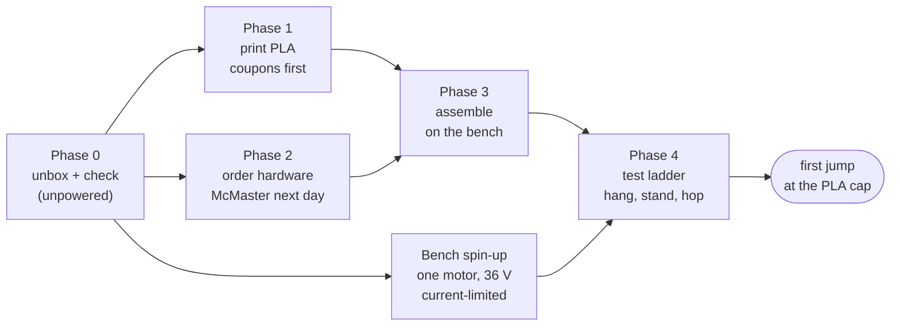

# Motor day: the first leg in PLA, to a first jump

The four RS-04 leg motors arrive on 2026-11-02. This page is the plan for using them: check them, print one leg in
PLA, order its hardware, put it together and work up to a jump. PLA is not strong enough for the robot. Here it only
has to survive a slow, capped test ladder, and the caps below are set so it should.

Every table between `gen:` markers is written by `cad/motor_day.py` from the CAD, the catalogues and the rig
simulation. Edit the script, not the tables.

**Download everything:** [motor-day-package.zip](../exports/motor-day/motor-day-package.zip) (CSV lists, STL and 3MF
print files, drawings).

> **Not a release.** No part on this page has been printed, bought or run. The owner runs every powered test. The
> RS-04 mounting support (#116) and the leg's structural cases (#29) are still open; PLA does not change that.

## The day-one stand: a boom, not the rig

The [extrusion rig](leg-rig-assembly.md) is the right tool for the measured tests (S1-S6), but it is 98 order lines
and 17 steps. For the first jump, the leg goes on the end of a wooden boom that pivots at a post: the classic
hopping-leg stand. The boom keeps the leg upright and in its plane, and a rope stops it rising too far.

<!-- gen:stand -->
(generated: the stand's picture, its parts and what it gives up)
<!-- /gen:stand -->

## Phase 0: when the motors arrive (unpowered first)

| # | Check | How | OK when |
|---|---|---|---|
| 0.1 | Inventory | Four RS-04s, their leads and connectors, against [purchases.md](purchases.md). Photograph each label (serial, firmware) | 4 motors, no transit damage, output turns freely by hand with a light, even cogging |
| 0.2 | Weigh and measure | Scale; calipers on the output flange, the mounting lugs and the dowel holes | mass within 5 % of 1,420 g; the dimensions the [mounting-fit record](rs04-mounting-fit.md) lists |
| 0.3 | Unpowered fit on a printed lug coupon | Print `coupon_frame_ring_nom` (the RS-04 seat cut from the hip frame, see Phase 1); offer the motor up to it with the two Ø5 dowels and two M4 x 20 by hand | the dowels enter, the motor face sits flat (0.05 mm feeler does not enter), screws start by hand. Write the result on #116 |
| 0.4 | Bench spin-up, one motor | [Leg rig safety](leg-rig-safety.md) rule 4: bench supply at 36 V, **current limit 2 A**, motor clamped to the bench, nothing on the output. Then C1-C5 in [the bench tests](leg-bench-tests.md#c1-c6-commissioning-one-motor-on-the-bench-supply) | the motor answers on CAN (id 127), takes ids 1-4, reports `limit_torque` as set; a 1 rad slow move at 2 N m and back |

C1-C5 need a USB-CAN adapter on SocketCAN, two 120 ohm terminators and an XT30 lead (Phase 2, "other vendors").
Without them, Phase 0 stops at 0.3.

## Phase 1: what to print (PLA)

<!-- gen:prints -->
(generated: the print list with PLA settings, time and grams from the slicer)
<!-- /gen:prints -->

## Phase 2: what to order

<!-- gen:orders -->
(generated: the McMaster-Carr list with part numbers, prices and substitutes; other vendors)
<!-- /gen:orders -->

## Phase 3: assembly

<!-- gen:assembly -->
(generated: exploded steps and ballooned drawings keyed to the BOM item numbers)
<!-- /gen:assembly -->

## Phase 4: the test ladder to a first jump

<!-- gen:derating -->
(generated: the PLA derating from cad-agent's material rows and the rig simulation at the day-one torque caps)
<!-- /gen:derating -->

<!-- gen:ladder -->
(generated: the ladder, each rung's cap and what to watch)
<!-- /gen:ladder -->
