# Motor day: the first leg in PLA, to a first jump

The four RS-04 leg motors have arrived. This page is the plan for using them: check them, print one leg in
PLA, order its hardware, put it together and work up to a jump. PLA is not strong enough for the robot. Here it only
has to survive a slow, capped test ladder, and the caps below are set so it should.

Every table between `gen:` markers is written by `tools/motor_day.py` from the CAD, the catalogues and the rig
simulation. Edit the script, not the tables.

**Download everything:** [motor-day-package.zip](../exports/motor-day/motor-day-package.zip) (CSV lists, STL and 3MF
print files, drawings).

> **Not a release.** No part on this page has been printed, bought or run. The owner runs every powered test. The
> RS-04 mounting support (#116) and the leg's structural cases (#29) are still open; PLA does not change that.

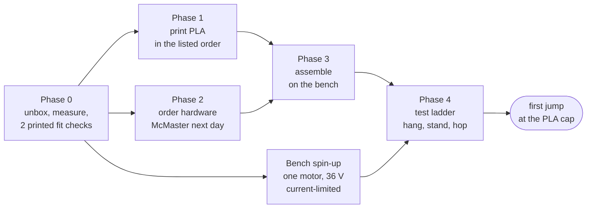

## The day-one stand: a boom, not the rig

The [extrusion rig](leg-rig-assembly.md) is the right tool for the measured tests (S1-S6), but it is 98 order lines
and 17 steps. For the first jump, the leg goes on the end of a wooden boom that pivots at a post: the classic
hopping-leg stand. The boom keeps the leg upright and in its plane, and a rope stops it rising too far.

<!-- gen:stand -->
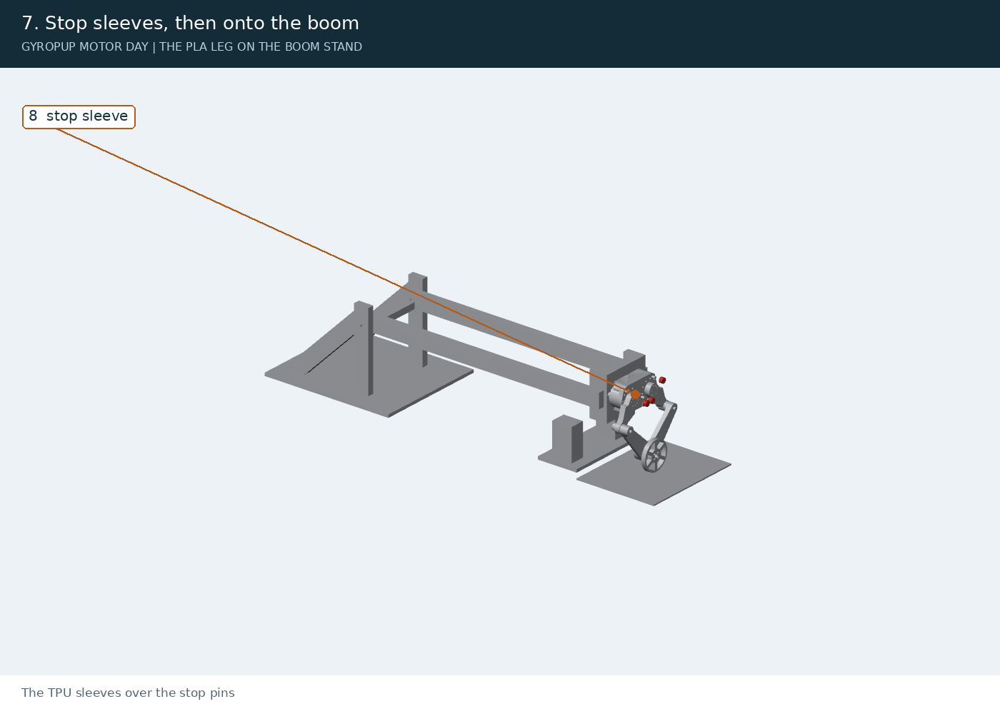

The boom is two 2x4 rails, 1.54 m from the pivot to the hip. Its parts and dimensions are on drawing MD-05 below. What it gives up:

| The rig has | The boom stand |
|---|---|
| Vertical rails: the hip goes straight up | An arc about the pivot: over a 150 mm rise the foot moves 7 mm along the boom (the wheel's axle direction) |
| 14.75 kg of ballast, the robot's half | no ballast: the boom's own weight at the foot (below), lighter, so gentler landings |
| ToF height sensor, load plate | none: the motors' encoders give the leg's length; film the jump against a tape |
| Bumpers and a top stop | the floor stop and the tether |
| The rig's numbers (S1-S6) compare with the simulation | rough: the arc and the boom's inertia are not in the model |

**Weight, not ballast.** The simulation carries one mass, 11.1 kg, for both the weight the leg holds and the inertia it accelerates. The stand already weighs about **11.9 kg** at the foot (a scale under it, the boom resting on it) while its inertia there is about 10.6 kg (15.1 kg moving, lumber at estimated densities). Ballast on the plate would add to both, so add none. Weigh it with the motors unpowered: the reading is `--half-mass` in the ladder. The derating scales the simulated forces by the larger mass; **above 12.7 kg the PLA cap no longer holds**: lighten the boom (a thinner end plate, shorter rails) before running.
<!-- /gen:stand -->

## Phase 0: when the motors arrive (unpowered first)

The motors have arrived. Phase 0 checks them unpowered against the drawing, then fits them to the first two prints
(Phase 1, prints 1 and 2) before the leg is printed.

| # | Check | How | OK when |
|---|---|---|---|
| 0.1 | Inventory | Four RS-04s, their leads and connectors, against [purchases.md](purchases.md). Photograph each label (serial, firmware) | 4 motors, no transit damage, output turns freely by hand with a light, even cogging |
| 0.2 | Weigh and measure | A scale under one bare motor; calipers on the output and the case (the table below) | each line of the table below written in; mass within 5 % of 1,420 g (the manual) or of 1,510 g (the spec sheet). Write the readings on #116 |
| 0.3 | Case fit: the frame-ring coupon (print 1) | `coupon_frame_ring_nom` is the ring of the hip frame that the motor's case bolts to. It has 10 x M4 clearance holes on Ø106, counterbored from the bed face. It also has two Ø5 holes on the same circle for the steel dowels (item 20, Ø5 x 16). The dowels locate the case: it has two Ø5 locating holes, 4.5 deep in the vendor STEP, and no pins. The printed dowel holes are 12 deep, which leaves a dowel 4.0 mm proud: only 0.5 mm short of the case hole's floor. So first drill each dowel hole deeper with a 5.2 mm twist drill, its tip 14.5 mm in (mark the drill with tape). A Ø5 dowel then stops where the drill's point narrows to 5.0, 13 mm down. The 5.2 keeps the CAD's slip fit for the epoxy; a 5.0 drill would make the dowel a press fit, which can split the PLA. There is solid PLA behind. Push the two dowels to the bottom, dry (no epoxy). If a dowel will not slide into the case's holes by hand, do not force it: leave the dowels out, do the rest of the check and write it on #116. Offer the case face up to the coupon, then start the ten M4 x 20 (item 19) by hand. The hip frame (print 4) has the same 12 mm holes: drill its four the same way (assembly step 3) | each dowel stands 3.0 mm proud (2.0 to 3.5: the calipers' depth rod on the seat face); the dowels enter the case's holes, the case face sits flat on the coupon (a 0.05 mm feeler does not enter), all ten M4 start by hand and run down without force. If item 19 has not come: any M4 x 20, not longer (20 leaves 4.4 mm in the case's 5 mm of thread). If item 20 has not come: check the face and the screws now, and the dowels when it comes |
| 0.4 | Output fit: the first PLA output adapter (print 2) | Press the adapter's motor face onto the output flange by hand, the three Ø6 pins into its three sockets. Then the nine M5 x 25 (item 22) through its counterbores into the output's M5 holes, by hand | all three Ø6 pins enter their sockets without force; the adapter's face sits flat on the flange (a 0.05 mm feeler does not enter); all nine M5 start by hand. If item 22 has not come: any M5 x 25, not longer (25 leaves 6 mm in the output's 6.5 mm of thread) |
| 0.5 | Bench spin-up, one motor | [Leg rig safety](leg-rig-safety.md) rule 4: bench supply at 36 V, **current limit 2 A**, motor clamped to the bench, nothing on the output. Then C1-C5 in [the bench tests](leg-bench-tests.md#c1-c6-commissioning-one-motor-on-the-bench-supply) | the motor answers on CAN (id 127), takes ids 1-4, reports `limit_torque` as set; a 1 rad slow move at 2 N m and back |

**If the pins bind in 0.4.** None of the C1 bore coupons has a Ø6 socket (they cover the leg's bearing seats, the
knee-eye sleeve bores, the stop-pin holes and the Ø5 dowel holes), so there is no coupon offset to pick for these.
The PLA adapter is the machined part's file: its three sockets are Ø6.00 (the H7 size), 3.5 deep, with no allowance
for a printed hole coming out small and no lead-in where they open on the bed. Open each socket by hand with a 6.0 mm
drill until the drill's full diameter is 3.5 mm in. The drill's point is about 1.8 mm long, so its tip goes about
5.5 mm deep: mark the drill at 5.5 mm with tape. There is solid PLA behind the socket's floor at that depth; do not
go through. Take the bed's flare off the mouths with a deburring tool. Do the same to the second adapter (print 5)
before it goes on.

**Measured on arrival** (0.2). Fill in the blanks; the design values are from the [RS-04 drawing and
STEP](../research/actuator-interfaces.md#robstride-rs-04-swap-candidate).

| Quantity | Design | Measured |
|---|---|---|
| Output pins: count, size, where | 3 x Ø6 (0/-0.01), on Ø35.86, between the 9 x M5 on Ø36 | **3 x Ø6, on the output between the M5 holes** (owner, 2026-11-03) |
| Neighbouring output pins, centre to centre | 31.06 mm (35.86 x sin 60°): calipers across two pins' outsides read 37.06 | |
| Output pins, standing proud | 3 ± 0.25 mm | |
| Output flange: diameter, and proud of the case face | about Ø49.8; 0.5 ± 0.3 mm | |
| Output M5 holes: count, circle | 9 x M5, 6.5 deep minimum, on Ø36 | |
| Case front: screw holes | 10 x M4, 5 deep minimum, on Ø106 | |
| Case front: locating features | 2 x Ø5 on Ø106, opposite each other (3° and 183°) | **2 x Ø5 holes, no pins** (owner, 2026-11-03: "the motor has no dowels on the static part of the motor (the two dowel holes)") |
| Case front: locating holes' depth | 4.5 mm (vendor STEP; not on the drawing). Push a Ø5 x 16 dowel in by hand to its stop and measure what stands out: the depth is 16 less that. Also write down whether it slid in by hand | |
| Case outside diameter | Ø120 | |
| Mass, one bare motor | 1,420 ± 20 g (manual); 1,510 g (spec sheet) | Owner, 2026-11-03: the 4 motors in their boxes weigh 7 kg together (1.75 kg each, boxed). The owner estimates 1.5–1.6 kg bare (spec 1.51 kg); weighing one bare motor is still to do. |

C1-C5 need a USB-CAN adapter on SocketCAN, two 120 ohm terminators and an XT30 lead (Phase 2, "other vendors").
Without them, Phase 0 stops at 0.4.

## Phase 1: what to print (PLA)

<!-- gen:prints -->
Sliced in Bambu Studio for a P1S, 0.4 mm nozzle, 0.20 mm layers, Bambu PLA Basic (TPU 95A HF for the sleeves). "Solid" is what the FEA assumes: 4 walls and 100 % infill. Times are the slicer's estimates. **Print them in this order**, top to bottom; "Item" is the BOM number the drawings and assembly steps use.

| Print | Part | Qty | Item | File | Settings | Time | Filament | Bed face, what to watch |
|---|---|---|---|---|---|---|---|---|
| **1** | **coupon frame ring nom** (Phase 0) | 1 |  | [coupon_frame_ring_nom.stl](../exports/rig/bench/coupon_frame_ring_nom.stl) | solid | 3.6 h | 202 g | the RS-04 seat cut from the hip frame, as printed in it: the motor's unpowered fit (Phase 0.3) |
| **2** | **output adapter (PLA)** (Phase 0) | 1 | 6 | [output_adapter.stl](../exports/leg/cnc/output_adapter.stl) | solid | 1.9 h | 70 g | the first of the two, printed before the leg: the motor's output fit (Phase 0.4). The motor face down (the three Ø6 pin sockets open on the bed); tap the eight face M5 holes by hand (M5 x 0.8 tap) before assembly step 4 |
| **3** | **C1 bore coupons** (Coupons) | 20 | | `exports/rig/bench/coupon_*_m01/nom/p01.stl` | solid | 12.3 h | 544 g | the leg's press-fit bores at -0.1 / 0 / +0.1 mm: print them as one batch and pick the offset that fits ([sheets](../research/leg-preprint/sheets/)). If a coupon other than `nom` fits, change the CAD before print 4: `PRINT_HOLE_COMP` for the sleeve holes (the RS-04 dowel holes are drilled out: Phase 0.3); `KC`, `AC` and `STOP_HOLE_PLAY` for the bearing seats and stop-pin holes (`cad/fivebar.py`; the [print package](leg-print-package.md) C1 row). Then regenerate the leg's files (`cad/build_leg.py`, then `tools/motor_day.py --slice` for the times and grams) |
| **4** | **hip frame** (Leg and stand) | 1 | 1 | [hip_frame.3mf](../exports/leg/hip_frame.3mf) | solid | 19.3 h | 1261 g | the web's outer face down, turned 45 deg (249 mm of the 256 mm bed: brim 3 mm at most); keep the stop-pin holes' lead-ins clean |
| **5** | **output adapter (PLA)** (Leg and stand) | 1 | 6 | [output_adapter.stl](../exports/leg/cnc/output_adapter.stl) | solid | 1.9 h | 70 g | the second, as the first; if Phase 0.4 needed the pin sockets opened with a 6.0 mm drill, open this one's the same way before it goes on; tap the eight face M5 holes |
| **6** | **upper link** (Leg and stand) | 2 | 2 | [upper_link.3mf](../exports/leg/upper_link.3mf) | solid | 14.2 h | 963 g | the outer face down; the knee-eye sleeve holes open on the bed |
| **7** | **wheel link** (Leg and stand) | 1 | 4 | [wheel_link.3mf](../exports/leg/wheel_link.3mf) | solid | 10.7 h | 734 g | the outer face down; the outer knee seat opens on the bed |
| **8** | **front link** (Leg and stand) | 1 | 3 | [front_link.3mf](../exports/leg/front_link.3mf) | solid | 8.1 h | 526 g | the inner face down, turned 45 deg; add tree supports from the bed only (never in the bearing seats) by hand: the time and grams here are without them (the slicer's auto-arrange refuses the 247 mm part with supports on) |
| **9** | **apex spacer** (Leg and stand) | 1 | 5 | [apex_spacer.3mf](../exports/leg/apex_spacer.3mf) | solid | 0.3 h | 15 g | the inner face down |
| **10** | **foot** (Leg and stand) | 1 | 7 | [foot.stl](../exports/motor-day/parts/foot.stl) | foot | 7.4 h | 246 g | the outer face down (nut pockets open on the bed), the boss up; stands in for the BotWheel |
| **11** | **stop sleeve** (Leg and stand) | 4 | 8 | [stop_sleeve.3mf](../exports/leg/stop_sleeve.3mf) | tpu | 1.7 h | 63 g TPU | TPU 95A, cap down |
| **12** | **drill template** (Leg and stand) | 1 | 9 | [drill_template.stl](../exports/motor-day/parts/drill_template.stl) | jig | 1.0 h | 61 g | flat; lay it on the plywood end plate to drill the six M5 holes and mark the two lead slots |

**Total:** 82.3 h of printing, 4.69 kg of PLA and 63 g of TPU: the two Phase 0 fit checks 5.5 h, the coupons 12.3 h, the leg and stand 64.5 h. Every file, with these settings and this order in `prints.csv`, is in the bundle.

**On one printer, print in the order above.** Prints 1 and 2 are the two fit checks (Phase 0.3 and 0.4). Fit each to a motor as it comes off the bed. The coupon is cut from the hip frame round one motor, and the first adapter is the same file as the second. So a misfit shows up before the hip frame (19.3 h) and the second adapter are printed. Print 3, the coupons, shows how the leg's bores come out in PLA. Start the hip frame 17.8 h in, once both fits have passed and the coupon offsets are picked. It is the longest print, and the motors go on it first. The drill template is last only because the leg does not need it. Print it sooner if you want to build the boom (assembly steps 1 and 2) while the leg prints.

**PLA limits on the bench.** PLA softens at about 55 °C and the RS-04s bolt straight to the hip frame: feel the motor cases, and stop above 40 °C. PLA creeps under a clamp: re-torque the M5s before each session.
<!-- /gen:prints -->

## Phase 2: what to order

<!-- gen:orders -->
### McMaster-Carr (20 lines, $588.55 in packs)

Part numbers from `catalog/hardware.json` (picked and read with the mcmaster-parts tooling). Prices as read on the date given; McMaster sells most screws in packs, so the cost is the packs'. Already have it? The last column says what will do.

| Item | McMaster | Part | Qty | Packs | Cost | Already have? |
|---|---|---|---|---|---|---|
| 10 | [6656K236](https://www.mcmaster.com/6656K236/) | Steel Ball Bearing, Steel, Shielded, Trade Number 6812-2Z, ABEC Rating 1 | 4 | 4 x 1 | $276.44 | 6812-2RS or -2Z (60 x 78 x 10) from any bearing shop |
| 11 | [5972K86](https://www.mcmaster.com/5972K86/) | Deep groove ball bearing 6301-2RSH (12 x 37 x 12, sealed both sides); McMaster-Carr 5972K86 is the same trade number (6301-2RS) | 4 | 4 x 1 | $50.12 | any 6301-2RS (12 x 37 x 12), check C0 >= 4.15 kN |
| 12 | [98541A174](https://www.mcmaster.com/98541A174/) | External Retaining Ring, for 60 mm OD, Black-Phosphate Spring Steel | 1 | 1 x 1 | $3.05 | any DIN 471 external ring for a 60 mm shaft |
| 13 | [92981A411](https://www.mcmaster.com/92981A411/) | Alloy Steel Shoulder Screws, 12 mm Shoulder Diameter, 90 mm Shoulder Length, M10 x 1.5 mm Thread | 2 | 2 x 1 | $16.04 |  |
| 14 | [94645A220](https://www.mcmaster.com/94645A220/) | High-Strength Steel Nylon-Insert Locknut, Zinc Plated, M10 x 1.5 mm Thread Size | 2 | 1 x 25 | $11.58 | any M10 x 1.5 nylon-insert nut |
| 15 | [98689A118](https://www.mcmaster.com/98689A118/) | 18-8 Stainless Steel Washer, Undersized, for M12 Screw Size, 13.0 mm ID, 20.0 mm OD | 4 | 1 x 100 | $13.71 | any M12 washer 20 mm OD or less (it must clear the knee boss) |
| 16 | [9056K68](https://www.mcmaster.com/9056K68/) | Multipurpose 6061 Aluminum Round Tube, 0.065" Wall Thickness, 5/8" OD | 2 | 1 x 1 | $6.26 | 5/8 in (15.9 mm) aluminium or steel tube, cut to 24 mm |
| 17 | [96990A403](https://www.mcmaster.com/96990A403/) | Metric Press-Fit Drill Bushing, 12 mm ID, 18 mm OD, 20 mm Long, Chamfer on One End | 4 | 4 x 1 | $64.44 |  |
| 18 | [98432A386](https://www.mcmaster.com/98432A386/) | Vented Pull-Out Dowel Pin with Flat Shaft, High-Strength 52100 Alloy Steel, 16 mm Diameter, 40 mm Long | 4 | 4 x 1 | $23.52 | a 16 mm steel rod or dowel, 40 mm long |
| 19 | [91290A168](https://www.mcmaster.com/91290A168/) | Black-Oxide Alloy Steel Socket Head Screw, US Origin, M4 x 0.7 mm Thread Size, 20 mm Long | 20 | 1 x 100 | $14.47 | any M4 x 20 socket head, class 12.9 (10.9 at a pinch); length matters: the RS-04 has 5 mm of usable thread |
| 20 | [91595A352](https://www.mcmaster.com/91595A352/) | Dowel Pin, 52100 Alloy Steel, 5 mm Diameter, 16 mm Long | 4 | 1 x 50 | $19.22 | any 5 mm h6/m6 steel dowel, 16 mm |
| 21 | [91595A356](https://www.mcmaster.com/91595A356/) | Dowel Pin, 52100 Alloy Steel, 5 mm Diameter, 20 mm Long | 4 | 1 x 25 | $10.88 | any 5 mm h6/m6 steel dowel, 20 mm |
| 22 | [91290A252](https://www.mcmaster.com/91290A252/) | Black-Oxide Alloy Steel Socket Head Screw, US Origin, M5 x 0.8 mm Thread Size, 25 mm Long | 18 | 1 x 50 | $10.96 | any M5 x 25 socket head, class 10.9 or 12.9 |
| 23 | [91290A662](https://www.mcmaster.com/91290A662/) | Black-Oxide Alloy Steel Socket Head Screw, M5 x 0.8 mm Thread Size, 40 mm Long, Partially Threaded | 16 | 1 x 50 | $8.09 | any M5 x 40 socket head (partly threaded is fine) |
| 24 | [94459A775](https://www.mcmaster.com/94459A775/) | Heat-Set Threaded Inserts for Plastic, Standard, Brass, M5 x 0.8 mm Thread Size, 7.9 mm Installed Length | 6 | 1 x 25 | $6.82 | any M5 heat-set insert for a 6.4 mm hole, about 8 mm long |
| 25 | [91290A336](https://www.mcmaster.com/91290A336/) | Black-Oxide Alloy Steel Socket Head Screw, US Origin, M6 x 1 mm Thread Size, 40 mm Long | 4 | 1 x 50 | $13.29 | any M6 x 40 socket head |
| 26 | **to confirm** | Washer, undersized (DIN 433), for M6 screw, 6.4 mm ID, 11.0 mm OD, 1.6 mm thick, 18-8 stainless steel | 4 | 4 x 1 | - | any M6 washer of 11 mm OD or less (a DIN 125 at 12 mm touches the hub bore) |
| 27 | [94645A205](https://www.mcmaster.com/94645A205/) | High-Strength Steel Nylon-Insert Locknut, Zinc Plated, M6 x 1 mm Thread Size | 4 | 1 x 100 | $12.26 | any M6 nylon-insert nut (10 mm across flats: the foot's pocket is 10.4) |
| 28 | [91290A254](https://www.mcmaster.com/91290A254/) | Black-Oxide Alloy Steel Socket Head Screw, US Origin, M5 x 0.8 mm Thread Size, 30 mm Long | 6 | 1 x 50 | $11.93 | any M5 x 30 socket head; check 10-11 mm reaches into the insert through your plywood |
| 29 | [91116A140](https://www.mcmaster.com/91116A140/) | 18-8 Stainless Steel Oversized Washer, for M5 Screw, 5.3mm ID, 15.0mm OD, 1.0mm to 1.4mm Thick | 6 | 1 x 100 | $15.47 | any M5 fender washer, 15 mm OD or more |

### Other vendors

| Group | Item | Qty | Vendor | Each | When | Note |
|---|---|---|---|---|---|---|
| filament | [Bambu Lab PLA Basic, 1 kg spool](https://us.store.bambulab.com/products/pla-basic-filament) | 6 | Bambu Lab | $14.99 | Phase 1 | 4.69 kg sliced + 10 % |
| filament | [Bambu Lab TPU 95A HF, 1 kg spool](https://us.store.bambulab.com/products/tpu-95a-hf) | 1 | Bambu Lab | $41.99 | Phase 1 | 0.06 kg sliced + 10 % |
| leg | RobStride RS-04 | 2 | RobStride | $255.00 | later | in hand (arrived: Phase 0 checks them) |
| leg | ODrive Robotics BotWheel (BW0124) | 1 | ODrive Robotics | $134.50 | later | later: the printed foot stands in on day one (other vendors) |
| leg | [Output adapter, machined 6061-T6 (exports/leg/cnc/output_adapter.step, README.md)](https://jlccnc.com/) | 2 | JLCCNC (instant price on upload) | - | order now (5-10 days) | replaces the PLA stand-ins before any cap above the PLA cap |
| leg | Structural epoxy, two-part, metal to plastic (D74) | 1 | owner's choice | - | Phase 3 | the stop pins, the knee-eye sleeves, the RS-04 dowels; not an anaerobic retainer on plastic |
| electronics | [DeWalt 20 V MAX dock adapter, 12 AWG leads, switch and 30 A blade fuse](https://www.amazon.com/dp/B0B9NPZM3M) | 2 | Amazon (CHoiKWong, sold by LIANQUAN) | $9.99 | Phase 4 (the pod: pendant, contactor, relay) |  |
| electronics | [36 V 16.6 A enclosed supply](https://www.bravoelectro.com/lrs-600-36.html) | 1 | Bravo Electro | $61.60 | Phase 0 (bench spin-up) |  |
| electronics | [Class CC time-delay fuse 30 A, 600 VAC / 300 VDC](https://www.standardelectricsupply.com/Littelfuse-KLDR030-TXP-POWR-GARD-Time-Delay-Fuse) | 1 | Standard Electric Supply | $31.70 | Phase 4 (the pod: pendant, contactor, relay) |  |
| electronics | [Class CC fuse holder, 1-pole, DIN rail, 600 VAC/DC](https://www.galco.com/lpsc0001z-littelfuse.html) | 1 | Galco | $28.99 | Phase 4 (the pod: pendant, contactor, relay) |  |
| electronics | [Sealed DC contactor 100 A, 900 VDC, 12 V coil (5.5 W)](https://www.tti.com/content/ttiinc/en/apps/part-detail.html?partsNumber=LEV100A4ANG&mfgShortname=TYC) | 1 | TTI, Inc. | $86.64 | Phase 4 (the pod: pendant, contactor, relay) |  |
| electronics | [Timer relay, multifunction (off-delay with a trigger input), 0.1-10 s, 12-125 VDC / 240 VAC, 10 A](https://www.automationdirect.com/adc/shopping/catalog/relays_-z-_timers/timer_relays/t2r-m1-adj-240u) | 1 | AutomationDirect | $44.50 | Phase 4 (the pod: pendant, contactor, relay) |  |
| electronics | [DIN-rail DC-DC, 18-75 V in, 12 V 2.5 A out](https://www.bravoelectro.com/ddr-30l-12.html) | 1 | Bravo Electro | $27.60 | Phase 4 (the pod: pendant, contactor, relay) |  |
| electronics | [USB to CAN adapter (candleLight gs_usb: SocketCAN)](https://biqu.equipment/products/bigtreetech-ebb36-42-can-bus-u2c-v2-1-klipper-board?variant=39762747949154) | 1 | BIQU Equipment | $23.99 | Phase 0 (bench spin-up) | US alternate: InnoMaker USB2CAN-Module (isolated) $34.99 ships from China: order the US alternate for day one |
| electronics | [Feather M4 CAN Express (ATSAME51)](https://www.adafruit.com/product/4759) | 1 | Adafruit | $24.95 | Phase 4 (the pod: pendant, contactor, relay) |  |
| electronics | [VL53L1X time-of-flight breakout, 30-4000 mm](https://www.adafruit.com/product/3967) | 1 | Adafruit | $14.95 | Phase 4 (the pod: pendant, contactor, relay) |  |
| electronics | [HX711 load cell amplifier](https://www.sparkfun.com/products/13879) | 1 | SparkFun | $4.95 | Phase 4 (the pod: pendant, contactor, relay) |  |
| electronics | [4 x 50 kg half-bridge load cells + HX711](https://www.amazon.com/dp/B079FTXR7Y) | 1 | Amazon (Geekstory) | $7.90 | Phase 4 (the pod: pendant, contactor, relay) |  |
| electronics | [Momentary switch, 35 mm, 6 ft cord, 3.5 mm mono plug](https://www.ablenetinc.com/specs-ic/) | 1 | AbleNet | $75.00 | Phase 4 (the pod: pendant, contactor, relay) |  |
| electronics | [12 AWG silicone wire, 10 ft red + 10 ft black](https://bntechgo.com/bntechgo-12-gauge-silicone-wire-kit-ultra-flexible-20-ft-black-and-red-each-color-10-ft-high-temp-200-c-600v-12-awg-silicone-wire-680-strands-of-tinned-copper-wire-stranded-wire-stranded-wire-for-model-battery/) | 1 | BNTECHGO | $14.98 | Phase 0 (bench spin-up) |  |
| electronics | [XT30 connector, male](https://www.racedayquads.com/products/xt30-connector-male-or-female) | 3 | RaceDayQuads | $0.99 | Phase 0 (bench spin-up) |  |
| electronics | [XT60H connector](https://www.racedayquads.com/products/amass-xt60h-connector-1pc-choose-your-version) | 4 | RaceDayQuads | $0.99 | Phase 4 (the pod: pendant, contactor, relay) |  |
| electronics | [Shielded 22 AWG 1.5-pair data cable, 20 ft](https://www.automationdirect.com/adc/shopping/catalog/bulk_wire_-a-_cable/data_-a-_communication_cable/q0357-1) | 1 | AutomationDirect | $21.20 | Phase 0 (bench spin-up) |  |
| electronics | [120 ohm 1/4 W (1000)](https://www.tti.com/content/ttiinc/en/apps/part-detail.html?partsNumber=CFR-25JB-52-120R&mfgShortname=YAG) | 2 | TTI, Inc. | $0.02 | Phase 0 (bench spin-up) |  |
| electronics | [Ferrule crimper + 770 ferrules (23-10 AWG)](https://www.iwiss.com/products/hsc8-6-4-kit-ferrule-crimping-tool-kit-awg-23-10-self-adjustable-ratchet-ferrule-crimper-plier-c-w-770end-sleeve-ferrules-connector-terminals) | 1 | IWISS | $19.99 | Phase 4 (the pod: pendant, contactor, relay) |  |
| electronics | [Heat-shrink assortment](https://www.racedayquads.com/products/530-pcs-heat-shrink-tube-set) | 1 | RaceDayQuads | $9.99 | Phase 0 (bench spin-up) |  |
| electronics | [10 ohm 25 W aluminium-housed resistor (box of 10)](https://www.tti.com/content/ttiinc/en/apps/part-detail.html?partsNumber=HSA2510RJ&mfgShortname=TYC) | 1 | TTI, Inc. | $3.70 | Phase 4 (the pod: pendant, contactor, relay) |  |
| electronics | [JST GH 1.25 mm 2-pin header, top entry (SMT)](https://www.lcsc.com/product-detail/C161690.html) | 4 | LCSC | $0.09 | Phase 0 (bench spin-up) |  |
| electronics | [Rectifier diode 1N4001 (1 A, 50 V)](https://www.sparkfun.com/diode-rectifier-1a-50v-1n4001.html) | 2 | SparkFun | $0.25 | Phase 4 (the pod: pendant, contactor, relay) |  |
| electronics | [Resistor kit 1/4 W, 500 (incl. 2.2k, 4.7k, 10k, 100k)](https://www.sparkfun.com/resistor-kit-1-4w-500-total.html) | 1 | SparkFun | $9.00 | Phase 4 (the pod: pendant, contactor, relay) |  |
| electronics | [FeatherWing Proto](https://www.adafruit.com/product/2884) | 2 | Adafruit | $4.95 | Phase 4 (the pod: pendant, contactor, relay) |  |
| electronics | [Socket head screw M2.5 x 8](https://www.mcmaster.com/91290A102/) | 4 | McMaster-Carr | $0.25 | Phase 4 (the pod: pendant, contactor, relay) |  |
| electronics | [XT60 male panel plug (the pack's inlet)](https://pro.maplin.co.uk/products/male-xt60e-panel-mount-gold-plated-connector-20a-amass) | 1 | Maplin (UK) | $1.50 | Phase 4 (the pod: pendant, contactor, relay) |  |
| electronics | [XT60 female panel socket (the motors' outlet)](https://www.jameco.com/z/XT60E-F-Amass-XT60-Female-Bullet-Plug-Connector-2-Position-for-RC-Battery-Panel-Mount-60A_2338319.html) | 1 | Jameco Electronics | $0.95 | Phase 4 (the pod: pendant, contactor, relay) |  |
| electronics | [3.5 mm panel jack](https://www.masterelectronics.com/en/switchcraft/35pm2a-12319088.html) | 1 | Master Electronics | $6.95 | Phase 4 (the pod: pendant, contactor, relay) |  |
| electronics | [5 x 20 mm panel fuse holder](https://www.digikey.com/en/products/detail/littelfuse-inc/03455LS1H/553826) | 1 | Digi-Key | $7.16 | Phase 4 (the pod: pendant, contactor, relay) |  |
| electronics | [5 x 20 mm fuse 5 A, DC-rated](https://www.digikey.com/en/products/detail/littelfuse-inc/0477005-MXP/1979192) | 2 | Digi-Key | $1.00 | Phase 4 (the pod: pendant, contactor, relay) |  |
| stand (hardware store) | 2x4 lumber, 8 ft (the rails, cleats, uprights, braces, floor stop) | 4 | any hardware store | - | Phase 2 | straight and dry; spruce-pine-fir |
| stand (hardware store) | Plywood 23/32 in, 2 x 4 ft (the end plate, the base, the stop board) | 1 | any hardware store | - | Phase 2 | catalog/rig.json plywood_18 |
| stand (hardware store) | Carriage bolt 1/2-13 x 5 in, 2 fender washers, 1 nylon-insert nut (the pivot, each side) | 2 | any hardware store | - | Phase 2 | price not checked |
| stand (hardware store) | Construction screws #10 x 3 in (rails to cleats, cleats through the plate, uprights, braces) | 40 | any hardware store | - | Phase 2 | price not checked |
| stand (hardware store) | Rope 6 mm (1/4 in), 3 m, and a screw eye (the tether) | 1 | any hardware store | - | Phase 2 | price not checked |
| stand (hardware store) | Sandbags or weight plates (on the stand's base) | 4 | any hardware store | - | Phase 2 | price not checked |
| stand (hardware store) | Bathroom scale (weigh the boom's end: the effective mass) | 1 | any hardware store | - | Phase 2 | in hand? |
| stand (hardware store) | Rubber mat under the foot | 1 | any hardware store | - | Phase 2 | catalog/rig.json rubber_mat (Amazon) |
<!-- /gen:orders -->

## Phase 3: assembly

<!-- gen:assembly -->
Each step's new parts in colour, lifted along the way they go in; the numbers are the BOM items (`bom.csv`). Torques for PLA are lower than the PA6-CF leg's.

#### 1. The stand: base, uprights, braces

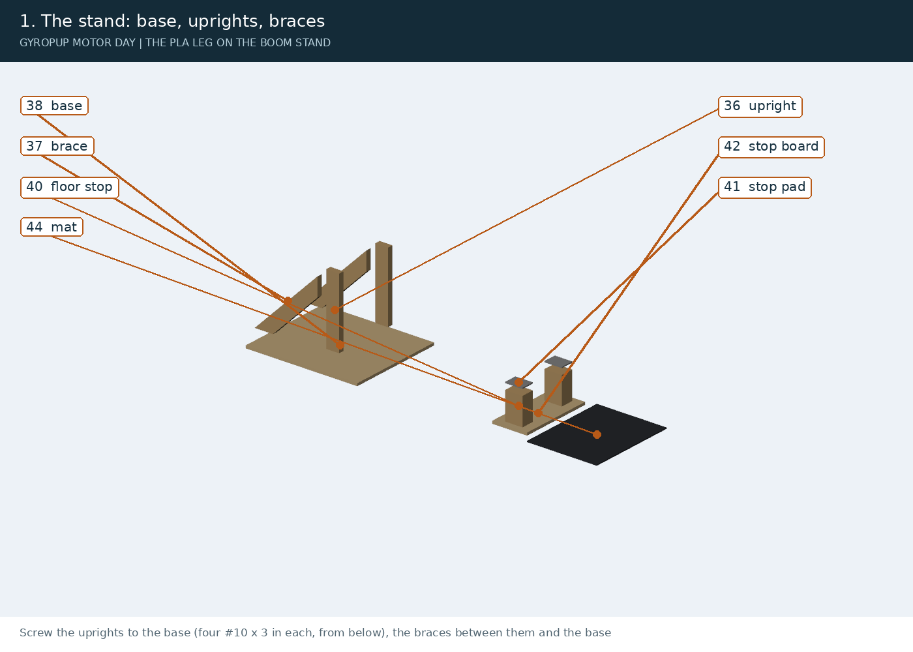

Screw the uprights to the base (four #10 x 3 in each, from below), the braces between them and the base. Stack the floor stop under where the rails will be and top it with the rubber pad. Weight the base with sandbags.

#### 2. The boom

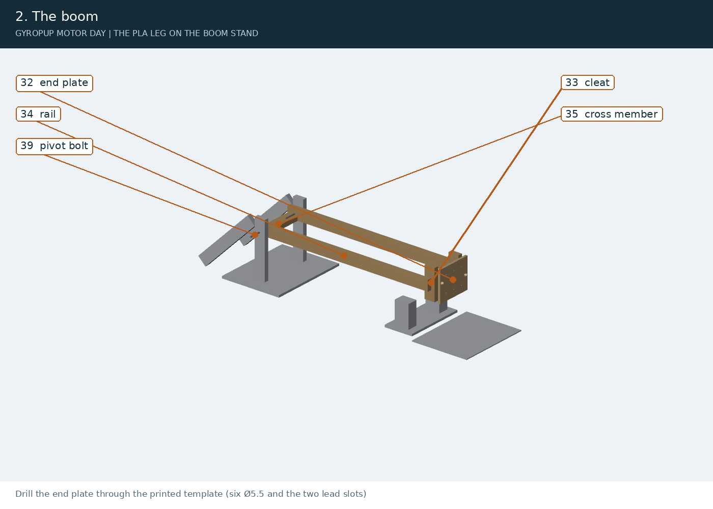

Drill the end plate through the printed template (six Ø5.5 and the two lead slots). Screw the cleats to the plate's back through its face, then the rails to the cleats' outer faces (four screws each, glued). Join the rails' far ends with the cross member. Hang the rails between the uprights on the two carriage bolts, a fender washer each side.

#### 3. Hip frame and motors (bench)

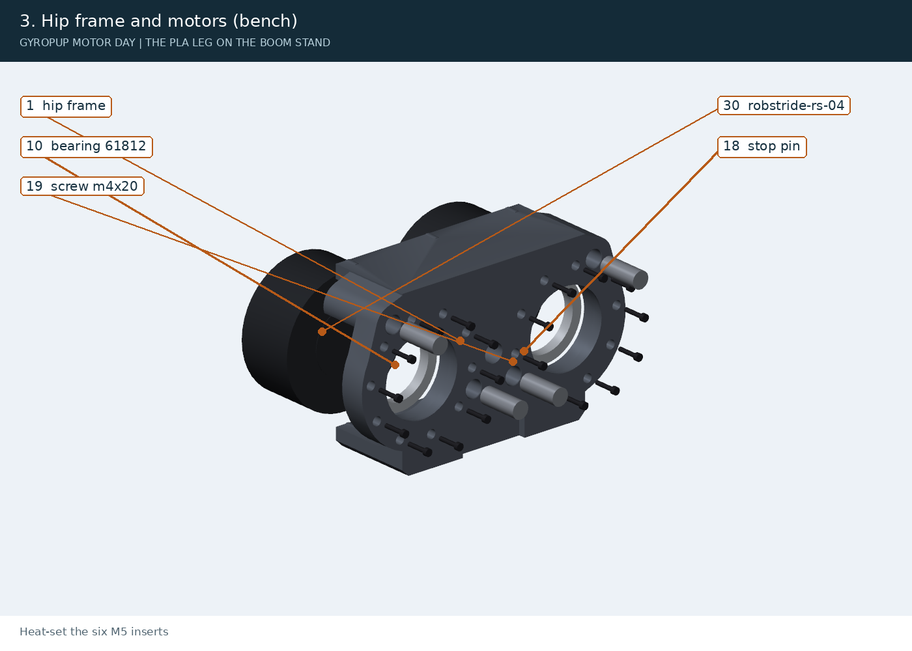

Heat-set the six M5 inserts. Press the two 61812s in from the motor side onto their lip (the C1 coupon says how tight PLA comes out). Drill the four Ø5 dowel holes deeper with a 5.2 mm drill, its tip 14.5 mm in (the same tape mark as Phase 0.3), so a dowel stops 13 mm down. With the epoxy, bond the four stop pins, and the four Ø5 x 16 dowels pushed to the bottom; wipe the squeeze-out flush with the seat face, and hold each dowel square to the face (a small square against it) while the epoxy sets. After the cure, check each dowel stands 3.0 mm proud (2.0 to 3.5). Each motor on its two dowels (into the case's two locating holes) and ten M4 x 20, snug only: the lug torque is not established (#116).

#### 4. Upper links and adapters (bench)

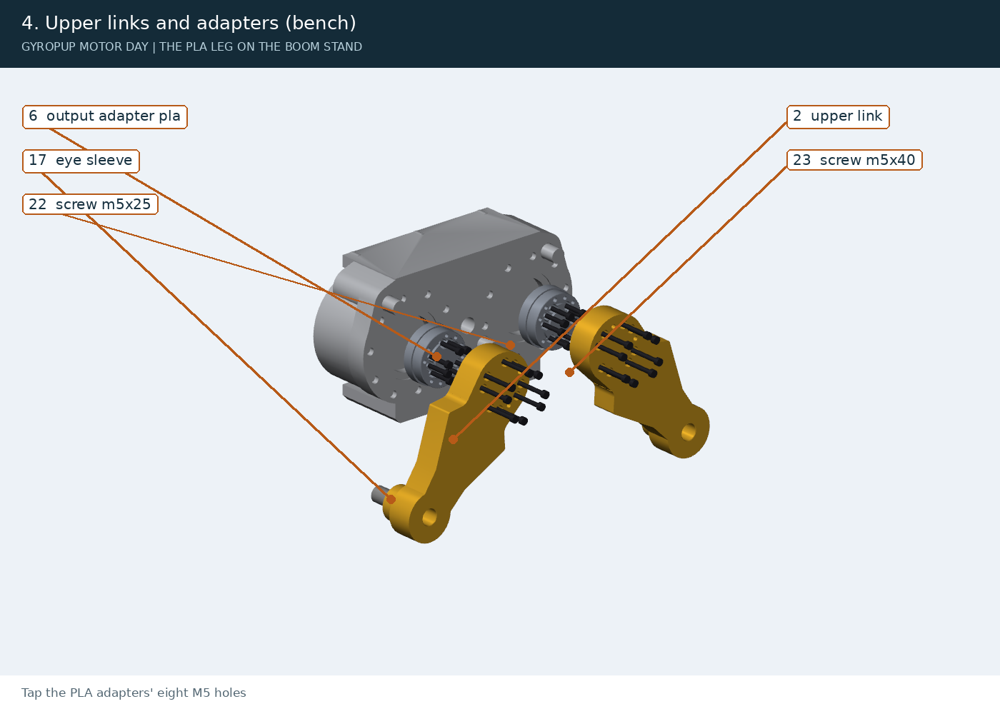

Tap the PLA adapters' eight M5 holes. Each adapter onto its motor's output: nine M5 x 25, heads in the pockets, snug (PLA: no 6 N m). The two DIN 179 sleeves bonded end to end into each link's knee eye. Each link on its adapter: two Ø5 x 20 dowels, eight M5 x 40 at 1.0 N m. Both links swing freely to their bare stop pins.

#### 5. Knees

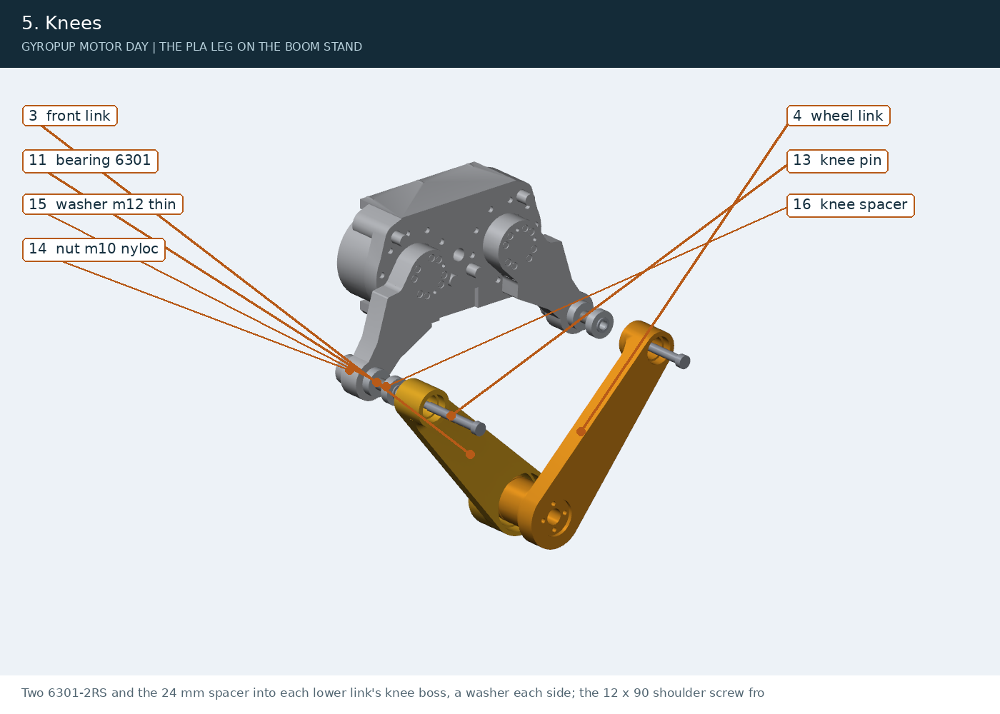

Two 6301-2RS and the 24 mm spacer into each lower link's knee boss, a washer each side; the 12 x 90 shoulder screw from outside through the lower link and the eye sleeves; the M10 nyloc in the upper link's pocket (20 N m: steel on steel). The knees turn freely.

#### 6. Apex and foot

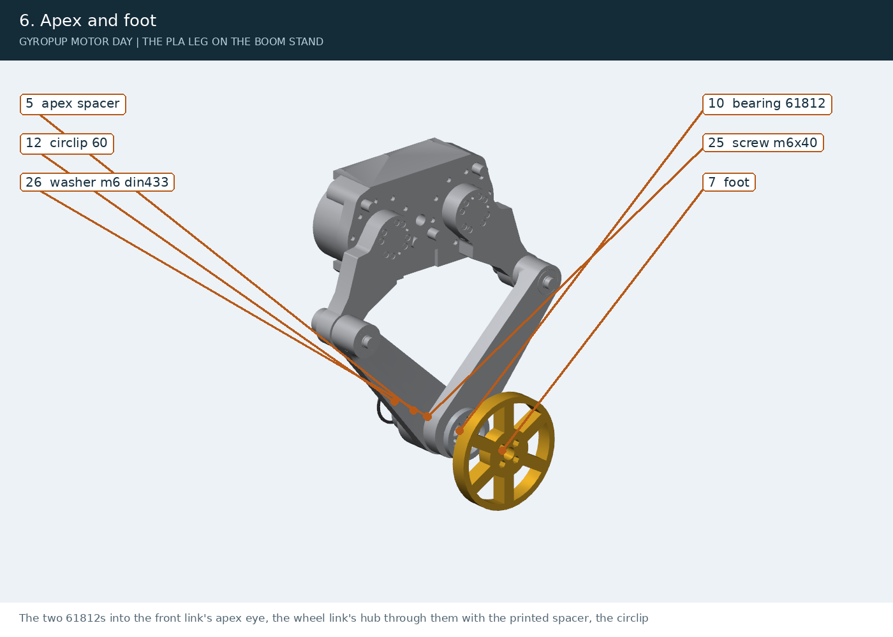

The two 61812s into the front link's apex eye, the wheel link's hub through them with the printed spacer, the circlip. The foot's boss into the wheel link's recess, four M6 nylon-insert nuts in its pockets, four M6 x 40 from inside the hub on the DIN 433 washers at 0.9 N m (the nuts bear on printed PLA: half the PA6-CF leg's torque). The leg folds and stretches by hand from stop to stop.

#### 7. Stop sleeves, then onto the boom

The TPU sleeves over the stop pins. The leg onto the end plate: six M5 x 30 with fender washers from the plate's back into the hip frame's inserts (1.5 N m), each motor's lead through its slot. Tie the tether. Put the leg's foot on the bathroom scale with the motors unpowered, the boom resting on it, and write the reading down: it is `--half-mass` in the ladder. No ballast.

### Drawings

Generated from the same CAD with hidden-line views, balloons keyed to the BOM items and the parts list on each sheet. All five are in [motor-day-drawings.pdf](../exports/motor-day/drawings/motor-day-drawings.pdf).

**MD-01 Hip module**

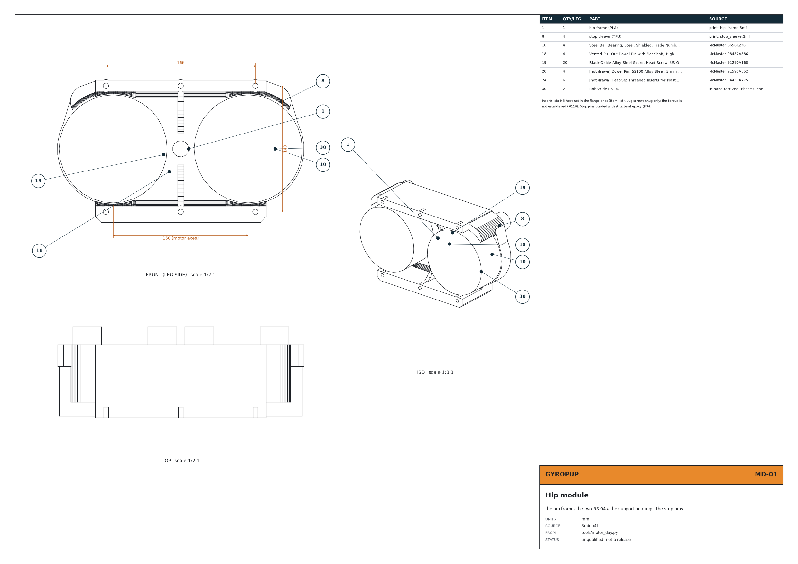

**MD-02 Upper link and adapter**

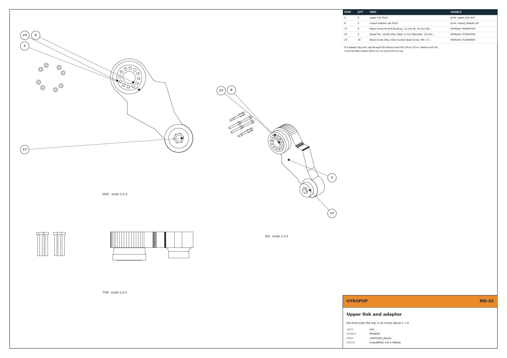

**MD-03 Lower links, knees, apex and foot**

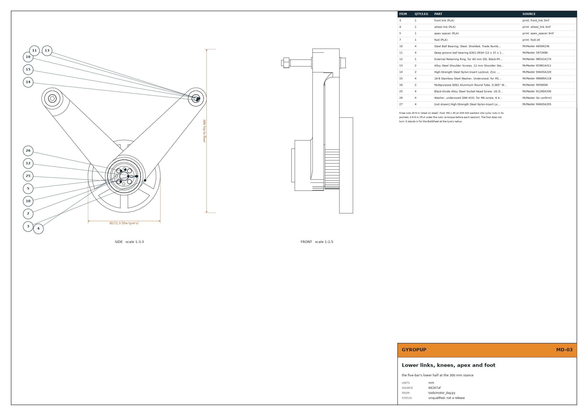

**MD-04 Foot (BotWheel stand-in)**

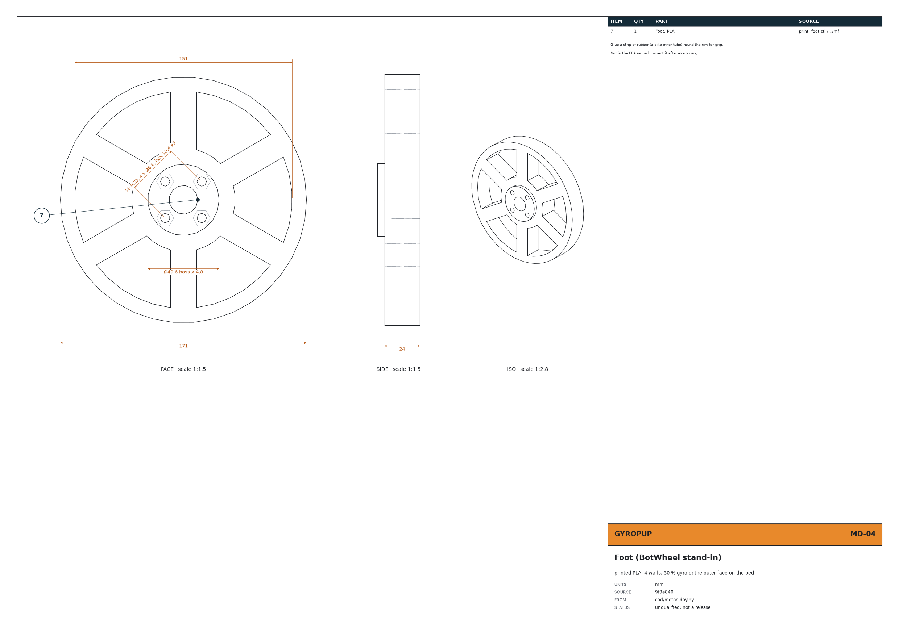

**MD-05 Boom stand**

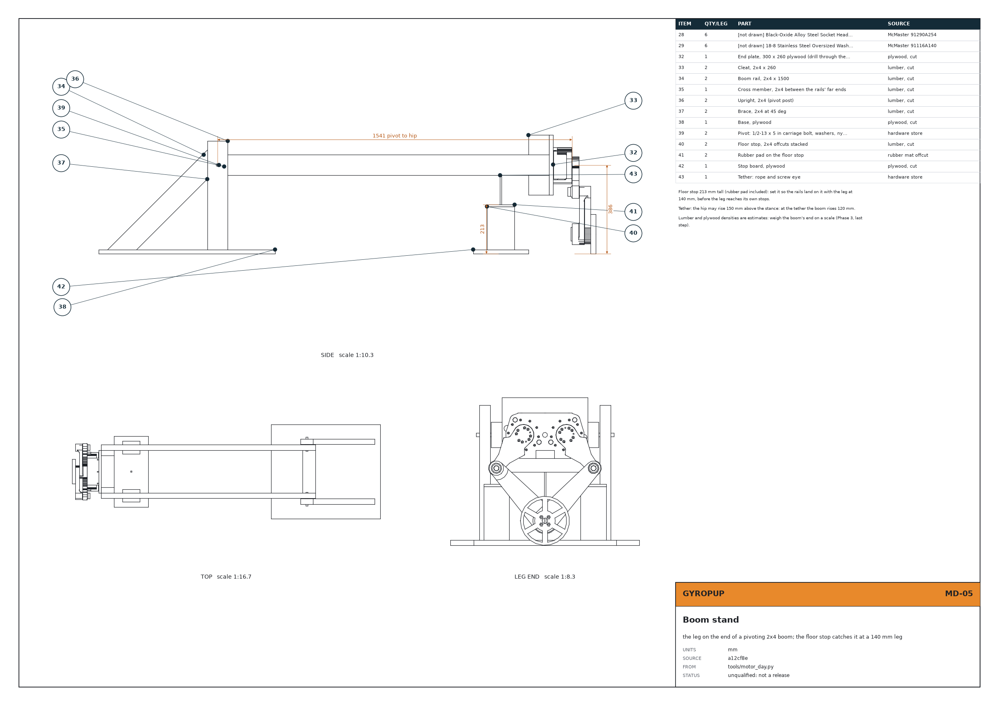
<!-- /gen:assembly -->

## Phase 4: the test ladder to a first jump

<!-- gen:derating -->
Every day-one run lands, so the landings are held to the everyday target (2), not the rare-event 1.2 the robot's record uses. A power cut is a fault: target 1. How the numbers are made:

- **Material:** cad-agent's PLA row (25 MPa, "Bambu PLA Basic: Z (layer) strength used") against each row's humid PA6-CF strength (40.8 MPa in the layers, 18.1 across) or 6061 for the adapter. The FEA is linear, so a row's factor scales with the strength.
- **Loads:** the rig's controller and MuJoCo model at each cap, at 11.1 kg (`tools/motor_day_sim.py`), against the loads the record's cases were run at (knee 574 N and hip 564 N in a landing, axle 1761 N on the wheel link, the motors' 60 and 120 N m). A landing case takes its worst joint; a power cut also its backdriven hub torque.
- **Mass:** the simulation has one mass; the stand weighs about 11.9 kg at the foot and its inertia is about 10.6 kg there. The simulated forces are scaled by the larger over the simulated mass (x 1.07).
- **Not in it:** PLA is brittle (it cracks without warning, where PA6-CF whitens first), creeps, and softens at 55 °C. No margin is added for these: the ladder adds them by stepping up slowly and inspecting after each rung.

| Cap at the motors | Jump (sim) | Axle peak | Knee peak | Hub peak | Weakest row | All rows at target |
|---|---|---|---|---|---|---|
| 12 N m | 46 mm | 703 N | 149 N | 18 N m | wheel_link R1w 2.13 | yes |
| 15 N m | 62 mm | 818 N | 194 N | 24 N m | wheel_link R1w 1.83 | **no** |
| 20 N m | 79 mm | 914 N | 232 N | 29 N m | wheel_link R1w 1.64 | **no** |
| 25 N m | 97 mm | 1261 N | 271 N | 33 N m | wheel_link R1w 1.19 | **no** |
| 30 N m | 105 mm | 1284 N | 289 N | 38 N m | wheel_link R1w 1.17 | **no** |
| 40 N m | 116 mm | 1258 N | 347 N | 45 N m | wheel_link R1w 1.19 | **no** |

**The PLA cap is 12 N m**: a 46 mm hop in the model (expect less: the stand's weight at the foot is more than its inertia there). At 15 N m wheel_link R1w falls to 1.83, under its target of 2. The cap holds for a stand up to **12.7 kg** at the foot (the landings scale with it).

Where PLA fails first, at 12 N m (the weakest rows):

| Part | Case | PLA factor | Target | Governed by | Load |
|---|---|---|---|---|---|
| wheel_link | R1w | 2.13 | 2 | gate | landing on the wheel link: axle 753 N against 1761 N |
| front_link | R1 | 2.92 | 2 | layer | landing: knee 160 N against 574 N |
| output_adapter | R1 | 3.28 | 2 | gate | landing: hub 18 N m against 60 |
| upper_link | R1 | 3.65 | 2 | gate | landing: hub 18 N m against 60 |
| upper_link | R1F | 3.69 | 2 | gate | landing: hub 18 N m against 60 |

**A power cut onto the floor stop** (the pendant let go, on purpose or not, at the 12 N m stand):

| Motors | Knee | Hip | Hub | Axle | Weakest rows | All rows at 1 |
|---|---|---|---|---|---|---|
| undamped (the worst case) | 394 N | 592 N | 49 N m | 252 N | output_adapter R1 0.9 (hip 634 N against 564 N); upper_link R1 1.0 (hip 634 N against 564 N) | **no** |
| with the RS-04's power-off damping (assumed: B1 measures it) | 66 N | 63 N | 7 N m | 95 N | front_link R1 6.63 (knee 70 N against 574 N); output_adapter R1 8.43 (hub 7 N m against 60) | yes |

The hub clamp in the PLA adapter: 1000 N a screw at 1.0 N m gives about 30.4 N m of friction. The hub sees about 18 N m in the hop and up to 49 N m in a power cut: above the friction the two dowels carry it. Re-torque before each session.

Full table: [derating.json](../exports/motor-day/derating.json).
<!-- /gen:derating -->

<!-- gen:ladder -->
Each rung runs only after the one before it passed and the leg was inspected. In every `rig.run` command:

- `--cap` is the cap in both places: `rig.run` writes it to both motors' `limit_torque` at start-up, reads it back (it stops if a motor does not take it) and clips its own commands to it. Without `--cap` it runs at the leg build's every-day cap (`--build`, default `pla_bench`: the PLA cap, and no higher `--cap` is accepted); the robot leg's 61 N m needs `--build robot` (docs/leg-protection.md). The laptop also runs the soft stops.
- `--damper 0` keeps the RS-04's power-off anti-backdrive protection on (the factory default), so a power cut is damped.
- `--half-mass KG`: KG is the scale's reading under the foot from assembly step 7 (about 11.9). It sets the gravity feed-forward.

The safety rules of [leg-rig-safety.md](leg-rig-safety.md) apply unchanged (one operator, the pendant, the clear zone, eye protection).

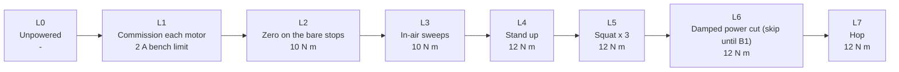

| Rung | What | Cap | How | Pass when |
|---|---|---|---|---|
| L0 | Unpowered | - | Fold and stretch the leg by hand from stop to stop; the boom swings freely; the foot lands on the mat at the stance with the boom level. | no rub; no part touches another |
| L1 | Commission each motor | 2 A bench limit | Phase 0.5 (C1-C5) on all four motors, then C6: ids 1 front, 2 rear on this leg. C4 saves the rig's 60 N m; then `python -m rig.rs04 --id N param limit_torque 10` and `--id N save`, so a motor powers up at 10. | the motor reads back 10 after a power cycle |
| L2 | Zero on the bare stops | 10 N m | The boom propped on the floor stop, the foot in the air. `python -m rig.calibrate`, one link at a time onto its stop pins by hand. | the 142 deg between the posts; no creak at the stop pins |
| L3 | In-air sweeps | 10 N m | `python -m rig.run --backend can --test squat --cap 10 --damper 0 --half-mass KG --rate-limit 5` with the foot in the air (boom propped). | smooth; the knees and the adapters do not click; motor cases under 40 °C |
| L4 | Stand up | 12 N m | `--test stand_up --cap 12 --damper 0 --half-mass KG`, the foot on the mat. | holds 300 mm; peak motor torque about 8 N m (sim) |
| L5 | Squat x 3 | 12 N m | `--test squat --cap 12 --damper 0 --half-mass KG`. | re-check every screw's paint mark after |
| L6 | Damped power cut (skip until B1) | 12 N m | Only once B1 has measured the RS-04's power-off damping at or above the model's: `--test power_off_damped --cap 12 --damper 0 --half-mass KG`, let go of the pendant. | the boom lands on the floor stop, not the leg on its own stops |
| L7 | Hop | 12 N m | `--test jump --cap 12 --damper 0 --half-mass KG`. | a hop of up to about 46 mm; inspect the weakest rows' corners (above) with a lamp |

**No deliberate undamped power cut on PLA.** Undamped, output_adapter R1 comes to 0.9 against 1 (power cut: hip 634 N against 564 N). With the modelled damping every row holds, so the damped cut waits for B1 to measure it. A pendant let go by accident is the same event, damped by the protection `--damper 0` keeps on, but by how much only B1 says (it needs the dyno, an archived fixture: [bench tests](leg-bench-tests.md#b1-the-power-off-damping-decides-d39)). **Until then the accidental cut is the residual risk**: at worst output adapter at a factor of 0.9 (under 1: it may break). Keep spare printed front links, output adapters and upper links on hand, keep the clear zone, set the floor stop before every session, and inspect the parts above after any cut.

**Stop the ladder** at any crack, whitening, click or creak, a screw's paint mark broken, a motor case over 40 °C, or a fault. Photograph it, write it on #156. **Look first** at: the wheel link's hub root (where the hub leaves the link, inside the apex), the front link's apex ring, the upper links' knee-eye stubs, the PLA adapters round their dowels and screws, and the foot's spokes.

Above 12 N m the leg needs the machined adapters and PA6-CF (the [print package](leg-print-package.md)).
<!-- /gen:ladder -->
