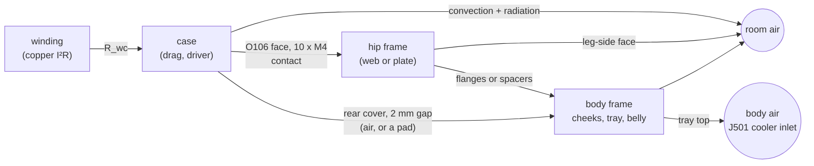

# RS-04 leg motors: heat into the hip frame and the body

<!-- Generated by cad/motor_thermal.py from exports/leg/thermal/motor_thermal.json: regenerate, never edit. -->

The owner asked on 2026-11-03 for "a model for motor heat dissipation into the body so we make sure we properly heat sink them" ([issue #194](https://github.com/Valpatel/gyropup/issues/194)). This page is that model's output: each leg motor's losses in the robot's duty cases, where the heat goes, the temperatures for five hip frame options, a limit for the PLA bench legs, and what to log on the first powered runs to correct it. Numbers: `cad/motor_thermal.py` → `exports/leg/thermal/motor_thermal.json`; tests: `cad/test_motor_thermal.py`. It is a lumped model calibrated on the manufacturer's ratings, not a measurement: the bench logs in section 7 are its acceptance.

**In short**

- **The printed frames insulate the motors.** A PA6-CF hip frame (today's design) leaves each motor to cool itself: in the worst case (driving and balancing at 260 mm: 0.25 g rms fore-aft at the tyre (assumed), 35 °C room) the winding settles at **129 °C** (target 120) and the frame's face at **107 °C** (PA6-CF limit taken 80).
- **Recommended: option E** (the 6061 plate of C, black anodised (eps 0.85), on G10 spacers: its heat to the open air, not into the body): winding 100 °C, plate 82 °C, body frame 50 °C in the same case; the body's air gets 3.5 W (the cooler's inlet 3.1 K over the room, D61's budget 3).
- **Do not use the body as the heat sink.** The body frame has the mass to soak up a few minutes of heat but little open area, inside a shell that the J501's cooler breathes from: a gap pad from the rear covers to the cheeks (D) cools the windings as well as a plate but runs the body frame at 82 °C and puts 17 W into the body's air.
- **PLA bench:** keep each motor under **8.3 N m (4.0 A rms, 5.6 A peak)** held, at a 25 °C room, and the PLA face stays under 50 °C indefinitely. At the PLA cap (12 N m) held without a break it passes 50 °C after **72 min**; the stand's own hold (7.5 N m) settles at 47 °C.

## 1. The heat path

Each motor is a winding node and a case node (the housing, stator iron, gears and the driver: 1.51 kg, 954 J/K). The case touches the hip frame on its O106 face annulus under the ten M4 lug screws, sits 3.5 mm under the printed frame's flanges (they shade half its side from the air) and 2.0 mm from the cheek behind its rear cover. A printed web is six layers through its 24.1 mm thickness; a plate is one node with the Song-Lee-Au spreading resistance from the face. The body frame (both cheeks, the tray, the belly: 1.98 kg) is one node shared by the four motors. Natural convection is Churchill-Chu (vertical plates, horizontal cylinders) and Incropera's horizontal plates, with linearised radiation; every surface's coefficient follows its temperature.

A held leg motor is a **stalled** motor: its hottest phase carries the peak current, so the firmware's per-phase winding estimate runs (f - 1) x P_cu x R_wc over the mean with f = 2.0 (the hot-spot term). Every robot case here holds the legs still; the motors' speed loss only matters in the jumps.

## 2. Calibration on the RS-04's own ratings

| | Manufacturer | Model |
|---|---|---|
| 40 N m at 50 rpm on 345 x 345 mm aluminium | winding at 145 °C | 145.0 °C (case 92.3, plate 66.1; 142.2 W) |
| 35.5 N m at 40 rpm on 220 x 200 mm | winding at 145 °C | 148.39 °C (case 106.5; 113.4 W) |
| 30.1 N m at 150 rpm on 220 x 200 mm (not fitted) | 145 °C | 124.7 °C |
| 31.8 N m at 115 rpm on 220 x 200 mm (not fitted) | 145 °C | 131.0 °C |
| 32.45 N m at 80 rpm on 220 x 200 mm (not fitted) | 145 °C | 131.2 °C |
| 30.0 N m at 191 rpm on 220 x 200 mm (not fitted) | 145 °C | 128.7 °C |
| 28.5 N m stalled (the stall table's rated row) | 145 °C | 103.5 °C |

Fitted: **R_wc = 0.411 K/W** winding to case, the test plates' emissivity 0.95 (8 mm plates assumed) — emissivity at its bound: the two ratings are not met together: the second rating comes out 3.4 K high, and **C_w = 74.5 J/K** for the winding from the overload table (rms error 0.176 in log time over 50-110 N m). With the spec book's 0.16 ohm line resistance the two continuous ratings agree with each other to a few kelvin: the resistance and the torque constant are consistent with the ratings.

| N m (50 rpm) | 120 | 115 | 110 | 105 | 100 | 90 | 80 | 70 | 60 | 50 |
|---|---|---|---|---|---|---|---|---|---|---|
| manual, s | 3 | 9 | 10 | 13 | 15 | 24 | 38 | 61 | 108 | 324 |
| model, s | 10.9* | 12.1* | 13.4 | 15.0 | 17.0 | 22.4 | 31.4 | 49.4 | 103.0 | 393.0 |

\* not fitted: at 115-120 N m the drive's peak-current timer acts first. What the calibration cannot see:

- **The speed loss is too low at speed.** The 220 x 200 table at 80-191 rpm should reach 145 °C; the model stops 14-20 K short, so the drag grows faster than kt x I0 x omega (iron loss). The held legs do not turn; do not use this model for fast cycling without a speed test.
- **The firmware's stall protection is stricter than the heat.** Stalled, the manual's times are 2-6 times shorter than the model at 70-120 N m, and its rated stall torque (28.5 N m) leaves the modelled winding at 103.5 °C: a locked-rotor protection (fault bit 14) acts on the current. Treat **28.5 N m per motor as the holding ceiling** whatever the temperature; every case below holds well under it.
- The test plates' thickness is not known: at 6 and 15 mm the fit gives R_wc 0.3786 and 0.4581 K/W and the worst case's winding moves by 2.5 K.

## 3. The duty cases: torque, current and loss per motor

At the design mass (D71: 18.75 kg a leg; the axle carries 144.7 N, the wheel's 4.0 kg taken off). The five-bar's two motors are both at the hip: **front** and **rear**, no knee motor. The rig's own stand-up ends holding 13.2 N m at 300 mm against this model's 14.63 (conservative: the links' weight is in it).

| Case | Front N m | Rear N m | Current, A rms | Loss, W (PA6-CF, steady) |
|---|---|---|---|---|
| Standing at the design stance (300 mm leg) | 14.63 | 14.63 | 6.97 | 17.2 |
| Holding the lowest controlled crouch (185 mm leg, D71) | 16.79 | 16.79 | 8.0 | 23.1 |
| Driving and balancing at 260 mm: 0.25 g rms fore-aft at the tyre (assumed) | 17.03 | 17.03 | 8.11 | 23.9 |
| A jump every 10 s (the rig's jump at the 60 N m cap), standing between | 16.34 | 16.32 | 7.78 | 22.2 |

The jumps are the rig's jump at the 60 N m cap (2.99 s from crouch to landing, 1170 N²m²s of torque squared on the front motor) every 10 s, as an rms torque; each jump's own pulse adds at most 1.2 K to the winding over that mean. Driving and balancing are an assumed fore-aft force at the tyre (0.25 g rms of the leg's load) on a held leg at 260 mm.

## 4. Temperatures: each case and option at a 25 °C room

Steady winding (the firmware's estimate) / case / mounting face, °C; the time to the face's limit where it passes it.

| Case | A PLA | B PA6-CF | C 6061 plate | D PA6-CF + pad | E black 6061, isolated |
|---|---|---|---|---|---|
| Standing at the design stance (300 mm leg) | 102 / 90 / 85 (face limit in 47 min) | 95 / 83 / 80 | 73 / 62 / 61 | 74 / 63 / 61 | 74 / 63 / 62 |
| Holding the lowest controlled crouch (185 mm leg, D71) | 126 / 108 / 102 (face limit in 35 min) | 116 / 100 / 95 (face limit in 102 min) | 87 / 72 / 70 | 88 / 73 / 70 | 88 / 73 / 72 |
| Driving and balancing at 260 mm: 0.25 g rms fore-aft at the tyre (assumed) | 128 / 110 / 104 (face limit in 34 min) | 119 / 102 / 97 (face limit in 96 min) | 89 / 73 / 71 | 90 / 74 / 72 | 90 / 74 / 73 |
| A jump every 10 s (the rig's jump at the 60 N m cap), standing between | 122 / 105 / 100 (face limit in 36 min) | 113 / 97 / 93 (face limit in 110 min) | 85 / 70 / 69 | 86 / 71 / 69 | 86 / 71 / 70 |

**The worst realistic case on a 35 °C day** (driving and balancing at 260 mm: 0.25 g rms fore-aft at the tyre (assumed)):

| Option | Winding °C (target 120) | Face °C (limit) | Body frame °C | Into the body's air, W (4 motors) | Cooler inlet over the room, K (budget 3) | Passes |
|---|---|---|---|---|---|---|
| A. Printed PLA hip frame (the bench build): 24.1 mm web, flanges to the cheek | 138 | 114 (50) | 59 | 6.8 | 3.58 | no |
| B. Printed PA6-CF hip frame (the current design), as A | 129 | 107 (80) | 58 | 6.5 | 3.54 | no |
| C. Flat 1/4 in 6061-T6 plate in the frame's place, on six O16 6061 spacers to the 5052 cheek | 100 | 82 (-) | 67 | 10.3 | 4.10 | yes |
| D. PA6-CF frame as B, plus a 3 W/mK gap pad from each rear cover to the cheek (2.0 mm gap) | 101 | 82 (80) | 82 | 16.9 | 5.06 | no |
| E. The 6061 plate of C, black anodised (eps 0.85), on G10 spacers: its heat to the open air, not into the body | 100 | 82 (-) | 50 | 3.5 | 3.10 | yes |

How fast it gets there (the crouch held from cold, 25 °C room; winding / face, °C):

| Option | 1 min | 5 min | 10 min | 30 min | 1 h | 2 h | steady |
|---|---|---|---|---|---|---|---|
| A PLA | 36 / 25 | 43 / 27 | 48 / 31 | 67 / 47 | 87 / 65 | 109 / 86 | 126 / 102 |
| B PA6-CF | 36 / 25 | 43 / 28 | 48 / 33 | 66 / 48 | 84 / 66 | 104 / 84 | 116 / 95 |
| C 6061 plate | 36 / 25 | 42 / 29 | 46 / 32 | 60 / 45 | 72 / 56 | 83 / 66 | 87 / 70 |
| D PA6-CF + pad | 36 / 25 | 42 / 28 | 46 / 31 | 58 / 42 | 71 / 54 | 83 / 65 | 88 / 70 |
| E black 6061, isolated | 36 / 25 | 42 / 29 | 47 / 33 | 61 / 47 | 75 / 59 | 85 / 69 | 88 / 72 |

The motors and frames take an hour or more to settle: short sessions run cooler than the steady figures, and the steady figures are what a robot left standing reaches.

## 5. The PLA bench (motor day)

The motor-day leg: a PLA hip frame on the stand's plywood end plate (no metal behind the motors), 11.89 kg at the foot, the firmware capped at 12 N m. Agents run no powered tests: these are the limits for the owner's runs.

| Room | Continuous limit per motor (PLA face <= 50 °C) |
|---|---|
| 20 °C | 9.5 N m = 4.54 A rms (6.4 A peak) |
| 25 °C | 8.3 N m = 3.97 A rms (5.6 A peak) |
| 30 °C | 6.9 N m = 3.30 A rms (4.7 A peak) |

| Held torque per motor, from cold at 25 °C | Face after 10 min | 30 min | 1 h | Steady face | Face passes 50 °C after |
|---|---|---|---|---|---|
| the PLA cap, 12 N m | 28 °C | 37 °C | 47 °C | 67 °C | 72 min |
| the stand's hold, 7.5 N m | 27 °C | 31 °C | 36 °C | 47 °C | never |
| the robot's crouch, 16.79 N m (not for PLA) | 31 °C | 47 °C | 65 °C | 98 °C | 34 min |

The face follows the motor's case a few kelvin behind it (PLA conducts almost nothing: 3 K at the cap's steady state), so **the case thermocouple is a safe stand-in: stop when the case passes 50 °C**, and a rule of stopping when the cases pass 40 °C is inside the limit. A warm room cuts the margin: at 30 °C the limit is 6.9 N m, under the stand's own hold of 7.5 N m.

## 6. Recommendation

**Option E: a flat 6061-T6 plate as the motors' mounting web, black anodised, with a thermal break to the body.** It keeps the windings at 100 °C in the worst realistic case at 35 °C (20 K under the target, 45 K under the firmware's cut), the body frame at 50 °C and the least heat into the body's air of the options that pass.

One thing it does not fix: the rear covers sit 2.0 mm from the cheeks, and that still air carries heat into the body frame with every option. With E the body's air gets 3.5 W and the J501 cooler's inlet comes out 3.10 K over the room against D61's 3 K (today's PA6-CF frame: 3.54 K). The body model's 2.59 K is itself high (its walls lose nothing), and B16's thermometer is that budget's acceptance; a thinner metal web would also move the motors off the cheek (the follow-up's geometry).

- The metal face takes the case's heat into a plate that sees the open air on both sides. Anodising takes it from 6.7 to 12.9 W/m²K at 82 °C (convection 5.9, radiation 0.8 bare, 7.1 black): that is what lets E drop the aluminium spacers into the body and still match C.
- The plain plate on aluminium spacers (C) cools the windings about as well but sends its heat into the body frame; the gap pad (D) does too. The body frame has little open area and is the floor of the shell the J501 cooler breathes from, and the battery bay hangs under it: keep the motors' heat out of it.
- The printed frames (A, B) fail on the face: PA6-CF's preloaded lug joint would sit at 95 °C in a long crouch at 25 °C. They warm slowly: B reaches its 80 °C after 96 min in the worst case from cold (section 4), long enough for the first powered work on the robot.
- How to build E (a plate on G10 spacers, or a 6061 web bolted into printed PA6-CF flanges that are the thermal break) is a CAD and strength question: a follow-up issue, not this change.

## 7. Acceptance: what to log on the first bench runs

Log at 1 Hz on every powered run, with the room temperature:

1. **Each RS-04's own temperature** from its feedback frame (communication type 2, bytes 6-7, °C x 10; the manual does not say if it is the thermistor or the winding estimate) and the board temperature parameter `boardTemp` (0x3020, x 10), with the torque (bytes 4-5) or `iq` (0x3021).
2. **A thermocouple on the case** (the O120 side, mid-length, taped and shaded).
3. **A thermocouple on the mounting face**: under a lug screw's head on the frame's face, or in a 1 mm groove at the motor's face edge.

The most useful run: hold a known torque (the stand's hold) for 30 minutes from cold, then 20 minutes off. Save it as CSV with the columns `t_s, tau_nm, room_c, motor_c, case_c, face_c` and run

    python3 cad/motor_thermal.py --fit bench-run.csv            # option A on the stand; --option/--mount for others

It fits three numbers, one reading each: the case's convection (`can_air_factor`, to the case thermocouple), the face contact (`h_contact_polymer`, to the face thermocouple) and R_wc (to the motor's own reading), and prints the rms errors. Put the fitted values into `INPUTS` with the run's date as their source and regenerate.

## 8. Sensitivity

The worst case (drive, 25 °C), steady winding / face °C for B (PA6-CF) and E (the recommendation), with each ranged input at its ends:

| Input | Range | B low | B high | E low | E high |
|---|---|---|---|---|---|
| `r_line_ohm` | 0.144 - 0.176 | 110 / 91 | 128 / 104 | 84 / 69 | 96 / 77 |
| `stall_factor` | 1.414 - 2.0 | 113 / 96 | 119 / 97 | 85 / 72 | 90 / 73 |
| `eps_case` | 0.3 - 0.9 | 141 / 117 | 116 / 94 | 100 / 82 | 88 / 72 |
| `can_side_exposed` | 0.3 - 0.9 | 130 / 107 | 104 / 84 | 94 / 76 | 88 / 71 |
| `h_contact_polymer` | 500.0 - 3000.0 | 119 / 96 | 119 / 97 | 90 / 73 | 90 / 73 |
| `h_contact_metal` | 1000.0 - 5000.0 | 119 / 97 | 119 / 97 | 90 / 72 | 90 / 73 |
| `c_mix_j_per_kgk` | 550.0 - 720.0 | 119 / 97 | 119 / 97 | 90 / 73 | 90 / 73 |
| `i_noload_arms` | 0.7 - 2.0 | 119 / 97 | 119 / 97 | 90 / 73 | 90 / 73 |
| `r_driver_ohm` | 0.002 - 0.008 | 118 / 96 | 122 / 99 | 89 / 72 | 92 / 74 |
| `drive_fx_g` | 0.1 - 0.4 | 99 / 82 | 159 / 125 | 77 / 64 | 116 / 90 |

E's warmest winding across these ranges is 116 °C (`drive_fx_g` at its high end), at 25 °C; B's coolest is 99 °C (`drive_fx_g`). The driving force is the largest lever and an assumption: log the motors' torque while driving and balancing (section 7) before trusting the hot-day margin. The case's emissivity and how much of it is shaded move the printed frames most; the bench fit measures those. The heat capacity and the no-load current do not move a steady state of a held leg (they shape the transients and the jumps).

## 9. Inputs and their sources

| Input | Value | Source |
|---|---|---|
| `kt_nm_per_arms` | 2.1 | manual 1.3 item 11 and spec book: torque constant at the output, N m per A rms |
| `r_line_ohm` | 0.16 | spec book RS04 page: line (phase-to-phase) resistance 0.16 ohm +-10 %; taken at 25 C (the book states no temperature: assumed) |
| `alpha_cu_per_k` | 0.00393 | textbook: annealed copper, +0.393 %/K |
| `i_noload_arms` | 0.7 | spec book: no-load current 0.7 A rms at 200 rpm (the manual says 2 A rms: the range); drag torque = kt x I0 at any speed (friction + iron) |
| `p_standby_w` | 2 | manual 2.1: standby <= 40 mA at 48 V (1.9 W); the driver's own idle loss |
| `r_driver_ohm` | 0.004 | assumed: the drive stage's conduction, 4 mohm per phase leg (3 x I^2 x R) |
| `winding_limit_c` | 145 | manual 1.3 item 13: the firmware's calculated winding limit ("the constraint temperature; the actual temperature is 180 C"); its thermistor fault is also 145 |
| `winding_target_c` | 120 | this model's margin: 10 K under insulation Class B (130 C, manual 1.2 item 11), 25 K under the firmware's 145 C cut |
| `stall_rated_nm` | 28.5 | manual 1.3 item 14: the stall table's rated (continuous) row; the firmware's locked-rotor protection (fault bit 14) trips sooner than the heat alone (section 2) |
| `stall_factor` | 2 | a held motor's hottest phase carries the peak current, I_pk^2 = 2 I_rms^2; the manual's text says 1.414, its stall table (40 / 28.5)^2 = 1.97: 2.0 taken |
| `mass_kg` | 1.51 | owner 2026-11-03: four boxed motors 7 kg, about 1.51 kg each with leads; the spec book's 1510 +- 20 g (the manual says 1420). Not a ledger change |
| `c_mix_j_per_kgk` | 632 | assumed mix: 40 % aluminium (900), 45 % steel (470), 10 % copper (385), 5 % magnets (450) |
| `eps_case` | 0.8 | assumed: an anodised or painted housing |
| `can_air_factor` | 1 | a multiplier on the case's convection and radiation: 1 until the bench fit (--fit) measures it |
| `od_m` | 0.12 | manual 1.1 drawing: housing O120 |
| `body_len_m` | 0.039 | manual 1.1 drawing: body 39 mm |
| `rear_cover_d_m` | 0.094 | manual 1.1 drawing: rear cover O94 x 13.2 |
| `rear_cover_len_m` | 0.0132 | manual 1.1 drawing |
| `face_bore_d_m` | 0.0786 | CAD: the hip frame's 61812 bore (O78 + 0.6), inside the motor's face annulus |
| `face_bolts` | 10 | CAD / manual: 10 x M4 on O106 (clearance O4.5 each) |
| `rating_a` | {"tau": 40.0, "rpm": 50.0, "plate_m": [0.345, 0.345]} | spec book: rated 40 N m measured at 50 rpm on a 345 x 345 mm aluminium plate (manual 1.2: GB/T 30549-2014, 25 C ambient; the manual says 100 rpm) |
| `rating_b` | {"tau": 35.5, "rpm": 40.0, "plate_m": [0.22, 0.2]} | spec book: the thermal-equilibrium T-N table on a 220 x 200 mm aluminium plate, 35.5 N m at 40 rpm |
| `rating_b_curve` | [[30.1, 150.0], [31.8, 115.0], [32.45, 80.0], [30.0, 191.0]] | spec book: the rest of that table (validation, not fitted) |
| `overload_table` | [[120, 3], [115, 9], [110, 10], [105, 13], [100, 15], [90... | manual 1.3 item 13: N m and seconds to the limit at 50 rpm, 345 x 345 plate, 25 C (from cold: assumed). Rows >= 115 N m are the drive's peak-current timer, not heat: not fitted |
| `stall_table` | [[120, 1], [110, 1], [100, 1.5], [90, 3], [80, 6], [70, 1... | manual 1.3 item 14: stalled, N m and seconds to the protection |
| `test_plate_t_m` | 0.008 | assumed: the test plates' thickness (GB/T 30549-2014 not read) |
| `h_contact_metal` | 2000 | assumed: dry bolted aluminium faces, light pressure (Madhusudana, Thermal Contact Conductance: 1-5 kW/m2K) |
| `h_contact_polymer` | 1000 | assumed: a printed face on the motor's machined face under 10 x M4 |
| `pla` | {"k": 0.13, "rho": 1240.0, "cp": 1800.0, "eps": 0.9, "fac... | catalog pla (density, max service 54 C); k 0.13 W/mK and cp assumed (printed PLA 0.12-0.20); the face limit 50 C is the owner's (PLA softens at about 55-60 C) |
| `pa6cf` | {"k": 0.4, "rho": 1090.0, "cp": 1500.0, "eps": 0.9, "face... | catalog pa6-cf (density, max service 164 C); k 0.4 W/mK assumed (printed CF nylon 0.25-0.8); face limit 80 C assumed: the bolted, preloaded joint creeps long before the HDT |
| `al6061` | {"k": 167.0, "rho": 2700.0, "cp": 896.0, "eps": 0.1} | textbook 6061-T6; eps 0.1 bare (mill) assumed |
| `al5052` | {"k": 138.0, "rho": 2680.0, "cp": 900.0, "eps": 0.1} | textbook 5052-H32; eps 0.1 bare assumed |
| `gap_pad` | {"k": 3.0, "t": 0.002} | assumed: a 2.5 mm silicone gap pad of 3 W/mK compressed to the 2.0 mm gap (k swept 1.5-6) |
| `k_air` | 0.027 | textbook: air at about 40 C, W/mK |
| `web_t_m` | 0.0241 | CAD fivebar.Y['frame']: the hip frame's web, y -25.1..-1.0 |
| `flange_len_m` | 0.0572 | CAD: web (y -25.1) to the mount plane (fivebar.Y['centre_plane'] -82.3) |
| `flange_x_m` | 0.095 | CAD fivebar.FLANGE_X: each flange 190 mm long, half of it per motor |
| `flange_t_m` | [0.013, 0.018] | CAD fivebar.HIP: top 13, bottom 18 mm |
| `rear_gap_m` | 0.002 | CAD: the rear cover (y -80.3) to the cheek's or the stand's face (y -82.3) |
| `rear_overlap_m2` | 0.00503 | CAD: the O94 rear cover face where the cheek (x <= 92) is behind it, the motor at x 75 (a circle minus its segment beyond the chord at 17 mm) |
| `can_side_exposed` | {"printed": 0.5, "plate": 0.85} | assumed: the share of the O120 side in free air; a printed frame's flanges cover its top and bottom 3.5 mm away, a flat plate leaves it open |
| `web_leg_face_m2` | 0.011 | CAD (approximate): per motor, the web's leg-side face from the hub's O80 to the frame's half outline (95 x 158 mm), less the stop bosses |
| `plate` | {"t": 0.00635, "w": 0.19, "h": 0.158, "posts": 6, "post_d... | option C, assumed: a SendCutSend 1/4 in 6061-T6 plate the web's outline (190 x 158 mm), the motors on its inner face, held off the cheek by six O16 6061 spacers 57.2 mm long at the frame's six M5 positions (x 0, +-83; z +-70) on through M5 screws |
| `plate_black` | {"eps": 0.85, "spacer_k": 0.3} | option E, assumed: black anodising eps 0.85 (textbook 0.8-0.9); the six spacers G10/FR4 (k 0.3 W/mK through the laminate) instead of aluminium, a thermal break to the cheek |
| `body_parts_kg` | {"cheeks": 0.984, "floor_tray": 0.753, "belly_plate": 0.247} | CAD docs/body-sections.md: 2 x 492 g cheeks (5052 3/16 in), the tray 753 g (5052 1/8 in), the belly 247 g (6061 0.100 in) |
| `body_surfaces` | [["cheek faces, open share", "vert", 0.181, 0.04662559999... | CAD dimensions (docs/body-frame.md); the open shares (35 %, 60 %, 30 %) assumed: the motors and frames cover the cheeks' outer faces, the gap between them is 31 mm and closed, the battery bay hangs under the belly |
| `tray_top_m2` | 0.056896 | CAD: the tray's top in the body's air (70 % open: the pallet, the power plate on posts) |
| `body_air` | {"rise_k": 2.59, "mcp_w_per_k": 6.84, "budget_k": 3.0} | exports/body/thermal/hand_model.json (cad/body_thermal.py, P1 deck): the cooler's inlet 2.59 K over the room at 21.1 m3/h (m cp 6.84 W/K); D61's budget 3 K |
| `ambient_c` | 25 | the manual's standard 25 C |
| `ambient_hot_c` | 35 | assumed: a warm day (the RS-04 allows -20..50 C) |
| `drive_fx_g` | 0.25 | assumed: driving and balancing as a fore-aft force at the tyre of 0.25 g rms of the leg's load |
| `jump_period_s` | 10 | the owner's case: a jump every 10 s |

Discovery (adopt or build): cad-agent's `cadagent.thermal.heatsink` has the Song-Lee-Au spreading resistance (adopted, copied: gyropup's CI does not install cad-agent) and forced-convection fins; it has no natural convection, lumped RC network or motor loss model, so those are built here (candidates to move upstream).

Related: [body thermal](body-thermal.md) (the J501 cooler, whose inlet budget this uses), [body frame](body-frame.md), [RS-04 mounting fit](rs04-mounting-fit.md), [leg bench tests](leg-bench-tests.md).
