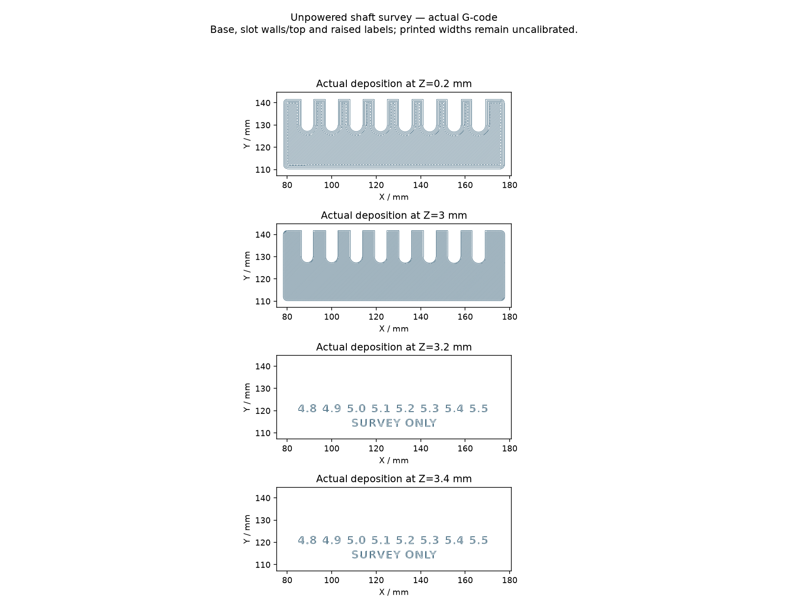

# Ordered turret motor: prepare the interface before changing the cartridge

**Ordered identity is confirmed; dimensional fit is not.** On 2026-10-30 the
owner confirmed the Deeahdah PRO3115-900KV threaded-shaft motor sold as
[Amazon B0GJNX17YX](https://www.amazon.com/dp/B0GJNX17YX). This is the confirmation
date, not an inferred order or delivery date. Purchased pack count and arrival
remain unknown. The listing's four-pack does not establish how many were ordered.
See [purchases](purchases.md) and [acceptance issue #124](https://github.com/Valpatel/gyropup/issues/124).

The current cartridge still models **SunnySky X2216 1400KV V3**, including its
separate prop adapter. It has not been silently relabelled as the ordered motor.
The new part's mounting face, shaft seating and retention must be measured before
we adapt that cartridge. This work does not release a full turret print or a
powered test.

## What is known, and what must be measured

The exact Amazon listing was retrieved on 2026-10-30. Its A+ specification table
adds useful claims that were absent from the earlier research. These are seller
claims, not a manufacturer drawing or measurements of the delivered samples.
The [source packet](../research/ordered-turret-motor/seller-claims.json) records
the selected ASIN, source URL, retrieval date and SHA-256 of the cached HTML.

| Interface | Exact listing claim | Still needed from the actual sample |
| --- | --- | --- |
| Body | Diameter 37.1 ± 0.15 mm | Maximum rotating envelope, stationary base and lead clearance |
| Axial envelope | 47.8 ± 0.3 mm, including output shaft | Mounting-face-to-bell and mounting-face-to-shaft-tip datums; rear protrusion |
| Output thread | M5 | Pitch, hand, usable threaded length, shoulder/pilot and clamping seat |
| Mount | M3, described as 19 × 19 mm | All four hole coordinates, thread pitch and usable depth; face reliefs |
| Mass | 120 g including 30 cm 16 AWG leads | Each motor's actual mass and delivered lead lengths/diameters |

The listing photos show the underside and threaded output, but contain no
usable dimensioned drawing. They also mix colour variants. Do not infer thread
pitch, hole depths, datums or tolerances from their pixels. A different brand's
3115 motor, or the old SunnySky's M5 × 0.8 adapter, is not evidence for this part.

The current CAD's 27.7 mm diameter, 32 mm mount-to-bell length, 16/19 mm opposing
mount-hole spans, separate adapter and 72 g mass are **legacy SunnySky inputs**.
The seller's larger diameter alone is enough to reject a simple name/KV swap;
it is not enough to design the new bracket or qualify its clearance.

## Delivery-day survey

1. Keep the motor unpowered. Assign each delivered motor an individual sample ID.
   Photograph the package/label, complete motor, underside, shaft and lead exit.
   Record the actual received quantity separately from the purchase confirmation.
2. Copy the [measurement template](../research/ordered-turret-motor/measurements.template.json)
   into a sample folder. Keep that sample's evidence files inside the same folder.
   Record the operator and observation date. Add each evidence file's relative
   path and SHA-256; an absolute path or a path escaping the folder is rejected.
3. Establish the datum: mounting face at **z=0**, shaft along **+z**, **+x toward
   the lead exit**, using a right-handed frame. Record all four mounting-hole
   centres in that frame. The [1:1 survey sheet](../research/ordered-turret-motor/mount-pattern-survey.svg)
   shows two interpretations of the seller's wording, explicitly as hypotheses.
   Print at 100% and check both 100 mm scale bars. It is **not a drill template**.
4. For every interface field, record the value, method, instrument, uncertainty
   and supporting evidence. Scalar/vector uncertainty is in the field's unit
   (mm, or g for mass); thread handedness has `null` uncertainty and requires
   explicit identification evidence. A zero shoulder or rear protrusion means
   its absence was observed: both corresponding length and diameter must be zero.
   Leave unknown values `null`; do not copy seller claims into measured fields.
5. Identify thread pitch/hand and usable engagement separately. A matching
   nominal diameter does not prove either. Do not force a nut or probe blind
   holes with screws into the windings. If safe usable depth cannot be established
   from an exact drawing or a suitable inspection method, leave it unknown.
6. Run the survey checker below. It rejects incomplete fields, wrong identity,
   missing/changed evidence, inconsistent datums and claims that the survey has
   qualified a design. Its pass means **the survey record is complete enough for
   engineering review**, not that the observations are correct or a fit is proven.

```sh
# cad-agent 0.4.2 must be installed in the selected Python environment.
# Acquisition and template generation themselves use only the Python standard library.
python tools/ordered-turret-motor.py template --out build/motor-sample-01/survey.json
sha256sum build/motor-sample-01/identity-photo.jpg
python tools/ordered-turret-motor.py check build/motor-sample-01/survey.json \
  --out build/motor-sample-01/checks.json
python tools/test-ordered-turret-motor.py
```

The untouched template intentionally fails. A successful survey still reports
`physical_fit_verified`, `mount_design_released`, `hub_design_released`,
`slicer_run` and `powered_operation_qualified` as **false**. Repeat for every
motor; variation between samples matters. Keep private order details and personal
information out of any evidence selected for publication.

## Inspect the unpowered shaft survey gauge

A small authored gauge now provides eight labelled open slots, **4.8–5.5 mm in
0.1 mm increments**. These are experimental measurement-tool dimensions around
the seller's nominal shaft size, not an assertion that the delivered motor has a
usable 5 mm shoulder. The tool is 100 × 32 × 3 mm, with 0.5 mm raised labels.

| Tool | Solid model | Print-oriented mesh |
| --- | --- | --- |
| Shaft-clearance survey gauge | [STEP](../exports/turret/ordered-motor-fit/shaft-clearance-survey.step) | [STL](../exports/turret/ordered-motor-fit/shaft-clearance-survey.stl) |

The [actual CAD receipt](../exports/turret/ordered-motor-fit/checks.json) records
**12 passes, no warnings and no failures** for the authored tool: one valid CAD
solid, a connected watertight STL, eight measured slot diameters/open mouths,
a STEP round trip, and rejected wrong-width/blocked-mouth controls. These are
geometry screens only. A separate retained slice is now available below. **It has
not been printed or physically checked; there is no print release or motor-fit
approval.** The CAD receipt's `slicer_run: false` describes that earlier geometry
run; the separate slice receipt records the actual machine-job preparation.

When a print has separately been reviewed and measured, record each actual slot
size and compare only with a verified accessible **smooth shoulder**, sliding
sideways without force. If the motor has no suitable shoulder, do not use it on
the thread or turn it into a thread gauge. Record the observed slip/clearance;
do not use the tool to clamp, retain, power or spin a motor. The width labels
state CAD nominal values, not calibrated printed dimensions.

The gauge's source is `research/ordered-turret-motor/gauge.py`. Its remote export used the
pushed project revision and pinned cad-agent sources recorded in the receipt;
STEP/STL and all source hashes are checked by the kernel-free regression script.
The run, log and collection command are recorded on
[issue #124](https://github.com/Valpatel/gyropup/issues/124#issuecomment-6540045462).

## Retained unpowered survey slice

**The first small-text slice is rejected for label printability.** Its unchanged
[diagnostic archive](../research/ordered-turret-motor/rejected-label-slice/README.md)
preserves the missing lettering. The replacement uses 5 mm bold text from an
explicit, hash-bound DejaVu Sans Bold font file, preserving all slot dimensions
and the 100 × 32 × 3.5 mm overall size. Its fresh remote CAD export again passed
all 12 geometry checks; the slice checks below are separate from those CAD screens.

This uses the same declared P1S **0.4 mm hardened nozzle / Bambu PA6-CF trial-2**
process as the [RS04 observation job](rs04-fit-job.md): 0.20 mm layers, four walls,
100% infill, textured PEI, no supports, 275°C nozzle / 100°C bed and commanded
deposition capped at 99 mm/s. It is an experimental dimensional tool, not a
calibrated gauge or an established printing process. Installed hardware,
filament condition, actual slot widths and motor measurements remain unknown.

The retained slice estimates **27 min 41 s, 8.47 g and 3.20 m** of filament.
Its 17 layers contain no support deposition; executable checks confirm the
275°C / 100°C waits and 99 mm/s maximum commanded deposition feed. These are
slicer estimates and command checks, not observed print performance.

- [Complete retained job ZIP](../exports/turret/shaft-survey-fit-job.zip).
- [Actual sliced 3MF](../exports/turret/shaft-survey-fit-job/slice/out/sliced.3mf)
  and [matching G-code](../exports/turret/shaft-survey-fit-job/slice/out/plate_1.gcode).
- [Job receipt and slicer estimates](../exports/turret/shaft-survey-fit-job/job.json),
  [eight-slot blank measurement sheet](../exports/turret/shaft-survey-fit-job/measurements.csv)
  and [blank process record](../exports/turret/shaft-survey-fit-job/process-record.csv).

The package preserves the exact source mesh and +Z layer normal, actual placement,
raw/resolved profiles, executable identity, logs/results and executable toolpaths.
It checks the P1S's actual bed area, exclusion and object nozzle paths. Use the
STEP/STL previews above to inspect geometry. The sliced 3MF uses Bambu's production
extension; the browser viewer offers its original download when that extension
is unsupported. Inspect that machine-job archive in Bambu Studio.



The replacement's actual Z=3.2 and 3.4 mm deposition views were read directly:
**4.8, 4.9, 5.0, 5.1, 5.2, 5.3, 5.4, 5.5 and SURVEY ONLY** are present and legible
in the toolpaths. Per-glyph centerline extent checks cover all nine labels on both
layers; eighteen negative controls remove each label's parsed deposition and must
fail. The original rejected slice also fails this screen. The screen allows one
0.4 mm nozzle diameter at glyph extrema for centerline inset and rounded tips;
it does not prove exact glyph reproduction or physical readability.

Identify slots from the top with open mouths pointing away: left to right, slots
1–8 have CAD nominal widths 4.8–5.5 mm. Measure both each mouth and round end;
never substitute a nominal label for a measured width. Check printed markings,
edge swelling, strings, warping and surface defects; reject ambiguous or
obstructed slots. No motor thread, clamping or retention use is permitted.

Follow the linked PA6-CF preparation guidance: record drying and dry-feed humidity,
the actual printer/nozzle/plate and calibration, then the conditioning and humidity
at measurement. Moisture changes dimensions. Each record starts blank; no delivered
motor measurements or print calibration have been inferred.

Verification reuses the reviewed fit-job inspectors without invoking CAD or a
printer. Use the same pinned lightweight runtime and cad-agent source noted in the
RS04 job instructions:

```sh
python tools/test-survey-fit-job.py
python tools/package-survey-fit-job.py --verify exports/turret/shaft-survey-fit-job
timeout --kill-after=10s 300s python tools/package-survey-fit-job.py --out build/new-shaft-survey-job
```

## Design work that follows the survey

| Step | Required evidence before proceeding |
| --- | --- |
| Motor mount and rear relief | Measured mounting coordinates, face seating, protrusions, usable thread depths, screw stack and driver access |
| Flywheel hub and retention | Measured output thread/hand, usable length, seating face, pilot/shoulder, tolerance stack and a reviewed retention approach |
| Cartridge packaging | New body/bell envelope and mass, swept clearance, lead exits, service access and cable routing with justified bend radii |
| Unpowered specimen | Source-bound STEP/STL, CAD/mesh checks, actual material and slicer evidence, documented physical fit on the identified samples |
| Powered qualification | Separate balance, containment, overspeed, electrical and thermal review and controlled tests; none is implied by an unpowered fit |

Manufacturer hardware CAD and catalog identities should be used where available,
following the existing cad-agent hardware workflow. Missing supplier geometry
must stay visibly incomplete; no generic 3115 cylinder is a qualified motor
model. Exact manufacturer drawings remain a useful missing input.

## Reproducing the acquisition

The raw vendor HTML and photographs are cached locally, not redistributed.
The parser reads the selected ASIN input, product title/brand and semantic table
rows. It rejects another ASIN, a mismatched identity, missing rows and conflicting
rows. It does not scrape dimensions from images or silently change current CAD.

```sh
python tools/ordered-turret-motor.py acquire \
  --html build/ordered-motor-source/amazon-B0GJNX17YX.html \
  --observed 2026-10-30 \
  --out research/ordered-turret-motor/seller-claims.json
python tools/ordered-turret-motor.py sheet \
  --out research/ordered-turret-motor/mount-pattern-survey.svg
```

The earlier CAN actuator research remains in [PR #46](https://github.com/Valpatel/gyropup/pull/46).
This packet settles purchased identity and prepares interface acquisition; it
does not settle bus selection, an ESC rail, motor operating limits or physical
acceptance. [Issue #124](https://github.com/Valpatel/gyropup/issues/124) remains open
until its physical acceptance conditions are met.
