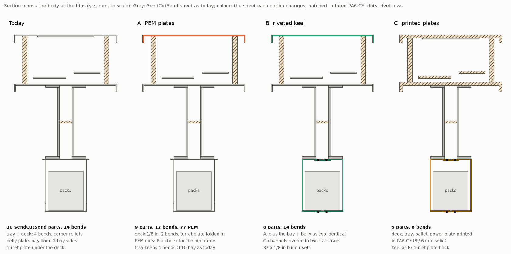
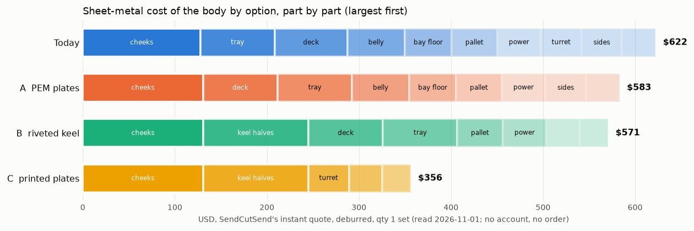
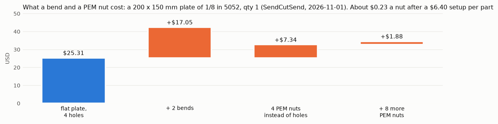
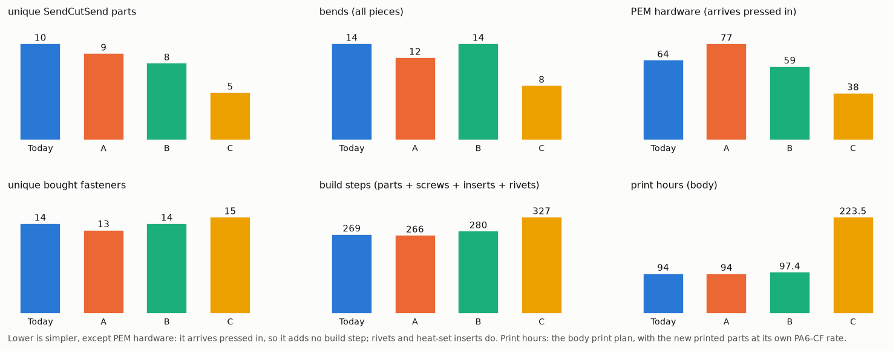
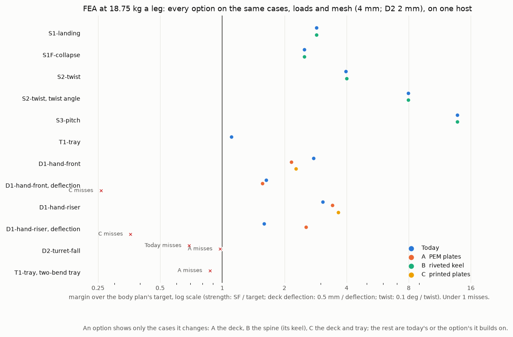
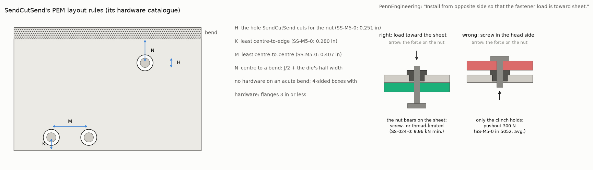
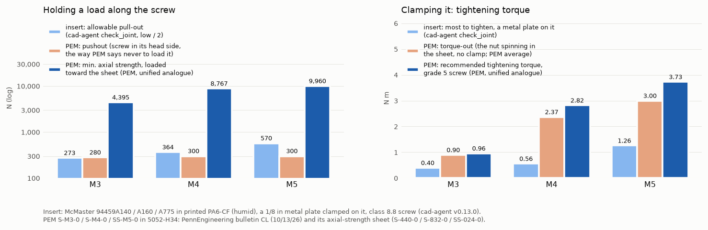

> **Historical study, recovered 2026-11-07.** This is the unmerged 2026-11-01–02 study from [commit `4585596`](https://github.com/Valpatel/gyropup/tree/4585596492a75a08489ef99b6b9e3b8334c5e5ee/research/body-sheet-metal) and closed, unmerged [PR #158](https://github.com/Valpatel/gyropup/pull/158). Its prices, design assumptions, cad-agent v0.13.0 calculations and incomplete FEA describe that historical configuration; they are not current design, price, manufacturing or physical qualification evidence.
>
> The **proposed body D75** below is preserved in the [historical decision archive](decisions-historical.yaml). It is a different record from the current [decided D75 for recorded pronunciation](../../program/decisions.yaml). This recovery adopts neither the old proposal nor any CAD change. The original scripts, DXFs and FEA files are archived evidence, not migrated current tools or approved manufacturing files. Owner choices 1–3 and the applicable acceptance work remain open in [issue #155](https://github.com/Valpatel/gyropup/issues/155).

# Body sheet metal: fewer, simpler SendCutSend plates (study, issue #155)

The owner asked for SendCutSend bent sheet that is affordable and easy to build. That means few parts, printing where
it can carry the load, simple plates with about two bends and PEM hardware pressed in by SendCutSend, and riveted
assemblies of simple bent parts where a box needs more. This study prices today's body and three alternatives, checks
them with cad-agent v0.13.0 and runs the body plan's FEA cases on each. **D75** in `docs/decisions.yaml` is the
proposal; the choice is the owner's. Nothing in `cad/` or `catalog/` changes here.



## The comparison

| | Today | **A** PEM plates | B riveted keel | C printed plates |
|---|---|---|---|---|
| SendCutSend metal, qty 1 set | $622 | **$583** | $571 | $356 |
| + printed material, rivets (est.) | $58 | **$58** | $66 | $221 |
| Unique SendCutSend parts / pieces | 10 / 13 | **9 / 12** | 8 / 12 | 5 / 9 |
| Bends: all pieces / most on one part | 14 / 4 | **12 / 4** | 14 / 4 | 8 / 2 |
| PEM hardware pressed by SendCutSend | 64 | **77** | 59 | 38 |
| Heat-set inserts in the body | 62 | **62** | 62 | 94 |
| Unique bought fasteners | 14 | **13** | 14 (incl. rivet) | 15 |
| Frame mass: sheet + printed | 4.68 kg | **4.64 kg** | 4.89 kg | 5.06 kg |
| FEA: cases that miss | D2 (1.38) | **D2 (1.95)** | D2 (A's deck) | D1: 1.94 mm deck |
| Build steps | 269 | **266** | 280 | 327 |
| Print hours (body) | 94 | **94** | 97 | 224 |

Costs are SendCutSend's instant quote for one set, deburred, read 2026-11-01 (no account, no cart, no order). One
part's quote timed out: A's cheek is priced as the quoted cheek plus six PEM nuts at the probes' rate. A part's price
is each at its set quantity: the cheek's $63.87 is each of two (one alone is $94.07). Printed
material is at the body print plan's own filament price. Rivets are an estimate at $0.12 each, not quoted. Masses come
from the CAD solids at each material's density. Build steps count parts, screws, nuts, standoffs, inserts and rivets.
`study.json` has every row, part by part.



## Where the money is

A part costs its setup before it costs its metal. A 200 × 150 mm plate of 1/8 in 5052 is $25.31 flat. Two bends add
$17.05. Four PEM nuts add $7.34, and eight more add only $1.88: about $0.24 a nut after a $6.40 setup per part. The
floor tray costs $80.62 with four bends and $78.92 with two. **Cutting a part saves money. A part's third and fourth
bends cost little, and more PEM nuts in a part that already has some cost almost nothing.**



- **Today's body already follows the owner's pattern.** It is ten SendCutSend plates carrying 64 PEM nuts and
  standoffs. The printed posts, riser and cassettes carry the rest. The cheeks (3/16 in, $128 the pair) are the
  largest line and the hip-to-hip load path. They stay as they are.
- **A** folds the turret plate into a thicker two-bend deck, and puts PEM nuts in the cheeks for the hip frame's
  through-bolts (D74): −$39 and −38 g.
- **B** also merges the belly plate, bay floor and bay sides into two identical riveted C-channels. It saves $12 more
  of metal, $4 more in all, but adds 0.25 kg and 32 rivets. PR #145 puts the robot at 38.56 kg against D71's 37.0 kg
  gate.
- **C** prints the deck, tray, pallet and power plate. That cuts the metal bill by $266 against today but costs $158 of
  PA6-CF and 130 print hours, its deck deflects about four times the limit, and it drops the compute's TPU isolators.
- **Quantity is the larger lever.** At ten of a part, the cheek is $44.89 instead of $63.87 and the deck $43.19
  instead of $81.20 (SendCutSend's own price breaks).



## Strength and stiffness

All four options ran the body plan's cases at 18.75 kg a leg on one host, the x86 mechanical compute host, with one
mesher, gmsh 4.15.2, and cad-agent 7c5c44d (v0.13.0). Cases ran at a 4 mm mesh and D2 at its converged 2 mm. Each
option ran only the cases it changes. Today was re-run on the same host as the baseline. The runs used the body CAD on dev at e07843c, before PR #145 merged, so D2's head is 2.56 kg at the 100 mm budget centre. #145 moves the centre to 135 mm.



| Case (target) | Today | A | B | C |
|---|---|---|---|---|
| S1 landing, S1F fault, S1b (SF 2.0 / 1.2 / 2.0) | 5.71 / 2.99 / 4.57 | today's | 5.71 / 2.99 / 4.58 | B's |
| S2 twist, S3 pitch (SF 2.0; twist ≤ 0.1°) | 7.94, 0.0126° / 27.5 | today's | 8.00, 0.0126° / 27.6 | B's |
| T1 tray (SF 2.0) | 2.21 | today's (four bends) | today's | not run (stopped) |
| D1 front: deck SF / deflection (2.0, ≤ 0.5 mm) | 5.53 / 0.31 mm | 4.31 / 0.32 mm | A's | 4.55 / **1.94 mm** |
| D1 riser: deck SF / deflection | 6.13 / 0.31 mm | 6.84 / 0.20 mm | A's | 7.28 / **1.39 mm** |
| D2 turret fall: deck SF (2.0) | **1.38** | **1.95** | A's | not run (stopped) |
| D2, reported only: rigid-pad edges (post corners; clamp-pad rims) | 0.35; 0.46 | 0.52; 1.25 | A's | not run |

- **Two bends are not enough for the floor tray.** With lips on its long sides only, T1 drops to SF 1.74 and 1.01 mm
  (the first run of A, kept as `fea/A-tray2b`). So the tray keeps its four bends in every option. The deck manages
  with two bends at 1/8 in.
- **D2 already fails today** with the turret's real mass. `exports/turret/mount.json` gives 2.56 kg, against the
  1.70 kg budget the committed record used. The deck reaches SF 1.38 and the plate's clamp zone 0.46 at a 100 mm
  centre; PR #145 finds 1.21 at the real 135 mm. **A's 1/8 in deck without the plate reaches 1.95** on the same load,
  host and mask. That is better, but still short of 2.0, so the deck's D2 fix is the CAD rebuild's to finish.

<details><summary>How far to trust these numbers: D2's mask, the riveted keel, C's deflection, the mesh</summary>

- A's `summary.json` names the 1.2 abuse target in its text, because `cad/body_studies.py` drops to it when the plate is gone; this study judges A's deck at 2.0, the same target as today's.
- **Read 1.38 and 1.95 as a comparison, not as margins.** Both peaks sit 25.9 mm from a riser foot's centre, just
  outside the 25.75 mm disc the by-part rule leaves out round each foot, so the disc's size sets them as much as the
  deck does. The 2 mm mesh was shown to converge for today's deck with the plate, not for A's; A's D2 has no finer-mesh
  or mask-radius check yet, and the rebuild PR runs one. The rigid-pad edges in the last row are singular at this
  mesh: `cad/body_studies.py` reports them, it does not judge on them, and today's clamp-pad rims (between the plates)
  are a different place from A's (round the riser's feet).
- **C's D2 and T1 were stopped.** D1 had already ruled C out, and its D2 at the 2 mm mesh held 60 GB of a shared host.
  C's model meshes the turret plate in PA6-CF too, so its deflection is an upper bound; with 1.94 mm against 0.5 mm,
  C still fails.
- **B's keel matches today with the rivets modelled as a bond** (the flanges and the strap fused over their overlap,
  a continuous weld), so the FEA cannot tell B's joints apart from today's plate. A hand check of the rivets: S1F's
  344 N·m over the 184 mm couple puts about 1.87 kN across the seam, about 230 N on each of the 8 rivets a row. That is
  3.3× IFI-114's 756 N minimum shear, and bearing in the 0.090 in flange (3.3 × 2.29 mm at 1.5 × 193 MPa, about 2.2 kN)
  is 9.5×. The rivets nearest the hips take more than an even share, so the margin is lower; the rebuild would check
  them one by one.
- **A's deck at a 3 mm mesh** reads 4.54 / 0.322 mm (front) and 6.92 / 0.197 mm (riser), against 4.31 / 0.320 and
  6.84 / 0.197 at 4 mm, so D1 has converged (`fea/A-mesh3`).
- The by-part rule (`cad/body_studies.py`) judges the deck away from the rigid post pads. It counts every element below
  the deck's underside as the plate, and that includes the deck's own lips. In A's runs they stay far below yield
  (44 MPa at most).

</details>


## PEM nuts against heat-set inserts

A PEM nut is stronger than a heat-set insert only when it is loaded the way PennEngineering says. The screw enters from
the side opposite the nut's head, so the load pulls the nut into the sheet. Loaded that way, the nut's thread or the
screw fails first: about 10 kN for the M5 size. Its pushout (300 N) and torque-out (3.0 N·m) measure what the clinch
holds while the nut is handled and while the screw is first turned. PennEngineering's bulletin says: "DON'T install
screw in the head side of fastener. Install from opposite side so that the fastener load is toward sheet."



Thread by thread, the chart sets the PEM in 5052 beside cad-agent's `check_joint` result for a heat-set insert in
printed PA6-CF (humid), with a 1/8 in metal plate clamped on it and a class 8.8 screw:



| Thread | Insert: allowable pull-out (low / 2) | Insert: most to tighten | PEM: pushout, head-side load | PEM: min. axial, load toward the sheet | PEM: recommended tightening |
|---|---|---|---|---|---|
| M3 | 273 N | 0.40 N·m | 280 N | 4,395 N | 0.96 N·m |
| M4 | 364 N | 0.56 N·m | 300 N | 8,767 N | 2.82 N·m |
| M5 | 570 N | 1.26 N·m | 300 N | 9,960 N | 3.73 N·m |

The insert's figures are cad-agent's (v0.13.0, `cadagent.mechanical.inserts.check_joint`). The PEM's come straight from
PennEngineering. Pushout and torque-out are averages in 5052-H34 from bulletin CL (dated 10/13/26). Axial strength and
tightening torque come from its "Axial Strength and Mating Screw Recommended Tightening Torque" sheet (updated
10/28/21). That sheet lists unified sizes only, so S-440-0, S-832-0 and SS-024-0 stand in for M3, M4 and M5.

**Each PEM joint in the body against its load** (the body plan's landing at 8.51 g, the leg's S1F fault, PR #145):

| Joint | PEM | Load per nut | Loaded toward the sheet? | Margin |
|---|---|---|---|---|
| Hip frame to cheek (A: the nut for D74's sleeved M5 through-bolt) | SS-M5-0, 6 a cheek | 851 N fault tension | yes: head in the spine's gap, frame on the flush face | the M5 8.8 screw's 8.25 kN proof (below the nut's 9.96 kN): × 9.7. An insert's 570 N allowable misses cad-agent's factor of 2 |
| Tray and belly to the cheeks' flanges | SS-M5-0, 8 a cheek | ~475 N shear, ~40 N tension (hand estimate) | yes (pressed from the flanges' inner side) | friction under a 3.7 N·m clamp (≈3.9 kN, μ 0.3): × 2.4 |
| Pack adapter plates to the belly or keel | S-M4-0, 4 a pack | 33 N | yes (screws up from below) | 300 N pushout even reversed: × 9 |
| Compute pallet isolator studs, tray | S-M4-0, 4 | 29 N | either | 300 N pushout: × 10 |
| Power plate: VESCs, shunt, switch, MCU | F-M5-2, F-M4-2 | under 10 N | either | × 30 or more |
| Fan duct tabs, deck (A) | S-M3-0, 3 | a few newtons | either | 280 N pushout |

The flange shear is the S1F roll moment (344 N·m) taken as a couple between the tray and the belly, 184 mm apart, on
four screws a flange. **In A, a PEM replaces the loose nut of each high-stress joint.** D74's sleeved hip-frame
through-bolts need a nut on the far side of the 31 mm gap. Six SS-M5-0 in each cheek put that nut in the plate, so the
bolt goes in from the leg's face, nothing is held in the gap, and the nut cannot turn. The nuts pass SendCutSend's
rules at the existing holes (Gyropup's sheet checks) and cost about $0.24 each. Tighten to PennEngineering's 3.7 N·m.
That is above the nut's 3.0 N·m torque-out, which is measured with no clamp: once the screw clamps, the nut's head
bears on the sheet and its friction carries the torque. It gives about 3.9 kN of clamp (4.5× the fault tension),
less than the 5.1 kN the leg plan sets for a loose nut.

**The riser's feet stay on inserts in A.** PR #145 finds 782 N a foot, a D74 high-stress joint. A PEM nut in the deck
would be loaded on its head side there (300 N pushout): the feet sit under the turret's bolts, on solid Ø18 legs with
the turret's insert on the same axis, so no screw reaches a deck nut from the top. A PEM version needs two off-axis
holes in each foot, outside the leg, with the deck's nuts moved to match: that is a riser change for the rebuild.
Heat-set inserts stay in the lightly loaded printed parts: the deck and power-plate posts and the bay rails.

## The options

- **A, PEM plates.** The deck becomes 1/8 in 5052 with lips on its two long sides only (two bends), and takes over the
  turret plate's job. The riser screws up through the deck into its inserts as today, and the fan duct's three tabs
  become PEM S-M3-0. Each cheek gains six SS-M5-0 for the hip frame. Every M5 button screw becomes M5 × 12. The tray,
  belly plate, bay, pallet and power plate stay as they are.
- **B, riveted keel.** A, plus the belly plate, the bay floor and both bay sides become two identical 0.090 in 5052
  C-channels (a web and two flanges each). They are riveted to two identical flat straps with 32 × 1/8 in blind rivets.
  The bay rails grow from 10 to 20 mm so their screws clear the top bend.
- **C, printed plates.** B, plus the deck, tray, compute pallet and power plate are printed in PA6-CF, solid at 8 mm
  and 6 mm. The deck and tray each print in two halves, joined with M5 screws into inserts. The turret plate comes
  back. The compute pallet sits on the tray's inserts without its TPU isolators.

## Recommendation

**Option A.** It is the only option that is cheaper, lighter and quicker to build than today's body, and stiffer
where today's fails:

- It costs $39 less and weighs 38 g less, with three fewer build steps.
- Its deck has two bends, replaces the turret plate, and reaches D2 1.95 against today's 1.38 on the same load.
- The hip frame's through-bolts (D74) get a PEM nut in each cheek, loaded toward the sheet, at 9.7× their load.

B's riveted keel matches today with the rivets modelled as a bond, and the rivets pass a hand check at about 3×. It
saves only $4 more in all, for 0.25 kg the mass budget does not have and 32 rivets to pull. C fails the deck's stiffness by four times and costs 130 print hours. Mild steel
does not pay either. A floor tray as stiff in bending as today's needs 2.24 mm of steel (E × t³ matched), and the
nearest gauge SendCutSend stocks, 0.104 in, weighs about 1.08 kg more than the 5052 tray.

D2 is not closed by any option. A raises the deck from 1.38 to 1.95 at the old 100 mm centre. The CAD rebuild (the
second PR) has to reach 2.0 at the turret's real 135 mm centre, with a finer-mesh and mask check. The levers are the
riser's foot spacing, a fold-down lip at the riser, or 0.160 in at the riser, each re-run on D2. The riser's feet need
D74's treatment for #145's 782 N: off-axis through-bolts into deck PEM nuts would be the PEM version.

## Owner decisions

1. **The option: today, A (recommended), B or C.** Only after this choice does the CAD rebuild follow, as a second PR.
2. **The hip-frame nut: a PEM SS-M5-0 in the cheek (A) or D74's loose nut on a DIN 9021 washer in the leg's face.**
   This changes the leg's hip-frame print package (the head moves to the leg's face pocket), so it must be agreed
   with the leg's print-readiness work (#29, PR #148) before the frames print.
3. **The turret's D2 target at its real centre.** No option reaches SF 2.0 at 2.56 kg and 135 mm yet. Should the
   rebuild size the deck to 2.0, or should D2 stay an abuse case at 1.2, as it was before D59?

## Where each number comes from

| Number | From | How |
|---|---|---|
| Bend radius, K factor, allowance, flat length, least flange, corner relief | cad-agent v0.13.0 | `cadagent.manufacturing.sheet_metal.bend` and `flat_length`, using SendCutSend's row where cad-agent's shop table has one (0.063, 0.090, 0.125 in 5052) |
| Manufacturability verdicts | cad-agent v0.13.0 | `cadagent.manufacturing.dfm.check("sheet-metal")` on each bent part's flanges, nearest hole to a bend, smallest hole and corner relief (`study.json` → `checks`) |
| Heat-set insert pull-out, torque-out, tightening | cad-agent v0.13.0 | `cadagent.mechanical.inserts.check_joint` |
| Stiffness and strength | cad-agent v0.13.0 | `cadagent.fea`, through `cad/body_studies.py`'s cases, patched per option by `fea.py` |
| PEM hole, edge, spacing, bend distance, sheet range | SendCutSend, read 2026-11-01 | its hardware catalogue and hardware service pages; Gyropup's own sheet checks apply them (cad-agent has no PEM rules yet) |
| Bend limits | SendCutSend, read 2026-11-01 | its CNC bending and hardware pages: 5052 in eight gauges from 0.040 to 0.250 in, no 6061 bends, features half a die from a bend, flanges of 3 in or less on boxes with hardware |
| PEM pushout, torque-out, axial strength, tightening torque | PennEngineering | bulletin CL (10/13/26); axial-strength sheet (10/28/21) |
| Blind rivet strength | IFI-114 (2015) | the minimum ultimate loads as a distributor prints them |
| Prices | SendCutSend's instant quote, 2026-11-01 | `quote.py`, no account and no order (`prices.json`) |
| Joint loads | Gyropup | the hip frame's 851 N (`research/leg-preprint/screen.md`), the riser feet's 782 N (PR #145), the rest by hand above |

**Gaps found in cad-agent v0.13.0.** These belong in cad-agent and will be fixed there through its own PR flow, not in
Gyropup. Sheet-metal, PEM and rivet work is already under way in cad-agent.

1. There are no PEM or clinch-hardware rules: hole, edge, spacing, bend distance, sheet range, installed side and load
   direction.
2. The shop table has no 0.100 in or 0.187 in 5052 rows, though SendCutSend bends both. Those parts fall back to
   generic rules, so the cheek's 30 mm flange reads as too short against a generic 33 mm, though SendCutSend takes it.
3. Hole to bend uses the generic 2 to 2.5 t + R. SendCutSend's own rule is half its die width, so cad-agent fails holes
   that SendCutSend accepts, such as the tray's power-plate post at 5.9 mm.
4. The smallest hole uses a punching rule (at least t), but SendCutSend cuts by laser.
5. The ALU-125 relief depth (6.86 mm) fails today's tray's round corner reliefs (r = t), which SendCutSend quoted
   without comment.
6. There is no rivet check, and `check_joint` has no clinch-nut model, so this page sets the two side by side by hand.

## Files

- `parts.py`: each option's SendCutSend parts, built from `cad/` functions and changed only here.
- `quote.py` → `prices.json`, `dxf/`: SendCutSend's instant price for every part and four probe plates.
- `fea.py` → `fea/<option>/summary.json`: the body plan's FEA cases on each option. Each summary records its host
  role, mesher, toolkit and source commit.
- `study.py` → `study.json`: the comparison, checks and joints. `figures.py` → `fig-*.png`.

To rerun, use cad-agent v0.13.0 on the path:

```
.venv/bin/python research/body-sheet-metal/study.py && .venv/bin/python research/body-sheet-metal/figures.py
```

FEA runs on an x86 CAD host: `fea.py --option today|A|B|C`, and `--mesh 3 --tag=-mesh3` for the finer check.
