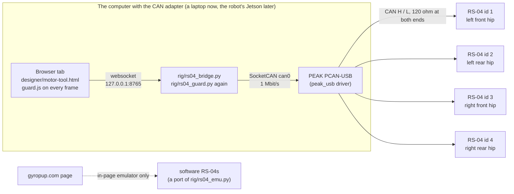
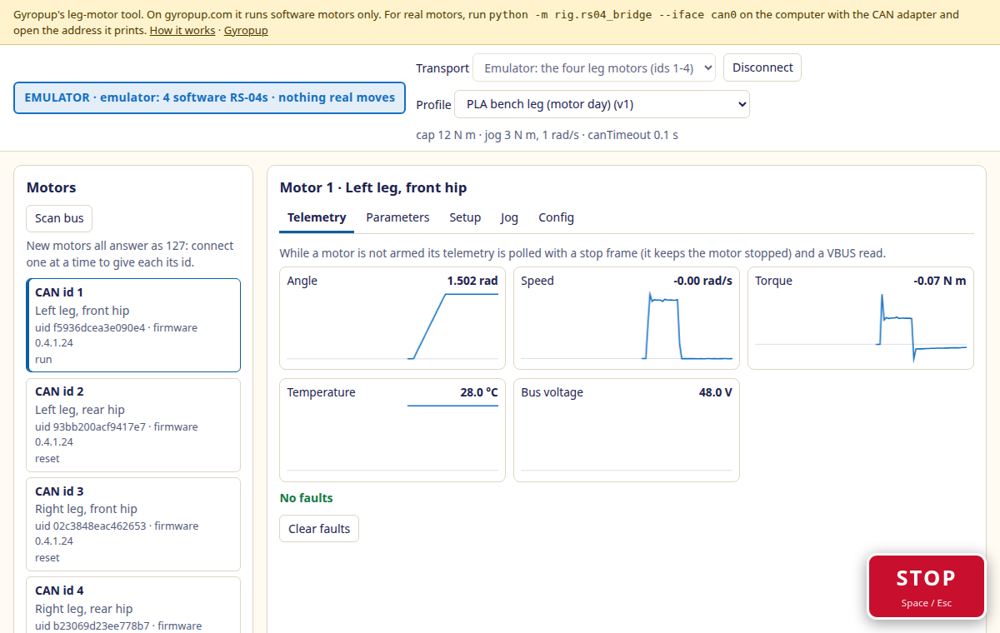

# RS-04 motor tool

The owner asked on 2026-11-03: "we have 4 of the motors, do we have a motor configuration tool web UI and so on?", and:
"Don't worry about which CAN adapter, probably a PEAK Pcan to start with or similar." This is that tool
([issue #206](https://github.com/Valpatel/gyropup/issues/206)): a browser page that scans the leg motors' CAN bus, reads
and writes every RS-04 parameter, gives each motor its joint id, sets its zero, plots its telemetry and keeps a config
file per motor. [Try it with software motors](https://gyropup.com/designer/motor-tool.html): on the website it never
reaches real hardware.

A browser cannot open a PEAK adapter: Linux drives it as a SocketCAN interface (the mainline `peak_usb` driver). So
the page talks over a websocket to a small bridge, `rig/rs04_bridge.py`, built on the same `rig/rs04.py` and
`rig/canio.py` the bench scripts use. The bridge is standard-library Python and serves the page itself. It is the
service the robot's Jetson will run; the deployment is in the hardware folders (issue to follow).

## First run with a PEAK PCAN-USB

The full bring-up checklist (four new motors, one at a time) comes with the hardware folder. In short:

1. With the motors' supply off, check the bus: about 60 ohm between H and L (a 120 ohm terminator at each end).
2. `sudo ip link set can0 up type can bitrate 1000000` (a PCAN-USB appears as `can0` when plugged in).
3. `python3 -m rig.rs04_bridge --iface can0` from the repository, then open the address it prints
   (`http://127.0.0.1:8765/`). The banner turns orange: **REAL HARDWARE**.
4. Power one new motor and **Scan**: it answers at the factory id 127 with its unique id and firmware version.
5. **Setup → Set id** to its joint (1 left front, 2 left rear, 3 right front, 4 right rear;
   [the firmware's ids](body-firmware.md)), then **Write and read back** the profile's settings, then **Save**.
6. Unplug it and do the next one: new motors all answer at 127, so two at once would collide.

Zeroing is done on the leg, with the upper link held on its bare knee-out stop post (the pose `rig/calibrate.py`
uses); the tool names the pose in its confirmation. A zero on a bare motor is for commissioning only.

## What keeps a motor safe

| Rule | Page (`guard.js`) | Bridge (`rs04_guard.py`) | Motor |
|---|---|---|---|
| Nothing enables without the arm step (two checks ticked, then **Arm**) and fresh read-backs: run mode 0, `limit_torque` at the jog torque, `canTimeout` on | yes | yes | |
| Jog frames inside the profile's jog torque, speed, Kp and Kd | yes | yes | clips to `limit_torque` |
| No write over the profile's cap, never `canTimeout` 0, only MIT mode, no current/speed/position commands, nothing written to an armed motor, no bit-rate or protocol change | yes | yes | |
| STOP (button, Space, Esc) to every motor seen | yes | yes | |
| A closed tab, a dropped connection, or a quiet tab while armed | page hide stops | stops every motor seen | `canTimeout` 0.1 s: reset mode |
| Only this computer can connect; another website's page cannot | | loopback only, Origin checked; LAN mode needs a token | |
| The banner says EMULATOR or REAL HARDWARE | yes | `hello` names the interface | |

The limits come from the build profile, PLA bench by default (`hardware/actuators/rs04/profiles/`): a cap of 12 N m
from [the motor-day derating](motor-day.md), a 3 N m and 1 rad/s jog, and the firmware's 0.1 s `canTimeout`. Each
sourced number is checked against its source by `rig/tests/test_rs04_vectors.py`. The final build's cap is the
firmware's 60 N m until the per-build caps of [issue #202](https://github.com/Valpatel/gyropup/issues/202) land. The
PLA bench's thermal stop (a case temperature) and continuous torque are read live from the motor heat model's export,
not copied.

## How it is built and checked

The reusable part is [`designer/kit/rs04/`](../designer/kit/rs04/README.md) (MIT, no Gyropup imports): the protocol,
the guard, the software motor, the client and the transports, with the adopt-or-build survey. The JavaScript is a port
of the Python driver and is tested against vectors the Python generates (`python -m rig.rs04_vectors`): every frame
byte for byte, every parse, the guard's verdicts on scripted sessions and a scripted emulator run.

| Check | Command |
|---|---|
| Protocol, guard and emulator against the Python's vectors; the bridge on software motors | `npm run test:rs04` |
| The page in Chrome: site emulator flow (scan, setid, cap refusal, save, zero, arm, jog, Space, export and diff) and the bridge flow (second tab refused, stop on close) | `npm run build && npm run test:motor-tool` |
| The RS-04 driver itself | `python -m pytest rig/tests/test_rs04.py` |

**Not yet:** nothing here has run on a real motor or adapter (agents never power or command one; the owner's first
scan is the first real test). The Web Serial slcan transport is offered only off the website and is untested on
hardware. The firmware still takes its cap from `gp_config.h`; reading the profiles there belongs to issue #202.
