# Turret assembly

The order to build the turret in, from cad/turret_assembly.py (which draws the pictures from the CAD: the new
parts of each step in colour, lifted along the way they go in; what is already fitted in grey). Tools (the
order sheets list them): a soldering iron with heat-set insert tips (M3, M4, M5); metric hex keys 1.5-4 mm;
external circlip pliers for a 50 mm ring; the IWISS IWD-1620 for the DT contacts and a ratcheting open-barrel
crimper for the Micro-Fit ones; a 5 mm reamer in a tap wrench (the flywheel hubs); a dial indicator on a magnetic
base (the hub runout); the Waveshare bus servo adapter (set each servo's ID first: 1 pan, 2 tilt, 3 feed); the
AM32 USB linker (the ESC settings, firmware/turret/am32_settings.md); cyanoacrylate gel; double-sided foam tape.

## 1. The pan base and its inserts

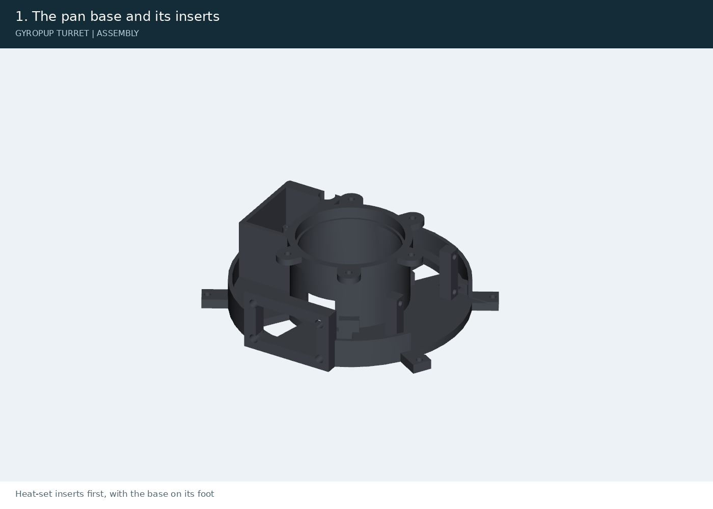

Heat-set inserts first, with the base on its foot: 5 x M3 in the clamp ears, 3 x M3 in the carrier bosses (from below), 4 x M3 in the external carrier anchors, 4 x M4 in the DT pad. The bumper tabs' 5 short M3 wait for the robot (no bumper on the bench, D42).

## 2. The pan servo, its pinion and the DT12 receptacle

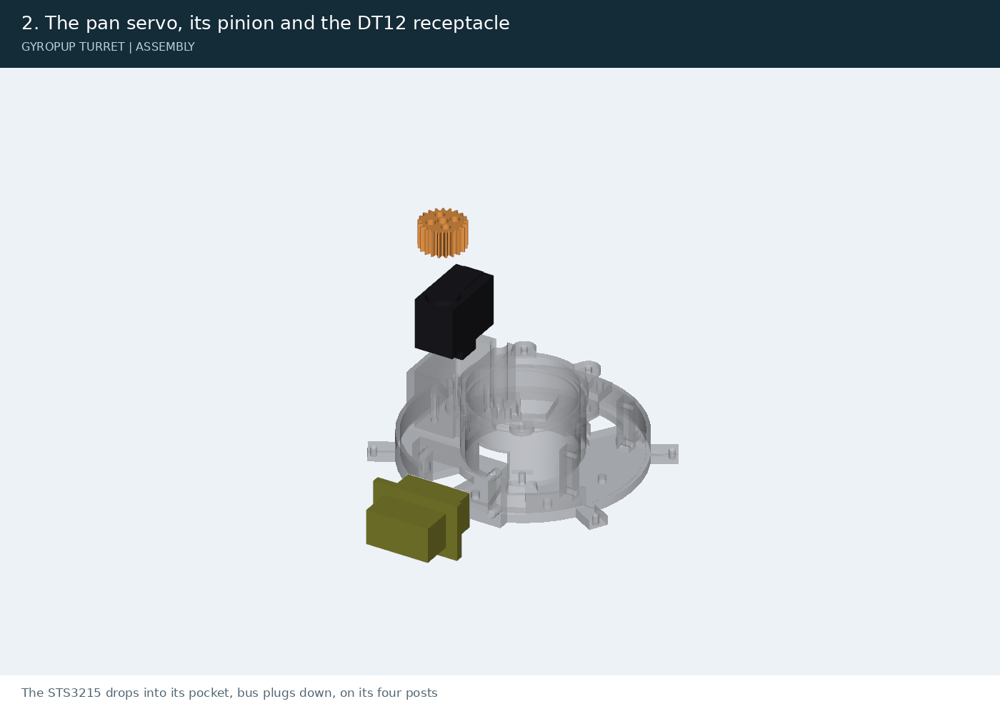

The STS3215 drops into its pocket, bus plugs down, on its four posts: 4 x M2 x 20 up through the foot. The pinion on its horn: 4 x M3 x 16 (heads sunk). The DT04-12PA on the pad: 4 x M4 x 10; its 12 pins and the W12P wedge with the harness to the base board.

## 3. The removable base-board module and the index magnet

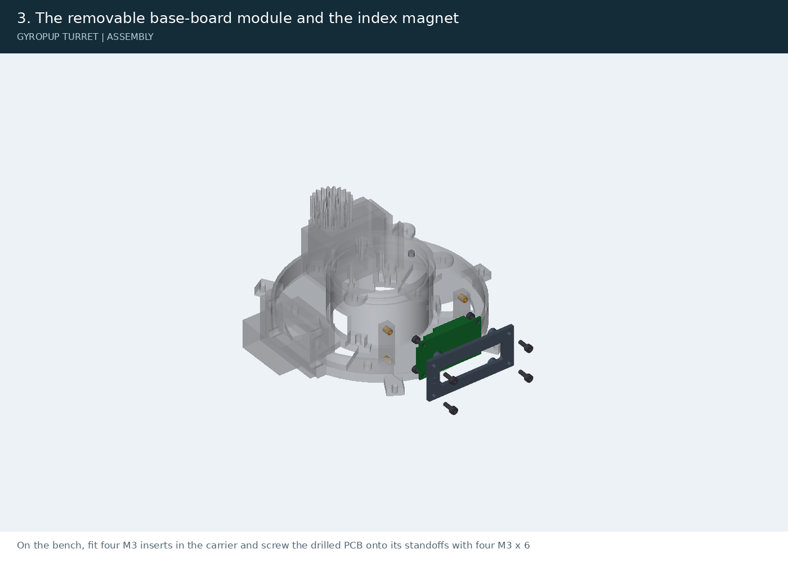

On the bench, fit four M3 inserts in the carrier and screw the drilled PCB onto its standoffs with four M3 x 6. Fit four M3 inserts in the base anchors from +x. Connect the harness, then slide the entire module in from +x and secure it with four M3 x 8 from outside. Remove the robot bumper before service; PCB screws are accessed only on the bench. Harness disconnection access and slack remain unverified: docs/base-board-service.md. Glue the index magnet in its housing pocket.

## 4. The pan bearing and its clamp

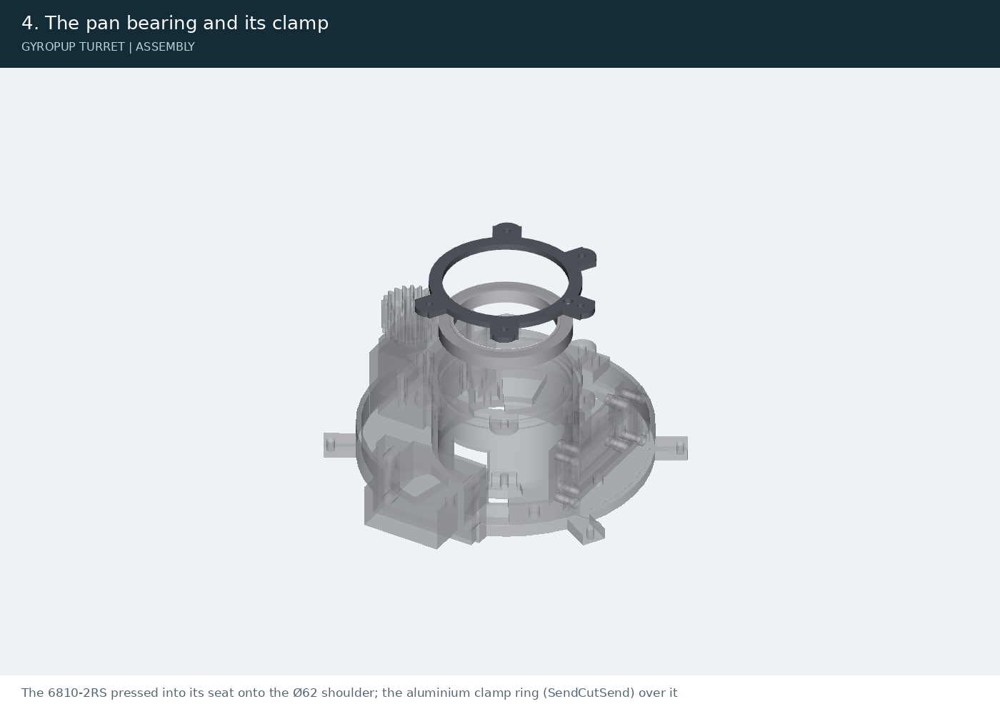

The 6810-2RS pressed into its seat onto the Ø62 shoulder; the aluminium clamp ring (SendCutSend) over it: 5 x M3 x 8.

## 5. The turntable, its spacer and the circlip

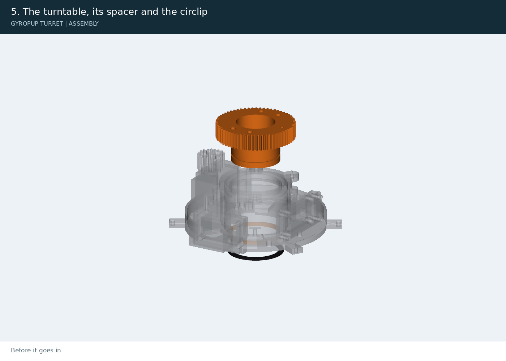

Before it goes in: 4 x M4 inserts in its top, the hall switch glued in the pocket underneath (leads up its hole). Its journal down through the inner race, the gear in mesh with the pinion; from below, through the foot's Ø65 opening, the spacer and the DIN 471-50 circlip in its groove (circlip pliers).

## 6. The ring driver and the slip ring on its carrier

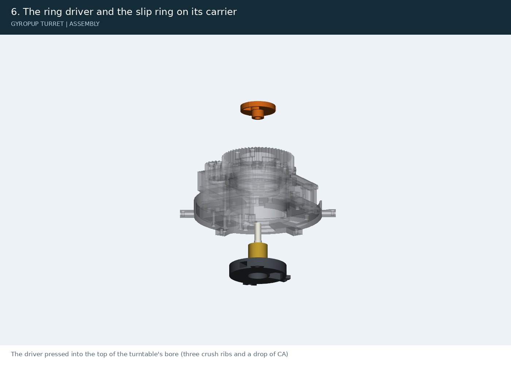

The driver pressed into the top of the turntable's bore (three crush ribs and a drop of CA). The ring screwed to its carrier (3 x M3 x 8 with washers), a 25 mm length of the 5/16 in tube on its rotor stub, its rotor leads gathered; from below, the ring goes up the bore, the tube into the driver's socket and the leads out through the driver's crescent; the carrier's tabs into their pockets: 3 x M3 x 10 flat heads.

## 7. The tilt yoke and the turret-board bay

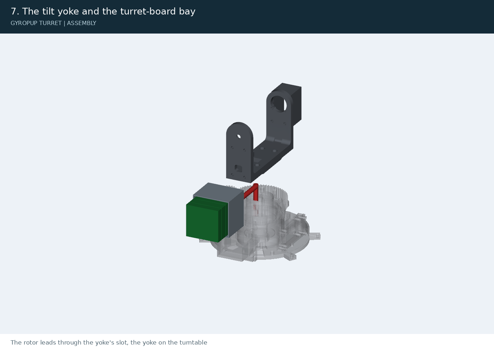

The rotor leads through the yoke's slot, the yoke on the turntable: 4 x M4 x 12. 4 x M3 inserts in the -y arm, the bay on them: 4 x M3 x 8 flat heads; the three boards on their standoffs (12 and 14 mm); the ring's rotor plug and the hall into level 2.

## 8. The tilt servo and the cradle on its aluminium cheeks

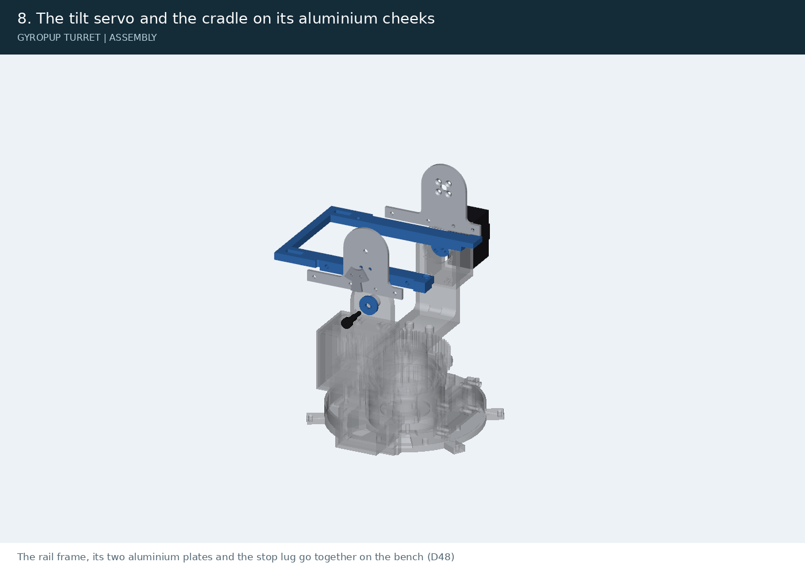

The rail frame, its two aluminium plates and the stop lug go together on the bench (D48): 8 x M3 inserts into the rail frame's two rebates, put in from the side; the aluminium stop lug onto the -y plate's outer face, 2 x M3 x 6 flat heads from the plate's inner face into its tapped holes, a drop of CA gel under it; each plate into its rail's rebate, 4 x M3 x 8 button heads. Then the STS3215 into its pocket on the +y arm, 4 x M2 x 10 from the arm's inner face, and the MR126 into the -y arm's seat. The cradle between the arms: the horn boss between the +y plate and the servo's horn, 4 x M3 x 14 flat heads from the plate's inner face into the horn (snug: 1.8 mm of thread); on the -y side the pivot spacer, its land against the bearing, and the ISO 7379 shoulder screw through the arm, the bearing and the spacer into the plate's tapped hole (snug, about 0.15 N m, a drop of CA gel on the thread). Check the 0 and -25 deg stops by hand before anything else: the lug meets the yoke's two sectors, and the barrel cannot be pushed above level.

## 9. The laser

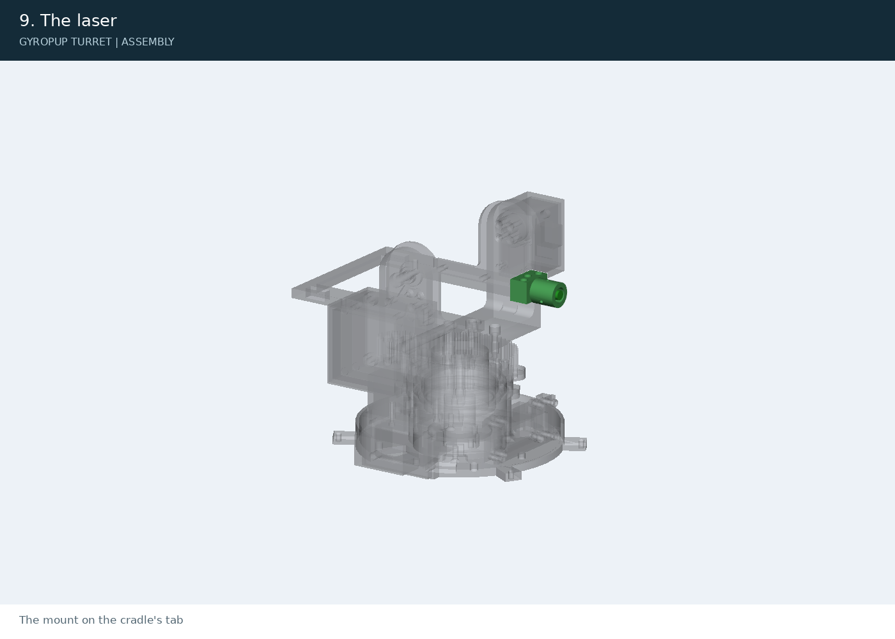

The mount on the cradle's tab: 2 x M3 x 10 up through it; the laser in the mount on three nylon-tip M3 set screws (boresight them on the bench).

## 10. The cartridge: feed servo, dial, flywheel motors and the cartridge board

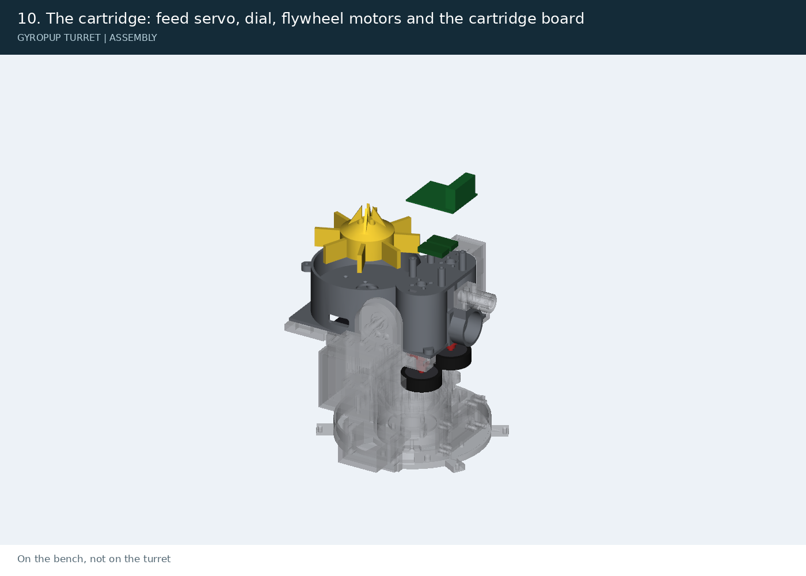

On the bench, not on the turret. The feed servo (its bus ID set to 3 beforehand) up against the dial floor's underside, its horn through the floor and its length to the rear: 4 x M2 x 6 flat heads from above, flush. The dial onto the horn: 4 x M3 x 8 down through the holes in its cone (the hopper off); set the servo's zero so a pocket is centred over the exit hole and write the count down. Each X2216 with its hub: the prop adapter from its box on the bell (3 x M2), the hub's flat face on the adapter's flange, its bore reamed to 5.00 on the pilot, the washer and an M5 nylon-insert nut (snug plus a quarter turn); turn it by hand with a dial indicator on the rim: under 0.15 mm, or re-seat; then the Ø34 tyre stretched on. Each motor goes up through the opening under its shell to the plate, its leads out through the slot: 4 x M3 x 6 in the radial slots (never longer: the motor has 2.8 mm of thread). The two AM32 ESCs on the cage plate on foam tape, each motor's leads to its ESC; the cartridge board on its four posts over them (4 x M3 x 6), the brake FETs' drains to the phase leads, and the pigtail to the two CT plugs (docs/turret-wiring.md).

## 11. The barrel, the hopper and the lid

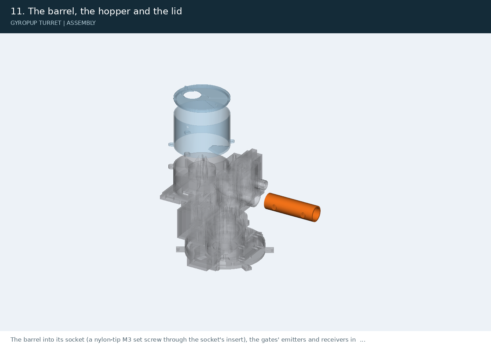

The barrel into its socket (a nylon-tip M3 set screw through the socket's insert), the gates' emitters and receivers in its bosses; the hopper on the housing (3 x M3 x 8: the front one through the hole in the cage plate); the lid. The fill flap and its spring wait for the dock (v1).

## 12. The cartridge on the cradle, the mount

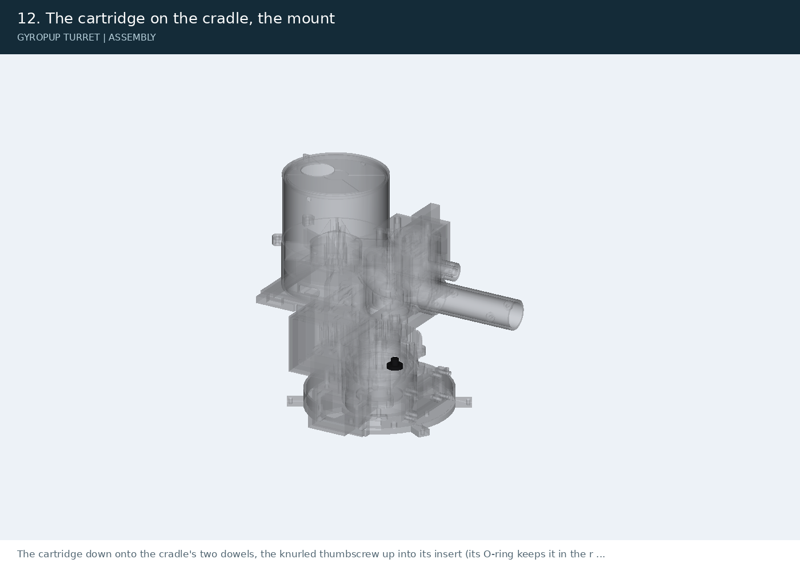

The cartridge down onto the cradle's two dowels, the knurled thumbscrew up into its insert (its O-ring keeps it in the rail); the two CT plugs (2 x 3 power, 2 x 5 signal). Then the turret on its stand: 2 x Ø5 dowels, 4 x M5 x 16, and the DT12 plug. The TPU bumper ring (5 x M3 x 20 and oversized washers on the base's tabs) is for the robot (v1).

## The hardware, all steps

| Line | Part | Part number | Qty |
|---|---|---|---|
| fuse main | Littelfuse MINI 58V blade fuse 20 A (the RS-04 branches) | Littelfuse 0997020.WXN | 1 |
| fuse compute | Littelfuse MINI 58V blade fuse 5 A (DDR-60L-12 input; the 24 V J501 and turret branches) | Littelfuse 0997005.WXN | 1 |
| plinth inserts m5 | Heat-Set Threaded Inserts for Plastic, Standard, Brass, M5 x 0.8 mm Thread Size, 7.9 mm Installed Length | McMaster-Carr 94459A775 | 4 |
| plinth screws m5 | Black-Oxide Alloy Steel Socket Head Screw, US Origin, M5 x 0.8 mm Thread Size, 16 mm Long | McMaster-Carr 91290A232 | 4 |
| plinth dowels | Dowel Pin, 52100 Alloy Steel, 5 mm Diameter, 16 mm Long | McMaster-Carr 91595A352 | 2 |
| plinth m4 | Black-Oxide Alloy Steel Socket Head Screw, US Origin, M4 x 0.7 mm Thread Size, 10 mm Long | McMaster-Carr 91290A144 | 4 |
| plinth inserts m4 | Heat-Set Threaded Inserts for Plastic, Standard, Brass, M4 x 0.7 mm Thread Size, 6.4 mm Installed Length | McMaster-Carr 94459A160 | 4 |
| tm screws | Black-Oxide Alloy Steel Socket Head Screw, US Origin, M5 x 0.8 mm Thread Size, 16 mm Long | McMaster-Carr 91290A232 | 4 |
| tm dowels | Dowel Pin, 52100 Alloy Steel, 5 mm Diameter, 16 mm Long | McMaster-Carr 91595A352 | 2 |
| screw m2x10 | Black-Oxide Alloy Steel Socket Head Screw, US Origin, M2 x 0.4 mm Thread Size, 10 mm Long | McMaster-Carr 91290A017 | 4 |
| screw m2x20 | Black-Oxide Alloy Steel Socket Head Screw, M2 x 0.4 mm Thread Size, 20 mm Long | McMaster-Carr 91290A049 | 4 |
| flat m2x6 | 18-8 Stainless Steel Hex-Drive Flat Head Screw, M2 x 0.4 mm Thread Size, 6 mm Long | McMaster-Carr 92125A052 | 4 |
| screw m3x6 | Black-Oxide Alloy Steel Socket Head Screw, US Origin, M3 x 0.5 mm Thread Size, 6 mm Long | McMaster-Carr 91290A111 | 20 |
| screw m3x8 | Black-Oxide Alloy Steel Socket Head Screw, US Origin, M3 x 0.5 mm Thread Size, 8 mm Long | McMaster-Carr 91290A113 | 19 |
| screw m3x10 | Black-Oxide Alloy Steel Socket Head Screw, US Origin, M3 x 0.5 mm Thread Size, 10 mm Long | McMaster-Carr 91290A115 | 2 |
| screw m3x16 | Black-Oxide Alloy Steel Socket Head Screw, US Origin, M3 x 0.5 mm Thread Size, 16 mm Long | McMaster-Carr 91290A120 | 4 |
| flat m3x14 | 18-8 Stainless Steel Hex-Drive Flat Head Screw, M3 x 0.5 mm Thread Size, 14 mm Long | McMaster-Carr 92125A133 | 4 |
| button m3x8 | Class 10.9 Screw, M3 x 0.5 mm Thread Size, 8 mm Long | McMaster-Carr 91239A113 | 8 |
| flat m3x6 | Black-Oxide Alloy Steel Hex-Drive Flat Head Screw, 90 Degree Countersink, M3 x 0.5 mm Thread Size, 6 mm Long | McMaster-Carr 91294A126 | 2 |
| screw m4x10 | Black-Oxide Alloy Steel Socket Head Screw, US Origin, M4 x 0.7 mm Thread Size, 10 mm Long | McMaster-Carr 91290A144 | 4 |
| flat m3x8 | Black-Oxide Alloy Steel Hex-Drive Flat Head Screw, 90 Degree Countersink, M3 x 0.5 mm Thread Size, 8 mm Long | McMaster-Carr 91294A128 | 4 |
| screw m4x12 | Black-oxide alloy steel socket head screw, M4 x 0.7 x 12 mm (the fuse board's M4 studs, down through the lug into the standoff's nyloc) | McMaster-Carr 91290A148 | 4 |
| flat m3x10 | Black-Oxide Alloy Steel Hex-Drive Flat Head Screw, 90 Degree Countersink, M3 x 0.5 mm Thread Size, 10 mm Long | McMaster-Carr 91294A130 | 3 |
| setscrew m3x6 | Nylon-Tip 18-8 Stainless Steel Set Screw, M3 x 0.5 mm Thread, 6 mm Long | McMaster-Carr 93285A115 | 4 |
| insert m3 | Heat-Set Threaded Inserts for Plastic, Standard, Brass, M3 x 0.5 mm Thread Size, 5.7 mm Installed Length | McMaster-Carr 94459A140 | 41 |
| insert m4 | Heat-Set Threaded Inserts for Plastic, Standard, Brass, M4 x 0.7 mm Thread Size, 6.4 mm Installed Length | McMaster-Carr 94459A160 | 9 |
| washer m3 large | 18-8 Stainless Steel Oversized Washer, for M3 Screw, 3.2mm ID, 9.0mm OD, 0.7mm to 0.9mm Thick | McMaster-Carr 91116A120 | 3 |
| dowel 4x8 | Dowel Pin, 52100 Alloy Steel, 4 mm Diameter, 8 mm Long | McMaster-Carr 91595A150 | 2 |
| oring ct | Oil-Resistant Buna-N O-Ring, 1/16 Fractional Width, Dash Number 006 | McMaster-Carr 9452K14 | 1 |
| standoff m3x12 | Aluminum Male-Female Threaded Hex Standoff, 4.5mm Hex, 12mm Long, M3 x 0.50 mm Thread | McMaster-Carr 98952A110 | 4 |
| hub nuts | High-Strength Steel Nylon-Insert Locknut, Zinc Plated, M5 x 0.8 mm Thread Size | McMaster-Carr 94645A102 | 2 |
| standoff m3x14 | Aluminum Male-Female Threaded Hex Standoff, 4.5mm Hex, 14mm Long, M3 x 0.50 mm Thread | McMaster-Carr 98952A112 | 4 |
