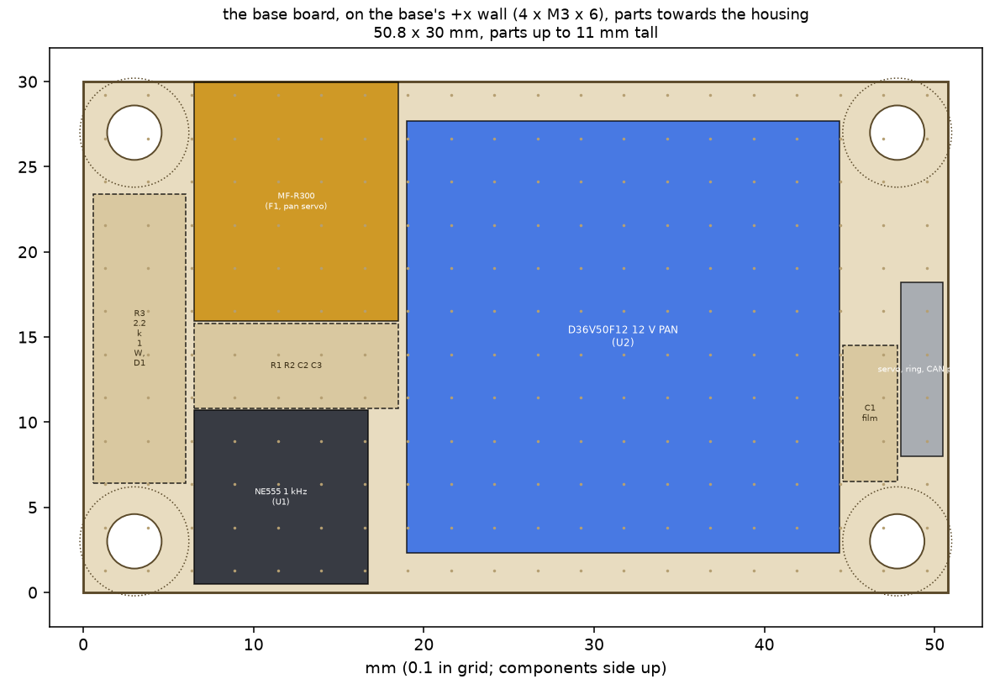
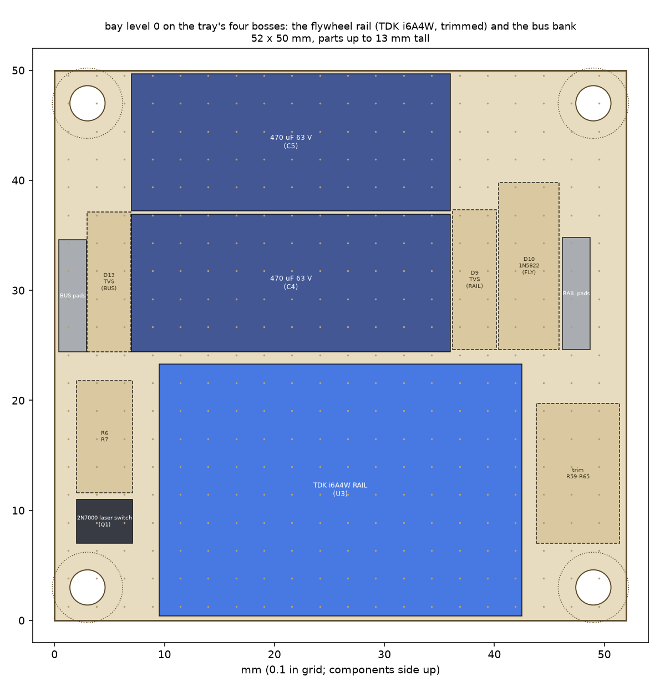
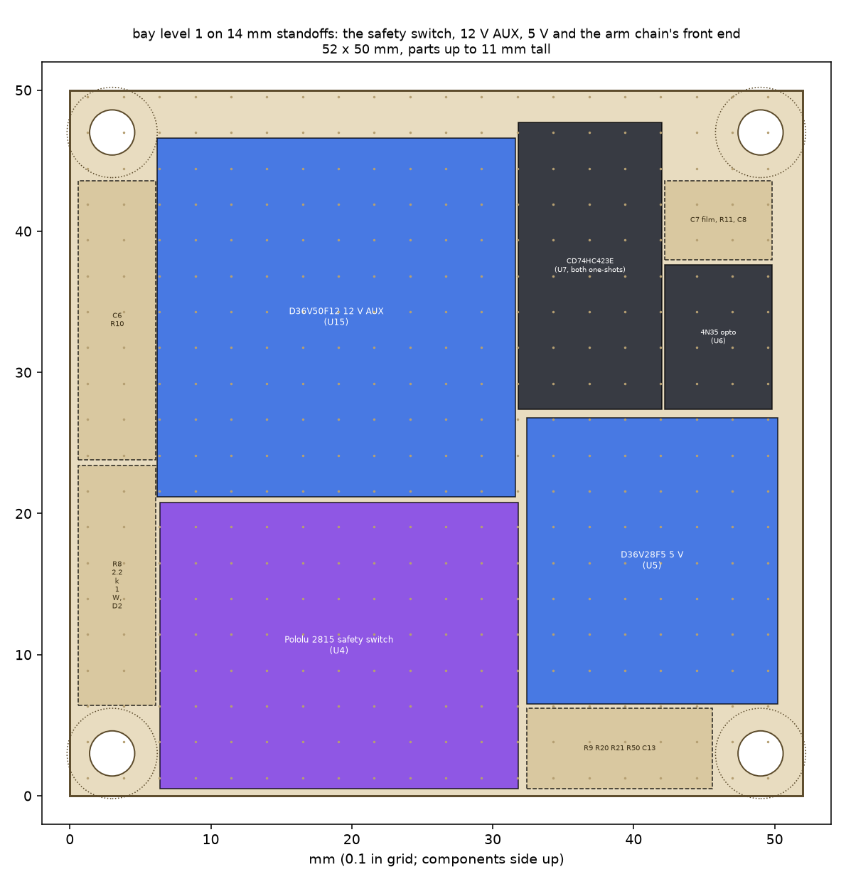
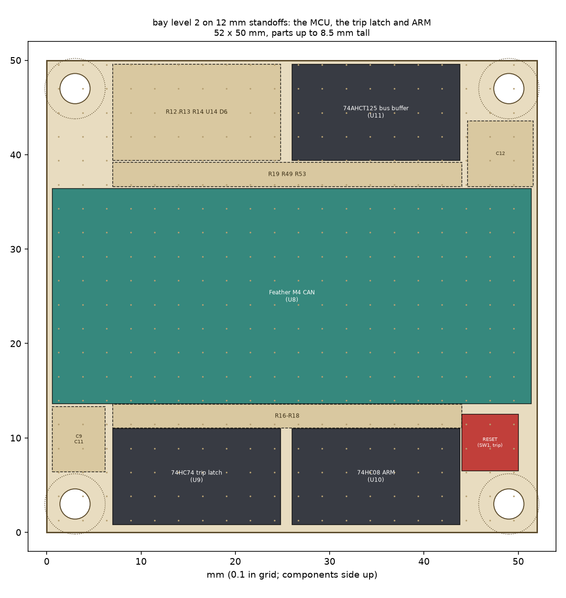
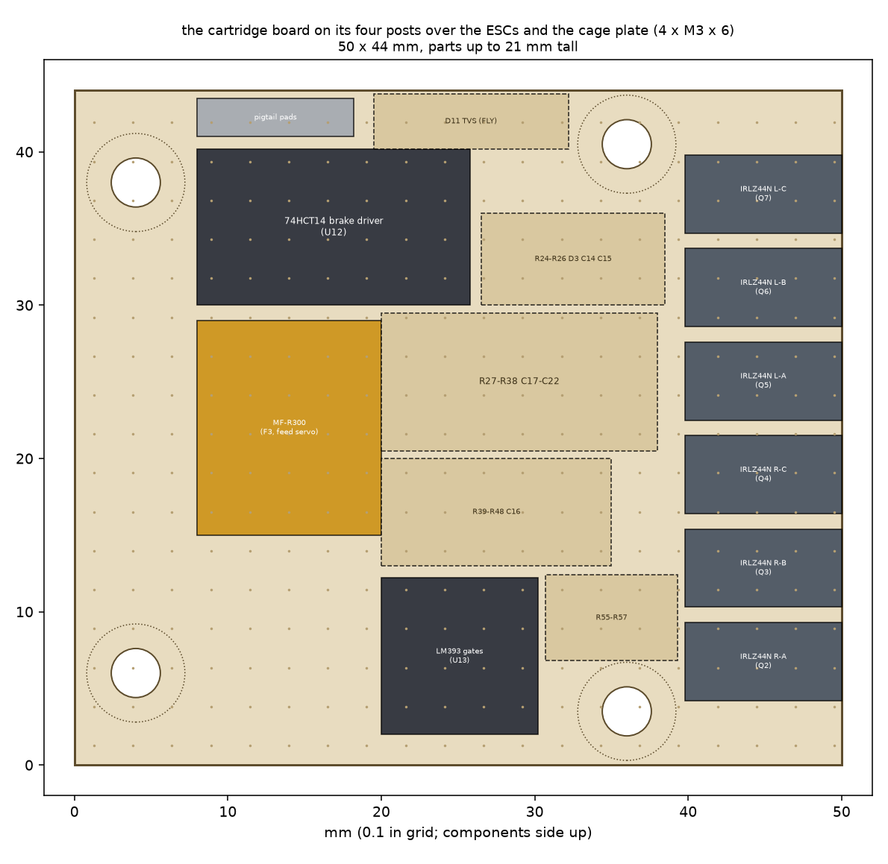
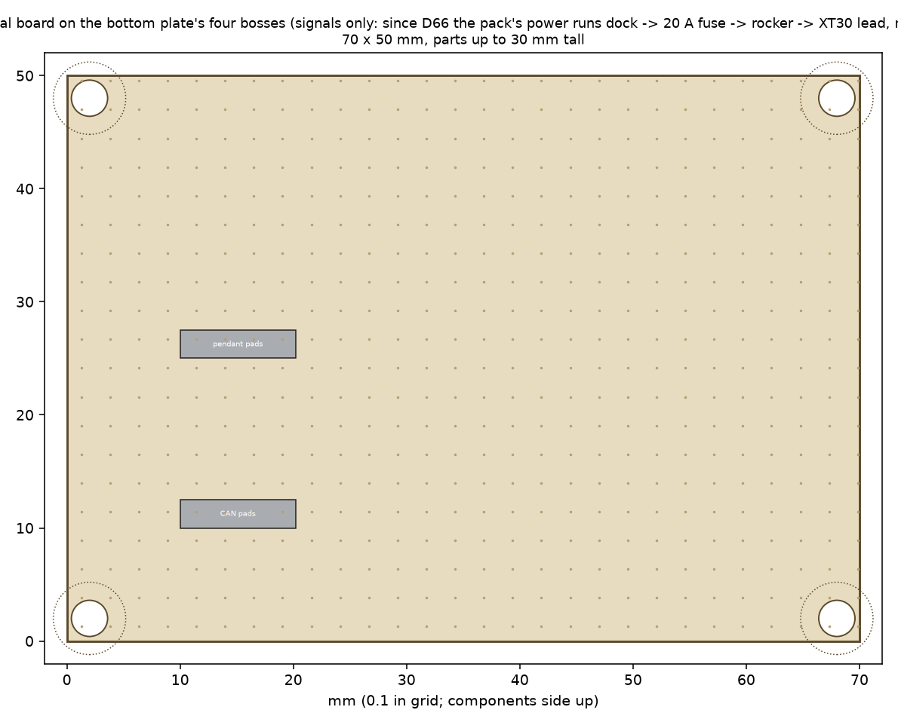

# Turret wiring and harness (v0, the bench build)

The electrics of the foam-ball turret as built for the bench (docs/decisions.yaml D42): every connector and its pinout,
every conductor's gauge and length, the fuses, the hardware arm chain (the safety pulses across the slip ring, the
overspeed trip, the phase-short brake), the current budget, and the boards laid out part by part. Since D66 the turret
has one input, an XT30 in its compute plinth (12-54 V in principle; in use one DCB609 in 20 V mode on the stand,
15-20.5 V, or Gyropup's 10S bus, 30-42 V), shared by its Jetson (J4012) and, through the slip ring, the head; since D68
the flywheels run from a trimmed TDK i6A4W rail. Sections 4 and 5 have the rails and the budget
(`sim/turret_power.py`). Part numbers are the catalogue keys of `exports/turret/bench/bom.json`; the order sheets are
`exports/turret/bench/orders/`. The physics numbers are docs/turret-physics.md's (v0 sections).

```
 BENCH STAND (fixed)            | PLINTH + BASE (fixed)            | SLIP RING | TURRET (pans)                       | CT  | CARTRIDGE (tilts,
 DCB609 (20 V mode) in its dock | XT30 in: 20 A main, 5 A J4012    | stator    | rotor -> the board bay (-y arm):    |     | lifts off)
 20 A fuse, rocker, XT30 lead   | J4012 (Jetson); 10 A head fuse   | -> rotor  |  L0 i6A4W RAIL (trimmed), bank      |     | 2 x AM32 ESC
 mini-XLR <- pendant            | DT04-12PA receptacle (-y pad)    |           |  L1 2815 RAIL->FLY, 12 V AUX, 5 V   |     | cartridge board:
 USB-CAN <- laptop              | base board (+x): 12 V PAN,       |           |     opto, one-shots                 |     |  6 brake FETs and
 terminal board (70 x 50)       |  the 555 pulse oscillator        |           |  L2 Feather M4 CAN, trip latch,     |     |  their driver,
 DT06-12SA plug                 | pan servo (STS3215, ID 1)        |           |     ARM gate, servo bus buffer      |     |  gate comparator
                                | index magnet                     |           |                                     |     | feed servo (ID 3)
                                |                                  |           | tilt servo (ID 2, +y arm), laser,   |     | 2 gates
                                |                                  |           | hall switch                         |     |
```

The pan joint is the slip ring (continuous pan). The tilt joint (yoke to cradle) is a lead loop: everything that rides
the cradle or the cartridge leaves the bay as one bundle and crosses the tilt axis in a 40 mm loop beside the -y pivot.
The cartridge (CT) is unplugged by hand: two Micro-Fit connectors on a short pigtail.

**What v0 changed from the plan's wiring (docs/turret-prototype-plan.md 4.4), and why:**

1. **The flywheel rail is always on and the safety switch is on its rail side.** Since D68 the rail is a TDK i6A4W
   buck (U3, level 0): BUS in, RAIL out at ~11.31 V, trimmed per turret (10.8-11.9 V) by a resistor string on its TRIM
   pin; the Pololu 2815 switches RAIL to FLY (the two ESCs and the feed servo) while ARM is held. The speed ceiling is
   the trimmed rail (the ESCs only ever see it), the safety line still cuts the flywheels and the dial in hardware, and
   pan and tilt stay live (D7). **The tilt servo has its own 12 V AUX regulator again** (a D36V50F12, U15, level 1):
   the rail is set to each turret's motors, and the servo's supply must not move with it. The D24V150F12 that made a
   fixed 12 V for both is gone (13.3-40 V in: not enough for a 42 V bus, and no trim).
2. **The fuses (D66): a 20 A MINI 58 V on the plinth's XT30, a 5 A MINI 58 V branch to the J4012, and a 10 A MINI
   58 V (`fuse_mini58_10a`) in an in-line holder in the head branch to the base board.** The 10 A protects the slip
   ring's three paralleled +BUS circuits and everything after it against a short; their 2 A ratings are held by the
   firmware's spin-up ramp and burst rate (section 5), not by the fuse. The stand's pack has its own 20 A MINI 58 V.
   No PCB blade holder fits: a blade fuse standing in its holder is 15-25 mm tall, against 11 mm under the base board
   and 13 / 11 / 8.5 mm on the bay's levels. The servos' leads have polyfuses (MF-R300) and the 5 V rail an MF-R250.
3. **The Pololu 2815's slide switch is set to OFF.** Pololu: "If the physical switch is in the 'off' position, the
   switch state can also be controlled by a digital signal" (pololu.com/product/2815); with the switch ON the MOSFET is
   on whatever ARM does, so the plan's "slide switch left ON" would defeat the safety line. **Check it before every
   power-up (bench test 3.2).** Its ON pin left open is off (Pololu).
4. The cartridge's power connector carries FLY on three contacts and GND on three: no BUS and no CAN node on the
   cartridge at all. The feed servo takes FLY through its polyfuse on the cartridge board.
5. **The bank is 2 x 470 uF 63 V** (Panasonic EEU-FR1J471B, lying on level 0 at the i6A4W's input, which TDK wants
   100 uF at), with a P6KE51A clamp (D13) beside it: since D66 the bus reaches 42 V, over the old 1000 uF parts' 35 V.
   Every part on BUS is rated 50 V or more (section 4).
6. **The arm chain's logic runs on the Feather's 3.3 V** (section 3): the plan's 5 V logic would have put 5 V on the
   Feather's pins (ARM_IN, TRIP_IN, PULSE_MON; the SAMD51's are not 5 V tolerant), and its gates' 3.3 V pull-ups were
   below a 5 V 74HC input's 3.5 V threshold. The servo bus comes back to RX through a Schottky diode (3.5).
7. **The 555 runs on the pendant loop's 12 V, with no 78L05.** A 5 V 555 drives the opto's LED through 4.4 k at about
   0.5 mA, too little for a 4N35 to pull its input low reliably; at 12 V it is 2 mA, and a diode (D1) keeps a BUS
   fault on the line out of the 555.
8. **The brake FETs short each phase to GND**, driven from ARM by a 74HCT14 on the cartridge board (section 3.3). The
   plan's common star floats: the FETs' gate drive would be referred to wherever the ESC's phase-sense dividers held
   the star, and they could stay off. Phases to GND is what AM32's own brake does.
9. **No CAN terminator on the boards**: the Feather M4 CAN has its own 120 R between H and L (Adafruit); a second one
   would leave the bus at 60 R at one end.
10. **From the part-by-part review (D47):** the trip latch is set-only (its D tied high, clocked by GATE_2 AND the
   window), where the plan's D = window would have let the next slower ball clear a trip; the Feather reads PULSE and
   ARM through 100 k, so a firmware fault cannot raise ARM; the one-shots are the CD74HC423E, which a rising reset never
   triggers, with an MCP120 supervisor making the power-up reset (a 10 ms RC edge is far too slow for HC inputs); each
   brake FET has 100 nF from gate to source (the ESC's phase edges would otherwise lift its gate past threshold) and
   three inverters share the six gates; PULSE_MON moved to A3 (A4 shares an interrupt line with D10); the Feather's
   USB pin, the 2815, FLY, the pendant loop and a reversed supply each got their protection (3.6); AM32's
   complementary PWM is off, so a slowing wheel never pushes energy into the 12 V rail.

## 1. Connectors and pinouts

### 1.1 TM connector: DT12 (base, -y pad)

TE Deutsch DT04-12PA-L012 receptacle on the pan base (`te-dt04-12pa-l012`, W12P wedgelock `te-w12p`, 12 x size-16 pins
`te-0460-202-16141`, crimped with the IWISS IWD-1620); the mating DT06-12SA plug with its W12S wedge and sockets on the
stand's harness (`te-dt06-12sa-kit`). Size-16 contacts, 13 A each.

| Pin | Signal | Wire |
|---|---|---|
| 1, 2 | spare | +24 V until D66: the turret's power now comes in on the plinth's XT30 (section 4) |
| 3, 4 | spare | GND until D66 |
| 5, 6 | CAN_H, CAN_L | 24 AWG twisted pair; terminated by the Feather's own 120 R on the turret and the USB-CAN's on the stand |
| 7, 8 | SAFETY_A, SAFETY_B | 24 AWG twisted pair: the pendant's dry loop (closed = run) |
| 9-12 | spare | |

### 1.1b On the robot: the DT12 harness and the safety line (D52)

Nothing on the turret changes for the robot: the same DT04 receptacle, the same pins, the same fuse. The stand's harness
is replaced by the body's, and the pendant by a contact of the body's radio stop (D37). The body's half (its parts are
the body's to order, with its build pack):

- **The plug:** the DT06-12SA with its W12S wedge and 12 size-16 sockets (`te-dt06-12sa-kit`, as the stand's), in a TE
  Deutsch 1011-248-1205 90 deg backshell that turns the harness down at the plug. The plug stands 45 mm proud of the
  base's -y pad, its centre 19 mm above the TM face, and comes out 30 mm further: that box stays clear of the riser and
  the deck (exports/turret/mount.json `dt12`).
- **The pigtail:** 300 mm, from the plug down through a grommet in the top deck at the robot's **right rear, (-130, -60)**
  in the robot frame. The receptacle is on the turret's -y side (the robot's right) and the TM dowels let the turret go
  on one way only, so the side cannot change: from a grommet at the left rear (-130, +60), the body plan's present
  place, 300 mm does not reach; if the body keeps it there, the pigtail is 450 mm.
- **The other end, inside the body:**

| Pin | The body's end | Wire | On the turret (unchanged) |
|---|---|---|---|
| 1-4 | spare (D66: the power is the body's XT30 branch from the 10S bus, below) | | |
| 5, 6 | CAN_H, CAN_L to the J501's can1; **one** 120 R at the body's end (the J501's own if can1 has one, else one on the body's terminal strip, never both) | 24 AWG twisted pair | the Feather's own 120 R terminates the turret's end |
| 7, 8 | SAFETY_A, SAFETY_B: **the STOP relay's signal pole**, a dry contact, closed = run | 24 AWG twisted pair | 12 V PAN through F4 (MF-R010) to the 555 (section 3.1) |
| 9-12 | spare | | |

**The safety line on the robot.** The contact across pins 7-8 takes the pendant's place exactly: the body puts no voltage
on it; it is closed only while the robot may fire, and it opens on the radio stop, on the receiver's failsafe (the link
lost) and when the robot sits (D37). It carries the base's 555 and its opto loop, about 10 mA at 12 V (the NE555's own
supply and the 2 mA through the 4N35's LED), so it must make reliably at a few milliamps: a gold-clad signal contact,
not a bare silver power contact. Once it opens, the turret's hardware does the rest with no help from the body or the
firmware: no 1 kHz edges, one-shot A drops ARM within 16-21 ms, the 2815 removes FLY from the ESCs and the feed
servo, and the phase-short brake closes 5-14 ms after that (sections 3.1, 3.3). Separately, the firmware zeroes the
throttle within 200 ms of the host's last heartbeat.

**The power (D66)** is the body's XT30 branch from the 10S bus (30-42 V) with its own 58 V fuse (D55), into the
plinth's XT30; the turret's Jetson (J4012) is on the same input. The turret does not need that branch cut on a stop:
its own arm chain removes FLY and brakes the wheels within ~30 ms of the contact opening (above), with no help from the
body. A body that cuts it anyway (as the old STOP relay's second pole cut the 24 V branch) also stops the turret's
Jetson, and the barrel rises to its 0 deg stop by itself (the tilting group's centre is 8 mm behind the tilt axis);
the switch then closes onto the bay's 940 uF and the J4012's input capacitance and must take that inrush (or the branch
gets an NTC in series). That is the body's call (docs/body-plan.md, not changed here).

**Plug the XT30 only with the branch off** (42 V onto the bank arcs at the pins). On the bus the turret draws at most
5.2 A for 0.1 s (a spin-up at 30 V with the J4012 at 48 W and the servos moving), 6.1 A with every servo at its torque
cap, and 2.7 A on average with the J4012 flat out (section 5).

**BUS from the supply to each ESC phase:**

| # | From | To | Through |
|---|---|---|---|
| 1 | the supply: the stand's DCB609 (its 20 A MINI 58 V and the rocker), or the body's 10S branch (its 58 V fuse) | the plinth's XT30 | the XT30 lead |
| 2 | the XT30 | the J4012 and the head branch | the plinth's 20 A MINI 58 V; the J4012 through its own 5 A MINI 58 V |
| 3 | the head branch | the base board | the 10 A MINI 58 V (`fuse_mini58_10a` in `littelfuse-0fhm0001zxj`), then D8 (1N5408: a reversed supply blows the fuse) and D14 (P6KE51A clamp) at the input pads |
| 4 | the base board | 12 V PAN | the D36V50F12 (U2): the pan servo, and the 555's loop through F4 |
| 5 | the base board | the bay (level 0) | the ring's stator Micro-Fit, circuits 1, 2, 11 (+BUS) and 3, 4, 12 (GND) in parallel, the rotor Micro-Fit at level 2 |
| 6 | the ring's BUS | RAIL | the 2 x 470 uF bank and D13 across it; the TDK i6A4W (U3, level 0, always on, trimmed); BUS also feeds U15 (12 V AUX: the tilt servo) and U5 (5 V) on level 1 |
| 7 | RAIL | FLY | the Pololu 2815 (level 1), on only while ARM is high (its slide switch OFF) |
| 8 | FLY | the cartridge | the lead loop across the tilt axis, the CT power Micro-Fit 2 x 3 (FLY on 1-3, GND on 4-6) |
| 9 | the cartridge's FLY | each AM32 ESC | the ESC's power leads; D11 (TVS) across the rail; the feed servo through F3 (MF-R300) |
| 10 | each ESC | its X2216's phases A, B, C | the ESC's three half-bridges; on each phase a brake FET (Q2-Q7) to GND, held off while ARM is high |

**The STOP contact to the 555:** base board 12 V PAN → F4 MF-R010 (0.1 A) → DT12 pin 7 → the pigtail → the STOP relay's
signal pole → the pigtail → DT12 pin 8 → U1 NE555's VCC (C3 1 uF) → the 986 Hz train → D1 → R3 → ring circuit 7
(SAFETY+) → R8 → the 4N35's LED → ring circuit 8 (SAFETY-) → base GND; the 4N35's transistor makes PULSE for one-shot A,
whose Q makes ARM (section 3.1).

### 1.2 The slip ring

SparkFun ROB-13065 (`sparkfun-rob-13065`: twelve 2 A gold-on-gold circuits, 28 AWG leads 250 mm, Ø22 x 26.5, flange
Ø44.5), **three circuits in parallel for each power rail** since D66 (the camera pair D41 kept is the third pair):

| Circuit | Signal | Notes |
|---|---|---|
| 1, 2, 11 | +BUS (after the head branch's 10 A fuse) | joined on both boards |
| 3, 4, 12 | GND | joined on both boards: the only power return |
| 5, 6 | CAN_H, CAN_L | adjacent circuits, twisted on both sides of the ring |
| 7, 8 | SAFETY+, SAFETY- | the 1 kHz pulse loop (section 3.1) |
| 9 | SERVO_TTL | the half-duplex bus to the pan servo in the base (500 kbit/s across the ring) |
| 10 | SIG_GND | the TTL and pulse reference: joined to GND on the base board and on level 2 (a third ground circuit beside 3-4) |

Three 2 A circuits in parallel carry the power; the busiest carries 42 % of it when one contact is at 10 mOhm and the
other two at 60 (each circuit is 2 x 250 mm of the ring's 28 AWG, 0.107 Ohm, plus its contact). On the 10S bus the
D68 flywheels' **800 ms spin-up** puts 1.4 A on the busiest circuit at 30 V and 1.0 A at 42 V, and 8 shots at 10/s
1.5 A RMS at 30 V: within 2 A with every servo moving. On the stand's pack the current doubles: the same spin-up is
3.0 A a circuit at 15 V and 2.1 A at 20.5 V, so on BUS_V under 24 V the firmware stretches the ramp and slows the
bursts (the stand profile, section 5). Why the camera pair went to power: since D66 the turret's computer sits in the
plinth under the ring, and a camera on the head could not reach it over two 2 A circuits anyway (USB needs four
conductors and more bandwidth than these contacts are rated for); with two power pairs, holding the wheels at speed
while aiming and feeding at 15 V (about 4 A) would already fill both to 2 A.

### 1.3 The ring's two connectors: Micro-Fit 3.0, 2 x 6

Each end of the ring ends in a Molex Micro-Fit 3.0 dual-row 12-way pair, so the ring is changed by unplugging two
connectors: the stator side at the base board, the rotor side at level 2. **The ring's own 28 AWG leads carry the
receptacles** (`molex-43025-1200`, with the 26-30 AWG female crimps `molex-43030-0010`, one lead per contact); the boards'
24 AWG tails carry the plugs (`molex-43020-1200`, male crimps `molex-43031-0001`). Pin n = circuit n at both ends; the
power circuits (1+2+11, 3+4+12) are joined on the boards.

### 1.4 The CT connectors (turret to cartridge): power 2 x 3 and signal 2 x 5

The cartridge brings a 150 mm pigtail with two plugs; the cradle carries the two receptacles on its -y rail (behind the
latch) on the harness from the bay. The three Micro-Fit sizes in the turret (2 x 3, 2 x 5, 2 x 6) cannot go into each
other's places, and Micro-Fit housings are polarised.

Power, Micro-Fit 3.0 2 x 3 (`molex-43025-0600` receptacle on the bay's harness, `molex-43020-0600` plug on the pigtail;
18 AWG crimps `molex-43030-0038` / `molex-43031-0021`; **18 AWG PTFE wire, 1.75 mm over the insulation**: Molex allows
1.85 mm at most, so silicone wire does not fit):

| Pin | Signal | Load |
|---|---|---|
| 1, 2, 3 | FLY | the two AM32 ESCs and, through an MF-R300 on the cartridge board, the feed servo; 3 contacts x 8.5 A |
| 4, 5, 6 | GND | |

**No contact of this connector ever carries BUS**: BUS reaches only the base board and the bay's levels 0 and 1. A
cartridge plugged into this turret sees FLY, 11.9 V at most (the trim's top).

Signal, Micro-Fit 3.0 2 x 5 (`molex-43025-1000` / `molex-43020-1000`, 24 AWG crimps `molex-43030-0001` /
`molex-43031-0001`, 24 AWG UL1007 wire):

| Pin | Signal | Notes |
|---|---|---|
| 1 | ESC_L | bidirectional DShot300 from the Feather (eRPM telemetry back on the same wire) |
| 2 | ESC_R | as above |
| 3 | FEED_TTL | the servo bus to the feed servo (ID 3) |
| 4 | spare | |
| 5 | ARM | the arm chain's output (3.3 V, high = armed); the cartridge's brake driver makes BRAKE from it (section 3.3) |
| 6 | +5 V | the gates' emitters and comparator |
| 7 | GATE_1 | first chronograph gate (LM393, open collector) |
| 8 | GATE_2 | second gate |
| 9 | spare | (the hopper-full beam in v1) |
| 10 | SIG_GND | |

### 1.5 Small connectors on the turret

| Run | From | To | Connector |
|---|---|---|---|
| Tilt servo (ID 2) | level 1: 12 V AUX (U15) through an MF-R300 in the lead; TTL from the 74AHCT125 on level 2 | STS3215 on the +y arm | its own 3-pin lead (Molex 5264-type), 200 mm extension |
| Pan servo (ID 1) | base board: 12 V PAN through its MF-R300; TTL from ring circuit 9 | STS3215 in the base | its own 3-pin lead |
| Feed servo (ID 3) | cartridge board: FLY (10.8-11.9 V) through its MF-R300; FEED_TTL from CT signal 3 | STS3215 under the dial floor | its own 3-pin lead |
| Laser | level 0: 5 V to the laser's +, its - through the 2N7000 (Q1); its gate at 5 V from the bus buffer's second channel on level 2 (U11, from LASER_EN on A5) | Quarton VLM-650-03 LPT on the cradle tab (2.6-6 V, < 35 mA) | 2-pin, 24 AWG, across the tilt loop |
| Hall index | level 2 (5 V, GND, PAN_INDEX) | A1120LUA-T in the turntable's underside, C23 100 nF across its VCC and GND at the sensor | 3 x 24 AWG up the Ø2.8 hole beside it |

## 2. Conductors

Lengths from the CAD's points (cad/turret.py: the DT pad, the base board's wall, the ring, the bay on the -y arm at
z 71-128, the cradle's rail, the cartridge board at z 63 over the cage); cut each wire 20 % long and trim at the
connector.

| # | Run | Conductors | Gauge | Length | Strain relief |
|---|---|---|---|---|---|
| C1 | stand (D66): the dock's leads -> 20 A MINI 58 V -> rocker -> the XT30 lead out of the top plate's rear notch to the plinth | 2 | 14 AWG (the dock's own 12 AWG to the fuse) | 250 mm (est) | the top plate's notch |
| C1b | stand: the pendant socket (TB3M mini-XLR, pins 1-2) -> DT06 pins 7-8; USB-CAN H/L -> pins 5-6 | 2 pairs | 24 AWG twisted | 250 mm | same |
| C2 | plinth -> base: the head branch from the 20 A fuse -> **10 A MINI 58 V in-line holder** -> base board (D8 and D14 across BUS and GND at its input pads); DT04 pins 5-6 (CAN) -> base board; 7 <- base board's 12 V PAN through F4 (in line); 8 -> the 555's VCC | 2 + 4 | 18 / 24 AWG | 120 mm round the housing (est) | a tie to the housing at 60 mm |
| C3 | base board -> the ring's stator plug (the ring's own 250 mm leads, 28 AWG, end in their receptacle) | 12 | 24 AWG tails | 60 mm | a tie at the board |
| C4 | the ring's rotor leads -> level 2 (up the Ø40 bore beside the coupling, through the driver's crescent, the yoke's slot and the -y arm's window) | 12 | 28 AWG (the ring's) | 160 mm | tied to the driver's crescent |
| C5 | level 0/1 -> CT power receptacle on the cradle's -y rail (through the 40 mm tilt loop) | 6 | 18 AWG PTFE | 220 mm | a tie at the yoke arm, one at the cradle rail |
| C6 | level 1/2 -> CT signal receptacle | 10 | 24 AWG | 220 mm | same |
| C7 | cartridge pigtail: the two plugs -> the cartridge board's pads (power GND 4-6 and SIG_GND 10 join on its ground bus) | 6 + 10 | 18 / 24 AWG | 150 mm | a tie at the cartridge's base plate |
| C7b | cartridge board's pads -> each ESC's + and - leads (FLY, GND) and signal lead (through R55 / R56) | 2 x (2 + 1) | 18 AWG / 24 AWG | 40 mm | a tie at the cage plate |
| C8 | level 1/2 -> tilt servo on the +y arm (12 V AUX from level 1, TTL from level 2) | 3 | its own lead + 200 mm | | ties on the bridge |
| C9 | level 0 -> laser on the cradle tab | 2 | 24 AWG | 250 mm in the tilt loop | a tie at the cradle tab |
| C10 | hall -> level 2 | 3 | 24 AWG | 90 mm | the pocket's hole |
| C11 | cartridge board -> each motor's three phases (the ESC's motor pads, the FETs' drains) | 3 + 3 | 18 AWG (the motor's own leads to the ESC; 22 AWG taps to the FETs) | 60 mm | a tie at the lead slot |
| C12 | cartridge board -> the two gates (TSAL4400 and TEFT4300 in the barrel's bosses) | 4 + 4 | 24 AWG | 120 mm | a tie at the barrel socket |
| C13 | level 0 <-> level 1 <-> level 2 (inside the bay) | from the rotor plug on level 2 down: BUS and GND to level 0 (the bank, U3) and from there to level 1 (U5, U15, the BUS_V divider), SAFETY+/- to the opto (level 1); RAIL up from level 0 to the 2815 on level 1 and FLY back down to level 0 (D10) and out to the CT power plug; 5 V from level 1 up to level 2 and down to level 0 (the laser); 3.3 V from the Feather down to level 1; PULSE (through R50), Q_A, Q_B, BUS_V up to level 2; ARM, GATE_1 and /CLR_PU down to level 1; LASER_5V down to level 0 | 18 AWG (power) / 24 AWG | 30 mm each | along the standoffs |

Twisted pairs: CAN, SAFETY, the gates' signals with SIG_GND. Ring circuit 10 (SIG_GND) joins GND on the base board and on
level 2: a third ground circuit beside 3-4, for the TTL and pulse references. 5 mm clearance from anything that moves at every pose
(the clash sweep checks the Ø7.5 bundle the CAD draws for the ring's rotor leads).

**The BUS path, end to end** (the acceptance trace): the DCB609 -> the dock -> the stand's 20 A MINI 58 V -> the
rocker -> the XT30 lead -> the plinth's XT30 -> its 20 A MINI 58 V -> (the J4012 through its 5 A) -> the head branch's
10 A MINI 58 V in-line fuse -> the base board (D8, D14; the D36V50F12 for 12 V PAN; the rest straight on) -> the ring's
stator plug pins 1, 2, 11 -> ring circuits 1, 2, 11 -> the rotor plug on level 2 -> level 0: the bank and D13 -> (a) the
TDK i6A4W -> RAIL -> the Pololu 2815 on level 1 (ON = ARM) -> FLY -> CT power pins 1-3 -> the pigtail -> each AM32
ESC's + -> its three phases -> the motor; (b) the D36V50F12 on level 1 -> 12 V AUX -> the tilt servo; (c) the D36V28F5
on level 1 -> 5 V. Nothing on the cartridge connects to anything upstream of the i6A4W.

## 2.1 Crimps, by connector

| Connector | Housing | Contacts | Wire |
|---|---|---|---|
| DT12 receptacle (base) | DT04-12PA-L012 + W12P | 12 x 0460-202-16141 (size 16) | 18 AWG (power), 24 AWG (signals) |
| Ring, ring side (x 2) | 43025-1200 receptacle | 12 x 43030-0010 (26-30 AWG) | the ring's 28 AWG leads |
| Ring, board side (x 2) | 43020-1200 plug | 12 x 43031-0001 (20-24 AWG) | 24 AWG tails |
| CT power, bay side | 43025-0600 receptacle | 6 x 43030-0038 (18 AWG) | 18 AWG PTFE |
| CT power, pigtail | 43020-0600 plug | 6 x 43031-0021 (18 AWG) | 18 AWG PTFE |
| CT signal, bay side | 43025-1000 receptacle | 10 x 43030-0001 | 24 AWG |
| CT signal, pigtail | 43020-1000 plug | 10 x 43031-0001 | 24 AWG |

The open-barrel Micro-Fit crimps go on with the ratcheting crimper (`tool-microfit-crimper`, 18-28 AWG; it is not a
Molex tool: test one crimp of each wire size with a pull first); the DT contacts with the IWD-1620.

## 3. The arm chain (no microcontroller in it)

Every part below has a designator; `exports/turret/wiring/parts.md` lists them board by board with their values,
their catalogue keys and where each pin goes (generated by `cad/turret_boards.py`, which also lays the boards out).
The logic that decides ARM runs on **3.3 V** from the Feather's 3V pin (U7, U9, U10, U14 and the pull-ups), so every
signal the Feather reads is a 3.3 V signal; the bus buffer, the brake driver and the gates' comparator run on 5 V.
The design was reviewed part by part against the datasheets before anything was soldered (D47; the review's fixes are
in this section).

### 3.1 Safety pulses across the ring

```
 BASE (base board)                                RING            TURRET (level 1)                         (level 2)
 12 V PAN ─ F4 MF-R010 ─> DT12 7 ─ pendant (dry loop) ─ DT12 8 ─> U1 NE555 VCC (C3 1 uF)
             U1 astable: R1 1.0 k, R2 6.8 k, C1 100 nF film -> 986 Hz
             U1 out ─ D1 1N4148 ─> R3 2k2 1 W ─> circ 7 SAFETY+ ─> R8 2k2 1 W ─> U6 4N35 LED (D2 reversed across it)
                                     base GND <─ circ 8 SAFETY- <──────────────── U6 LED cathode
                                                                 U6 transistor: PULSE (R9 39 k to 3.3 V) ─ R50 100 k ─> Feather A3 (PULSE_MON)
                                                                 PULSE ─> U7 1A: one-shot A (CD74HC423E), retriggerable 18.5 ms (R10 39 k, C6 1 uF)
                                                                          U7 1Q = Q_A ─────────────────────> U10 74HC08: ARM = Q_A AND /TRIP
                                                                                                                │
                     U4 Pololu 2815 ON (> 1 V = on; ITS SLIDE SWITCH OFF, glued) <──────────────────────────────┤
                     RAIL (U3 TDK i6A4W) ────> U4 ─> FLY (CT power 1-3): the ESCs, the feed servo                 ├─ R53 100 k ─> Feather D12 (ARM_IN)
                                                                                                                └──> CT signal 5 ─> the brake (3.3)
```

- Pendant released, a loop wire cut, the 555 unpowered or stuck, a ring contact open or shorted to BUS or to GND,
  mains hum: no 1 kHz edges, so one-shot A's Q falls within 16-21 ms, ARM falls, the 2815 removes FLY from the
  ESCs and the feed servo, and the cartridge's brake shorts the motors' phases 5-14 ms later. The MCU, the pan and tilt
  servos, the laser supply and the gates stay powered, so the turret reports what happened.
- The LED current: the 555 runs on the pendant loop's 12 V, so its output is ~10.6 V high and the loop carries
  (10.6 - 0.7 - 1.15) / 4.4 k = **2 mA**. The 4N35's saturated transfer ratio at 2 mA is about 0.45 of its 10 mA
  value (Vishay fig. 2), so a minimum part sinks about 0.9 mA at 25 C and 0.36 mA at its temperature extremes, against
  the 0.085 mA that R9 (39 k) needs. A BUS fault on SAFETY+ drives a steady 6-19 mA through R8 and the LED at 15-42 V
  (no edges: released; R8 then dissipates 0.76 W at 42 V, inside its 1 W) and cannot reach the 555 (D1 blocks it); SAFETY+ to GND stops the LED; D2 keeps any reverse voltage off
  the LED. The 555's 1 uF holds it up for about 0.5 ms after the pendant opens. F4 (0.1 A) limits a short of the
  hand-held loop to GND.
- **The Feather reads ARM and PULSE but cannot drive them:** each reaches its pin through 100 k (R53, R50). A pin set
  as an output by a firmware fault moves PULSE (39 k to 3.3 V) only to 2.7 V and ARM by millivolts, so it can neither
  retrigger one-shot A nor turn the 2815 on (> 1 V). Its own conditions sit on top (ARM_IN high, a CAN heartbeat no
  older than 200 ms, the 1 kHz train on PULSE_MON) and only ever command zero throttle when they fail.
- A bouncing ring contact drops a pulse or two (< 1 ms) and the 18.5 ms one-shot rides through it.
- One-shot A: t = K x R10 x C6 = 18.5 ms (K = 0.475 at 3.3 V, TI's fig. 5; C6 a 10 % ceramic: 16-21 ms, inside the
  bench's 25 ms; 18 periods of the train). U7 is the CD74HC423E, not the '123: a rising /R never triggers it, so the
  power-up reset (3.2) releasing /CLR_PU cannot fire one-shot A while PULSE is low.
- **What the hardware does not see:** a retriggerable one-shot only checks that edges keep coming, so a wrong frequency
  (300 Hz, 3 kHz, 50-60 Hz hum) also holds ARM up. The ring's real faults (open, shorted to GND or BUS, a DC level,
  the 555 stopped or unpowered) all stop the edges and are caught in hardware; a wrong-frequency train can only come
  from a broken 555 or a test generator (hum cannot drive the opto's LED through 2k2). The Feather's PULSE_MON input
  checks the period (0.85-1.15 ms, 870-1,176 Hz; the 555 is 986 Hz, about +-9 % worst case) and zeroes the throttle and
  refuses to feed within 1-6 ms of a wrong train (firmware/turret; bench test 3.2). A hardware frequency window (a
  74HC221 pair: too fast and too slow) is a v1 item.

### 3.2 The overspeed trip: a set-only latch

```
 GATE_1 (U13 LM393, high while the beam is cut; R17 1 k to 3.3 V) ─> U7 2B: one-shot B, t = K x R11 x C7 = 3.01 ms
                                                                         U7 2Q = Q_B ─┐
 GATE_2 (R18 1 k to 3.3 V) ─────────────────────────────────────────────> U10 gate 2: TRIP_CLK = GATE_2 AND Q_B
                                                                                        └─> U9 74HC74 CLK, D = 3.3 V
                                                     U9 Q = TRIP ─> Feather A1 (polled);  U9 /Q = /TRIP ─> U10 gate 1 (3.1)
 /CLR_PU: U14 MCP120 (open drain, low until the 3.3 V is up), R12 10 k to 3.3 V, SW1 RESET (recessed) to GND
          ─> U9 /CLR and U7 1/R
```

A ball that reaches gate 2 while the 3.0 ms window from gate 1 is still open is faster than 66 fps: TRIP_CLK rises,
the flip-flop clocks its D (tied high) and TRIP latches; ARM falls exactly as for a released loop. Its D is tied high
and its clock only runs while the window is open, so no later edge can clear it (a slower ball, a finger in the
barrel, a reseated plug): only the recessed button or a power cycle does. U14 holds /CLR_PU low at power-up until the
3.3 V is up, then lets it rise in one clean edge (the HC inputs want edges under 1 us, which a 10 ms RC is not). The
window: C7 = 100 nF film 5 %, R11 = 63.4 k 1 % to start (K = 0.475 at 3.3 V: 3.01 ms); K varies part to part, so bench
test 3.3 sets the final R11 by selection from 60.4 / 63.4 / 66.5 / 69.8 / 73.2 k (all in the parts list), never a
trimmer. The gates' 1 k pull-ups give the latch's clock (no Schmitt input) edges well under 1 us. The Feather times
both gates too and logs every shot's speed; it refuses to feed after any ball over 66 fps on its own. It reads GATE_1,
GATE_2 and TRIP directly: driving them could only set the latch, never clear it.

### 3.3 The phase-short brake (on the cartridge board)

```
 ARM (CT signal 5) ─┬─ R24 100 k to GND (a pulled plug reads as released)
                    ├─ R25 6.8 k ──────────────┬─ BRK_RC ─ C15 1 uF to GND
                    └─ D3 1N4148 ─ R26 1 k ────┘     │
                                                     U12 74HCT14 (5 V): three inverters in parallel, each driving two gates
                                                     1Y ─ R27, R28 1 k ─> Q2, Q3;  2Y ─ R29, R30 ─> Q4, Q5;  3Y ─ R31, R32 ─> Q6, Q7
                                                     each gate: 100 k (R33-R38) and 100 nF (C17-C22) to GND
 Q2-Q4 (right motor), Q5-Q7 (left): IRLZ44N, drain to a phase, source to GND (the cartridge's power GND)
```

Six IRLZ44N (`infineon-irlz44npbf`), one from each phase of each motor **to GND**. Shorting all three phases to GND
brakes the motor exactly as shorting them together does (the winding's neutral is free), and it is what AM32 itself
does on a stop (`brake_on_stop`), so the two never fight; with the sources at GND the gates see 4.95 V (the 100 k
pull-downs take nothing). Each gate has 100 nF to its source, right at the FET's legs: while the ESC runs, every 0-12 V
phase edge pushes the FET's gate-drain charge into its gate, which through 1 k alone would lift it 2-3 V, past the
1-2 V threshold; with 100 nF the kick is under 0.1 V. Three inverters share the six gates (two each): an output starts
at 10 mA, inside the 74HCT14's 25 mA. BRAKE = NOT BRK_RC: when ARM falls, C15 empties through R25 and BRAKE rises when
BRK_RC crosses the 74HCT14's lower threshold, **6.8 ms x ln(3.3 / V_T-) = 5-14 ms (about 8 ms) after ARM**; by then
the 2815 has cut the ESCs and the Feather has commanded zero throttle. When ARM rises, D3 and R26 fill C15 (tau 0.9 ms)
and the short opens 0.6-1.4 ms later, long before the ESCs can drive (AM32 arms only after 0.5 s of zero throttle). The
74HCT14's TTL thresholds read the 3.3 V ARM correctly on 5 V. The motor's own back-EMF drives the braking current:
through the motor's 117 mOhm, two FETs (25 mOhm each at 5 V on the gate) and the taps, tau 10.2 ms at low speed; the
winding's inductance (not published; 35 uH est) limits it at full speed, so the wheels reach 5 % speed **40-57 ms**
after release (48 ms at 35 uH) and are stopped (< 0.1 %) by the 96 ms when the first ball still in the chute could
arrive (docs/turret-physics.md section 5). The peak braking current is 13-58 A for a few ms; at a 5 V gate the
IRLZ44N's channel carries about 60 A (its fig. 1), so the 58 A of the zero-inductance case is at its limit and the
estimated 21 A is well inside. The FETs' tabs are the motor phases: they stand apart, never on a shared heatsink.

### 3.4 The chronograph gates

Each gate: a TSAL4400 940 nm emitter (D4, D5) on 5 V through 100 R (R39, R40: ~37 mA) in one side of the barrel's
gate boss, a TEFT4300 phototransistor (Q8, Q9) with a 10 k pull-up (R41, R42) in the other, the 1 x 2 mm slit between
them (cad/turret.py `GATES`). The beam holds the phototransistor on (its collector low); a ball cutting it lets the
collector rise. U13 (LM393, one package for both gates, on 5 V) compares each collector (through 10 k, R43/R44) with
2.5 V (R45/R46), with 100 k from each output back to its input (R47/R48: 0.3 V of hysteresis). Its open-collector
outputs are GATE_1 and GATE_2, high while the beam is cut, pulled up to 3.3 V on level 2 (R17, R18, 1 k) for the
Feather (D9, D10), one-shot B and the trip's clock. The light through the slits is not confirmed (the TEFT4300 gives at
least 0.8 mA at 1 mW/cm^2, and the TSAL4400 gives about 0.85 mW/cm^2 at the gate's 26.5 mm before the slits): bench
test 3.10 reads each collector, under 1 V with the beam clear and over 4 V when cut; if the clear level stays over
1 V, R41/R42 go to 39 k (in the parts list). A ball cuts a 1 mm beam in 47-60 us: well inside the comparator's
microsecond response.

### 3.5 The signals into the Feather

Nothing above 3.3 V reaches a Feather pin. ARM_IN (D12) and PULSE_MON (A3) come through 100 k (3.1); GATE_1 (D9),
GATE_2 (D10) and TRIP_IN (A1) come straight from 3.3 V logic or 3.3 V pull-ups; PAN_INDEX (D11) is the hall's open
drain with R19 10 k to 3.3 V; BUS_V (A0) is BUS through 182 k / 10 k (0.78 V at 15 V, 2.19 V at 42 V, 2.81 V at D66's
54 V ceiling: R20, R21, C13 on level 1); the firmware sets the stand profile from it (section 5). The Feather's own pull-ups and pull-downs stay off on all of them. **Interrupts:** the SAMD51 has one
external-interrupt line per number, shared between pins: D10 and A4 are both EXTINT 4, A1 and D11 both EXTINT 5. So
PULSE_MON is on A3 (EXTINT 9), not A4, and TRIP_IN is polled (it is a latch); the gates (EXTINT 3, 4), the index (5)
and ARM_IN (6) keep their interrupts.

The servo bus (5 V, R14 4.7 k pull-up) comes back to RX (D0) through D6, a BAT85 Schottky with its anode at RX and
R16 10 k from RX to 3.3 V: the bus pulls RX down to about 0.5 V when it is low, and a high bus, whether a servo drives
it to 3.3 V or the pull-up holds it at 5 V, leaves RX at 3.3 V. The buffer (U11, 74AHCT125 on 5 V) takes the Feather's
3.3 V TX on its TTL input; its /OE (SERVO_DIR, D4) has R13 10 k to 3.3 V, so the bus is released until the firmware
drives it. The laser's 2N7000 needs more than the Feather's 3.3 V on its gate (its threshold is up to 3 V), so
LASER_EN (A5, R49 100 k to GND) goes through U11's second buffer and reaches Q1 at 5 V. LASER_EN is not D13: that pin
also lights the Feather's red LED, which the bootloader pulses on a reset.

**The Feather's USB pin is its USB-C port's VBUS.** The turret's 5 V reaches it through D7 (a 1N5817 in line, anode at
the 5 V), so a laptop on the USB-C port and the turret's 5 V never feed each other. CAN uses the Feather's own 120 R
(its Trm jumper left closed): no other terminator on the turret; the USB-CAN adapter terminates the stand's end (its
terminator switched on).

### 3.6 Protection around the switched rail

- **The 2815** (Pololu: "do not use this switch as an emergency cutoff"; the robot's radio stop cuts the head rail
  upstream as well). Pololu's own advice for switching large currents is followed: a TVS across its input (D9, P6KE15A
  on RAIL: 12.8 V standoff over the trim's 11.9 V top) and a Schottky across its output (D10, 1N5822 on FLY), both on
  level 0. It sits on RAIL, never on BUS: its 32 V maximum is under the 42 V bus. Its slide switch is set
  to OFF and glued there (it sits under level 2, out of sight); the release check (FLY off when the pendant is
  let go) opens every session (bench test 3.2).
- **No energy back into the rail.** With complementary PWM a slowing ESC pushes the wheels' energy back into its
  supply (9.7 J a wheel at 15,286 rpm, D68: 0.3 J into the rail's ~1 mF would lift 11.3 V to 27 V), and the i6A4W is
  a buck that cannot take it. So AM32's complementary PWM is off (firmware/turret/am32_settings.md): a slowing wheel
  coasts or brakes in its own windings, never into the rail, and the firmware slows the wheels only through zero
  throttle (brake on stop) or a slow ramp. D11 (P6KE15A across FLY at the cartridge's pads) catches what is left.
- **Signals into unpowered parts.** With FLY off, the feed servo and the ESCs are unpowered while their signal
  lines may still be high: R55-R57 (1 k in ESC_L, ESC_R and FEED_TTL on the cartridge board) limit what reaches their
  inputs, and the firmware holds the DShot pins low while ARM_IN is low.
- **A reversed supply:** D8 (1N5408 across BUS and GND right after the head branch's 10 A fuse: 1000 V, 200 A for
  8.3 ms) conducts and the fuse blows; the Pololu regulators have their own reverse protection, the i6A4W and the bank
  have none. The J4012's branch is the plinth's: D8 does not cover it (its carrier's own protection is not published).
- **Overvoltage (D66):** every part on BUS is rated 50 V or more (section 4). D13 (level 0) and D14 (the base board's
  input) are P6KE51A: 43.6 V standoff (nothing at a full 42 V bus), conducting from 48.5 V, under the Pololus' 50 V and
  the i6A4W's 53 V. A fast, energetic spike still clamps near 70 V: the source (the stand's pack, the body's branch) must
  not ring past 50 V; plug the XT30 with the branch off.
- **The cartridge's plugs** go in and out only with the stand's rocker off: a pulled signal plug floats both gates
  high together and takes the brake driver's 5 V with it.

## 4. Power rails and protection

Since D66 the turret has one input and, since D68, a trimmed flywheel rail. The net names: **BUS** (the input after the
head branch's fuse, across the ring), **RAIL** (the TDK i6A4W's trimmed output, always on), **FLY** (RAIL through the
2815 while ARM is held), **12 V AUX**, **12 V PAN**, **5 V**, **3.3 V**.

| Rail | Where | Source | Feeds | Protection |
|---|---|---|---|---|
| Input | the plinth | the XT30 (D66): one DCB609 in 20 V mode on the stand (15 V empty under load, 20.5 V full) or Gyropup's 10S bus (30 V near empty, 42 V full) | the J4012, the head branch | the plinth's **20 A MINI 58 V**; the J4012 on its own **5 A MINI 58 V** |
| BUS | the base board, the ring, the bay | the input, through the head branch's fuse | U2 (12 V PAN); ring circuits 1, 2, 11 to the bay: the bank, U3, U5, U15 | **10 A MINI 58 V** (`fuse_mini58_10a`) in the in-line holder (`littelfuse-0fhm0001zxj`); D8 (1N5408) for a reversed supply; D14 and D13 (P6KE51A) clamps |
| 12 V PAN | base board | D36V50F12 (U2, `pololu-d36v50f12-4095`) | the pan STS3215; the 555 through the pendant loop | MF-R300 (`bourns-mf-r300`) to the servo; F4 MF-R010 (0.1 A) to the pendant loop |
| RAIL | level 0 | TDK i6A4W020A033V-001-R (U3, `tdk-lambda-i6a4w020a033v-001-r`), always on; ~11.31 V, trimmed per turret to 10.8-11.9 V by R59-R65 (bench test 4.1) | the 2815 only | D9 TVS (P6KE15A, 12.8 V standoff); the i6A4W's own 27 A over-current limit |
| FLY | level 1 | the Pololu 2815 (U4, `pololu-2815`) switching RAIL, ON = ARM | the two AM32 ESCs; the feed STS3215 | MF-R300 on the cartridge board for the feed servo; D10 Schottky (1N5822, level 0), D11 TVS (P6KE15A, cartridge); no regeneration (AM32 complementary PWM off, 3.6) |
| 12 V AUX | level 1 | D36V50F12 (U15) | the tilt STS3215 | MF-R300 in its lead |
| 5 V | level 1 | D36V28F5 (U5, `pololu-d36v28f5-3782`) | the Feather (its USB pin, through D7), the bus buffer, the cartridge (brake driver, gates), the hall, the laser | MF-R250 (`bourns-mf-r250`) in line |
| 3.3 V | level 2 | the Feather's own regulator (3V pin, 500 mA peak) | the arm chain's logic (U7, U9, U10, U14) and every pull-up the Feather reads: under 5 mA | (the Feather's) |
| Bank | level 0 | 2 x 470 uF 63 V low ESR (`panasonic-eeu-fr1j471b`) across BUS at U3's input | U3's input (TDK: 100 uF) and the bursts' recovery pulses | D13 |

**The trim (D68).** U3's output is set by the resistance from its TRIM pin to VOUT-: Ru = 0.6 V x 36.5 k / (Vo - 0.6 V)
- 511 R (TDK's i6A full specification; the i6A4W's own constants are to be confirmed against its specification),
1.53 k for 11.31 V, 1.43-1.64 k for 10.8-11.9 V before the module's ±4 %. The string is R59 (1.33 k) in series with
R60-R65 (10, 20, 40.2, 80.6, 162, 324 R), each with a solder bridge across it: 1.33-1.97 k in 10 R steps, about 0.5 %
of the rail a step. Bench test 4.1 starts with no bridge (~9.5 V: the slow side) and bridges from the largest down
until the faster motor, warm, turns at or under 15,722 rpm; the bridges are then sealed with conformal coat. Nothing
on the turret can be turned: a change takes a soldering iron.

**Every part on BUS, against a full 42 V bus** (D66's 54 V input ceiling is reached by neither supply):

| Part | Rating | Margin over 42 V |
|---|---|---|
| TDK i6A4W (U3) | 9-53 V in | 11 V |
| Pololu D36V50F12 (U2, U15) | 50 V max | 8 V |
| Pololu D36V28F5 (U5) | 50 V max | 8 V |
| Panasonic EEU-FR1J471B (C4, C5) | 63 V | 21 V |
| P6KE51A (D13, D14) | 43.6 V standoff, 48.5-53.6 V breakdown | no current at 42 V; conducts from 48.5 V |
| 1N5408 (D8) | 1000 V reverse | |
| MINI 58 V fuses (20 A, 10 A, 5 A) | 58 V DC | 16 V (their in-line holders are 32 V parts: the fuse interrupts; labelled "58 V fuses only", D55) |
| R20 182 k (1/4 W, 250 V), R8 2.2 k 1 W on a SAFETY+ fault (0.76 W at 42 V), C13 (50 V; sees 2.2 V) | | |
| No longer on BUS: the Pololu 2815 (32 V; on RAIL now), the 1N5822 (40 V; D10 on FLY only), the D24V150F12 (40 V; removed), the 1000 uF 35 V bank (removed), the 5 A MINI 32 V (removed) | | |

**The converters (D66, D68).** The flywheel rail is the TDK i6A4W (9-53 V in, 3.3-15 V out by one resistor, 20 A,
250 W; $47.46 Digi-Key, Newark backup): one buck covers both supplies, its trim sets each turret's speed ceiling, and it
is the only supply the ESCs ever see. Its ON/OFF pin is tied on: the 2815 on its output is the ARM switch, so the rail
is already up and stiff when the ESCs' capacitors switch onto it (the i6A4W allows 1,500 uF of load). Rejected: the
Pololu D24V150F12 (13.3-40 V in, fixed 12 V, no trim), the D42V110F12 (60 V in, but fixed 12 V ±4 %: D68's stack fails
untrimmed), a buck-boost (not needed: the 1400 KV motor's ~11.3 V rail sits 3 V under the empty pack), the i6A4W's ON/OFF
as the ARM switch (the rail would soft-start on every ARM and the 2815 would go; the rail-side switch keeps the
switched part to one, Pololu-documented, module). The tilt servo and the logic have their own Pololu D36V50F12 and
D36V28F5 (50 V in), so the trimmed rail never moves their supplies; a second i6A4W for them would be $47 for ~25 W.
The feed servo stays on FLY (10.8-11.9 V, inside the STS3215's 6-12.6 V): it must lose power with ARM.

## 5. Current budget (sim/turret_power.py, `exports/turret/e2e/power.json`, `power.png`)

The model: the supply behind its source resistance (est 60 mOhm for the pack, 40 for the bus branch) -> the plinth's
node (the J4012, constant power; the pan servo's U2) -> the head branch -> the ring's three +BUS and three GND circuits
(2 x 250 mm of 28 AWG each, 0.107 Ohm, plus a 10-60 mOhm contact) -> the 940 uF bank -> the i6A4W (95.5 % at 15 V in,
93 % at 42 V, plus 1 W, est), U15 and U5 -> the D68 flywheels (two X2216 1400 KV on AM32's 10 A, a PI speed loop on the
firmware's 800 ms ramp; 8 shots at 10/s, each taking the launch model's 5.7 % of the wheels' speed). Loads: **play**,
the pan, tilt and feed servos moving (0.6 A each at 12 V), the J4012 at 48 W (40 W module + 8 W carrier, fan, SSD: est),
the logic at 5 W; **worst**, every servo that can move at its 50 % torque cap at once (1.5 A each: 2.7 A stall, est).
The ring's busiest circuit carries 42 % of the ring's current (its contact at 10 mOhm, the other two at 60). A spin-up is
judged by its 100 ms peak (the ramp's top lasts ~0.2 s); a burst by its worst 1 s RMS (each shot's recovery pulse, both
ESCs at 10 A on the rail, lasts ~10 ms); the ring's 2 A and the stand switch's rating are heating ratings.

| At the turret's input | 15 V (pack empty) | 20.5 V (pack full) | 30 V (bus low) | 42 V (bus full) |
|---|---|---|---|---|
| Spin-up, 800 ms ramp: peak (100 ms), play / worst | 11.2 / 13.1 A | 7.9 / 9.1 A | 5.2 / 6.1 A | 3.7 / 4.3 A |
| 8 shots at 10/s: 1 s RMS, play / worst | 11.3 / 13.7 A | 8.0 / 9.7 A | 5.2 / 6.3 A | 3.7 / 4.4 A |
| A shot's recovery pulse (~10 ms), worst | 24.6 A | 20.7 A | 12.8 A | 9.0 A |
| Wheels held at speed, nothing moving, J4012 at 25 W | 4.8 A | 3.4 A | 2.3 A | 1.7 A |
| **Game average** (est: ARM held 30 s a minute, 4 spin-ups, 4 bursts of 8, aiming 30 % of the time), J4012 at 25 W | **3.9 A** (58 W) | **2.8 A** | **1.9 A** | **1.4 A** |
| Game average, J4012 flat out at 48 W | 5.4 A (81 W) | 3.9 A | 2.7 A | 1.9 A |
| The flywheels: the i6A4W's input, spin-up peak (100 ms) / a recovery pulse / holding speed | 85 / 215 / 37 W | 85 / 269 / 37 W | 86 / 272 / 38 W | 87 / 275 / 38 W |
| The bank's lowest (a recovery pulse, worst) | 11.6 V: the rail dips under 11.31 V for a few ms a shot (only ever slower) | 17.1 V | 28.2 V | 40.7 V |
| The head branch's 10 A fuse: peak (100 ms), worst | 10.4 A (MINI: 135 % takes over 0.75 s) | 6.9 A | 4.5 A | 3.2 A |

| The ring's busiest circuit (2 A rating) | 15 V | 20.5 V | 30 V | 42 V |
|---|---|---|---|---|
| Spin-up, 800 ms: peak (100 ms), play / worst | **3.0** / 3.5 A | **2.1** / 2.4 A | 1.4 / 1.6 A | 1.0 / 1.1 A |
| 8 shots at 10/s: 1 s RMS, play / worst | **3.3** / 3.9 A | **2.4** / 2.8 A | 1.5 / 1.8 A | 1.1 / 1.3 A |
| A recovery pulse (~10 ms), worst | 8.2 A | 7.2 A | 4.4 A | 3.1 A |
| Game average, a circuit | 0.64 A | 0.47 A | 0.32 A | 0.23 A |

**On the robot (the 10S bus) everything holds at the firmware's 800 ms and 10/s**, with every servo at its cap. **On
the stand's pack it does not**: the ring's three circuits would carry 2.1-3.3 A each at the top of a spin-up and through
a 10/s burst. So the firmware sets a **stand profile from BUS_V** (sweeps in power.json; play loads):

| BUS_V | Spin-up ramp | 8-shot bursts, at most | Ring's busiest circuit (spin-up / burst) | Rocker (spin-up / burst) |
|---|---|---|---|---|
| 24 V and over (the bus) | 0.8 s | 10/s | 1.4 / 1.5 A at 30 V | (not on the stand) |
| 20.5 V | 1.0 s | 4/s | 1.9 / 1.9 A | 7.4 / 6.9 A |
| 18 V (the pack's nominal) | 1.6 s | 2/s | 1.8 / 1.8 A | 7.6 / 7.3 A |
| 15 V (the pack empty) | 2.4 s (2.3 s to 95 % speed) | 1/s | 2.0 / 1.9 A | 8.7 / 8.3 A |

With every servo at its torque cap at once (beyond play) the 15 V profile still puts 2.4 / 2.6 A on the busiest circuit:
that coincidence is the open margin on the stand. The real fix is more ring: the plan's robot-tier ring (two 10 A power
circuits, docs/turret-plan.md 2.2) or a boost to ~36 V in the stand, so the stand looks like the bus to the turret;
neither is in this change (the ring carrier and the stand are other sections' CAD).

**The stand's power switch (D70): a Blue Sea 6006 battery switch** (48 V DC, 275 A continuous), in place of the
Bulgin R13244AAAA rocker (10 A 28 V DC). At 15 V with the firmware's 800 ms and 10/s the stand would carry 11.2 A at
the top of a spin-up and 11.3 A RMS through a burst (play), 13.1 / 13.7 A worst: over the rocker's 10 A. The firmware
now runs the supply profile above (implemented and tested in firmware/turret: test_firmware `supply_*`), and the
switch is DC-rated far above any of it; it switches at most the idle current (4.8 A at 15 V with the wheels held).
"rocker" below means this switch.

## 6. The boards, part by part

`cad/turret_boards.py` lays every board out on its 0.1 in grid and checks each part against the board's edges, its
standoff holes, the other parts and the height its level allows (`exports/turret/wiring/boards.json`; none fails). The
pictures show the components side; wire on the back. Each part's footprint includes its leads.

| Board | Picture | Parts |
|---|---|---|
| Base board, 50.8 x 30, on the base's +x wall |  | D36V50F12 (12 V PAN, BUS in), the NE555 on the pendant loop's 12 V with its R1, R2, C1-C3, D1 and R3 (the 1 kHz pulses), MF-R300 (pan servo), the pan servo's 3-pin, the ring plug's tails, CAN through; D8 (1N5408), D14 (P6KE51A) and F4 in the harness beside it |
| Bay level 0, 52 x 50, parts to 13 mm |  | TDK i6A4W (RAIL, always on) with its trim string R59-R65 at its TRIM pin, the bus bank (2 x 470 uF 63 V, lying) and its clamp D13, the 2N7000 laser switch with R6, R7, the 2815's TVS (D9) and Schottky (D10), the BUS and RAIL pads |
| Bay level 1, 52 x 50, on 14 mm standoffs, parts to 11 mm |  | Pololu 2815 (RAIL to FLY; slide switch OFF, glued), D36V50F12 (12 V AUX, the tilt servo), D36V28F5 (5 V), the 4N35 with R8, D2, R9 and R50, the CD74HC423E (both one-shots, on 3.3 V) with R10, R11, C6-C8, the BUS_V divider |
| Bay level 2, 52 x 50, on 12 mm standoffs |  | Feather M4 CAN, 74HC74 (the set-only trip latch) and 74HC08 (ARM, the trip's clock) on 3.3 V, the MCP120 power-up reset, 74AHCT125 (servo bus, laser gate) on 5 V, the recessed RESET, the pull-ups, R53 and the RX diode |
| Cartridge board, 50 x 44, on four posts over the cage |  | 6 x IRLZ44N in a row along the front edge (phases to GND, 100 nF and 100 k at each gate), the 74HCT14 brake driver (three inverters, two gates each) and its RC, LM393 (gates), MF-R300 (feed servo), D11 (TVS), R55-R57 in the ESC and feed signals, the gates' resistors, the pigtail's pads; the two ESCs lie on the cage plate under it |
| Stand terminal board, 70 x 50 |  | the pendant and CAN junctions to the DT06 plug (the pack's power runs fuse -> rocker -> XT30, not through it: D66) |

The perfboard is SparkFun's PRT-08619 (80 x 100 mm, plated through; one board cuts into two 52 x 50 pieces). Drill the
corner holes to Ø3.2 at the standoff pattern (46 x 44 on the bay's boards). The Feather goes in on its two header rows,
USB towards the bay's open face; nothing on level 2 stands taller than 8.5 mm.

## 7. Building the electrics, in order

1. The stand's harness (C1, C1b) and the DT06 plug; continuity and polarity at the plug before the turret is fitted.
2. The base: the DT04 with C2 and the in-line fuse; the base board; the ring's stator plug. With the turret off the
   stand, bench test 3.1 on the base alone: 12 V PAN present, the 555 at 1 kHz only while the pendant is held.
3. The bay: level 0, then 1, then 2, each tested before the next goes on (the regulators' outputs with no load, the
   i6A4W's RAIL with no bridge across its trim string, ~9.5 V: bench test 4.1 bridges it up with the motors; then
   the 2815's ON from a lamp with its slide switch OFF; then glue the slide switch in OFF).
4. The ring's rotor plug, the hall, the tilt servo and the laser; then the CT receptacles on the cradle.
5. The cartridge board and its pigtail, on the bench with the cartridge off the turret: the brake FETs to the phase
   leads, the gates, the feed servo.
6. Then docs/turret-bench-tests.md section 3 (the electrics without motors): the pulse train's fault list, the trip
   window, the brake timing with a lamp.

Rules for every session: the CT plugs go in and out only with the rocker off; the Feather is programmed over its
USB-C port with the turret powered or not (D7 keeps the laptop and the turret's 5 V apart); the release check (FLY
off when the pendant is let go) opens the session.
