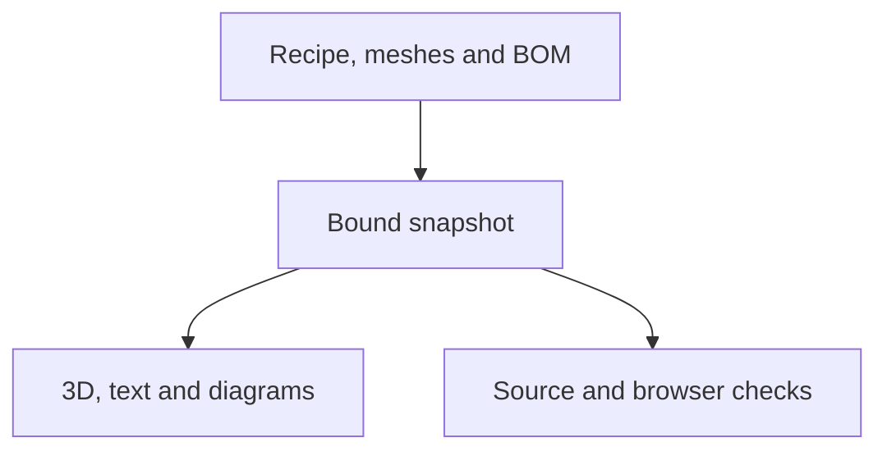

# Versioned Build guide: design and verification

Issue #266 extends the existing Build page and existing viewer. Shared schema,
asset loader, absolute rendering state and lifecycle are owned by
[cad-agent #302](https://github.com/Valpatel/cad-agent/issues/302). Shared testing contract: [assembly-guide-testing.md](https://github.com/Valpatel/cad-agent/blob/d0d13ee3b700b20ebec76ddc3e51561e8d7fbdcc/docs/practice/assembly-guide-testing.md). Product uses the targeted viewer/guide import recorded in `.agents/plans/versioned-build-guide-shared-sync.json`; its existing stage, loading helpers and route entry remain.

The pilot follows twelve authored turret steps across three subassemblies.
Source identity, rendering and physical qualification are separate: this guide
remains educational WIP, with fit/feed/laser/strength checks unresolved.

Data, frames and qualification boundary

## Data and presentation

The current turret recipe, original manifest and BOM are pinned to immutable
source `4866459e2abdb6c7f5f25e9448156b6615593499`. The exporter reads the existing
literal STEPS without executing a CAD module. Fifty-five modeled instances cover the 53 logical recipe additions. Five
additional modeled fittings have no explicit mesh placement in that recipe and
remain declared unplaced context; the robot-only bumper and future dock flap
are also excluded with reasons. No fitting is silently assigned to an operation. Original
triangle topology and normals are preserved; the existing zero-angle hierarchy
is translated once to assembled CAD mm/z-up with TM face at the origin. Guide
offsets never alter those baseline vertices. No new geometry or manufacturing
output is authored by the adapter.

Static and interactive instructions must share the same recipe, part identities,
camera and offsets. The old assembly JSON/images remain historical and are not
used as current posters. WIP source identity and publication do not establish
physical qualification. Original fitting/laser/feed/strength gaps remain visible.
The selector advertises no invented released history. Two different frozen test
versions exercise isolation separately from the exact-commit public WIP.

Complete feature test matrix: positive and negative cases

## Feature matrix

Status meanings: **implemented** means source exists; **passed** requires actual
retained command/result evidence; **pending** is not claimed tested.

| Feature | Positive control | Negative or sensitivity control | Test owner / current status |
| --- | --- | --- | --- |
| Neutral frame and exact source inputs | Binary vertices translated once; normals/order/attributes retained; current original Git and SHA bindings | Wrong group, malformed STL and NaN reject; fixed independent expected offsets catch wrong units/double transform | `tests/site/assembly/test_turret_guide.py`: 4 tests passed before browser integration |
| Complete twelve steps and three subassemblies | Every instance added exactly once; final membership exact; mirrored wheels both present | Unknown/duplicate/missing membership rejected | Same Python test + shared schema tests; browser pending |
| Authored camera views | Every actual camera-minus-target direction equals the once-transformed recipe direction, including step 6 underneath | A floor-orbit clamp cannot silently replace the authored underside view | Existing product twelve-step loop and poster capture; shared guide-bound correction and actual results pending |
| Current authored instructions | Recipe current positive stop used | Retained real old zero-stop export differs and is never consumed | Same Python test passed |
| Forward/back/direct/reload | Sequential and direct step states equal; real rendered instances and positions checked | Reordered/late steps cannot accumulate offsets | Product browser test pending |
| Picking, highlight and isolation | Real canvas pick and list pick agree with part card/mesh | Hidden/future part cannot be picked; clear selection restores context | Product/shared browser tests pending |
| Ghost, wireframe, explode and assembled reset | Actual material state, meaningful rendered output and baseline transforms | Mutated opacity/double transform detected; reset removes all guide offsets | Product/shared browser tests pending |
| Selected-instance appearance | One selected housing can be transparent or wireframe while other visible instances remain unchanged; Automatic restores its global mode | Actual two-part material comparison; next step/reset clears override and DOM control returns to Automatic | Shared partModes + product browser controls pending |
| Two frozen fixtures + WIP | Distinct source/model/text/membership; deep links; version-scoped progress | No cross-version mesh/progress/text reuse or invented release; denied storage retains guide-scoped completion in the same tab | `test-guide-state.mjs`: six pure controls passed (including changed text with same geometry); Chromium switching scope passed at `c58e4ae2`, final two-engine source pending |
| Errors and failed switches | Retain prior coherent snapshot; retry explicit | Wrong guide/model/mesh/poster digest; missing/corrupt/late assets | Shared loader + product browser tests pending |
| Phone/desktop/keyboard/reduced motion | Useful unoccluded model, reachable previous/next and stage selection, no horizontal overflow | Fresh portrait/landscape, actual hasTouch phone taps and keyboard-only; no hidden control acceptance | Product browser tests pending |
| No WebGL / no script / Markdown | Current same-recipe plain text/poster and source caveat | Disabled WebGL cannot become empty ready scene; old poster cannot masquerade current | `test-guide-fallback.mjs` passed with stale actual instruction mutation; existing Markdown six tests passed. No-script/WebGL browser pending |
| Buy/Print/original downloads | Existing totals, rounding, tracking/import/export and deep anchors preserved | Switching workstream cannot erase unrelated state or detach controls | Existing Build tests need opening detail view; not yet rerun |
| Disposal and races | One live canvas after repeated switches; old callbacks/resources stop | Slow old request completing after new selection cannot mutate scene | Shared two-engine lifecycle passed; Chromium product switching scope passed at `c58e4ae2`, final two-engine source pending |
| Publication/package closure | Exact snapshot dependency bytes and working relative paths | Escaping/missing dependencies reject | Existing shared release tests; root owner |

Retained verification results and unfinished acceptance

The first pre-poster browser probe at `678d4ba3` reached its global 180-second bound; its partial execution observations are retained in `.agents/plans/versioned-build-guide-preposter-probe.json` and are not full acceptance. The corrected switching and real hasTouch phone scopes passed in Chromium at `c58e4ae2`; exact source/assets, case names and raw report digests are retained in `.agents/plans/versioned-build-guide-browser-proof.json`. Chromium core and fallback scopes also passed at `872fcfab`, including selected-part appearance and all twelve steps. WebKit subsequently rejected an occluded projected pick point after a part-list scroll; that retained result led to an ordinary vertical canvas-framing test correction. Corrected latest-source two-engine and legacy Build controls remain pending. The shared `cdbee23b` multipart component tests passed in both engines, separately from product acceptance. No full Build regression, current CI or production pass is claimed at this checkpoint. `npm run test:build-guide` is wired into the existing Build-portal browser CI suite. Its browser portion and actual receipts remain required before the pilot is ready to merge.

