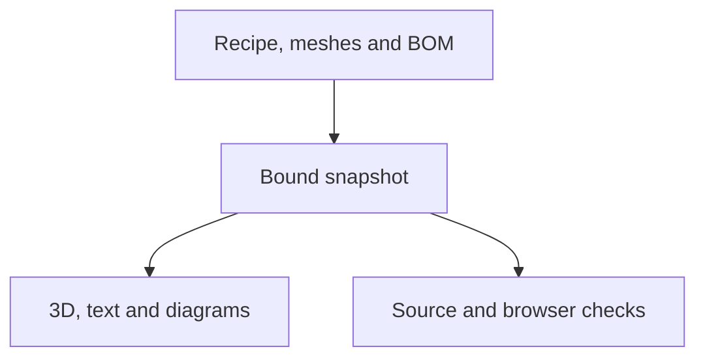

# Versioned Build guide: design and verification

Issue #266 extends the existing Build page and existing viewer. Shared schema,
asset loader, absolute rendering state and lifecycle are owned by
[cad-agent #302](https://github.com/Valpatel/cad-agent/issues/302). Shared testing contract: [assembly-guide-testing.md](https://github.com/Valpatel/cad-agent/blob/d0d13ee3b700b20ebec76ddc3e51561e8d7fbdcc/docs/practice/assembly-guide-testing.md). Product uses the targeted viewer/guide import recorded in `.agents/plans/versioned-build-guide-shared-sync.json`; its existing stage, loading helpers and route entry remain.

The pilot follows twelve authored turret steps across three subassemblies.
Source identity, rendering and physical qualification are separate: this guide
remains educational WIP, with fit/feed/laser/strength checks unresolved.

## Integrated workspace acceptance (2026-11-09 revision)

The Build experience uses one large, stable canvas with overlay navigation, an
assembly explorer, working icon actions and a compact instruction card. The
existing shared renderer/controller, snapshot identities, authored twelve-step
recipe, download originals and progress/import/export contracts remain intact.
Assembly choices are Robot (real body and both legs, turret group hidden), Turret
(the immutable authored bench sequence) and Combined (the existing full robot
with its correctly mounted current turret, without replacement or duplication).
Each assembly has an independent snapshot choice and remembered selection: Robot
and Combined currently expose only the actual current WIP; Turret uses its exact
bound snapshot index. Unpublished rev0/revA history is never invented. Robot and
Combined are overviews only, not fabricated assembly procedures.
The overview reuses the real `buildRobotV2` model used by the playground;
it is current robot context, explicitly separate from the immutable turret guide.
No full-body assembly procedure or new physical qualification is inferred.

Before this revision is ready, real Chromium and WebKit must demonstrate:

- Robot, Turret and Combined remain distinct with actual hidden-group, geometry,
  units/frame and mounted-turret assertions; independent snapshot state and deep
  links, reload and browser Back/Forward retain the selected assembly.
- The real full robot, including both legs and current turret, renders in the
  overview; failures are explicit and retryable, and late context loads cannot
  replace a newer snapshot or resurrect a disposed canvas.
- At 1440, 390 and 320px widths, the canvas, instruction card and Previous/Next
  boxes keep their dimensions and positions across every authored step. Model
  geometry fits the uncovered canvas area. Explorer and tools open/close with
  keyboard and trusted touch; every icon has an accessible name and real state.
- Native fullscreen enter/exit and Escape reflect actual fullscreen state; a denied
  or unavailable Fullscreen API offers an honestly labeled expanded workspace.
  Fit remains an independent action. Both native and fallback layouts retain
  unoccluded geometry, fixed navigation and touch/keyboard access.
- Previous, Jump to step, Complete and Next float in that exact order beneath
  the main toolbar. The one native step dropdown belongs to the current assembly
  and snapshot; the explorer has no redundant step selector. Narrow layouts use
  named arrow buttons and four fixed columns with 44px touch targets.
  The separate instruction panel expands/collapses only by explicit user action;
  opening an inspector temporarily folds instructions and restores the chosen
  instruction size on close. Controls must pass actual elementFromPoint checks
  beneath the global app navigation, not just rectangle comparisons.
- Part hover has a compact bounds-clamped tooltip; selection, keyboard part-list
  focus and touch expose the same source-backed name/ID/details. Grouped meshes
  remain labeled as grouped, and orbit/drag behavior is not intercepted.
- Orthogonal section choices use verified CAD-axis labels, axis cycling and
  retained-side flip with the existing depth slider; no free-angle cutting.
  Default/reset retain the original CAD-X scalar behavior.
- Tree chapter/step navigation, selection, appearance, section, explode, reset,
  completion, deep links and all earlier fallback/version/race controls work.
  Source/qualification details stay available through a compact disclosure.
- Print and Buy occupy explicit bounded panel views. Print rows use actual tables
  with consistent columns, supplier is a filter on one order table, pagination
  reaches every source item, and headers/status columns remain aligned.
- Search, sorting, all prices/rounding/totals, workstream selection, original
  part IDs, file links and progress import/export survive pagination and panel
  switches. Existing browser tests navigate pages rather than assume infinite
  visible rows. Fault controls remain actual failures, never source snapshots.

### Playback, hierarchy and selection workflow amendment

The instruction panel contains the current action text only. Relevant parts move
into the actual subassembly → instance hierarchy, including exact quantities and
source identity. A single selection popover combines metadata and working view
or print actions; hover remains a compact non-interactive hint. Fullscreen starts
with a compact balanced-width instruction card and retains explicit expansion.

Automatic assembly extends the shared guide controller, with one authored model
instance installed at a time from its existing exploded offset to the assembled
baseline. Explicit source-backed presentation order is required; manifest/BOM
iteration order is not an installation sequence. A source compound stays one
compound operation and is labeled accordingly. Zero-offset foundation parts may
appear without an invented translation path. Overview/reference stages are not
construction operations. Playback remains an educational illustration, with no
claim of verified insertion paths, hardware torque or physical qualification.

Acceptance adds real Play/Pause, Loop and speed controls, manual-input pause,
reduced-motion stopped default, background pause and disposal cancellation. Tests
must sample actual world transforms and arrival timing, reject two simultaneous
moving instances and stale/invalid order, compare speeds, loop without accumulated
transforms, and prove user completion checkboxes are not changed by animation.
The existing stage supplies ticks; no second renderer or animation framework is
introduced. Static/manual instructions remain available if playback is unavailable.

Selection uses one viewport-clamped popover with actual part name/ID, known BOM,
material/quantity/source details and explicit compound identity. Pointer click,
keyboard part focus and trusted touch share it. Outside click and Escape close it
without stealing orbit gestures. Print actions require an explicit audited `geometry_match.status=matched` record
  and matching original bytes. Git identity alone cannot establish correspondence
  to the displayed geometry; pending originals remain identified downloads.
  Print actions may only use exact source-backed
manufacturing originals, never neutral posed guide meshes. Bought items offer
truthful source/purchase actions. A Print-this-part handoff preserves exact part
and snapshot identity in the existing print workflow; printer submission requires
an actual supported secure handoff and selected job/printer, with no fake Send UI.

Draft UX pushes supersede earlier PR browser runs. Playground/presentation CI uses
one concurrency group per workflow/event/PR, canceling only superseded PR runs;
main pushes retain non-canceling serialized execution. Canceled draft runs are
not passing evidence. A complete final frozen-head run remains required.

### Responsive docking amendment

Expanded desktop instructions dock at the right edge. When View tools are open,
Tools remain rightmost and instructions occupy the adjacent pane immediately to
their left; closing Tools moves instructions back to the right edge. Both use
actual measured stage insets. The collapsed instruction strip stays compact.

At tablet/phone widths the same controls use one switchable sheet for Instructions,
Parts and Tools, with one active pane, explicit expand/collapse and reachable
floating navigation above it. A selected-part popover uses the same mobile sheet
footprint, rather than adding another pane over the model. No second renderer or
new UI framework is introduced. Browser acceptance covers desktop, tablet,
390x844 and 320x700, actual control hit targets, panel bounds after each toggle,
model geometry outside occupied overlays and fixed navigation across steps.

Implementation and browser evidence for this revision are pending; prior retained
receipts below describe the earlier presentation only.

Data, frames and qualification boundary

## Data and presentation

The current turret recipe, original manifest and BOM are pinned to immutable
source `4866459e2abdb6c7f5f25e9448156b6615593499`. The exporter reads the existing
literal STEPS without executing a CAD module. Fifty-five modeled instances cover the 53 logical recipe additions. Five
additional modeled fittings have no explicit mesh placement in that recipe and
remain declared unplaced context; the robot-only bumper and future dock flap
are also excluded with reasons. No fitting is silently assigned to an operation. Original
triangle topology and normals are preserved; the existing zero-angle hierarchy
is translated once to assembled CAD mm/z-up with TM face at the origin. Guide
offsets never alter those baseline vertices. No new geometry or manufacturing
output is authored by the adapter.

Static and interactive instructions must share the same recipe, part identities,
camera and offsets. The old assembly JSON/images remain historical and are not
used as current posters. WIP source identity and publication do not establish
physical qualification. Original fitting/laser/feed/strength gaps remain visible.
The selector advertises no invented released history. Two different frozen test
versions exercise isolation separately from the exact-commit public WIP.

Complete feature test matrix: positive and negative cases

## Feature matrix

Status meanings: **implemented** means source exists; **passed** requires actual
retained command/result evidence; **pending** is not claimed tested.

| Feature | Positive control | Negative or sensitivity control | Test owner / current status |
| --- | --- | --- | --- |
| Neutral frame and exact source inputs | Binary vertices translated once; normals/order/attributes retained; current original Git and SHA bindings | Wrong group, malformed STL and NaN reject; fixed independent expected offsets catch wrong units/double transform | `tests/site/assembly/test_turret_guide.py`: 4 tests passed before browser integration |
| Complete twelve steps and three subassemblies | Every instance added exactly once; final membership exact; mirrored wheels both present | Unknown/duplicate/missing membership rejected | Same Python test + shared schema tests; both-engine full twelve-step core scopes passed |
| Authored camera views and framing | Actual camera direction equals the once-transformed recipe; every visible vertex stays within the canvas and near/far planes | A floor clamp and real too-close camera are rejected; modeled bounds are distinguished from floor/shadow context | Both-engine final core passed actual vertex/frustum checks and too-close negative; retained capture-pose proof has minimum12.998px margin |
| Current authored instructions | Recipe current positive stop used | Retained real old zero-stop export differs and is never consumed | Same Python test passed |
| Forward/back/direct/reload | Sequential and direct step states equal; real rendered instances and positions checked | Reordered/late steps cannot accumulate offsets | Both-engine core scopes passed sequential/back/direct/reload actual states |
| Picking, highlight and isolation | Real canvas pick and list pick agree with part card/mesh | Hidden/future part cannot be picked; clear selection restores context | Both-engine product core and shared multipart tests passed |
| Ghost, wireframe, explode and assembled reset | Actual material state, meaningful rendered output and baseline transforms | Mutated opacity/double transform detected; reset removes all guide offsets | Both-engine product core and shared multipart tests passed |
| Selected-instance appearance | One selected housing can be transparent or wireframe while other visible instances remain unchanged; Automatic restores its global mode | Actual two-part material comparison; next step/reset clears override and DOM control returns to Automatic | Both-engine shared and product material/DOM controls passed |
| Two frozen fixtures + WIP | Distinct source/model/text/membership; deep links; version-scoped progress | No cross-version mesh/progress/text reuse or invented release; denied storage retains guide-scoped completion in the same tab | Six pure state controls passed; both-engine final switching scopes passed with two distinct frozen fixtures and exact WIP |
| Errors and failed switches | Retain prior coherent snapshot; retry explicit | Wrong guide/model/mesh/poster digest; missing/corrupt/late assets | Shared loader negatives and both-engine final corrupt/missing/late-switch scopes passed |
| Phone/desktop/keyboard/reduced motion | Useful unoccluded model, reachable previous/next and stage selection, no horizontal overflow | Fresh portrait/landscape, actual hasTouch phone taps and keyboard-only; no hidden control acceptance | Both-engine core and dedicated native emulated-touch scopes passed; trusted actual touch events include canvas selection |
| No WebGL / no script / Markdown | Current same-recipe plain text/poster and source caveat | Disabled WebGL cannot become empty ready scene; old poster cannot masquerade current | Pure stale-instruction mutation, Markdown6, and both-engine final no-script/NoGL/version-progress scopes passed with all12 decoded diagrams |
| Buy/Print/original downloads | Existing totals, rounding, tracking/import/export and deep anchors preserved | Switching workstream cannot erase unrelated state or detach controls | Full original Build regression passed in both engines, including643 engineering originals,55 bound derivatives and real STL/STEP/3MF viewers; WebKit24 loading/recovery cases passed |
| Disposal and races | One live canvas after repeated switches; old callbacks/resources stop | Slow old request completing after new selection cannot mutate scene | Shared and final both-engine product switching/disposal scopes passed |
| Publication/package closure | Exact snapshot dependency bytes and working relative paths | Escaping/missing dependencies reject | Existing shared publisher dependency/portable ZIP tests passed in both engines; actual product publication remains separate |

Retained verification results and unfinished acceptance

The final poster-bearing product source `fc79cd99` passed all four named feature scopes in both Chromium and WebKit: core, switching, fallback and touch. Every twelve-step forward/back/direct state, current camera/frustum bounds, real picking and material controls, two frozen fixtures plus WIP, denied storage, corrupt/late replacements, no-script and no-WebGL versions/progress were exercised. The revised touch consumer requires actual trusted touchstart events on controls and canvas; WebKit's observed maxTouchPoints=0 is retained as metadata, rather than being mistaken for failed input. The complete original Build regression passed in both engines, and WebKit's 24 loading/recovery cases passed. Exact report hashes, tested source identities and case names are in `.agents/plans/versioned-build-guide-final-browser-proof.json`.

The current default page measured 1,756px desktop / 2,711px phone in Chromium and 1,747px / 2,691px in WebKit at1440x1000 /390x844, before expanding Buy/Print. The original live-page study measured19,821px /25,234px. These are observations, not a new height threshold; all original detail tables and anchors remain available.

All twelve actual canvas diagrams are attached and checked against visual fingerprint `a388013e`; their bytes equal the first inspected capture. The first receipt, new source-bound receipt and actual all-pose vertex projection evidence are retained separately. No geometry or camera was changed to dismiss the observed floor-shadow edge. Source and poster checks pass.

Earlier failed probes remain failed: the pre-poster180-second whole-service timeout, WebKit's occluded canvas target, procurement-only initial layout scan, touch capability assertion and first offscreen Progress disclosure stability timeout. The latter was not reproduced in an isolated fresh click; the final legacy test uses the existing ordinary Parts & prints jump link, asserts its native disclosure is open, and preserves every following table/download assertion. No forced clicks, relaxed thresholds or timeouts were introduced. Current whole-head CI, independent final review and production acceptance remain pending. `npm run test:build-guide` is wired into the existing Build-portal check for both Chromium and WebKit with the complete default scope.

The reviewed hip print handoff keeps original STL identity separate from the derived geometry-only 3MF. Both original and project bytes must match their declared SHA-256. Only a matched model-to-original mapping may expose Prepare print; a project must additionally use its exact content-addressed URL, reference the verified original digest, and retain its limitations. A failed verification is retryable for the same part. Opening Print leaves native or expanded fullscreen before revealing the existing Print view. Tests must exercise transient404→restore→same-part retry and both fullscreen modes, rather than only source validation.

Desktop-client links follow the pinned official Bambu Studio source [Windows/Linux handler](https://github.com/bambulab/BambuStudio/blob/a78684a11de4abddad9a6d19eeb75a6a1d2e82a5/src/slic3r/GUI/GUI_App.cpp#L1040-L1078), [distinct macOS handler](https://github.com/bambulab/BambuStudio/blob/a78684a11de4abddad9a6d19eeb75a6a1d2e82a5/src/slic3r/GUI/GUI_App.cpp#L6944-L6984), and [3MF-only download path](https://github.com/bambulab/BambuStudio/blob/a78684a11de4abddad9a6d19eeb75a6a1d2e82a5/src/slic3r/GUI/Plater.cpp#L16550-L16555). Platform-labelled links and verified download fallback are provided; tests generate the URI without launching an application. No installed handler, real printer fit, slicing settings or print job is claimed. The project describes a generic256mm rectangle with3mm margin and no keepouts; actual printer, filament, orientation, supports and slicing remain user decisions.

Independent review of `1dda4850` found two boundary defects: a failed prepared-project fetch was cached as ready, and reference overviews could enter construction completion. Project failure now remains partial/retryable and preserves only the verified original link; the actual mount regression exercises404→restoration with the same part and the explicit retry action. Completion excludes reference entries on read, migration and save, and their checkbox is disabled. Neither defect is dismissed by a successful original-file verification or a valid guide digest.

Measured software-rendering probes require layout partitioning by assembly and actual viewport. Every Robot24, Combined25 and Turret12 entry is still exercised at1440×1000,1024×900,390×844 and320×700 in both engines, with unchanged geometry/hit-target assertions. Unknown or empty scope selectors fail closed. Each report records the engine, source version, selected assembly/width and actual completed phases. The original180-second combined layout timeout is retained separately from its completed Robot24-step prefix.
