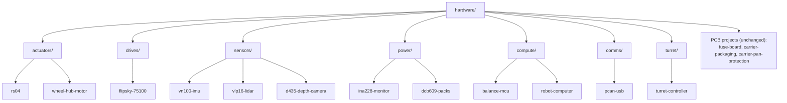

# Hardware: one folder per component

Everything the repository knows about each bought or owned component, in one place per part: where its manual is,
how it connects, how it is configured, which code drives it, which units are in hand and how to bring it up. The
design itself stays where it is (the catalog, the docs, the CAD); these folders point at it and hold the parts that
belong to one component: its versioned config, its inventory and its bring-up page.

## The map

| Folder | Component | In hand | State |
|---|---|---|---|
| [actuators/rs04/](actuators/rs04/README.md) | RobStride RS-04 leg motors | 4 (arrived 2026-11-03) | profiles, inventory, [bring-up](actuators/rs04/bring-up.md), the [motor tool](../docs/rs04-motor-tool.md) |
| [actuators/wheel-hub-motor/](actuators/wheel-hub-motor/README.md) | 10 in hoverboard-class hub motors (D69) | none | to buy and measure (W1) |
| [drives/flipsky-75100/](drives/flipsky-75100/README.md) | Flipsky 75100 VESCs for the wheels | none | VESC Tool settings recorded |
| [sensors/vn100-imu/](sensors/vn100-imu/README.md) | VectorNav VN-100 Rugged | 1 (the owner's) | boot registers recorded |
| [sensors/vlp16-lidar/](sensors/vlp16-lidar/README.md) | Velodyne VLP-16 | 1 (the owner's) | interfaces only |
| [sensors/d435-depth-camera/](sensors/d435-depth-camera/README.md) | RealSense D435 x 2 | 2 (the owner's) | interfaces only |
| [power/ina228-monitor/](power/ina228-monitor/README.md) | INA228 bus monitor and its shunt | none | shunt builds recorded |
| [power/dcb609-packs/](power/dcb609-packs/README.md) | DeWalt DCB609 packs and dock adapters | 2 (the owner's) | firmware limits recorded |
| [compute/balance-mcu/](compute/balance-mcu/README.md) | STM32G474 balance MCU board and CAN transceivers | none | pins and buses |
| [compute/robot-computer/](compute/robot-computer/README.md) | the robot's Jetson (J501 + AGX Orin in the design) | 1 (the owner's J501) | [hardware/deploy/jetson](deploy/jetson/README.md); which Jetson is open |
| [comms/pcan-usb/](comms/pcan-usb/README.md) | PEAK PCAN-USB configuration adapter | 1 (the owner's) | used by the motor tool |
| [turret/turret-controller/](turret/turret-controller/README.md) | the turret's Feather M4 CAN electronics | none | a pointer to the turret docs |

**PCB projects** stay where they are, with their own layout: [fuse-board/](fuse-board/) (the generated KiCad fuse and
shunt board, D60; its doc is [docs/body-fuse-board.md](../docs/body-fuse-board.md)),
[carrier-packaging/](carrier-packaging/README.md) (issue #96) and
[carrier-pan-protection/](carrier-pan-protection/README.md) (issue #87). They are boards being designed, not components
bought; moving them under a category would break their build scripts' paths and their links for no gain, so they
are listed here and left alone.

## The skeleton every component folder keeps

`tools/check-hardware.py` checks it in CI (workflow `jetson-deploy`): every folder under a category has these, every
JSON file parses and names a `gyropup.*` schema, every relative link resolves, every sourced value in a
`gyropup.config/1` file still matches its source, and this map lists the folder. The RS-04 profiles
(`gyropup.rs04-profile/1`) are checked the same way by `python -m rig.rs04_profiles` and `rig/tests/test_rs04_vectors.py`.

| Part | What goes in it |
|---|---|
| `README.md` | a short intro, a diagram, then these sections in this order: **References**, **Interfaces**, **Config and profiles**, **Driver**, **Inventory**, **Bring-up and tests**, **Open questions** |
| References | where the manual, datasheet and CAD come from, **cited, never redistributed**: vendor files stay local, with a `SOURCE.txt` under `references/vendor/` saying where and when |
| `interfaces.md` | power, connectors, pinouts, buses and mounting, each row with its source |
| `config/` or `profiles/` | versioned JSON (`version`, `changes`) of the settings the component holds. A value taken from elsewhere has a `sources` entry (`c_define`, `json` + `pointer`, or `contains` + `text`) and the check fails when its source changes |
| Driver | a pointer to the code that talks to it (`rig/`, `firmware/`, `designer/kit/`): no code is copied here |
| `inventory.json` | `gyropup.inventory/1`: what was ordered and arrived (or is the owner's: `held`), and one record per unit. **Serials and ids are filled from the unit itself (a scan, an export, its label), never typed in or invented**; until then they are `null` |
| Bring-up and tests | the steps from a unit in its box to a working one, or a link to them; the software checks that cover it |

A section with nothing in it yet says **Not yet** and what would fill it. Nothing in these folders claims a test
that has not run.

## Adding a component

1. Pick its category; make `hardware/<category>/<name>/` (lower case, hyphens).
2. Copy the sections above into its README and fill what the repository already knows, with sources.
3. Add `interfaces.md` and `inventory.json` (empty `units` until one arrives), and `config/` when it holds settings.
4. Add a row to the map above and run `python3 tools/check-hardware.py`.
5. When it is bought, add the order to [docs/purchases.md](../docs/purchases.md) and the folder's inventory together.

## Deployment

What runs on the robot's computer (CAN bring-up, stable adapter names, the RS-04 bridge service) is in
[hardware/deploy/jetson](deploy/jetson/README.md), installed by one idempotent command.
