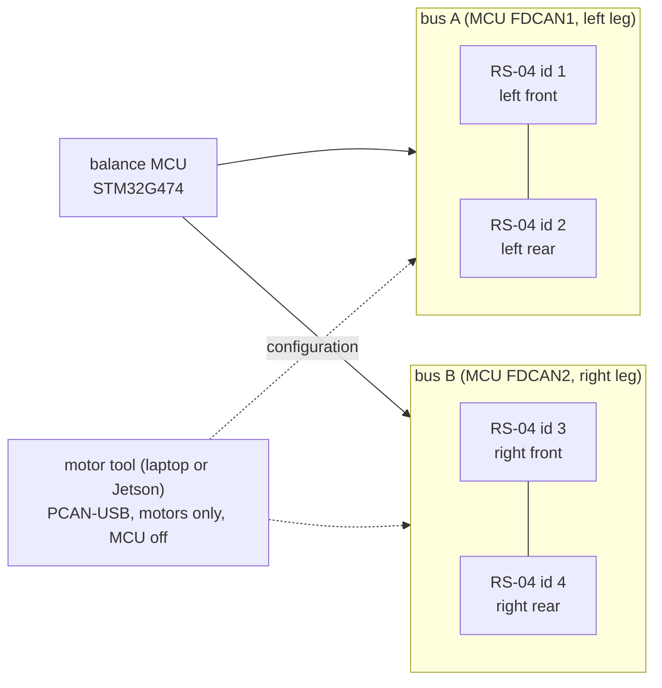

# RobStride RS-04 leg actuator

The four hip motors of the two five-bar legs: each leg has a front and a rear hip motor and no knee motor. A
quasi-direct-drive actuator with its own driver, on the robot's 30-41 V bus, commanded over CAN by the balance MCU
(the motor tool on a laptop or the Jetson for configuration). **4 in hand since 2026-11-03**, none scanned yet.

## References

- RS04 User Manual 260713 and the STEP model: RobStride's [Product_Information](https://github.com/RobStride/Product_Information)
  repository, kept locally only (no licence to redistribute): where and when, in
  [references/vendor/robstride-rs-04/SOURCE.txt](../../../references/vendor/robstride-rs-04/SOURCE.txt).
- RobStride's [Python_Sample](https://github.com/RobStride/Python_Sample) (MIT): the protocol cross-check.
- Mass, torque curve and price: `catalog/leg_actuators.json`; the mounting interface: [RS-04 mounting fit](../../../docs/rs04-mounting-fit.md)
  and [support study](../../../docs/rs04-support-study.md).

## Interfaces

Power on the bus through an XT30 on the motor's lead (the robot adapts it to XT60H), CAN on a GH1.25 2-pin, 1 Mbit/s
29-bit frames, factory id 127, host id 0xFD: [interfaces.md](interfaces.md).

## Config and profiles

[`profiles/`](profiles/) holds the build profiles as versioned JSON: `pla-bench` (the default: a 12 N m cap from
[the motor-day derating](../../../docs/motor-day.md), 10 N m stored as motor-day step L1 does, a 3 N m jog) and `final` (the firmware's 60 N m until the
per-build caps of [issue #202](https://github.com/Valpatel/gyropup/issues/202) land). Each holds the limits the motor tool and its bridge
enforce and the settings a configured motor holds (`motor_config`). Every number taken from elsewhere names its
source and is checked against it (`python -m rig.rs04_profiles`). The firmware still writes its own cap from
`gp_config.h` at boot; reading the profiles there belongs to issue #202.

**Heat:** the PLA bench's limits are the motor heat model's ([`motor_thermal.json`](../../../exports/leg/thermal/motor_thermal.json),
`/bench`, and [docs/motor-thermal.md](../../../docs/motor-thermal.md), from [PR #195](https://github.com/Valpatel/gyropup/pull/195)): stop when a motor's case passes
its face limit; plan held torque under its continuous limit for the room. The `pla-bench` profile points at them and
the motor tool reads them live.

## Driver

| Where | What |
|---|---|
| [`rig/rs04.py`](../../../rig/rs04.py) | The protocol from the manual, a bus and motor handle, the command line (`python -m rig.rs04 scan`) |
| [`rig/rs04_emu.py`](../../../rig/rs04_emu.py) | A software RS-04 for tests |
| [`rig/rs04_bridge.py`](../../../rig/rs04_bridge.py), [`rig/rs04_guard.py`](../../../rig/rs04_guard.py) | The SocketCAN bridge for the browser tool and its safety rules |
| [`designer/kit/rs04/`](../../../designer/kit/rs04/README.md) | The browser tool and its protocol port (MIT) |
| [`firmware/balance/src/core/gp_rs04.c`](../../../firmware/balance/src/core/gp_rs04.c) | The balance firmware's driver: boot configuration and the 1 kHz MIT exchange |

## Inventory

[`inventory.json`](inventory.json): 4 units, ordered 2026-10-27 from Seeed Studio, arrived 2026-11-03. Every field is
blank until the owner scans the unit; then `python -m rig.rs04_inventory add <export.json>` fills its record (uid,
CAN id, joint, firmware, zero offset) from the motor tool's Config → Export. Mass and notes are added by hand.

| Unit | uid | CAN id | Joint | Firmware | Zero | Mass |
|---|---|---|---|---|---|---|
| 1-4 | not scanned yet | 127 (factory) | not assigned | – | not set | – |

## Bring-up and tests

The [bring-up checklist](bring-up.md) walks through the first scan, `setid`, the profile's settings, the zero and
`save` with the [motor tool](../../../docs/rs04-motor-tool.md). Then [bench tests](../../../docs/leg-bench-tests.md)
C1-C6 and the [motor-day ladder](../../../docs/motor-day.md). Software checks: `npm run test:rs04`,
`python -m pytest rig/tests/test_rs04.py`, `python -m unittest rig.tests.test_rs04_inventory`.

## Open questions

- No unit has been scanned: firmware versions, uids and the as-delivered parameters are unknown.
- The firmware's cap and the profiles' come from different places until issue #202 lands.
- The manual leaves byte 7 of the type 23-25 frames and the byte order of the type-21 fault words open (`rig/rs04.py`).
