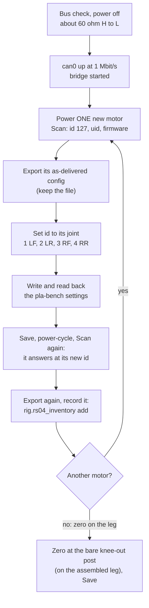

# RS-04 bring-up: the first scan, ids, settings, zero and save

For the four RS-04s that arrived on 2026-11-03, with the [motor tool](../../../docs/rs04-motor-tool.md) and a PEAK
PCAN-USB on a Linux laptop (or the robot's Jetson once [deploy/jetson](../../../deploy/jetson/README.md) is installed).
One motor at a time: new motors all answer at id 127, so two at once collide. Agents never power a motor; this page
is the owner's.

## What you need

- The PCAN-USB, a lead from its D-Sub 9 to the motor's GH1.25 CAN plug, and a 120 ohm terminator at each end of the
  short bus (the PCAN-USB has none built in: see [its folder](../../comms/pcan-usb/README.md)).
- The bench supply (36 V, as [C1-C6](../../../docs/leg-bench-tests.md) plans), the motor's XT30 lead, its switch in reach.
- A clear bench: the motor clamped, nothing on its output.
- This repository checked out, and Python 3.10 or newer (nothing to install).

## Steps

| # | Do | You should see | Record |
|---|---|---|---|
| 1 | Supply off. Measure between CAN H and L at the motor's plug | about 60 ohm (two 120 ohm in parallel) | |
| 2 | Plug in the PCAN-USB. `ip -details link show can0` | a `can` link from the `peak_usb` driver | |
| 3 | `sudo ip link set can0 up type can bitrate 1000000` | `state ERROR-ACTIVE` in `ip -details link show can0` | |
| 4 | `python3 -m rig.rs04_bridge --iface can0` and open `http://127.0.0.1:8765/` | the tool, an orange **REAL HARDWARE** banner after **Connect** | |
| 5 | Power one motor, **Scan bus** | CAN id 127, its 16-hex-digit uid and firmware version | |
| 6 | **Config → Export this motor's config** | a JSON file named after its uid | keep it: the as-delivered settings |
| 7 | **Setup → Set id** to its joint, confirm | the motor is now CAN id 1, 2, 3 or 4 | |
| 8 | **Setup → Write and read back** (the `pla-bench` profile) | run_mode 0, limit_torque 10, canTimeout 2000, zero_sta 1, damper 0, each read back | |
| 9 | **Parameters → Save to the motor**, power-cycle the motor, **Scan bus** | it answers at its new id with the same uid; **Config** shows no differences against the profile | |
| 10 | **Jog** (optional): tick both checks, **Arm**, hold **Jog +** briefly, then Space | it turns slowly (3 N m, 1 rad/s), stops at Space | case temperature by hand |
| 11 | **Config → Export** again, then `python -m rig.rs04_inventory add <file> --mass-g <scale reading>` | `hardware/actuators/rs04/inventory.json` gets the unit's record | commit it |
| 12 | Unplug it, label it with its id and joint, and go back to step 5 with the next motor | | |

**The zero** is set on the assembled leg, not on the bench: hold the upper link on its **bare knee-out stop post**
(no TPU sleeve), then **Setup → Set zero here** with that pose, then **Save**, and export again for the inventory.
That is the pose `rig/calibrate.py` uses; it reads the travel against the CAD and writes the motor's direction.

## If something is off

| Symptom | Look at |
|---|---|
| No motor answers | the supply, both terminators (step 1), the bit rate (step 3), H and L swapped |
| Two uids at one id, or garbled replies | two motors at 127 on the bus: unplug one |
| The tool refuses a write | the log says why: over the profile's cap, `canTimeout` 0, another run mode: the profile's limits are on purpose |
| A fault in Telemetry | read it, fix the cause (supply, wiring), then **Clear faults** |
| `ip link` has no can0 | `modinfo peak_usb`, `sudo modprobe peak_usb`; on a Jetson the module's own CAN ports may take can0/can1 first |
