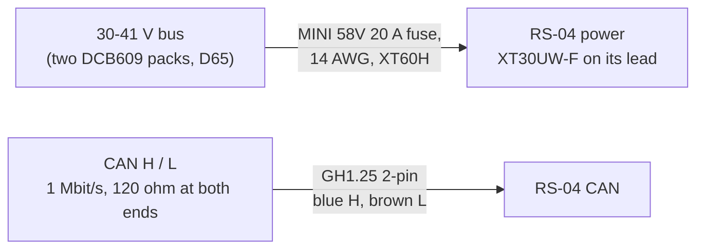

# RS-04 interfaces

What the repository records about each RS-04's power, connectors, bus and mounting. Sources in each row.

## Power

| Item | Value | Source |
|---|---|---|
| Rated input | 24-60 V; the robot's bus is 30-41 V | docs/body-electrical.md 1 (D65) |
| Faults | under-voltage 12 V, over-voltage 60 V (the firmware limps at 58 V) | `rig/rs04.py` FAULT_BITS; `gp_config.h` GP_VBUS_OVER_V |
| Lead | the motor's lead ends in an XT30UW-F (red +, black -) | docs/leg-rig-wiring.md, Connectors |
| On the robot | a 450 mm pigtail with XT60H-M from a fused bus tap: MINI 58V 20 A, 14 AWG (W10-W13, returns W18) | docs/body-electrical.md, wiring table |
| Current | about 12 A in a jump, 25 A peaks | docs/body-electrical.md, W10 |

## CAN

| Item | Value | Source |
|---|---|---|
| Connector | GH1.25 2-pin: blue CAN_H, brown CAN_L | docs/leg-rig-wiring.md (RS04 manual 2.3) |
| Board connector (reference) | 1 power +, 2 power -, 3 CAN_L, 4 CAN_H | docs/leg-rig-wiring.md (manual 2.5) |
| Bit rate | 1 Mbit/s classic CAN, 29-bit identifiers (RobStride's private protocol) | `rig/rs04.py` |
| Identifier | bits 28-24 the type, 23-8 data area 2, 7-0 the destination | `rig/rs04.py` (manual 4.1) |
| Ids | factory 127; the robot 1 left front, 2 left rear (bus A), 3 right front, 4 right rear (bus B); the host 0xFD | docs/body-firmware.md 2; `gp_config.h` |
| Termination | 120 ohm at each end of each bus: the MCU's CAN Pal and the rear motor's plug | docs/body-electrical.md 4 |
| Watchdog | `canTimeout` 2000 (0.1 s) written at boot | `gp_config.h` GP_RS04_CAN_TIMEOUT |
| Rates | the balance loop's MIT exchange at 1 kHz on each leg's bus | docs/body-firmware.md |

On the robot the motors are on the MCU's buses A and B, not on the Jetson's CAN. To configure them from the Jetson
or a laptop, power the MCU off and plug a USB adapter (a PEAK PCAN-USB) into the leg's bus: two masters must never
command the same motors.

## Mounting

Ten M4 lugs (docs/leg-bench-tests.md, C1-C6); the proposed interface, its support and preload are open in
[the mounting-fit work](../../../docs/rs04-mounting-fit.md). The datasheet mass is 1510 g (`catalog/leg_actuators.json`).

## Pinout of the PC side (a PCAN-USB)

A PEAK PCAN-USB has a D-Sub 9 male wired to the CiA 303-1 convention (pin 7 CAN_H, pin 2 CAN_L, pin 3 GND; check the
adapter's own manual, which the repository does not keep): see
[the CAN adapter's folder](../../comms/pcan-usb/README.md). A GH1.25-to-D-Sub lead is not in the repository yet.
