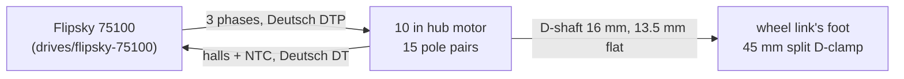

# Wheel hub motor (10 in hoverboard class)

The two wheels: a 36 V 350 W outer-rotor hub motor of the hoverboard family with a 10 x 2.125 pneumatic tyre, one
per leg, clamped on its D-shaft in the wheel link's foot and driven by a [Flipsky 75100](../../drives/flipsky-75100/README.md)
on halls ([D69](../../../docs/program/decisions.yaml), [wheel change plan](../../../docs/legs/wheel-change-plan.md)). **Not bought
yet**: task W1 buys two and measures them before the foot is cut ([issue #24](https://github.com/Valpatel/gyropup/issues/24)).

The ODrive BotWheel BW0124 that D69 replaced is kept only as the leg CAD's wheel geometry
(`catalog/wheel_motors.json`, [its source](../../vendor/odrive-botwheel/SOURCE.txt)); it is not on the robot.

## References

- The decision and study: [D69](../../../docs/program/decisions.yaml), `research/air-tyre-hub-wheels.md`, the
  [wheel change plan](../../../docs/legs/wheel-change-plan.md) (W1-W9).
- No datasheet or listing is kept yet: W1 adds `references/vendor/hoverboard-10in/` with photos and a sketch of the
  motor in hand.

## Interfaces

Shaft, phases, halls and the tyre: [interfaces.md](interfaces.md). The numbers are the listings' and the study's
until W1 measures them.

## Config and profiles

Not yet: the wheel's settings live in its drive's VESC Tool configuration
([drives/flipsky-75100/config](../../drives/flipsky-75100/config/wheel-vesc.json)). W1's measured Kv, R, L and the hall
order go into `catalog/wheel_motors.json` (`hoverboard-10in-36v`).

## Driver

The [Flipsky 75100](../../drives/flipsky-75100/README.md) in FOC on halls; the balance firmware commands its current
over CAN (`firmware/balance/src/core/gp_vesc.c`). Simulation: `sim/leg_rig.py`, `sim/robot_v2.py`, `sim/wheel_study.py`.

## Inventory

[`inventory.json`](inventory.json): none ordered or in hand (`docs/purchases.md`).

## Bring-up and tests

Not yet. W6 is the bench plan: one wheel on a 75100, hall detection, Kv by the drill test, Kt at stall, the
phase-short brake, the clamp slip test, 20 min at 10 A and the tyre's stiffness
([wheel change plan](../../../docs/legs/wheel-change-plan.md)); results go to `docs/wheel-bench-tests.md`.

## Open questions

- Which listing: Robokits RKI-9013 or a US-shipping 10 in 36 V 350 W unit (W1 confirms one live before ordering).
- Every number below is unmeasured: mass, shaft hardness, Kv, R, L, hall order, the hub's seal.
- The encoder upgrade (AS5047P, W7) only if the hall-only wheel speed limit-cycles (W5, P1).
