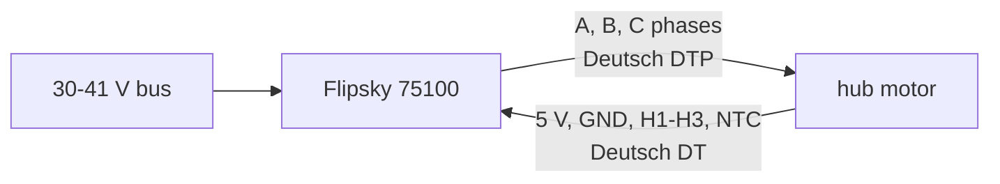

# Wheel hub motor interfaces

From D69 and the wheel study; **none of it is measured yet** (W1 measures two motors).

| Item | Value | Source |
|---|---|---|
| Motor | 36 V 350 W outer-rotor hub motor, 15 pole pairs, halls | D69 (docs/decisions.yaml) |
| Tyre | 10 x 2.125 pneumatic with a tube, 30-35 psi | D69 |
| Shaft | hollow D-shaft, 16 mm, 13.5 mm across the flat, 76 mm long, one side only | D69 |
| Mount | the wheel link's foot: a 45 mm split D-clamp, 4 x M5 in inserts; a steel clamp block if the print slips | D69, W2 |
| Phases | 3 wires to the drive's phase pigtails on a Deutsch DTP (wires W50-W53 with the halls) | docs/body-electrical.md, wiring table |
| Halls and NTC | 5 V, GND, three halls, the stator NTC if the motor has one, on a Deutsch DT | D69, W8 |
| Current | 30 A motor maximum, 10 A continuous (the drive's limits) | D69 |
| Ingress | the hub sealed (greased bearing, silicone seam, sealed lead exit, vent plug) | D69, W8 |
| Backup | the same motor's 8.5 in version | D69 |

## What W1 measures before the foot is cut

Each number above becomes a measurement on the two motors bought in W1, written into `catalog/wheel_motors.json`
(`hoverboard-10in-36v`) and `catalog/interfaces.json`, with the date:

| Measure | How | Why it matters here |
|---|---|---|
| Mass, with the tyre and tube | a scale | the mass ledger's 37.0 kg gate (D71) |
| Shaft diameter, flat, length | calipers | the foot's D-clamp (W2) |
| Shaft hardness | a file test or Rockwell | the shaft as a cantilever at the axle spike (W3) |
| Run-out | a dial gauge on the tyre and the cover | the clamp's seat and the balance loop's wheel speed |
| Kv, R, L, pole pairs, hall order | the drill test and VESC Tool's detection | the drive's set-up ([config](../../drives/flipsky-75100/config/wheel-vesc.json)) |
| Hall board, stator NTC, seals | a teardown of one motor | the connector pin-out (W8) and the ingress plan |
