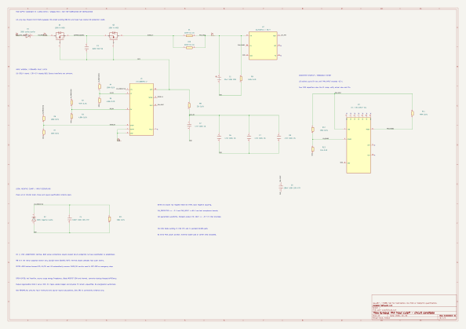

# PAN supply protection — circuit candidate B

**The editable 30-part candidate now includes a reverse-input barrier and explicit converter startup inhibit. It remains unselected and unqualified: do not fabricate or energize it.** D1/D2 separate negative raw BUS from the LTC4368 input; a TPS3760 UV supervisor drives converter EN. The revised sense network and gate ramp have reproducible conditional startup bounds. The output remains 12 V and the shared head BUS still bypasses this circuit.

Tracking [issue87](https://github.com/Valpatel/gyropup/issues/87) / [PR88](https://github.com/Valpatel/gyropup/pull/88), following [candidate A](https://github.com/Valpatel/gyropup/pull/84) and [input requirements](../../research/protection/carrier-input-protection.md). No catalog selection, carrier geometry or external connector changes here.



The preview fits this page; pinch or use browser zoom for details. The original vector drawing uses A2 paper dimensions.

- <a href="pictures/pan-cutoff.svg" download>Download original SVG</a>, [native KiCad schematic](pan-cutoff.kicad_sch) and [editable symbol library](candidate.kicad_sym).
- [Exact manufacturer pins and carrier boundaries](pins.md), [BOM](candidate-bom.csv), [dated offers and primary sources](availability.json).
- [Fault states, numerical bounds and unresolved qualification](fault-review.md), [calculations](reports/calculations.json), [KiCad netlist](reports/netlist.xml), [ERC](reports/erc.rpt), [source/artifact receipt](reports/receipt.json).

The proposed bounds cover a charged-output reversal and a 3.25 A **12 V output** load, not merely a controller's reverse-voltage headline or nominal input current. At the declared assumptions the startup margin is 0.281 A; the 15 V enable headroom is only 69 mV. The diode loss screen is approximately 5.98 W and demands an engineered thermal path. These are explicit reasons to qualify or reject the candidate before placement, not a robust-startup or thermal pass.

All 104 physical leads across 30 parts, 15 connected nets and 11 NC groups are independently checked against KiCad's exported connectivity. The power path, parallel sense resistors, dividers, ramp bank and EN supervisor use connected native wires. Visible discrete/body-diode polarity is also checked. Zero ERC verifies consistency only; it cannot certify timing, thermal behavior, fit or safety.

## Reproduce

Use Python 3 and pinned KiCad CLI 10.0.1:

```sh
python hardware/carrier-pan-protection/build.py
python hardware/carrier-pan-protection/test_circuit.py
python hardware/carrier-pan-protection/verify.py
```

The build regenerates the schematic, local library, BOM, ERC, XML and SVG from `circuit_design.py` and binds all source/artifact hashes. Tests export corrupted native schematics: reversed MOSFET, swapped sense pins, hidden power net, bypassed cutoff, wrong gate-cap return, reversed series/clamp diodes, bypassed EN and omitted parallel resistor. Arithmetic faults reject excessive capacitance/slew, low efficiency, diode drop, charged reverse stress and a missing ramp capacitor. Variant checks reject the OV supervisor sold as a “parametric equivalent” of the UV candidate.

Open `pan-cutoff.kicad_pro` / `.kicad_sch` in KiCad. Permanent edits belong in `circuit_design.py` followed by regeneration. The existing `hardware/fuse-board/sexp.py` parser is reused without modification. Optional PDF: `kicad-cli sch export pdf -o /tmp/pan-cutoff.pdf hardware/carrier-pan-protection/pan-cutoff.kicad_sch`.

No PCB or extra-board area is allocated. Negative hot-insertion waveforms, positive-source transients, actual converter Cin/efficiency/dropout, diode/MOSFET SOA and thermal behavior, 12 V regeneration, reset/arming, signal backfeed and carrier fit remain open. Several inherited passive offers also need confirmation; this is not a ready-to-order kit. Automatic UV/OV/EN recovery is not a persistent safety interlock.
