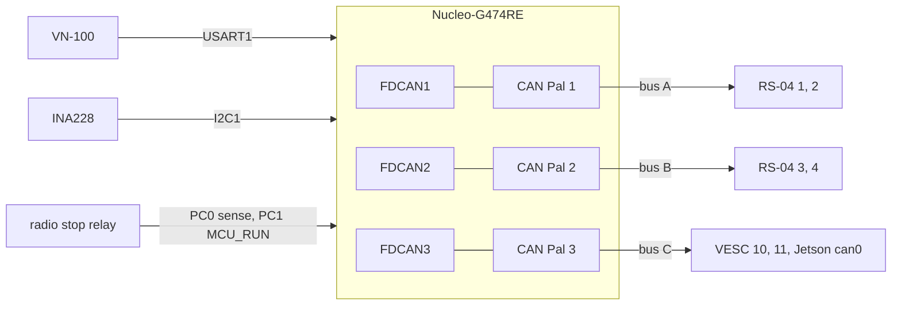

# Balance MCU board (STM32G474)

The robot's real-time controller: an STM32G474 running the 1 kHz balance loop, master of the three CAN buses (the
legs' A and B, the wheels' and the computer's C), reading the [VN-100](../../sensors/vn100-imu/README.md) and the
[INA228](../../power/ina228-monitor/README.md). The firmware is written for the **ST Nucleo-G474RE**
([docs/body-firmware.md](../../../docs/software/body-firmware.md); D63 proposed); D7 still names a WeAct G474 core board as
assumed (open), and the WeAct is catalogued as the alternative. **Not bought yet.**

## References

- ST's Nucleo-G474RE user manual UM2505 and the STM32G474 reference manual, from st.com (not kept).
- The WeAct alternative: [references/vendor/weact-stm32g474-core/SOURCE.txt](../../vendor/weact-stm32g474-core/SOURCE.txt).
- The transceiver alternative: [references/vendor/waveshare-sn65hvd230-can-board/SOURCE.txt](../../vendor/waveshare-sn65hvd230-can-board/SOURCE.txt).
- The pins, frames and buses: [docs/body-firmware.md](../../../docs/software/body-firmware.md); the wiring:
  [docs/body-electrical.md](../../../docs/body/body-electrical.md).

## Interfaces

Pins, the three CAN transceivers and their termination, power: [interfaces.md](interfaces.md).

## Config and profiles

The firmware's configuration is `firmware/balance/include/gp/gp_config.h` (the motor ids and caps, the VESC ids, the
voltage and current limits), with the build options `GP_PROFILE=rig` and `GP_SHUNT=blue_sea`. The numbers other
folders need are recorded and checked there: [the RS-04 profiles](../../actuators/rs04/profiles/),
[the VESC settings](../../drives/flipsky-75100/config/wheel-vesc.json), [the pack limits](../../power/dcb609-packs/config/pack-limits.json).
Reading build profiles in the firmware belongs to [issue #202](https://github.com/Valpatel/gyropup/issues/202).

## Driver

[`firmware/balance/`](../../../software/firmware/balance/README.md): `src/core/` (the controller, the RS-04, VESC, VN-100 and
INA228 drivers, the Jetson link), `src/mcu/board.c` (the G474's clocks, pins and peripherals), `hil/` (the
hardware-in-the-loop harness).

## Inventory

[`inventory.json`](inventory.json): none in hand. The BOM lists 1 Nucleo-G474RE and 3 Adafruit CAN Pal 5708
(`docs/body-orders.md`).

## Bring-up and tests

Not yet on hardware. Build and flash: [docs/body-firmware.md](../../../docs/software/body-firmware.md) section 7 (CMake with the
Arm toolchain, then the ST-LINK); the host and HIL tests run in CI. On the robot, step B13 checks the crystal and the
solder bridges, then each bus.

## Open questions

- D7 (WeAct, assumed) and D63 (Nucleo, proposed) disagree: the firmware's pins are the Nucleo's.
- The I2C timing is computed, not scoped; the morpho connector positions are wired from UM2505 at B13.
