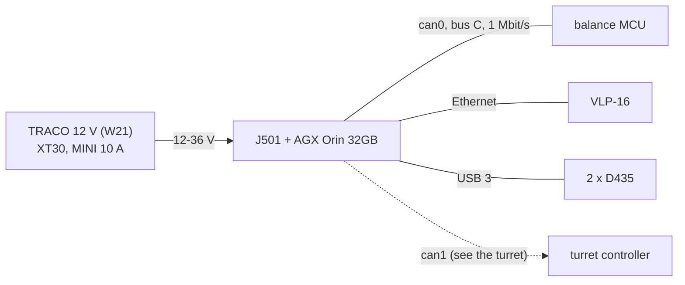

# Robot computer (Jetson)

The robot's own computer: it plans, sees (the [lidar](../../sensors/vlp16-lidar/README.md) and the
[depth cameras](../../sensors/d435-depth-camera/README.md)) and sends the balance MCU its setpoints on bus C. The
design names a **Seeed reComputer J501 carrier with a Jetson AGX Orin 32GB** (`catalog/sensors_compute.json`; the
user's: `docs/cad-plan.md`; listed, not ordered: `docs/body-orders.md`). Its software is installed from
[hardware/deploy/jetson](../../deploy/jetson/README.md).

**Open question for the owner: which Jetson is the robot's computer, a Jetson AGX Thor or the J501's AGX Orin?** The
repository's design is the J501 and this folder does not change it; the deployment is written for JetPack in general
so it serves either.

## References

- Seeed's J501 datasheet and wiki (cited in `catalog/sensors_compute.json` and `docs/body-plan.md`), not kept. The
  wiki, not the datasheet, is right about CAN: two isolated CAN-FD ports on the J25 terminal, each with its own
  120 ohm.
- The carrier's geometry for the CAD: [references/vendor/j501/](../../../references/vendor/j501/) (revision 0.9 with
  the G48R cooler).
- NVIDIA's JetPack documentation (developer.nvidia.com), not kept.

## Interfaces

Power, CAN, Ethernet and USB: [interfaces.md](interfaces.md).

## Config and profiles

What the robot installs on it: [hardware/deploy/jetson](../../deploy/jetson/README.md) (CAN bring-up at 1 Mbit/s for USB
adapters, stable names, the RS-04 bridge service). Its own CAN ports and network are not configured by the repository
yet.

## Driver

The Jetson side of the MCU link (setpoints 0x110 out, state 0x120-0x123 in) is specified in
[docs/body-firmware.md](../../../docs/body-firmware.md) section 4.3 and implemented on the MCU
(`firmware/balance/src/core/gp_jetson.c`); the Jetson's own program is not written yet.

## Inventory

[`inventory.json`](inventory.json): 1 held (the owner's J501), serial not read.

## Bring-up and tests

Not yet. First: `hardware/deploy/jetson/install.sh --dry-run`, then the install; `ip link` shows whether both J25 CAN ports
come up (if only one does, bus C moves to an isolated USB-CAN adapter: `docs/body-electrical.md` 4).

## Open questions

- **Which Jetson: AGX Thor or the J501's AGX Orin** (above).
- JetPack: the catalog says JetPack 6.0 from Seeed's datasheet; the installed version is not recorded.
- The 12 V feed: the J501 takes 12-36 V; D65 retired the 24 V converter (it starts at 33.6 V).
