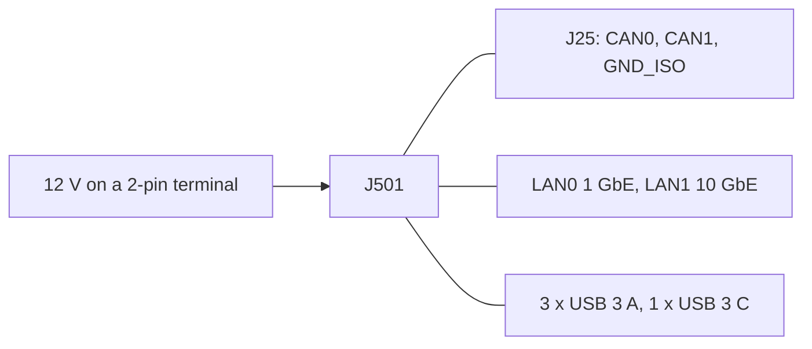

# Robot computer interfaces

| Item | Value | Source |
|---|---|---|
| Supply | 12-36 V on a 2-pin terminal, 15-60 W; on the robot 12 V from the TRACO (W21, XT30, MINI 10 A) | `catalog/sensors_compute.json`; docs/body-electrical.md |
| CAN | two isolated CAN-FD ports on the J25 20-pin terminal, 120 ohm built in (GPIO-switched); the datasheet's "1x CAN" is wrong | docs/body-plan.md (the Seeed wiki) |
| can0 | bus C at 1 Mbit/s: the balance MCU and the VESCs; its 120 ohm is one end | docs/body-electrical.md 4 |
| can1 | the turret's controller in [PR #196](https://github.com/Valpatel/gyropup/pull/196) (D76); on dev the turret uses Ethernet (D66) | docs/body-electrical.md 4 |
| Ethernet | 1 x 1 GbE, 1 x 10 GbE: the lidar | `catalog/sensors_compute.json` |
| USB | 3 x USB 3.1 Type-A, 1 x USB 3.1 Type-C host, 1 x USB 2.0 Type-C device: the D435s, a PCAN-USB for configuration | `catalog/sensors_compute.json` |
| Grounds | the motor-side CAN grounds tie to the J501's GND_ISO | docs/body-plan.md |
| Size | carrier 176 x 163 mm, enclosure 206 x 181 x 112 mm | `catalog/sensors_compute.json` |
