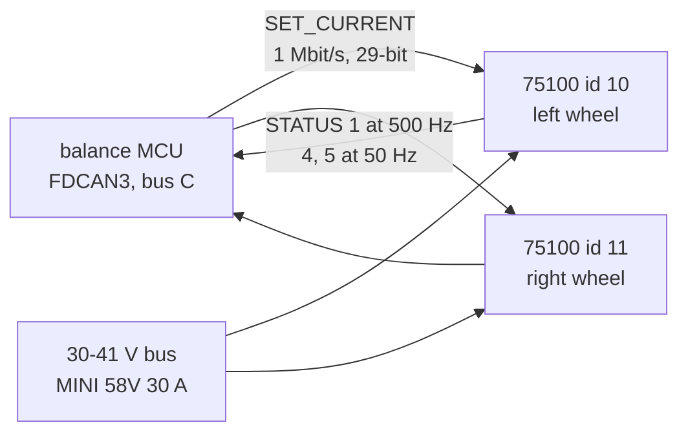

# Flipsky 75100 wheel drive (VESC)

One per wheel: a single-channel 75 V 100 A VESC-based motor controller that drives a
[wheel hub motor](../../actuators/wheel-hub-motor/README.md) in FOC on its halls. The balance MCU sends it a current
on bus C (CAN ids 10 left, 11 right) and reads back its speed. **Not bought yet**: 2 are on the leg workstream's order
list (`docs/body-orders.md`), none in `docs/purchases.md`.

## References

- The product page and its dimension drawing: the flipsky.net URLs in `catalog/motor_drivers.json` (`flipsky-75100`).
  No datasheet or drawing is kept in the repository.
- VESC firmware and VESC Tool: [vesc-project.com](https://vesc-project.com/) (GPL; nothing vendored).
- The CAN frames the firmware uses: [docs/body-firmware.md](../../../docs/software/body-firmware.md), section 4.2.

## Interfaces

Power, phases, halls and CAN pigtails, the mounting holes: [interfaces.md](interfaces.md).

## Config and profiles

[`config/wheel-vesc.json`](config/wheel-vesc.json): the VESC Tool settings the robot needs (CAN ids, bit rate, status
rates, the CAN timeout, current limits, the motor set-up of D69). The ids and the firmware's current limit are read
from `gp_config.h` and checked by `tools/check-hardware.py`; the rest are set by hand in VESC Tool at bring-up and
recorded here. The export of each drive's own VESC Tool XML belongs next to it once one is configured (not yet).

## Driver

[`firmware/balance/src/core/gp_vesc.c`](../../../software/firmware/balance/src/core/gp_vesc.c) (its header
`include/gp/gp_vesc.h`): SET_CURRENT out, STATUS 1-5 in, the stale-speed timeout. The hardware-in-the-loop harness
(`firmware/balance/hil/harness.py`) plays the drives in tests.

## Inventory

[`inventory.json`](inventory.json): none in hand.

## Bring-up and tests

Not yet run. The plan is the body's bring-up step B13 ([docs/body-firmware.md](../../../docs/software/body-firmware.md)): set
the values in `config/wheel-vesc.json` in VESC Tool over USB-C, run hall detection, check each wheel's direction
(the right one is -1 by default), then the wheel bench W6 of the [wheel change plan](../../../docs/legs/wheel-change-plan.md).

## Open questions

- The regenerative current limit is to match the firmware's clamp at B13 (`GP_REGEN_I_A`).
- On VESC firmware 5.3 or later, the phase filter must be off (`catalog/motor_drivers.json`): check the version.
- The battery current limit is 20 A in the wiring table and 25 A in the firmware section: the config records both
  with their sources; B13 settles one.
