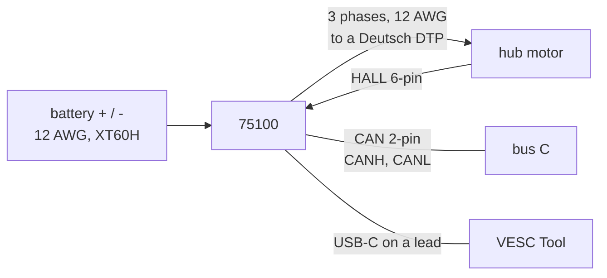

# Flipsky 75100 interfaces

| Item | Value | Source |
|---|---|---|
| Supply | 14-84 V (the robot's bus is 30-41 V) | `catalog/motor_drivers.json` |
| Current | 100 A continuous, 120 A peak (the drive's rating; the robot sets far less) | `catalog/motor_drivers.json` |
| Power leads | battery 12 AWG red/black, W14/W15 from a MINI 58V 30 A bus tap, XT60H; returns W19 | docs/body-electrical.md, wiring table |
| Phases | 3 x 12 AWG (blue, green, yellow), bare ends, to the wheel's Deutsch DTP (W50, W52) | `catalog/motor_drivers.json`; docs/body-electrical.md |
| Halls | HALL 6-pin pigtail: 5 V, GND, H1-H3 and the motor NTC, to a Deutsch DT (W51, W53) | `catalog/motor_drivers.json`; docs/body-electrical.md |
| Other pigtails | USB-C (VESC Tool), COMM 7-pin, PPM 3-pin, UART2 8-pin | `catalog/motor_drivers.json` |
| CAN | 2-pin pigtail CANL / CANH, classic CAN at 1 Mbit/s on bus C, 29-bit VESC frames | docs/body-firmware.md 4.2 |
| Mounting | two end flanges, 4 holes 5.8 mm (M5) on 100 x 27 mm; all leads leave one end | `catalog/motor_drivers.json` (from the product drawing) |
| Size, mass | 108 x 50.7 x 35 mm; about 230 g (an estimate: weigh one) | `catalog/motor_drivers.json` |
