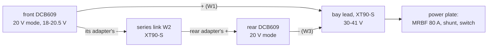

# DeWalt DCB609 packs and dock adapters

The robot's battery: two DeWalt DCB609 FLEXVOLT 9.0 Ah packs, each in 20 V mode, in series in two 20 V dock
adapters: a 10S 36 V bus, 30-41 V ([D65](../../../docs/program/decisions.yaml); the user's packs, D71). They hang in the belly
bay and charge on DeWalt's own chargers: the robot has no charge port and no BMS of its own.

## References

- DeWalt's DCB609 page (cited in D65): [dewalt.com/en-us/product/dcb609](https://www.dewalt.com/en-us/product/dcb609/20v60v-max-flexvolt-90ah-battery).
- The adapters: `catalog/body.json` (the body's Terrafirma 10 AWG 4-pack, 30 A) and `catalog/rig.json` (the rig's
  adapters with a switch and a 30 A fuse); `catalog/power_electronics.json` still has an old Terrafirma 60 V dock.
- The MRBF fuse block (the main fuse): [references/vendor/blue-sea-5191-mrbf-terminal-fuse-block/SOURCE.txt](../../vendor/blue-sea-5191-mrbf-terminal-fuse-block/SOURCE.txt).

## Interfaces

The packs' mode, the adapters, the series link and the bay's lead: [interfaces.md](interfaces.md).

## Config and profiles

[`config/pack-limits.json`](config/pack-limits.json): the voltage and current limits the balance firmware enforces
for this pack (cells, warn, sit, cut-off, regen clamp, over-charge, bus currents), each checked against `gp_config.h`
by `tools/check-hardware.py`.

## Driver

The firmware's battery logic in `firmware/balance/src/core/` with its limits in `include/gp/gp_config.h`; the
[INA228](../ina228-monitor/README.md) measures the bus.

## Inventory

[`inventory.json`](inventory.json): the owner's 2 packs (D71); the count is not confirmed in `docs/purchases.md`, and
`docs/body-orders.md` still lists 2 to buy.

## Bring-up and tests

Not yet. The bay steps are in [docs/body-electrical.md](../../../docs/body/body-electrical.md) section 2 (each pack's mode,
then the series link); the battery checks of B12 (the pack's 0.100 ohm, the adapters' contacts after ten jumps, the
cut-off's filter, a fresh pair's voltage) are in [docs/body-firmware.md](../../../docs/software/body-firmware.md).

## Open questions

- Owned or to buy: D71 says the user's packs; the order list has 2 at $259 each.
- The pack resistance (0.100 ohm) is the rig's figure: measure it at B12.
- One DCB609 on a holder at each end ([issue #193](https://github.com/Valpatel/gyropup/issues/193)) is not reflected in
  the body docs yet.
