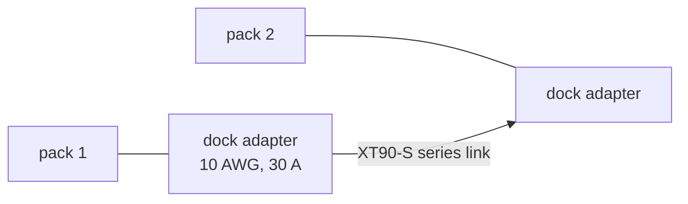

# DCB609 interfaces

| Item | Value | Source |
|---|---|---|
| Pack | DCB609 FLEXVOLT 9.0 Ah, 20 V mode (5S3P), 180 Wh rated; its slider stays out | D65; docs/body-electrical.md 2.1 |
| Pair | 10S3P in series: 36 V nominal, about 41 V full, 30 V empty, 360 Wh rated | D65 |
| Adapter, body | Terrafirma 10 AWG DeWalt 20 V dock adapter, 30 A stated (ASIN B07HYJ628S) | `catalog/body.json`; `gp_config.h` GP_BUS_I_CONT_A |
| Adapter, rig | a dock adapter with a switch and a 30 A fuse (ASIN B0B9NPZM3M) | `catalog/rig.json` |
| Series link | W2: the front adapter's - to the rear's + on an XT90-S pair | docs/body-electrical.md 2.1 |
| Bay lead | W1, W3 to an XT90-S female, up to the power plate | docs/body-electrical.md 2.1 |
| Protection | the MRBF 80 A main fuse, the anti-spark switch in the - lead, the firmware's limits | docs/body-electrical.md 3; D55 |
| Bay | under the belly plate, 318 x 102 x 132 mm, a door at each end | docs/body-electrical.md 2.1 |
| Charging | off the robot, on DeWalt's chargers | docs/body-electrical.md 2.2 |
