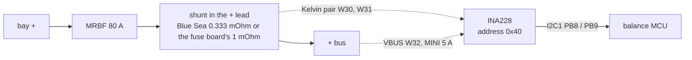

# INA228 bus monitor

The robot's pack voltage and current: a TI INA228 on the balance MCU's I2C, reading a shunt in the + lead. It feeds
the firmware's cut-off, its regen clamp and the bus current limit. Default part: the Adafruit 5832 breakout with its
own 15 mOhm shunt removed (`docs/body-orders.md`); on the fuse board (P3) an INA228AIDGSR is U1 on a 1 mOhm shunt.
**Not bought yet.**

## References

- TI's INA228 datasheet SBOSA20 (cited by the firmware): [ti.com/product/INA228](https://www.ti.com/product/INA228), not kept.
- The Adafruit 5832 breakout: [adafruit.com/product/5832](https://www.adafruit.com/product/5832); the shunt and the
  fuse board: `catalog/body.json`, [docs/body-fuse-board.md](../../../docs/body/body-fuse-board.md).
- Why the shunt is on the + side: [docs/body-electrical.md](../../../docs/body/body-electrical.md) section 3 (issue #11).

## Interfaces

I2C, the sense pair, VBUS and the two shunts: [interfaces.md](interfaces.md).

## Config and profiles

[`config/shunt.json`](config/shunt.json): the address, the two shunt builds (`GP_SHUNT=blue_sea` or the fuse board's
default) with their ADC range and SHUNT_CAL, and the ADC set-up, each checked against the firmware's headers by
`tools/check-hardware.py`.

## Driver

[`firmware/balance/src/core/gp_ina228.c`](../../../software/firmware/balance/src/core/gp_ina228.c) computes the range and
SHUNT_CAL from the shunt's resistance and converts the readings; the registers are in `include/gp/gp_ina228.h`.

## Inventory

[`inventory.json`](inventory.json): none in hand.

## Bring-up and tests

Not yet. The steps are in [docs/body-electrical.md](../../../docs/body/body-electrical.md) (bring-up 4-6): move the shunt to
the + lead before the INA228 is wired, then the pack within 0.2 V of a meter and the current within 0.1 A at a 2 A
load, discharge reading negative. The battery checks of B12 follow (`docs/body-firmware.md`).

## Open questions

- `docs/body-firmware.md` still calls the shunt low-side; the electrical page and the fuse board put it on the + side.
  The sign the firmware applies (`ina_sign`) is checked at B12.
- The I2C timing value (400 kHz from 170 MHz) is computed, not seen on a scope.
