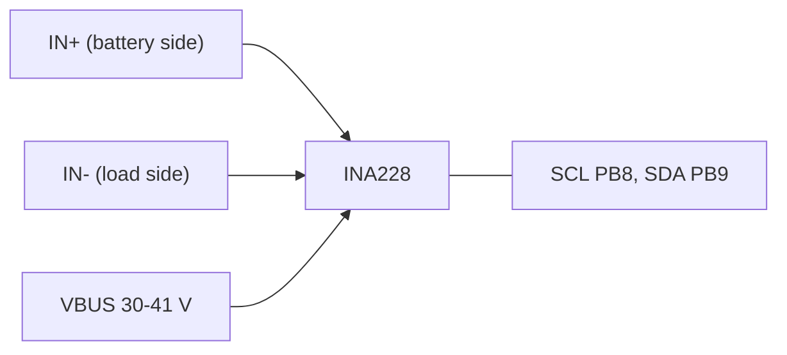

# INA228 interfaces

| Item | Value | Source |
|---|---|---|
| Bus | I2C1 on the Nucleo's PB8 (SCL) / PB9 (SDA), 400 kHz, the breakout's pull-ups | docs/body-firmware.md 6 |
| Address | 0x40 (A0 = A1 = GND, the breakout's default) | `include/gp/gp_ina228.h` |
| Sense | a twisted Kelvin pair from the shunt's screws: IN+ battery side (W30), IN- load side (W31), 22 AWG | docs/body-electrical.md, wiring table |
| VBUS | from a + bus tap on its own MINI 58V 5 A (W32); 85 V input | docs/body-electrical.md |
| Common mode | high side: the inputs sit 30-41 V above the INA228's ground, inside its 85 V | docs/body-electrical.md 3 |
| Shunt, P0-P2 | Blue Sea 150 A / 50 mV (0.333 mOhm) | `catalog/body.json`; `gp_ina228.h` |
| Shunt, P3 | the fuse board's Bourns CSS2H-3920R-1L00F, 1 mOhm | docs/body-fuse-board.md |
| Power | 3.3 V from the MCU board (the breakout) | `catalog/body.json` |
