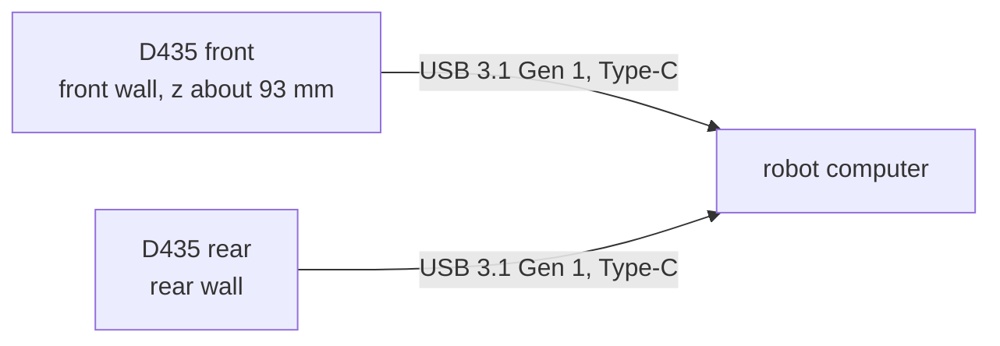

# RealSense D435 depth cameras

Two active-IR stereo depth cameras, one in the body's front wall and one in the rear, on the robot computer's USB.
**The owner's own units**: the owner has D415 and D435 cameras (`docs/body-plan.md`); the plan uses two D435s.

## References

- The D400 series datasheet (337029-017, March 2026) and RealSense's SolidWorks part, kept locally only:
  [references/vendor/realsense-d435/SOURCE.txt](../../../references/vendor/realsense-d435/SOURCE.txt).
- librealsense (Apache 2.0), RealSense's SDK: [github.com/IntelRealSense/librealsense](https://github.com/IntelRealSense/librealsense), not vendored.
- Specs and mounting: `catalog/sensors_compute.json` (`realsense-d435`).

## Interfaces

USB-C, the back M3 mount, the field of view: [interfaces.md](interfaces.md).

## Config and profiles

Not yet: the stream modes (resolution, rate) are not chosen.

## Driver

Not in this repository: librealsense on the robot computer. The CAD places them (`cad/body_shell.py`) and
`tools/robot_view.py` draws their view.

## Inventory

[`inventory.json`](inventory.json): 2 planned from the owner's cameras; which units (and whether both are D435s)
is not recorded.

## Bring-up and tests

Not yet: `rs-enumerate-devices` on the robot computer, both at USB 3 speed, then depth at the chosen mode.

## Open questions

- Which of the owner's cameras go on the robot (D415 or D435 at each end).
- The stream modes, and whether both cameras fit the robot computer's USB 3 bandwidth at those modes.
