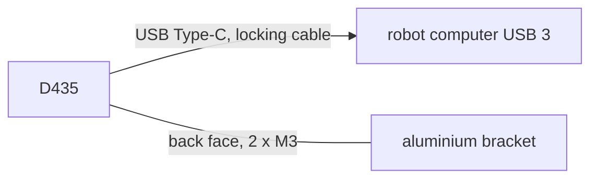

# D435 interfaces

| Item | Value | Source |
|---|---|---|
| Power | 5 V from USB, 3.0 W typical, 3.4 W maximum | `catalog/sensors_compute.json` (Table 7-8) |
| Data | USB 3.1 Gen 1 on a Type-C socket on one end; a certified locking cable recommended | `catalog/sensors_compute.json` |
| Mounting | 2 x M3 on the back face 45 mm apart (3 mm deep, 0.4 N m) to an aluminium bracket; a 1/4-20 socket below | `catalog/sensors_compute.json` (Figure 10-9) |
| Cooling | about 3 W of heat; sink it through the back face, keep the side vents clear, 0-35 C | `catalog/sensors_compute.json` |
| View | 87 x 58 deg depth, 0.2-3 m ideal; the front window must stay clear | `catalog/sensors_compute.json` |
| Size, mass | 90 x 25 x 25 mm, 75 g | datasheet Table 3-52 |
| On the robot | front wall at z about 93 mm, rear wall; nothing sticks out of the front | docs/body-plan.md |
