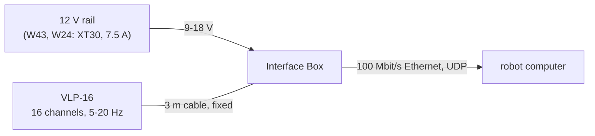

# Velodyne VLP-16 lidar

The robot's 360 degree lidar, flush with the front of the deck plate, feeding the Jetson over Ethernet. **The owner's
own unit** (`docs/body-plan.md`, `docs/body-orders.md`: listed, not ordered).

## References

- The datasheet 63-9229 Rev K (Puck Datasheets zip, Ouster's Velodyne downloads), kept locally only:
  [references/vendor/velodyne-vlp-16/SOURCE.txt](../../vendor/velodyne-vlp-16/SOURCE.txt). No official CAD
  exists.
- The user manual 63-9243 Rev F (cited in `docs/body-plan.md`), not kept.
- Specs and mounting: `catalog/sensors_compute.json` (`velodyne-vlp-16`).

## Interfaces

Power through the Interface Box, Ethernet, the base's mounting holes: [interfaces.md](interfaces.md).

## Config and profiles

Not yet. The lidar's own settings (address, rotation rate, return mode) are set in its web page; the robot's choice
of rate and the Jetson's network settings are not decided. The defaults are the factory's (`catalog/sensors_compute.json`).

## Driver

Not in this repository yet: the Jetson runs the lidar's driver (none chosen). The simulator models its beam
(`sim/robot_v2.py`, the `ear_top` rule).

## Inventory

[`inventory.json`](inventory.json): 1 held (the owner's), serial not read yet.

## Bring-up and tests

Not yet: power the box at 12 V, check the 3 A spin-up on the rail, reach its web page from the robot computer, and
see points at the planned rotation rate.

## Open questions

- The Interface Box's size and mass, and where it sits in the body (`docs/body-plan.md`).
- The rotation rate and the network address the robot uses.
- Which driver the robot computer runs.
