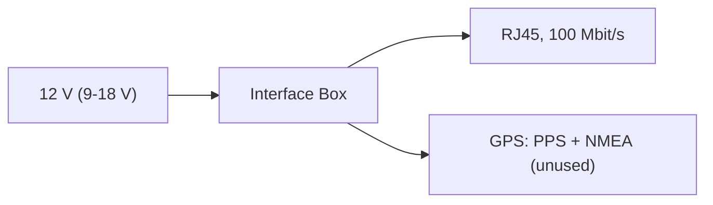

# VLP-16 interfaces

| Item | Value | Source |
|---|---|---|
| Supply | 9-18 V through the Interface Box; 8 W typical, 3 A at spin-up | `catalog/sensors_compute.json` |
| On the robot | the 12 V rail: W43 (MINI 58V 7.5 A) to W24, an XT30 on the box's lead | docs/body-electrical.md, wiring table |
| Data | 100 Mbit/s Ethernet, UDP, to the robot computer; the factory's default address | `catalog/sensors_compute.json` |
| Cable | about 3 m, fixed to the sensor, leaving the base at 0 deg through a gland | `catalog/sensors_compute.json`; docs/body-plan.md |
| Time | PPS and NMEA through the box (not used) | `catalog/sensors_compute.json` |
| Mounting | 1/4-20 UNC at the base centre, 2 x 4.06 mm dowel holes 88.9 mm apart; on the deck at x = 108.35 | `catalog/sensors_compute.json`; docs/body-plan.md |
| Size, mass | 103.3 mm across, 71.7 mm tall, about 830 g without the cable and box | datasheet 63-9229 Rev K |
| Beam | 16 channels, -15 to +15 deg, 360 deg, 5-20 Hz | `catalog/sensors_compute.json` |
